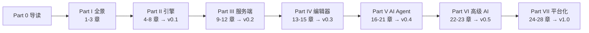

# 第 0 章 本书怎么读

> 本章目标：读完你能把 n8n 和 mini-n8n 都跑起来，并知道每一章的结构和阅读顺序。前置：无。对应代码：`code/mini-n8n`（任意版本）

## 1. 这本书要解决什么问题

n8n 是一个开源的工作流自动化平台。你在画布上拖节点、连线，就能把“收到 Webhook → 调 API → 判断 → 发消息”这样的流程跑起来。2024 年以后，n8n 又把 LLM、工具、记忆、向量库做成了节点，于是同一张画布也能编排 **AI Agent**。

很多人会用 n8n，但很少有人能回答这些问题：

- 一个节点的输出是怎么变成下一个节点的输入的？为什么 n8n 的数据总是“一组 item”？
- 画布上有分支、合并，甚至有环（循环），引擎按什么顺序执行节点？
- `{{ $('Webhook').item.json.body }}` 这样的表达式，怎么知道“对应的那一条”是哪一条？
- AI Agent 节点调用工具时，工具节点为什么也会出现在执行日志里？
- 一个执行等待 3 天后再继续，状态存在哪里？

这本书用两条线来回答它们：

1. **读源码**：每个概念都对应到 n8n 仓库里的真实文件和行号。
2. **写代码**：我们从零写一个 **mini-n8n**。它的包结构、类型名、函数名都尽量和 n8n 保持一致，所以你可以随时在两个代码库之间跳转。

读完全书，你能从零写出一个可以运行的 AI Agent Workflow 平台：有执行引擎、有服务端、有可视化画布，能跑 Agent 和工具，能部署。

## 2. 全书结构



- **Part I（浅）**：先建立全局图。第 3 章跟踪一次真实执行，从浏览器点击按钮一直走到画布上节点变绿。后面每一章都是在放大这条链路的某一段。
- **Part II–IV（中）**：先写引擎，再写服务端，最后写画布。顺序和依赖一致：没有引擎就没有东西可以保存，没有服务端就没有东西可以画。
- **Part V–VI（核心）**：AI Agent。这里是本书的重点，但它建立在前面的引擎之上：n8n 的 Agent 不是一个独立的框架，它是 **引擎里的一个节点**，工具也是 **引擎调度的节点**。
- **Part VII（深）**：队列模式、子工作流、沙箱、多用户、部署。

带 ★ 的章节是主线，★★ 是全书最难也最重要的部分（第 7、18、19 章）。时间不够时，按 **3 → 4 → 7 → 16 → 18 → 19** 的顺序读。

## 3. 每一章的结构

每章都按同样的 6 个小节写：

| 小节 | 内容 |
|---|---|
| 1. 问题与概念 | 为什么需要它，核心概念，一张图 |
| 2. n8n 是怎么做的 | 按调用顺序读源码，给出 `路径:行号` 和不超过 20 行的摘录 |
| 3. 从零实现 | mini-n8n 的关键代码，以及和 n8n 的差异表 |
| 4. 运行与验证 | 精确命令和 **真实** 的运行输出 |
| 5. 练习 | 3 题：巩固、扩展、读源码 |
| 6. 延伸阅读 | 相关文件和资料 |

每个 Part 结尾有一个 Lab，带你把 mini-n8n 升级到下一个版本。

## 4. 准备环境

| 工具 | 版本 | 用途 |
|---|---|---|
| Node.js | 22.x（本书用 22.22） | mini-n8n 用到了 `node:sqlite`（22.13 起不需要实验参数） |
| npm | 10.x | mini-n8n 用 npm workspaces |
| pnpm | 跟随 n8n 仓库 | 只在你想从源码构建 n8n 时需要 |
| Chrome | 任意新版本 | 第 13 章以后用 headless Chrome 做界面测试 |
| Docker | 可选 | 第 25、28 章（Redis、部署） |
| Ollama | 可选 | 第 17 章以后用真实小模型验证（本书用 `qwen2.5:0.5b`） |

### 4.1 跑起 n8n

只想看效果，用官方镜像或 npx 最快：

```bash
npx n8n                      # 或：docker run -it --rm -p 5678:5678 docker.n8n.io/n8nio/n8n
# 打开 http://localhost:5678
```

想调试源码，就从仓库构建（本书参照的提交是 `60ad29f242`）：

```bash
git clone https://github.com/n8n-io/n8n.git && cd n8n
git checkout 60ad29f242
pnpm install
pnpm build > build.log 2>&1   # 构建很慢，输出很多，务必重定向
pnpm start                   # 后端 + 打包好的前端，端口 5678
```

### 4.2 跑起 mini-n8n

```bash
git clone https://github.com/luxiang0412/mini-n8n code/mini-n8n
cd code/mini-n8n
git checkout v0.1            # 切到某一版
npm install
npm test                     # 每个版本都有测试
npm run mini-n8n -- execute --file examples/01-orders.json
```

看某一版改了什么：

```bash
git diff v0.1 v0.2 --stat
```

## 5. 怎么读 n8n 的源码

n8n 是一个很大的 monorepo（`packages/` 下有几十个包）。不要从目录树开始读，要 **从一个具体问题开始**，沿调用链往下走。几个实用技巧：

1. **从节点类型名找实现**。工作流 JSON 里每个节点都有 `type`，例如 `n8n-nodes-base.if`。去掉前缀，在 `packages/nodes-base/nodes/` 下找同名目录即可；AI 节点（`@n8n/n8n-nodes-langchain.agent`）在 `packages/@n8n/nodes-langchain/nodes/`。
2. **从 REST 路由找后端入口**。浏览器开发者工具里看到 `POST /rest/workflows/123/run`，就在 `packages/cli/src` 里搜 `@Post('/:workflowId/run')`。
3. **从推送消息找前端处理**。后端 `pushInstance.send({ type: 'nodeExecuteAfter' ... })`，前端在 `usePushConnection/handlers/` 下有同名文件。
4. **用作用域明确的 grep**。仓库很大，`grep -r . ` 会很慢。先限定目录：

   ```bash
   grep -rn "processRunExecutionData" packages/core/src --include=*.ts | grep -v test
   ```

5. **读测试**。`__tests__/` 下的测试经常是最好的用法说明。

本书引用源码时写成 `packages/core/src/execution-engine/workflow-execute.ts:2260`。行号以提交 `60ad29f242` 为准；n8n 更新很快，如果你用的是更新的版本，行号会偏移，但函数名通常还在。

## 6. 本书的约定

- **术语**：“节点（node）”指画布上的一个方块；“节点类型（node type）”指它的实现（一个实现 `INodeType` 的类）。“执行（execution）”指一次工作流运行；“运行（run）”在 n8n 中常指 **一个节点的一次运行**（`runIndex`），一个节点在一次执行中可以运行多次。
- **代码风格**：mini-n8n 的类型名尽量和 n8n 相同（`INode`、`IConnections`、`IRunExecutionData`、`WorkflowExecute`……）。差异会在每章的“差异表”里写明。
- **真实输出**：书中所有“运行结果”都是作者实际执行后复制的输出。
- **踩坑记录**：只记录真实遇到的问题。写代码前自查发现的问题会单独标注。

## 7. 练习

1. **巩固**：用 `npx n8n` 启动 n8n，新建一个工作流：Manual Trigger → Edit Fields（Set）→ If，执行一次，然后在右上角菜单里“Download”工作流 JSON，观察 `nodes` 和 `connections` 两个字段。
2. **扩展**：克隆 mini-n8n，切到 `v0.1`，运行 `npm test`，数一数有多少个测试，每个测试在验证引擎的哪个能力。
3. **读源码**：在 n8n 仓库里找到 If 节点的实现文件，说出它最新版本的类名。（提示：`packages/nodes-base/nodes/If/`）

## 8. 延伸阅读

- n8n 文档：<https://docs.n8n.io/>
- n8n 仓库根目录的 `AGENTS.md`：官方给 AI 编码助手的仓库导读，对包结构的说明很简洁。
- 本书配套代码：<https://github.com/luxiang0412/mini-n8n>
