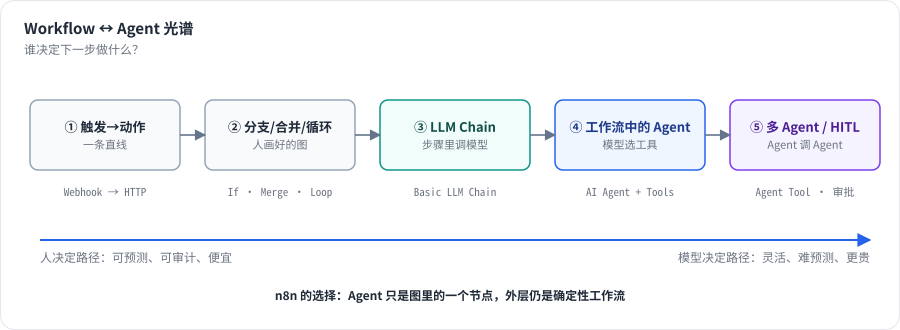
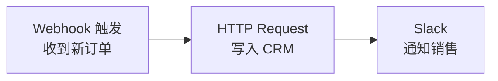
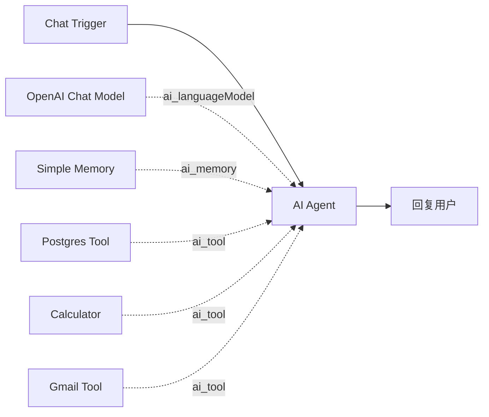

# 第 1 章 从自动化到 AI Agent：Workflow 平台的几种形态

> 本章目标：读完你能区分“确定性工作流”和“Agent”，并能说出 n8n 用哪些节点实现了每一种形态。前置：第 0 章。对应代码：无

## 1. 问题与概念

“AI Agent Workflow”这个词把两件看起来相反的事放在了一起：

- **Workflow（工作流）**：步骤是 **人** 事先画好的。同样的输入，总是走同样的路径。可预测、可审计、便宜。
- **Agent（智能体）**：步骤是 **模型** 在运行时决定的。模型看到任务和一组工具，自己决定下一步调用哪个工具、调用几次、什么时候停。灵活，但不可预测、更贵。

真实的系统几乎都在两者之间。n8n 的做法是：**把 Agent 当成工作流里的一个节点**。外层的触发、预处理、通知、错误处理仍然是确定性的工作流；只有“需要判断”的那一段交给 Agent。

*图 1-1：从左到右，控制权从人画好的图逐渐移交给模型。n8n 在同一张画布上覆盖了整个光谱。*

下面按从左到右的顺序看五种形态。

### 1.1 形态一：触发 → 动作（Trigger–Action）

最早的自动化产品（IFTTT、Zapier 的早期形态）只有一条直线：**某事发生 → 做某事**。

在 n8n 里，每个流程都从一个 **触发器节点（trigger）** 开始：Manual Trigger（手动点按钮）、Webhook、Schedule Trigger（定时）、各种应用的事件触发（Gmail、GitHub……）。触发器产出第一批数据，后面的节点逐个处理。

### 1.2 形态二：有分支、合并、循环的 DAG

现实的业务逻辑需要判断和汇总：

```mermaid
flowchart LR
  T[Webhook] --> C{If<br/>金额 ≥ 100?}
  C -- true --> V[Set: VIP]
  C -- false --> N[Set: 普通]
  V --> M[Merge]
  N --> M
  M --> R[汇总并回复]
```

这里出现了 n8n 数据模型最重要的特点：节点之间传递的不是“一个值”，而是 **一组 item**。If 节点会把 3 个订单拆成两组，分别送到两个分支；Merge 节点再把两组合起来。第 4 章和第 7 章会详细讲这背后的执行机制。

n8n 的图还允许 **环**：Loop Over Items 节点把一批数据分成小批，循环处理，处理完再从 `done` 输出出去。所以严格说它不是 DAG，引擎要能处理“一个节点运行多次”。

### 1.3 形态三：在步骤里调用 LLM（Chain）

把 LLM 当作一个“很聪明的函数”放到流程中间：分类、摘要、抽取字段、翻译。流程的形状没变，只是某个节点的实现换成了模型调用。

n8n 里对应的是 **Basic LLM Chain**、**Text Classifier**、**Information Extractor**、**Summarization Chain** 等节点（都在 `packages/@n8n/nodes-langchain/nodes/chains/`）。

### 1.4 形态四：Workflow 里的 Agent

当步骤数量和顺序无法事先确定时，就需要 Agent。例如“用户在聊天框里问：上周哪个客户下单最多？给他发一封感谢邮件”——要查数据库还是查 CRM？要不要先算一下？由模型决定。

注意图里的虚线。在 n8n 里，模型、记忆、工具 **也是节点**，它们通过特殊类型的连接（`ai_languageModel`、`ai_memory`、`ai_tool`）挂在 Agent 节点下面。n8n 把这种“一个根节点 + 一组子节点”的结构叫 **Cluster Node**。第 16 章会讲它的设计，第 18、19 章讲 Agent 如何在引擎中运行。

### 1.5 形态五：多 Agent 与人在回路

更复杂的系统里：

- **Agent as Tool**：一个“主管” Agent 把另一个 Agent 当成工具调用（n8n 的 `AI Agent Tool` 节点）。
- **Workflow as Tool**：把整个子工作流包装成一个工具（`Call n8n Workflow Tool`），让 Agent 能调用一段确定性的流程。
- **Human in the Loop（HITL）**：Agent 想执行敏感操作（发邮件、付款）前，先停下来等人批准。n8n 用“等待（waiting）”状态实现：执行被保存到数据库，等人点击批准链接后再恢复。
- **MCP**：通过 Model Context Protocol，n8n 可以调用外部 MCP 服务器提供的工具（MCP Client Tool），也可以把自己的工作流暴露成 MCP 工具（MCP Server Trigger）。

这些在第 20、23、24 章展开。

## 2. n8n 是怎么做的：同一个引擎，不同的节点

上面五种形态，在 n8n 里 **共用同一个执行引擎**（`packages/core/src/execution-engine/workflow-execute.ts`）。差别只在节点上：

| 形态 | 代表节点 | 节点类型名 | 源码位置 |
|---|---|---|---|
| 触发器 | Manual Trigger、Webhook、Schedule | `n8n-nodes-base.manualTrigger` 等 | `packages/nodes-base/nodes/ManualTrigger/` 等 |
| 数据变换 | Edit Fields (Set)、Code | `n8n-nodes-base.set`、`n8n-nodes-base.code` | `packages/nodes-base/nodes/Set/`、`Code/` |
| 流程控制 | If、Switch、Merge、Loop Over Items、Wait | `n8n-nodes-base.if` 等 | `packages/nodes-base/nodes/If/` 等 |
| LLM Chain | Basic LLM Chain | `@n8n/n8n-nodes-langchain.chainLlm` | `packages/@n8n/nodes-langchain/nodes/chains/ChainLLM/` |
| Agent | AI Agent | `@n8n/n8n-nodes-langchain.agent` | `packages/@n8n/nodes-langchain/nodes/agents/Agent/` |
| 子节点 | Chat Model、Memory、Tool | `...lmChatOpenAi`、`...memoryBufferWindow`、`...toolCalculator` | `packages/@n8n/nodes-langchain/nodes/` 下各目录 |

在本书参照的版本里，`packages/nodes-base` 注册了 445 个节点和 412 种凭证，`packages/@n8n/nodes-langchain` 注册了 125 个 AI 节点（数自各自 `package.json` 的 `n8n.nodes` 字段）。

这张表透露了 n8n 的一个关键设计取舍：**Agent 没有自己的运行时，它借用了工作流引擎**。好处是：

- Agent 调工具的每一步都会作为节点运行记录下来，能在画布上看到、能调试、能 pin 数据。
- 工具可以是任何节点，Agent 自动获得了几百种集成。
- 错误处理、重试、超时、队列模式、权限，这些工作流已有的能力，Agent 全部继承。

代价是：Agent 的循环必须适配引擎的“栈式调度”，这就是第 19 章要讲的 `EngineRequest` 机制，也是 n8n Agent 实现里最巧妙的部分。

## 3. 从零实现：mini-n8n 要覆盖哪些形态

mini-n8n 不追求节点数量，只追求 **每种形态至少有一个能跑的例子**：

| 形态 | mini-n8n 的节点 | 版本 |
|---|---|---|
| 触发器 | Manual Trigger、Webhook、Schedule Trigger、Chat Trigger | v0.1 / v0.2 / v0.4 |
| 变换与控制 | Set、Code、If、Merge、Loop Over Items、Split Out、Aggregate、Wait | v0.1 |
| 外部调用 | HTTP Request | v0.1 |
| LLM | Chat Model（Mock / Ollama / OpenAI 兼容）、Basic LLM Chain | v0.4 |
| Agent | AI Agent、Calculator / Code / HTTP / Workflow 工具、Simple Memory | v0.4 |
| 高级 AI | 向量存储、Embeddings、Agent Tool、人工审批工具、结构化输出 | v0.5 |
| 平台 | Execute Workflow（子工作流）、队列模式 | v1.0 |

## 4. 运行与验证

本章没有代码。请在 n8n 里亲手搭一下 1.2 节的工作流（用 Code 节点造 3 个订单），执行后点开 If 节点，看看 true / false 两个输出分别有几个 item。第 4 章会用同一个例子讲数据模型。

## 5. 练习

1. **巩固**：用自己的话解释“Workflow”和“Agent”的区别，各举一个适合的业务场景。
2. **扩展**：如果一个客服机器人需要“退款金额超过 1000 元时必须人工批准”，你会把哪部分做成确定性工作流，哪部分交给 Agent？画出你的设计。
3. **读源码**：打开 `packages/@n8n/nodes-langchain/package.json`，在 `n8n.nodes` 列表里找出所有以 `tools/` 开头的条目，数一数 n8n 内置了多少个 AI 工具节点。

## 6. 延伸阅读

- Anthropic, *Building effective agents*（2024）：区分 workflow 和 agent 的经典文章。
- n8n 文档：*Advanced AI* 章节，介绍 Cluster Node、Root Node、Sub-node 的概念。
- `packages/@n8n/nodes-langchain/nodes/agents/Agent/Agent.node.ts`：AI Agent 节点的版本入口。
