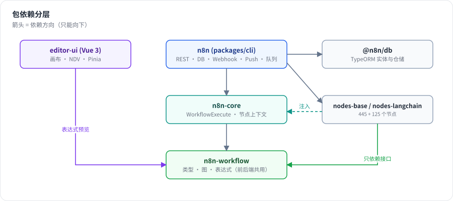
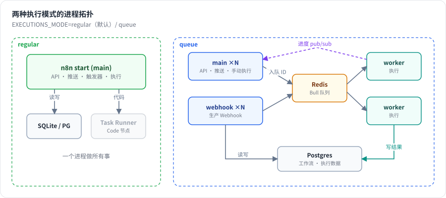

# 第 2 章 n8n 架构鸟瞰：monorepo、包依赖、运行时拓扑

> 本章目标：读完你能画出 n8n 的包依赖图和两种部署拓扑（regular / queue），并知道每个进程负责什么。前置：第 1 章。对应代码：`code/mini-n8n` v0.1 的目录结构

## 1. 问题与概念

打开 n8n 仓库，`packages/` 下有几十个包。第一次读很容易迷路。其实只要抓住 **四个核心包** 和 **三类进程**，整个系统就清楚了。

**四个核心包**，自底向上：

| 包 | npm 名 | 一句话 |
|---|---|---|
| `packages/workflow` | `n8n-workflow` | 数据模型 + 表达式 + 图算法。纯 TypeScript，前后端共用 |
| `packages/core` | `n8n-core` | 执行引擎 `WorkflowExecute` + 给节点用的上下文（`this.getNodeParameter()` 等） |
| `packages/nodes-base` / `@n8n/nodes-langchain` | `n8n-nodes-base` 等 | 节点实现。只依赖 `n8n-workflow` 定义的接口 |
| `packages/cli` | `n8n` | 服务端：REST API、数据库、Webhook、推送、触发器、队列。也是命令行入口 |

前端 `packages/frontend/editor-ui`（Vue 3）直接依赖 `n8n-workflow`：画布上的表达式预览、参数显示规则，用的是和后端 **同一份代码**。



*图 2-1：依赖只能自上而下。`n8n-workflow` 不依赖任何运行时，所以既能跑在 Node.js 里，也能跑在浏览器里。*

**三类进程**（同一个 `n8n` 可执行文件，不同子命令）：

| 命令 | 角色 | 主要职责 |
|---|---|---|
| `n8n start` | main | REST API、编辑器静态文件、推送连接、激活触发器、Wait 跟踪，regular 模式下也直接执行工作流 |
| `n8n worker` | worker | 只在 queue 模式下使用：从 Redis 队列取任务并执行 |
| `n8n webhook` | webhook | 只在 queue 模式下使用：接收生产 Webhook 请求，把执行放入队列 |

另外还有 **Task Runner** 进程，专门运行 Code 节点里的用户代码（JS / Python），和主进程隔离（第 26 章）。

## 2. n8n 是怎么做的

### 2.1 包依赖：用 package.json 验证

用一行 Node 脚本把各包对内部包的依赖打印出来（在 `packages/` 目录下执行）：

```bash
node -e "for (const p of ['workflow','core','cli','nodes-base','@n8n/nodes-langchain']){const j=require('./'+p+'/package.json');const d=Object.keys({...j.dependencies,...j.peerDependencies}).filter(x=>x.startsWith('n8n')||x.startsWith('@n8n/'));console.log(p,'=>',d.join(' '))}"
```

真实输出（节选）：

```text
workflow => @n8n/constants @n8n/errors @n8n/utils @n8n/expression-runtime @n8n/tournament
core => @n8n/backend-common ... @n8n/di @n8n/errors @n8n/utils @n8n/workflow-sdk n8n-workflow
nodes-base => @n8n/backend-network @n8n/config @n8n/di @n8n/errors @n8n/imap @n8n/utils n8n-workflow
@n8n/nodes-langchain => @n8n/ai-utilities ... n8n-core n8n-nodes-base n8n-workflow
cli => @n8n/agents ... @n8n/db @n8n/di @n8n/engine ... n8n-core n8n-editor-ui n8n-nodes-base n8n-workflow
```

几个观察：

- `n8n-workflow` 只依赖表达式相关的小包（`@n8n/tournament` 是表达式模板解析器，`@n8n/expression-runtime` 是隔离执行表达式的运行时，第 6 章会讲）。
- `n8n-nodes-base` **不依赖** `n8n-core`。节点只面向接口（`IExecuteFunctions`）编程，由 core 在运行时注入实现。这让社区节点可以只依赖 `n8n-workflow`。
- `cli` 依赖一切，是“组装层”。数据库访问被收拢在 `@n8n/db` 包里（TypeORM 实体与仓储），仓库的 `AGENTS.md` 明确要求业务逻辑不能直接 import `@n8n/typeorm`。
- `@n8n/engine` 是正在开发中的 v2 执行引擎，它的 README 写着“currently a scaffold and is not yet wired into n8n”（`packages/@n8n/engine/README.md`）。本书讲的是当前生产使用的引擎：`packages/core/src/execution-engine/workflow-execute.ts`。

### 2.2 后端的组织方式：DI + 装饰器

`packages/cli` 用自研的依赖注入容器 `@n8n/di`。服务用 `@Service()` 注册，控制器用 `@RestController()` 和 `@Get/@Post` 装饰器声明路由。例如手动执行的入口：

```ts
// packages/cli/src/workflows/workflows.controller.ts:507
@Post('/:workflowId/run')
@ProjectScope('workflow:execute')
async runManually(req: WorkflowRequest.ManualRun) {
```

`@ProjectScope('workflow:execute')` 是权限检查：只有对这个工作流所在项目有执行权限的用户才能调用（第 27 章）。

较新的功能以 **backend module** 的形式组织在 `packages/cli/src/modules/` 下（如 `mcp`、`data-table`、`chat-hub`、`instance-ai`），每个模块有自己的实体、服务和控制器，可以按配置启用。

### 2.3 进程：start 命令做了什么

`packages/cli/src/commands/start.ts` 是 `n8n start` 的实现。它在启动时拿到几个关键单例：

```ts
// packages/cli/src/commands/start.ts:64-66
protected activeWorkflowManager: ActiveWorkflowManager;

protected server = Container.get(Server);
```

- `Server`：Express 应用，挂载 REST API、Webhook 路由、推送端点和前端静态文件。
- `ActiveWorkflowManager`（`packages/cli/src/active-workflow-manager.ts`）：启动时把所有“已发布/激活”的工作流的触发器注册好——Webhook 加入路由表，Schedule 加入定时器，轮询触发器启动轮询（第 12 章）。
- `WaitTracker`（`packages/cli/src/wait-tracker.ts`）：每 60 秒查询一次数据库中 `waiting` 状态、70 秒内要恢复的执行，为它们设置定时器（第 24 章）。

### 2.4 两种执行模式

执行模式由配置项 `EXECUTIONS_MODE` 决定，默认是 `regular`：

```ts
// packages/@n8n/config/src/configs/executions.config.ts:83,91
const executionModeSchema = z.enum(['regular', 'queue']);
	mode: ExecutionMode = 'regular';
```

数据库默认是 SQLite，也可以用 Postgres：

```ts
// packages/@n8n/config/src/configs/database.config.ts:163-164
	@Env('DB_TYPE', dbTypeSchema)
	type: DbType = 'sqlite';
```



*图 2-2：regular 模式下 main 进程自己执行工作流；queue 模式下 main 和 webhook 进程只负责“接活”，把执行 ID 放进 Redis（Bull 队列），由多个 worker 进程执行。执行数据统一写在数据库里。*

在 `WorkflowRunner.run()` 中能直接看到这个分叉：

```ts
// packages/cli/src/workflow-runner.ts:460-484（节选）
const shouldEnqueue =
	process.env.OFFLOAD_MANUAL_EXECUTIONS_TO_WORKERS === 'true'
		? this.executionsConfig.mode === 'queue'
		: this.executionsConfig.mode === 'queue' && data.executionMode !== 'manual';
...
if (shouldEnqueue) {
	await this.enqueueExecution(executionId, workflowId, data, loadStaticData, realtime, ...);
} else {
	await this.runMainProcess(executionId, data, shouldReloadStaticData, ...);
}
```

注意第二个条件：即使开了 queue 模式，**手动执行（manual）默认仍在 main 进程里跑**，因为编辑器需要实时看到每个节点的结果。设置 `OFFLOAD_MANUAL_EXECUTIONS_TO_WORKERS=true` 才会把手动执行也交给 worker。

### 2.5 前端

前端是 Vue 3 + Pinia + Vite，画布用 `@vue-flow/core`（`packages/frontend/editor-ui/package.json`）。可复用组件在 `@n8n/design-system`，界面文案在 `@n8n/i18n`。前端和后端之间有两条通道：

- **REST**（`/rest/...`）：CRUD、触发执行。
- **Push**（默认 WebSocket，也支持 SSE，见 `packages/cli/src/push/push.config.ts:7` 的 `backend: 'sse' | 'websocket' = 'websocket'`）：后端主动推送执行进度。

## 3. 从零实现：mini-n8n 的包结构

mini-n8n 照搬 n8n 的分层，只是把包的数量压到最少：

```text
code/mini-n8n/
├── packages/
│   ├── workflow/     ← n8n-workflow：类型、Workflow 图、表达式与沙箱、数据代理
│   ├── core/         ← n8n-core：WorkflowExecute、ExecuteContext、生命周期钩子
│   ├── nodes-base/   ← n8n-nodes-base：内置节点
│   ├── cli/          ← n8n (cli)：命令行，v0.2 起加入 HTTP 服务端
│   ├── nodes-ai/     ← v0.4 加入，对应 @n8n/nodes-langchain
│   └── editor/       ← v0.3 加入，对应 editor-ui
└── examples/         ← 示例工作流 JSON
```

依赖方向和 n8n 一致：`nodes-base` 的源码只 import `@mini-n8n/workflow`，节点只面向 `IExecuteFunctions` 接口编程；`cli` 组装一切。

| 方面 | n8n | mini-n8n | 原因 |
|---|---|---|---|
| 包管理 | pnpm + Turbo | npm workspaces | 包少，不需要增量构建 |
| 运行 | 先 `tsc` 编译再运行 | `tsx` 直接运行 TS | 读者改完代码立刻能跑 |
| HTTP 框架 | Express + 装饰器路由 | Fastify | 代码更短，自带 JSON schema |
| 数据库 | TypeORM，SQLite / Postgres | `node:sqlite` 手写 SQL | 不引入 ORM，表结构一目了然 |
| 依赖注入 | `@n8n/di` | 手动传参 | 规模小，显式更易读 |
| 推送 | WebSocket（默认）/ SSE | SSE | 单向推送足够，浏览器原生支持 |
| 队列 | Bull + Redis | v1.0 实现一个数据库队列，可选 Redis | 第 25 章对比 |

## 4. 运行与验证

在 mini-n8n v0.1 上确认结构和测试：

```bash
cd code/mini-n8n && git checkout v0.1
ls packages
npm test
```

真实输出：

```text
cli  core  nodes-base  workflow

 Test Files  2 passed (2)
      Tests  24 passed (24)
```

## 5. 练习

1. **巩固**：不看本章，画出 `n8n-workflow`、`n8n-core`、`n8n-nodes-base`、`n8n`（cli）、`editor-ui` 五个包的依赖箭头。
2. **扩展**：为什么 `n8n-nodes-base` 不应该依赖 `n8n-core`？如果一个社区节点直接 import 了 `n8n-core` 的内部类，会出现什么问题？
3. **读源码**：在 `packages/cli/src/workflow-runner.ts` 里找到 `runMainProcess`，说出它创建 `WorkflowExecute` 的两条路径分别在什么情况下走（提示：看 `data.executionData`）。

## 6. 延伸阅读

- `packages/cli/src/commands/start.ts`、`worker.ts`、`webhook.ts`：三类进程的启动代码。
- `scripts/backend-module/backend-module-guide.md`：n8n 后端模块的编写规范。
- n8n 文档：*Queue mode*、*Configuring scaling*。
