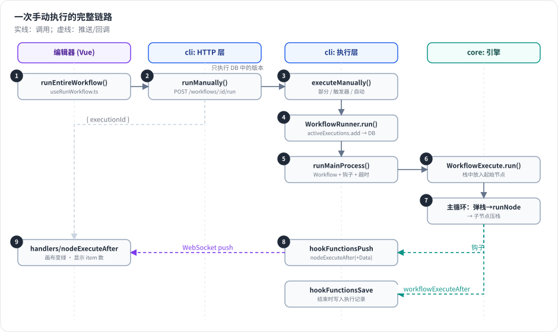

# 第 3 章 一次执行的完整生命周期 ★

> 本章目标：读完你能说清楚“在编辑器里点 Execute workflow”之后，请求经过了哪些文件、哪些函数，结果又是怎么回到画布上的。前置：第 2 章。对应代码：mini-n8n v0.1 的 `packages/cli/src/commands/execute.ts`

## 1. 问题与概念

这是全书的脊柱。后面每一章，都是在放大这条链路中的一段：



*图 3-1：一次手动执行的 9 个步骤。实线是请求方向，虚线是推送回前端的事件。左边的数字对应本章 2.1–2.9 小节。*

先记住四个概念，后文会反复出现：

| 概念 | 类型 | 一句话 |
|---|---|---|
| `IWorkflowBase` | JSON | 工作流定义：`nodes` + `connections` + `settings` + `pinData` |
| `Workflow` | 类 | 运行时视图：按名字索引节点、双向索引连接、表达式解析器 |
| `IRunExecutionData` | JSON | 执行状态：执行栈、等待区、每个节点的运行记录（`runData`）。**可以完整序列化** |
| `ExecutionLifecycleHooks` | 类 | 引擎对外的唯一出口：`nodeExecuteBefore/After`、`workflowExecuteBefore/After` |

引擎（`WorkflowExecute`）本身不知道数据库、不知道 WebSocket、不知道 HTTP。它只做一件事：**按规则把节点一个个跑完，并在关键时刻调用钩子**。持久化和推送都挂在钩子上。这是 n8n 架构中最值得学习的一条边界。

## 2. n8n 是怎么做的

### 2.1 前端：点击按钮

`packages/frontend/editor-ui/src/app/composables/useRunWorkflow.ts` 里的 `runEntireWorkflow()`（第 630 行）收集要运行的信息（从哪个触发器开始、有没有 pin 数据、是不是部分执行），最终调用 store 中的 `runWorkflow`：

```ts
// packages/frontend/editor-ui/src/app/stores/workflows.store.ts:446-452
async function runWorkflow(startRunData: IStartRunData): Promise<IExecutionPushResponse> {
	try {
		return await makeRestApiRequest(
			rootStore.restApiContext,
			'POST',
			`/workflows/${startRunData.workflowId}/run`,
			startRunData as unknown as IDataObject,
```

请求头里会带上 `push-ref`：它标识“这个浏览器标签页的推送连接”。后端稍后会用它把进度推回同一个标签页。

### 2.2 控制器：只执行数据库里的版本

```ts
// packages/cli/src/workflows/workflows.controller.ts:507-527（节选）
@Post('/:workflowId/run')
@ProjectScope('workflow:execute')
async runManually(req: WorkflowRequest.ManualRun) {
	const parseResult = ManualRunDto.safeParse(req.body);
	...
	// Always load the stored workflow from the database.
	// This prevents execution of arbitrary workflow definitions —
	// users can only execute workflows as they exist in the DB.
	const dbWorkflow = await this.workflowRepository.get({ id: workflowId });
```

注释说明了一个安全决策：即使请求体里带了工作流定义，也只执行 **数据库中保存的版本**。前端在执行前会先自动保存。

### 2.3 执行服务：判断是哪一种手动执行

`WorkflowExecutionService.executeManually()`（`packages/cli/src/workflows/workflow-execution.service.ts:343`）区分三种情况：

1. **部分执行**（第 371 行）：用户点的是某个节点上的“Execute step”，并且前面节点已有运行数据 → 只重跑需要的部分。
2. **从已知触发器完整执行**（第 390 行）：如果触发器是 Webhook 这类需要外部请求的节点，且没有 pin 数据，就先注册一个 **测试 Webhook**，返回 `{ waitingForWebhook: true }`，编辑器显示“等待触发事件”。
3. **从未知触发器完整执行**（第 426 行）：自动选择触发器。

能立刻执行时，组装一个 `IWorkflowExecutionDataProcess`（执行模式 `manual`、pin 数据、`pushRef`、用户 ID……），交给 `WorkflowRunner`。

### 2.4 WorkflowRunner：登记执行，选择在哪里跑

```ts
// packages/cli/src/workflow-runner.ts:404（run 方法，节选）
const executionId = await this.activeExecutions.add(data, existingExecution);
...
if (shouldEnqueue) {
	await this.enqueueExecution(executionId, workflowId, data, ...);
} else {
	await this.runMainProcess(executionId, data, ...);
}
```

`ActiveExecutions.add()`（`packages/cli/src/active-executions.ts:73`）在数据库中创建执行记录（状态 `new`），得到执行 ID，并把它登记在内存里的“活动执行表”中，后续停止执行、等待结果都靠这张表。手动执行默认不入队（见第 2 章），所以走 `runMainProcess`。

### 2.5 runMainProcess：构建 Workflow 和钩子

`runMainProcess()`（`packages/cli/src/workflow-runner.ts:563`）做四件事：

1. 计算超时：`settings.executionTimeout` 或全局默认值，且不超过 `maxTimeout`。
2. 构建运行时 `Workflow` 对象（第 589 行）。
3. 构建 `additionalData`：引擎需要从外部获得的一切（凭证解析器、执行子工作流的函数、HTTP 请求代理……）。
4. 创建生命周期钩子并启动引擎：

```ts
// packages/cli/src/workflow-runner.ts:625-627
try {
	const lifecycleHooks = getLifecycleHooksForRegularMain(data, executionId);
	additionalData.hooks = lifecycleHooks;
```

然后调用 `ManualExecutionService.runManually()`（`packages/cli/src/manual-execution.service.ts:54`）。完整执行最终落到：

```ts
// packages/cli/src/manual-execution.service.ts:178-191（节选）
const workflowExecute = new WorkflowExecute(additionalData, data.executionMode, undefined, storedAt);
return workflowExecute.run({
	workflow,
	startNode,
	destinationNode: data.destinationNode,
	pinData: data.pinData,
	triggerToStartFrom: data.triggerToStartFrom,
	additionalRunFilterNodes,
});
```

### 2.6 钩子：引擎对外的唯一出口

`getLifecycleHooksForRegularMain()`（`packages/cli/src/execution-lifecycle/execution-lifecycle-hooks.ts:988`）把一组组处理函数挂到钩子上：

```ts
// packages/cli/src/execution-lifecycle/execution-lifecycle-hooks.ts:1018-1026
hookFunctionsWorkflowEvents(hooks, userId, projectId, projectName, source, telemetryMetadata);
hookFunctionsNodeEvents(hooks);
hookFunctionsFinalizeExecutionStatus(hooks);
hookFunctionsSave(hooks, optionalParameters);
hookFunctionsPush(hooks, optionalParameters, userId, source);
hookFunctionsSaveProgress(hooks, optionalParameters);
hookFunctionsStatistics(hooks, source);
hookFunctionsPreExecute(hooks, source);
hookFunctionsPostExecute(hooks);
```

每一组都是独立的关注点：`Save` 写数据库，`Push` 推前端，`SaveProgress` 按配置在每个节点后保存进度（崩溃后可以恢复），`Statistics` 统计生产执行次数……新增一个关注点，只需要再挂一组函数，引擎一行都不用改。

### 2.7 引擎：执行栈循环

`WorkflowExecute.run()`（`packages/core/src/execution-engine/workflow-execute.ts:164`）把起始节点和一个空 item `{ json: {} }` 放进执行栈，然后进入 `processRunExecutionData()`（第 2260 行）的主循环：

```ts
// packages/core/src/execution-engine/workflow-execute.ts:2289-2309（节选）
executionLoop: while (this.isExecutionStackNotEmpty()) {
	if (this.shouldStopExecuting()) {
		return;
	}
	...
	executionData = this.popExecutionStack();
	executionNode = executionData.node;
```

每次循环：弹出一个“待执行项”（节点 + 输入数据）→ 调用 `nodeExecuteBefore` 钩子 → `runNode()` 执行节点 → 记录运行数据 → 调用 `nodeExecuteAfter` 钩子 → 把下游节点压栈。第 7 章会逐行精读这个循环。

### 2.8 推送：每个节点结束就通知前端

`hookFunctionsPush()` 中的 `nodeExecuteAfter` 处理函数先推送一条 **不带数据** 的消息（只有每个输出的 item 数量），再推送一条带完整数据的 `nodeExecuteAfterData`：

```ts
// packages/cli/src/execution-lifecycle/execution-lifecycle-hooks.ts:320-343（节选）
hooks.addHandler('nodeExecuteAfter', async function (nodeName, data, executionData) {
	const itemCountByConnectionType = getItemCountByConnectionType(data?.data);
	const { data: _, ...taskData } = data;

	pushInstance.send(
		{
			type: 'nodeExecuteAfter',
			data: { executionId, nodeName, sequenceNumber: nodeEventSequence++, itemCountByConnectionType, data: taskData },
		},
		pushRef,
	);
```

拆成两条是性能考虑：画布上节点变绿、显示“3 items”只需要数量；真正的数据可能很大，作为 WebSocket 二进制消息发送，前端可以直接交给 Web Worker 解析（见第 382–387 行的注释）。`sequenceNumber` 让前端在消息乱序到达时也能按引擎顺序处理。

执行开始和结束分别推送 `executionStarted`（第 443 行）和 `executionFinished`（第 472 行，等待状态时是 `executionWaiting`）。

### 2.9 前端：处理推送，更新画布

`packages/frontend/editor-ui/src/app/composables/usePushConnection/usePushConnection.ts` 按消息类型分发给 `handlers/` 下的同名函数。`nodeExecuteAfter.ts` 收到消息后，先根据 item 数量填充占位数据，让画布立即显示节点状态和数量；等 `nodeExecuteAfterData` 到达再替换成真实数据。`executionFinished.ts` 收尾：设置最终状态、显示错误提示等。

与此同时，`hookFunctionsSave` 的 `workflowExecuteAfter` 处理函数（第 588 行）把完整的 `IRunExecutionData` 写进数据库的执行记录。于是你在“Executions”列表里能看到这次执行，并能完整回放每个节点的输入输出。

### 2.10 小结：设计取舍

| 决策 | 好处 | 代价 |
|---|---|---|
| 引擎只通过钩子对外 | 引擎可在 main、worker、CLI、测试中复用 | 钩子顺序和异步要小心（钩子是 `await` 串行执行的） |
| 执行状态完全可序列化 | 可暂停（Wait）、可恢复、可跨进程（队列模式） | 运行数据可能很大，存储和推送都要优化 |
| 推送拆成“数量 + 数据”两条 | 画布响应快，大数据不阻塞 | 前端要处理占位数据和乱序 |
| 只执行 DB 中的版本 | 安全，可审计 | 执行前必须先保存 |

## 3. 从零实现：mini-n8n 的最小链路

v0.1 还没有服务端，但已经能演示链路中最核心的一段：**构建 Workflow → 创建钩子 → 引擎执行 → 钩子输出结果**。这正是 `runMainProcess` 的骨架：

```ts
// code/mini-n8n/packages/cli/src/commands/execute.ts（v0.1）
const data = JSON.parse(readFileSync(args.file, 'utf8')) as IWorkflowBase;
const workflow = new Workflow({ ...data, nodeTypes: loadNodeTypes() });

const hooks = new ExecutionLifecycleHooks('cli', 'cli-1');
hooks.addHandler('nodeExecuteAfter', (nodeName, taskData) => {
	const counts = (taskData.data?.main ?? []).map((o) => o?.length ?? 0).join('/');
	console.log(`✓ ${nodeName.padEnd(28)} items out: ${counts || '-'}  (${taskData.executionTime} ms)`);
});

const run = await new WorkflowExecute({ executionId: 'cli-1', hooks }, 'cli').run({ workflow });
```

这里的 `nodeExecuteAfter` 处理函数做的事，和 n8n 推送 `itemCountByConnectionType` 一模一样，只是输出到终端而不是 WebSocket。v0.2 会把同一个钩子接到 SSE 上，把 `workflowExecuteAfter` 接到 SQLite 上，引擎代码不需要任何改动。

| n8n 的步骤 | mini-n8n 对应 | 版本 |
|---|---|---|
| 2.1 前端点击 | 画布上的“Execute workflow”按钮 | v0.3 |
| 2.2 控制器 | `POST /rest/workflows/:id/run` | v0.2 |
| 2.3 执行服务 | `WorkflowExecutionService.executeManually` | v0.2 |
| 2.4–2.5 Runner | `WorkflowRunner.run` / `runMainProcess` | v0.2 |
| 2.6 钩子 | `ExecutionLifecycleHooks` | v0.1 ✅ |
| 2.7 引擎 | `WorkflowExecute` | v0.1 ✅ |
| 2.8 推送 | SSE `/rest/push` | v0.2 |
| 2.9 前端处理 | Pinia store + 画布状态 | v0.3 |

## 4. 运行与验证

```bash
cd code/mini-n8n && git checkout v0.1
npm run mini-n8n -- execute --file examples/01-orders.json
```

真实输出：

```text
✓ Start                        items out: 1  (0 ms)
✓ Orders                       items out: 3  (14 ms)
✓ Big order?                   items out: 2/1  (2 ms)
✓ VIP                          items out: 2  (1 ms)
✓ Normal                       items out: 1  (0 ms)
✓ Merge                        items out: 3  (0 ms)
✓ Summary                      items out: 1  (1 ms)

status: success
last node: Summary
[
  {
    "orders": 3,
    "vip": [
      "Ada",
      "Grace"
    ],
    "total": 715
  }
]
```

注意 `Big order?` 的 `2/1`：If 节点有两个输出，true 分支 2 个 item，false 分支 1 个。每一行都是一次 `nodeExecuteAfter` 钩子调用，顺序就是引擎的执行顺序。为什么是 VIP 先于 Normal、Merge 为什么等两个分支都跑完才执行——这是第 7 章的内容。

## 5. 练习

1. **巩固**：不看图 3-1，按顺序写出一次手动执行经过的 6 个后端类/函数。
2. **扩展**：给 mini-n8n 的 CLI 增加一个 `--trace` 参数：在 `nodeExecuteBefore` 钩子里打印“▶ 开始执行 X”，并统计整个执行的总耗时（在 `workflowExecuteAfter` 里打印）。
3. **读源码**：在 n8n 中找到 `hookFunctionsSaveProgress`，说明它在什么配置下生效、在哪个钩子上保存、保存的是什么。

## 6. 延伸阅读

- `packages/cli/src/execution-lifecycle/execution-lifecycle-hooks.ts`：所有钩子处理函数。
- `packages/core/src/execution-engine/execution-lifecycle-hooks.ts`：钩子类本身（只有几十行）。
- `packages/cli/src/push/`：WebSocket 与 SSE 两种推送实现。
