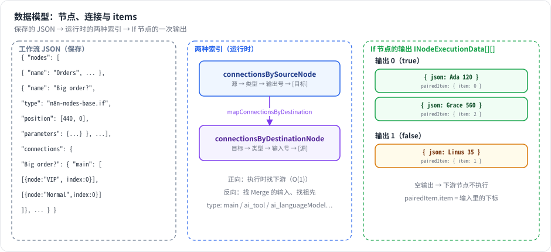

# 第 4 章 数据模型：节点、连接与 items ★

> 本章目标：读完你能手写一个 n8n 工作流 JSON，解释“连接按源节点索引”和“item 数组”这两个关键设计，并读懂一次执行的 `runData`。前置：第 3 章。对应代码：mini-n8n v0.1 的 `packages/workflow/src/interfaces.ts`、`graph.ts`、`workflow.ts`

## 1. 问题与概念

工作流平台的数据模型要回答两个问题：

1. **图怎么存？** 节点和边用什么结构保存，才能方便地“从一个节点找到下一个节点”？
2. **数据怎么流？** 节点之间传的是什么？一个值？一个对象？一个列表？

n8n 的答案：

- 图存成 `nodes`（数组）+ `connections`（**以源节点名为键** 的嵌套对象）。
- 节点之间传的永远是 **item 数组**：`[{ json: {...} }, { json: {...} }, ...]`。一个节点可以有多个输出，所以节点的完整输出是一个二维数组 `INodeExecutionData[][]`（输出 × item）。



*图 4-1：左边是保存的 JSON；中间是 `connections` 的两种索引方向；右边是 If 节点的一次运行结果：两个输出，各自是一个 item 数组，每个 item 用 `pairedItem` 记住自己来自哪个输入 item。*

## 2. n8n 是怎么做的

### 2.1 节点：INode

```ts
// packages/workflow/src/interfaces.ts:1739-1757（节选）
export interface INode {
	id: string;
	name: string;
	typeVersion: number;
	type: string;
	position: [number, number];
	disabled?: boolean;
	notes?: string;
	retryOnFail?: boolean;
	maxTries?: number;
	waitBetweenTries?: number;
	alwaysOutputData?: boolean;
	executeOnce?: boolean;
	onError?: OnError;
	continueOnFail?: boolean;
	parameters: INodeParameters;
	credentials?: INodeCredentials;
```

几个要点：

- **`name` 是主键**。连接、表达式 `$('Name')`、运行数据都用名字引用节点，所以同一工作流里节点名必须唯一。重命名节点时，n8n 要同步改连接和所有引用它的表达式（`Workflow.renameNode`）。`id` 是 UUID，主要用于前端和 Webhook 路径。
- **`type` + `typeVersion`** 决定用哪个实现。节点类型可以有多个版本（If 有 v1、v2……），老工作流里的节点保持老版本行为，不会因为升级 n8n 而改变。
- **`position`** 不只是画布坐标，**还会影响执行顺序**（第 7 章）。
- `retryOnFail`、`onError`、`alwaysOutputData`、`executeOnce` 这些是 **节点设置**，对所有节点类型通用，由引擎而不是节点自己实现（第 8 章）。
- `parameters` 是一棵任意 JSON 树，其中以 `=` 开头的字符串是表达式（第 6 章）。

### 2.2 连接：以源节点为键

```ts
// packages/workflow/src/interfaces.ts:115-124
export interface IConnection {
	// The node the connection is to
	node: string;

	// The type of the input on destination node (for example "main")
	type: NodeConnectionType;

	// The output/input-index of destination node (if node has multiple inputs/outputs of the same type)
	index: number;
}
```

整张图的结构是：

```text
connections[源节点名][连接类型][源节点的输出序号] = IConnection[]（目标列表）
```

例如 If 节点的两个输出分别连向 VIP 和 Normal：

```json
"Big order?": {
  "main": [
    [{ "node": "VIP",    "type": "main", "index": 0 }],
    [{ "node": "Normal", "type": "main", "index": 0 }]
  ]
}
```

为什么按 **源节点** 索引？因为执行是向前走的：一个节点跑完，引擎要立即知道“我的第 k 个输出要送给谁”。按源节点索引时，这是一次 O(1) 查找。

但很多场景需要反向查找：“Merge 有几个输入？分别来自谁？”、“`$('Webhook')` 是不是当前节点的祖先？”。所以 `Workflow` 构造时会生成一份反向索引：

```ts
// packages/workflow/src/workflow.ts:146
this.connectionsByDestinationNode = mapConnectionsByDestination(this.connectionsBySourceNode);
```

仓库的 `AGENTS.md` 专门提醒了这一点：“`workflow.connections` is indexed by **source node**. To find parent nodes, use `mapConnectionsByDestination()` to invert it first.” 图遍历函数统一放在 `packages/workflow/src/common/` 下（`getParentNodes`、`getChildNodes` 等）。

**连接类型** 不只有 `main`：

```ts
// packages/workflow/src/interfaces.ts:2974-2988
export const NodeConnectionTypes = {
	AiAgent: 'ai_agent',
	AiChain: 'ai_chain',
	AiDocument: 'ai_document',
	AiEmbedding: 'ai_embedding',
	AiLanguageModel: 'ai_languageModel',
	AiMemory: 'ai_memory',
	AiOutputParser: 'ai_outputParser',
	AiRetriever: 'ai_retriever',
	AiReranker: 'ai_reranker',
	AiTextSplitter: 'ai_textSplitter',
	AiTool: 'ai_tool',
	AiVectorStore: 'ai_vectorStore',
	Main: 'main',
} as const;
```

`main` 承载数据流；`ai_*` 承载“能力”：一个 Chat Model 节点通过 `ai_languageModel` 连到 Agent，不是把数据传给 Agent，而是把 **一个模型对象** 提供给 Agent（第 16 章）。同一套 `connections` 结构同时表达了这两种关系。

### 2.3 Item：INodeExecutionData

```ts
// packages/workflow/src/interfaces.ts:1853-1872（节选）
export interface INodeExecutionData {
	json: IDataObject;
	binary?: IBinaryKeyData;
	error?: NodeApiError | NodeOperationError;
	pairedItem?: IPairedItemData | IPairedItemData[] | number;
	...
}
```

- `json`：这一条数据本身，必须是对象（不能是数组或字符串）。
- `binary`：文件附件（图片、PDF），按属性名索引，实际内容存在二进制数据服务里。
- `pairedItem`：**血缘**。“我是由输入的第几个 item 产生的”：

```ts
// packages/workflow/src/interfaces.ts:1790-1794
export interface IPairedItemData {
	item: number;
	input?: number; // If undefined "0" gets used
	sourceOverwrite?: ISourceData;
}
```

为什么所有数据都是数组？这是 n8n 最核心的设计决策之一：

1. **隐式循环**。HTTP Request 节点收到 3 个 item，就发 3 次请求；表达式 `{{ $json.email }}` 对每个 item 分别求值。用户不用写循环。
2. **统一接口**。每个节点的签名都是“item 数组进，item 数组出”，任何两个节点都能连。
3. **分支即分组**。If 节点不需要“跳转”，它只是把输入数组分成两组，分别放到两个输出上。某个输出为空数组时，下游节点就不执行。

### 2.4 运行数据：IRunData 与 ITaskData

一个节点在一次执行里可能运行多次（循环、多次触发），所以运行数据是“节点名 → 运行记录数组”：

```ts
// packages/workflow/src/interfaces.ts:3453-3456
export interface IRunData {
	// node-name: result-data
	[key: string]: ITaskData[];
}
```

```ts
// packages/workflow/src/interfaces.ts:3605-3610（节选）
export interface ITaskData extends ITaskStartedData {
	executionTime: number;
	executionStatus?: ExecutionStatus;
	data?: ITaskDataConnections;
	inputOverride?: ITaskDataConnections;
	error?: ExecutionError;
```

`ITaskStartedData` 里有 `startTime`、`executionIndex`（全局执行序号）和 **`source`**：这次运行的每个输入来自哪个节点的哪个输出的哪次运行。

```ts
// packages/workflow/src/interfaces.ts:3629-3633
export interface ISourceData {
	previousNode: string;
	previousNodeOutput?: number; // If undefined "0" gets used
	previousNodeRun?: number; // If undefined "0" gets used
}
```

`pairedItem`（item 级血缘）+ `source`（运行级血缘）一起，就能从任意一个 item 一路追溯到触发它的源头。第 6 章的 `$('Node').item` 就靠这个。

### 2.5 执行状态：IRunExecutionData

```ts
// packages/workflow/src/run-execution-data/run-execution-data.v1.ts:34-63（节选）
export interface IRunExecutionDataV1 {
	version: 1;
	startData?: { startNodes?: StartNodeData[]; destinationNode?: IDestinationNode; runNodeFilter?: string[]; ... };
	resultData: {
		error?: ExecutionError;
		runData: IRunData;
		pinData?: IPinData;
		lastNodeExecuted?: string;
		...
	};
	executionData?: {
		contextData: IExecuteContextData;
		nodeExecutionStack: IExecuteData[];
		metadata: { [key: string]: ITaskMetadata[] };
		waitingExecution: IWaitingForExecution;
		waitingExecutionSource: IWaitingForExecutionSource | null;
	};
	...
	waitTill?: Date;
```

- `resultData`：已经发生的事（每个节点的运行记录、错误）。
- `executionData`：还没发生的事（执行栈、等待区、节点上下文）。
- `waitTill`：执行在等待，什么时候恢复。

`executionData` 让执行可以 **在任意节点边界暂停并恢复**：把这个对象存进数据库，过三天读出来，交给一个新的 `WorkflowExecute` 继续跑。注意它带有 `version` 字段，说明 n8n 已经对这个格式做过一次版本升级（v0 → v1），旧数据在读取时迁移。

## 3. 从零实现

### 3.1 类型

mini-n8n 的 `packages/workflow/src/interfaces.ts` 保留了上面所有字段的核心子集，名字一一对应：

```ts
// code/mini-n8n/packages/workflow/src/interfaces.ts（节选）
export interface IConnection {
	node: string;
	type: NodeConnectionType;
	index: number;
}

/** outputIndex -> list of destinations */
export type NodeInputConnections = Array<IConnection[] | null>;

/** Indexed by SOURCE node name (like n8n). */
export interface IConnections {
	[sourceNode: string]: INodeConnections;
}

export interface INodeExecutionData {
	json: IDataObject;
	pairedItem?: IPairedItemData | IPairedItemData[] | number;
	error?: ExecutionErrorJSON;
}
```

`IRunExecutionData` 也一样分成 `startData` / `resultData` / `executionData`，并提供 `createRunExecutionData()` 工厂函数填默认值。

### 3.2 反向索引与图遍历

```ts
// code/mini-n8n/packages/workflow/src/graph.ts
export function mapConnectionsByDestination(connections: IConnections): IConnections {
	const result: IConnections = {};
	for (const [sourceNode, byType] of Object.entries(connections)) {
		for (const [type, outputs] of Object.entries(byType)) {
			outputs.forEach((destinations, outputIndex) => {
				for (const destination of destinations ?? []) {
					const byDestType = (result[destination.node] ??= {});
					const inputs = (byDestType[destination.type] ??= []);
					while (inputs.length <= destination.index) inputs.push([]);
					(inputs[destination.index] ??= []).push({
						node: sourceNode,
						type: type as NodeConnectionType,
						index: outputIndex,
					});
				}
			});
		}
	}
	return result;
}
```

反转后，`IConnection.node` 变成了 **源节点**，`index` 变成了源节点的 **输出序号**；外层数组的下标变成了目标节点的 **输入序号**。这和 n8n 的 `mapConnectionsByDestination` 语义相同。

`getConnectedNodes()` 是一个按层次的广度优先遍历：传入正向索引得到子孙，传入反向索引得到祖先。`type` 参数支持 `'main'`、某个 AI 类型、`'ALL'` 和 `'ALL_NON_MAIN'`（后者在第 16 章用来找 Agent 的所有子节点）。

### 3.3 Workflow 类

```ts
// code/mini-n8n/packages/workflow/src/workflow.ts（节选）
export class Workflow {
	nodes: Record<string, INode> = {};
	connectionsBySourceNode: IConnections;
	connectionsByDestinationNode: IConnections;
	...
	constructor(params: WorkflowParameters) {
		for (const node of params.nodes) this.nodes[node.name] = node;
		this.connectionsBySourceNode = params.connections;
		this.connectionsByDestinationNode = mapConnectionsByDestination(params.connections);
		this.settings = { executionOrder: 'v1', ...params.settings };
		...
	}

	getStartNode(destinationNode?: string): INode | undefined {
		const candidates = destinationNode
			? [destinationNode, ...this.getParentNodes(destinationNode)].map((n) => this.nodes[n])
			: Object.values(this.nodes);
		const enabled = candidates.filter((n) => n && !n.disabled);
		const trigger = enabled.find((n) => this.isTriggerNode(n));
		if (trigger) return trigger;
		...
	}
}
```

| 方面 | n8n | mini-n8n |
|---|---|---|
| `INode` 字段 | 20+ 个（含遥测标签、强制自定义操作等） | 15 个核心字段 |
| 二进制数据 | `binary` + 二进制数据服务（文件系统 / S3） | 不支持（JSON 足以演示所有机制） |
| 执行数据格式 | 带 `version`，有 v0→v1 迁移 | 单一版本 |
| 节点上下文 | `executionData.contextData` | 同名字段，v0.1 用于 Loop Over Items |
| 起始节点选择 | `__getStartNode`：按 `STARTING_NODE_TYPES` 和触发器判断 | 触发器优先，否则选无 main 输入的节点 |

## 4. 运行与验证

`examples/inspect-graph.ts` 加载第 3 章的订单工作流，打印两种索引和遍历结果：

```bash
cd code/mini-n8n && npx tsx examples/inspect-graph.ts
```

真实输出：

```text
bySource["Big order?"] = {"main":[[{"node":"VIP","type":"main","index":0}],[{"node":"Normal","type":"main","index":0}]]}
byDestination["Merge"]  = {"main":[[{"node":"VIP","type":"main","index":0}],[{"node":"Normal","type":"main","index":0}]]}
parents of Summary: [ 'Merge', 'VIP', 'Normal', 'Big order?', 'Orders', 'Start' ]
children of Orders (depth 1): [ 'Big order?' ]
start node: Start
```

两行 JSON 长得几乎一样，但含义完全不同：第一行说“If 的输出 0 去 VIP 的输入 0，输出 1 去 Normal 的输入 0”；第二行说“Merge 的输入 0 来自 VIP 的输出 0，输入 1 来自 Normal 的输出 0”。

再看一次运行的数据（`--json` 输出整个 `resultData`），If 节点的记录如下（真实输出，`startTime` 是毫秒时间戳）：

```json
{
  "startTime": 1791447436187,
  "executionIndex": 2,
  "executionTime": 2,
  "executionStatus": "success",
  "source": [{ "previousNode": "Orders", "previousNodeOutput": 0, "previousNodeRun": 0 }],
  "data": {
    "main": [
      [
        { "json": { "id": 1, "customer": "Ada", "amount": 120 }, "pairedItem": { "item": 0 } },
        { "json": { "id": 3, "customer": "Grace", "amount": 560 }, "pairedItem": { "item": 2 } }
      ],
      [
        { "json": { "id": 2, "customer": "Linus", "amount": 35 }, "pairedItem": { "item": 1 } }
      ]
    ]
  }
}
```

Grace 在 true 分支里排第 2 位（下标 1），但她的 `pairedItem.item` 是 2：她来自输入的第 3 个 item。Merge 的 `source` 是两个元素的数组，对应两个输入：

```json
[{"previousNode":"VIP","previousNodeOutput":0,"previousNodeRun":0},{"previousNode":"Normal","previousNodeOutput":0,"previousNodeRun":0}]
```

## 5. 练习

1. **巩固**：手写一个工作流 JSON：Manual Trigger → Code（输出 2 个 item）→ 两个并行的 Set 节点 → Merge。只写 `nodes` 和 `connections`，然后用 mini-n8n 的 CLI 运行它。
2. **扩展**：给 mini-n8n 的 `Workflow` 增加 `renameNode(oldName, newName)`：同时更新 `nodes`、两份连接索引。（进阶：同时改写其他节点参数里 `$('oldName')` 形式的表达式。）
3. **读源码**：阅读 `packages/workflow/src/common/get-parent-nodes.ts`（或同目录下的实现），说明 n8n 的 `depth` 参数和 mini-n8n 的实现在“菱形依赖”（A→B、A→C、B→D、C→D）下返回的顺序是否一致。

## 6. 延伸阅读

- `packages/workflow/src/interfaces.ts`：n8n 几乎所有核心类型都在这一个文件里（3000+ 行），用编辑器的大纲视图浏览。
- `packages/workflow/src/run-execution-data/`：执行数据格式的版本与迁移。
- `packages/workflow/src/common/`：图遍历工具函数。
