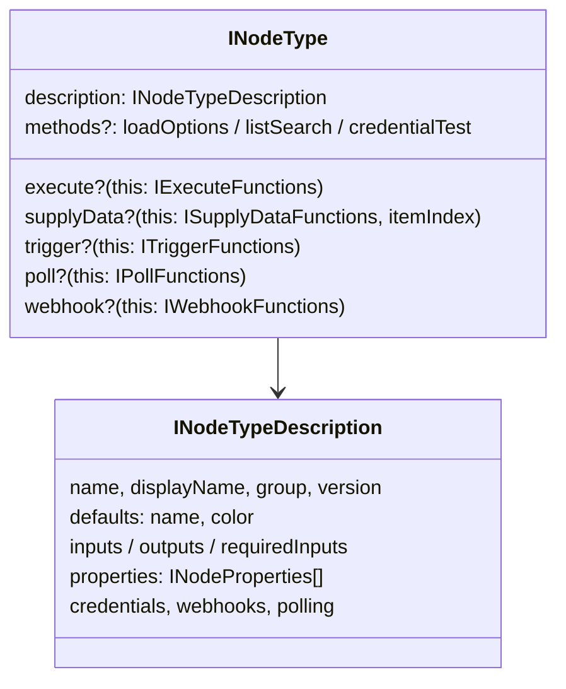
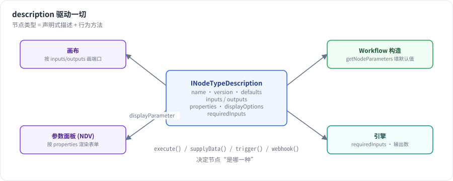

# 第 5 章 节点类型系统：description 驱动一切

> 本章目标：读完你能写一个自定义节点，理解 `description` 如何同时驱动画布、参数面板和引擎，以及 n8n 如何管理节点版本和按需加载 500 多个节点。前置：第 4 章。对应代码：mini-n8n v0.1 的 `packages/nodes-base/`、`packages/workflow/src/node-helpers.ts`、`examples/custom-node.ts`

## 1. 问题与概念

n8n 有 500 多个节点，前端却没有为每个节点写一个参数表单。秘密在于：**每个节点类型都用一份声明式的 `description` 描述自己**，前端、引擎、文档生成、AI 工作流构建器都读这一份描述。

一个节点类型 = 一份描述 + 若干行为方法：



- `description` 是 **数据**：名字、图标、有几个输入输出、有哪些参数、参数在什么条件下显示。
- 行为方法决定节点的 **种类**：普通节点实现 `execute`；AI 子节点实现 `supplyData`；触发器实现 `trigger`、`poll` 或 `webhook`。



*图 5-1：同一份 `description`，画布用它画出端口，参数面板用它渲染表单并按 `displayOptions` 显示/隐藏字段，`Workflow` 构造时用它填默认值，引擎用 `inputs` 和 `requiredInputs` 决定调度。*

## 2. n8n 是怎么做的

### 2.1 INodeType：一个接口，多种角色

```ts
// packages/workflow/src/interfaces.ts:2568-2579（节选）
export interface INodeType {
	description: INodeTypeDescription;
	supplyData?(this: ISupplyDataFunctions, itemIndex: number): Promise<SupplyData>;
	execute?(this: IExecuteFunctions, response?: EngineResponse): Promise<NodeOutput>;
	onMessage?(context: IExecuteFunctions, data: INodeExecutionData): Promise<NodeOutput>;
	poll?(this: IPollFunctions): Promise<INodeExecutionData[][] | null>;
	trigger?(this: ITriggerFunctions): Promise<ITriggerResponse | undefined>;
	webhook?(this: IWebhookFunctions): Promise<IWebhookResponseData>;
	methods?: { loadOptions?: ...; listSearch?: ...; credentialTest?: ...; ... };
```

注意 `execute` 的第二个参数 `response?: EngineResponse` 和返回值里的 `NodeOutput`：Agent 节点可以返回一个“请帮我执行这些工具”的请求，引擎执行完再把结果作为 `response` 传回来。这是第 19 章的主角，这里先留个印象。

方法用 `this` 而不是参数接收上下文（`this: IExecuteFunctions`），所以节点代码里到处是 `this.getInputData()`、`this.getNodeParameter(...)`。引擎调用时用 `nodeType.execute.call(context)` 绑定 `this`。

### 2.2 INodeTypeDescription

```ts
// packages/workflow/src/interfaces.ts:3108-3119（节选）
export interface INodeTypeDescription extends INodeTypeBaseDescription {
	version: number | number[];
	defaults: NodeDefaults;
	inputs: Array<NodeConnectionType | INodeInputConfiguration> | ExpressionString;
	requiredInputs?: string | number[] | number; // Ony available with executionOrder => "v1"
	inputNames?: string[];
	outputs: Array<NodeConnectionType | INodeOutputConfiguration> | ExpressionString;
	outputNames?: string[];
	properties: INodeProperties[];
	credentials?: INodeCredentialDescription[];
	maxNodes?: number; // How many nodes of that type can be created in a workflow
	polling?: true | undefined;
```

两个值得注意的设计：

- `inputs` / `outputs` 可以是 **表达式字符串**。AI Agent 的输入端口取决于参数“是否需要输出解析器”“是否启用备用模型”，所以它的 `inputs` 是一段 `={{ ... }}` 表达式，在运行时根据参数计算（`packages/@n8n/nodes-langchain/nodes/agents/Agent/V3/AgentV3.node.ts` 第 36 行起）。
- `requiredInputs` 告诉 v1 执行顺序下的引擎：“至少有几个输入有数据我才能跑”。Merge 节点写的是：

  ```ts
  // packages/nodes-base/nodes/Merge/v3/actions/versionDescription.ts:107
  requiredInputs: '={{ $parameter["mode"] === "chooseBranch" ? [0, 1] : 1 }}',
  ```

  “选择分支”模式必须两个输入都到齐，其他模式有一个输入就能跑。第 7 章会看到引擎如何使用它。

### 2.3 参数：INodeProperties 与 displayOptions

`properties` 是参数定义数组。常见类型：

| `type` | 表单控件 | 例子 |
|---|---|---|
| `string` / `number` / `boolean` | 输入框 / 数字框 / 开关 | URL、超时 |
| `options` / `multiOptions` | 下拉框 | HTTP 方法、操作类型 |
| `collection` | “添加选项”的可选字段组 | HTTP 节点的 Options |
| `fixedCollection` | 可重复的结构化行 | Query 参数列表 |
| `resourceLocator` | 按列表/ID/URL 选择资源 | 选一个 Google Sheet |
| `filter` / `assignmentCollection` | 条件编辑器 / 字段赋值编辑器 | If v2 的条件、Set v3 的字段 |
| `notice` | 只读提示 | “请连接一个输出解析器” |

`displayOptions` 让字段按条件显示：

```ts
// packages/workflow/src/node-helpers.ts:419-449（节选）
export function displayParameter(nodeValues, parameter, node, nodeTypeDescription, nodeValuesRoot?, displayKey = 'displayOptions') {
	if (!parameter[displayKey]) {
		return true;
	}
	const { show, hide } = parameter[displayKey];
	...
	if (show) {
		// All the defined rules have to match to display parameter
		for (const propertyName of Object.keys(show)) {
			const values = getPropertyValues(nodeValues, propertyName, node, nodeTypeDescription, nodeValuesRoot);
			if (values.some((v) => typeof v === 'string' && v.charAt(0) === '=')) {
				return true;
			}
			if (!checkConditions(show[propertyName]!, values)) {
				return false;
			}
		}
	}
```

规则：`show` 里 **所有** 条件都满足才显示；`hide` 里 **任一** 条件满足就隐藏。有一个细节：如果被依赖的参数是表达式（以 `=` 开头），值在设计时无法确定，就一律显示。条件里还可以用 `@version` 按节点版本显示字段，用 `_cnd` 写 `gte`、`lt` 等比较（Agent V3 的 `promptType` 字段就用了 `{ '@version': [{ _cnd: { gte: 3.1 } }] }`）。

**同一套规则在前后端都要执行**：前端用它决定显示哪些字段；`Workflow` 构造时用它填默认值并 **丢弃隐藏字段的值**：

```ts
// packages/workflow/src/workflow.ts:108-117
// Add default values
const nodeParameters = NodeHelpers.getNodeParameters(
	nodeType.description.properties,
	node.parameters,
	true,
	false,
	node,
	nodeType.description,
);
node.parameters = nodeParameters !== null ? nodeParameters : {};
```

所以保存的工作流 JSON 里通常只有“非默认值”，加载后引擎看到的是完整参数。也因此 `getNodeParameter` 本身不处理默认值，取不到就报错：

```ts
// packages/core/src/execution-engine/node-execution-context/node-execution-context.ts:537-543
const value = get(node.parameters, parameterName, fallbackValue);

if (value === undefined) {
	throw new UserError(`Could not get parameter "${parameterName}"`, {
		extra: { parameterName },
	});
}
```

取到值以后，交给 `workflow.expression.getParameterValue(...)` 解析表达式（第 555 行）——这是第 6 章的入口。

### 2.4 版本

节点行为一旦改变，老工作流就可能坏掉。n8n 的规则是：**改变行为就加版本，老节点保持老版本**。两种做法（见 `packages/nodes-base/AGENTS.md` 的 Versioning 一节）：

- **轻量版本**：`version: [3, 3.1, 3.2]`，同一个类，在代码里按 `this.getNode().typeVersion` 分支，在 `displayOptions` 里用 `@version` 控制字段。
- **完整版本**：继承 `VersionedNodeType`，每个大版本一个独立实现：

```ts
// packages/nodes-base/nodes/Set/Set.node.ts:7-31（节选）
export class Set extends VersionedNodeType {
	constructor() {
		const baseDescription: INodeTypeBaseDescription = {
			displayName: 'Set',
			name: 'set',
			...
			defaultVersion: 3.5,
		};
		const nodeVersions: IVersionedNodeType['nodeVersions'] = {
			1: new SetV1(baseDescription),
			2: new SetV1(baseDescription),
			3: new SetV2(baseDescription),
			...
			3.5: new SetV2(baseDescription),
		};
		super(nodeVersions, baseDescription);
	}
}
```

新建节点时用 `defaultVersion`；加载老工作流时按节点上保存的 `typeVersion` 取对应实现。

### 2.5 声明式节点

很多 SaaS 集成只是“把参数拼成 HTTP 请求”。n8n 允许这类节点 **不写 `execute`**，而在属性上声明路由规则（`routing`、`requestDefaults`），由 `RoutingNode` 统一执行。加载节点类型时，如果节点没有 `execute`，就自动补一个：

```ts
// packages/cli/src/node-types.ts:119-125
if (shouldAssignExecuteMethod(versionedNodeType)) {
	versionedNodeType.execute = async function (this: ExecuteContext) {
		const routingNode = new RoutingNode(this, versionedNodeType);
		const data = await routingNode.runNode();
		return data ?? [];
	};
}
```

同一个函数里还有一段很有意思的逻辑：请求 `n8n-nodes-base.slackTool` 这种 **以 Tool 结尾、但并不存在** 的类型时，n8n 会以 `slack` 节点为蓝本 **动态合成** 一个工具节点（第 128–158 行）。这就是“任何节点都能当 AI 工具”的实现方式，第 20 章细讲。

### 2.6 加载：500 个节点怎么启动不慢

`packages/cli/src/load-nodes-and-credentials.ts` 的 `LoadNodesAndCredentials` 在启动时扫描节点包。对内置包使用 **懒加载**：构建时预先生成两个 JSON——`dist/types/nodes.json`（所有节点的 description，发给前端）和 `dist/known/nodes.json`（节点名 → 源文件路径）——启动时只读这两个文件：

```ts
// packages/core/src/nodes-loader/lazy-package-directory-loader.ts:7-13
override async loadAll() {
	try {
		this.known.nodes = await this.readJSON('dist/known/nodes.json');
		this.known.credentials = await this.readJSON('dist/known/credentials.json');

		this.types.nodes = await this.readJSON('dist/types/nodes.json');
		this.types.credentials = await this.readJSON('dist/types/credentials.json');
```

真正第一次用到某个节点时才 `require` 它的源文件：

```ts
// packages/core/src/nodes-loader/directory-loader.ts:242-256（节选）
getNode(nodeType: string) {
	const { nodeTypes, known: { nodes: knownNodes } } = this;
	if (!(nodeType in nodeTypes) && nodeType in knownNodes) {
		const { sourcePath } = knownNodes[nodeType];
		this.loadNodeFromFile(sourcePath);
	}
	...
```

## 3. 从零实现

### 3.1 接口

mini-n8n v0.1 的 `INodeType` 只有 `description` 和 `execute`；`supplyData` 等方法在后面的版本加入：

```ts
// code/mini-n8n/packages/workflow/src/interfaces.ts（v0.1）
export interface INodeType {
	description: INodeTypeDescription;
	execute?(this: IExecuteFunctions): Promise<INodeExecutionData[][] | null>;
}
```

`inputs` / `outputs` 和 n8n 一样，既可以是数组，也可以是一个表达式字符串。字符串由 `normalizeConnectionList` 求值，作用域里只有 `$parameter`：

```ts
// code/mini-n8n/packages/workflow/src/workflow.ts（节选）
export function normalizeConnectionList(list: INodeTypeDescription['inputs'], parameters: IDataObject): INodeInputConfiguration[] {
	const raw = typeof list === 'string' ? (evaluateDescriptionExpression(list, parameters) as INodeTypeDescription['inputs']) : list;
	if (!Array.isArray(raw)) return [];
	return raw.map((entry) => (typeof entry === 'string' ? { type: entry as INodeInputConfiguration['type'] } : entry));
}
```

为什么不用更“自然”的函数 `(parameters) => [...]`？因为描述要通过 REST 接口发给前端，函数无法 JSON 序列化；字符串可以，前端用同一个 `n8n-workflow`（mini-n8n 里是 `@mini-n8n/workflow`）求值即可。这正是 n8n 选择表达式字符串的原因。

### 3.2 一个完整的节点：If

```ts
// code/mini-n8n/packages/nodes-base/src/nodes/If.node.ts（节选）
export const If: INodeType = {
	description: {
		name: 'n8n-nodes-base.if',
		displayName: 'If',
		group: ['transform'],
		version: 1,
		defaults: { name: 'If', color: '#408000' },
		inputs: ['main'],
		outputs: ['main', 'main'],
		outputNames: ['true', 'false'],
		properties: [conditionProperties, { displayName: 'Combine', name: 'combinator', type: 'options', default: 'and', options: [...] }],
	},
	async execute(this: IExecuteFunctions) {
		const items = this.getInputData();
		const trueItems: INodeExecutionData[] = [];
		const falseItems: INodeExecutionData[] = [];
		items.forEach((item, i) => {
			const conditions = (this.getNodeParameter('conditions', i) as { values?: Condition[] }).values ?? [];
			const combinator = this.getNodeParameter('combinator', i) as string;
			const results = conditions.map(evaluateCondition);
			const pass = combinator === 'or' ? results.some(Boolean) : results.every(Boolean);
			(pass ? trueItems : falseItems).push({ json: item.json, pairedItem: { item: i } });
		});
		return [trueItems, falseItems];
	},
};
```

三个要点，几乎所有节点都遵守：

1. **按 item 取参数**：`getNodeParameter('conditions', i)`。条件里的 `{{ $json.amount }}` 会针对第 i 个 item 求值。
2. **返回二维数组**：`[trueItems, falseItems]`，下标就是输出序号。
3. **写上 `pairedItem`**：告诉引擎“这个输出 item 来自第 i 个输入 item”。

### 3.3 displayOptions 与默认值

```ts
// code/mini-n8n/packages/workflow/src/node-helpers.ts（节选）
export function displayParameter(parameters: INodeParameters, property: Pick<INodeProperties, 'displayOptions'>): boolean {
	const { show, hide } = property.displayOptions ?? {};
	if (show) {
		for (const [name, allowed] of Object.entries(show)) {
			if (!allowed.includes(parameters[name])) return false;
		}
	}
	if (hide) {
		for (const [name, denied] of Object.entries(hide)) {
			if (denied.includes(parameters[name])) return false;
		}
	}
	return true;
}
```

`getNodeParameters()` 用它填默认值、丢弃隐藏字段；`Workflow` 构造函数对每个已知类型的节点调用一次，和 n8n 一样：

```ts
// code/mini-n8n/packages/workflow/src/workflow.ts（节选）
for (const node of params.nodes) {
	// Fill in default values of parameters (n8n does the same in its Workflow constructor)
	const type = this.tryGetNodeType(node);
	if (type) node.parameters = getNodeParameters(type.description.properties, node.parameters ?? {});
	this.nodes[node.name] = node;
}
```

### 3.4 注册表

```ts
// code/mini-n8n/packages/core/src/node-types.ts（节选）
export class NodeTypes implements INodeTypes {
	private readonly types: Record<string, INodeType> = {};
	register(type: INodeType): this {
		this.types[type.description.name] = type;
		return this;
	}
	getByNameAndVersion(name: string): INodeType {
		const type = this.types[name];
		if (!type) throw new UserError(`Unrecognized node type: ${name}`);
		return type;
	}
}
```

v0.1 内置 12 个节点：Manual Trigger、Edit Fields (Set)、If、Merge、Code、HTTP Request、No Operation、Wait、Split Out、Aggregate、Stop and Error、Loop Over Items。节点类型名沿用 n8n 的 `n8n-nodes-base.*`，方便对照，但 **参数结构是简化过的**，不能直接导入 n8n 导出的工作流。

| 方面 | n8n | mini-n8n |
|---|---|---|
| 节点行为方法 | `execute`、`supplyData`、`trigger`、`poll`、`webhook`、`methods` | v0.1 只有 `execute`，后续版本逐步加入 |
| `inputs` 动态化 | 表达式字符串 | 表达式字符串（只提供 `$parameter`） |
| 版本 | 轻量版本 + `VersionedNodeType` | 只有一个版本 |
| 声明式节点 | `routing` + `RoutingNode` | 不支持 |
| `displayOptions` | `show`/`hide`、`@version`、`_cnd` 比较、表达式值一律显示 | 只支持 `show`/`hide` 的等值匹配 |
| 加载 | 懒加载 + 预生成的 JSON 清单 | 启动时全部 import |

## 4. 运行与验证

`examples/custom-node.ts` 定义了一个 Change Case 节点（带一个只在 `mode=custom` 时显示的字段），注册后运行：

```bash
cd code/mini-n8n && npx tsx examples/custom-node.ts
```

真实输出：

```text
parameters after defaults: { field: 'text', mode: 'upper' }
separator visible for mode=upper? false
success [ { text: 'HELLO MINI N8N' }, { text: 'WORKFLOW ENGINE' } ]
```

第一行说明：节点在 JSON 里的 `parameters` 是 `{}`，构造 `Workflow` 后填上了 `field` 和 `mode` 的默认值；`separator` 因为不可见，没有出现。

## 5. 练习

1. **巩固**：仿照 Change Case 写一个 `Filter` 节点：只保留满足条件的 item（只有一个输出），并正确设置 `pairedItem`。
2. **扩展**：给 mini-n8n 的 `displayParameter` 加上“依赖的参数是表达式时一律显示”的规则，并写一个测试。
3. **读源码**：打开 `packages/nodes-base/nodes/If/` 目录，找出 If 节点有几个大版本，最新版本的条件参数是什么 `type`。

## 6. 延伸阅读

- `packages/nodes-base/AGENTS.md`：官方的节点开发规范（结构、版本、凭证、安全）。
- n8n 文档：*Creating nodes* → *Choose your node building approach*（声明式 vs 编程式）。
- `packages/workflow/src/node-helpers.ts`：`getNodeParameters`、`displayParameter` 的完整实现。
