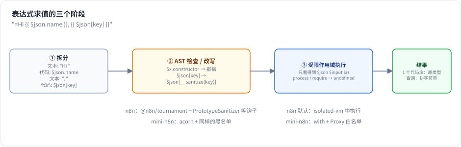
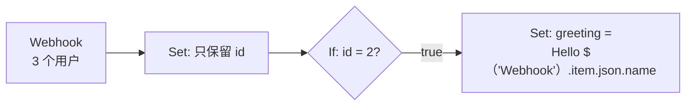
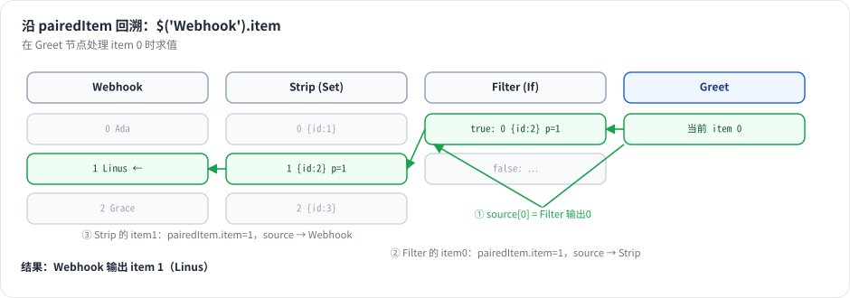

# 第 6 章 表达式引擎：`{{ $json }}`、数据代理与沙箱

> 本章目标：读完你能解释一个表达式从字符串到值的全过程，实现 `$json`、`$('Node').item` 等变量，并知道为什么表达式必须放进沙箱、n8n 用了几层防护。前置：第 4、5 章。对应代码：mini-n8n v0.1 的 `packages/workflow/src/expression*.ts`、`workflow-data-proxy.ts`

## 1. 问题与概念

表达式是 n8n 的“胶水”。几乎每个参数都可以写成表达式，用上游节点的数据动态计算：

```text
=Hello {{ $json.name }}, your order #{{ $('Webhook').item.json.body.orderId }} has shipped.
```

一个表达式引擎要解决三件事：

1. **解析**：`=` 开头表示这是表达式；`{{ }}` 之间是 JavaScript，之外是普通文本。
2. **上下文**：`$json`、`$input`、`$('Node')` 这些变量从哪里来？“当前 item”是哪一个？
3. **安全**：表达式是用户写的 JavaScript，运行在服务器上。必须防止它读环境变量、读文件、执行命令。



*图 6-1：字符串先被拆成文本和代码块；代码块经过 AST 检查和改写；最后在一个只能看到数据代理变量的作用域里执行。只有一个代码块时保留原始类型，否则拼成字符串。*

## 2. n8n 是怎么做的

### 2.1 入口：resolveSimpleParameterValue

第 5 章看到，`getNodeParameter()` 取到原始值后调用 `workflow.expression.getParameterValue(...)`。它递归遍历参数树，对每个字符串调用 `resolveSimpleParameterValue`：

```ts
// packages/workflow/src/expression.ts:621-641（节选）
resolveSimpleParameterValue(parameterValue, data, returnObjectAsString = false) {
	// Check if it is an expression
	if (!isExpression(parameterValue)) {
		// Is no expression so return value
		return parameterValue;
	}
	// Remove the equal sign
	parameterValue = parameterValue.substr(1);

	// An expression that fits the native subset grammar is interpreted
	// in-process, skipping the global-context setup, extendSyntax, and the
	// engine (isolate). Everything else takes the regular pipeline below.
	if (Expression.nativeEvaluation) {
		const native = evaluateNatively(parameterValue, data);
		if (native.handled) return this.finalizeResolvedValue(native.value, returnObjectAsString);
	}
```

后面依次是：准备全局上下文（第 660 行 `initializeGlobalContext`）、挂上 `__sanitize` 函数（第 690 行）、一个针对 `.constructor` 的正则检查（第 698 行）、`extendSyntax`（把 `'abc'.toTitleCase()` 这类扩展方法改写成 `extend('abc', 'toTitleCase', [])`），最后 `renderExpression`。

`{{ }}` 模板的拆分由 n8n 自己维护的 `@n8n/tournament` 包完成：它把模板解析成 AST（基于 recast/esprima），在 AST 上执行一组“钩子”做安全检查和改写，再生成代码。

### 2.2 数据代理：$json 从哪里来

所有 `$` 变量由 `WorkflowDataProxy`（`packages/workflow/src/workflow-data-proxy.ts`，1700 多行）生成。它接收的上下文就是 `getParameterValue` 的那一长串参数：`runExecutionData`、`runIndex`、`itemIndex`、当前节点名、`connectionInputData`（当前节点 0 号输入的 item 数组）、`executeData`（含 `source`）……

常用变量：

| 变量 | 含义 |
|---|---|
| `$json` | 当前 item 的 `json`（= `connectionInputData[itemIndex].json`） |
| `$input.item` / `.all()` / `.first()` / `.last()` | 当前节点的输入 |
| `$('Name').item` | **与当前 item 配对的** 那个节点的 item（沿 `pairedItem` 回溯） |
| `$('Name').all()` / `.first()` | 那个节点的全部输出 |
| `$node["Name"].json` | 旧语法，取同下标的 item |
| `$now` / `$today` | Luxon `DateTime` |
| `$workflow` / `$execution` | 工作流 id/name/active，执行 id/mode/resumeUrl |
| `$vars` / `$env` | 变量 / 环境变量（默认禁止访问） |
| `$fromAI()` | 工具参数由模型填写（第 20 章） |

### 2.3 Paired item：`$('Name').item` 是怎么找到的

这是表达式里最“聪明”的部分。考虑：



在 Greet 节点，当前 item 只有 `{ id: 2 }`。要拿到它对应的用户名，必须回溯：Greet 的输入 item 0 ← If 的 true 输出 item 0，其 `pairedItem.item = 1` ← Set 的输出 item 1，其 `pairedItem.item = 1` ← Webhook 的输出 item 1。



*图 6-2：每一步用两条信息：item 上的 `pairedItem`（我来自输入的第几个 item、哪个输入）和该节点运行记录的 `source`（那个输入来自哪个节点的哪个输出、哪次运行）。*

n8n 的实现是 `getPairedItem` / `resolvePairedItem`：

```ts
// packages/workflow/src/workflow-data-proxy.ts:1033-1048
const getPairedItem = (
	destinationNodeName: string,
	incomingSourceData: ISourceData | null,
	initialPairedItem: IPairedItemData,
	usedMethodName: PairedItemMethod = PAIRED_ITEM_METHOD.$GET_PAIRED_ITEM,
): INodeExecutionData =>
	resolvePairedItem(
		destinationNodeName,
		incomingSourceData,
		initialPairedItem,
		usedMethodName,
		undefined,
		// Ancestry is a DAG: branches recombine on shared ancestors (e.g. an
		// Aggregate output pairing to all its inputs), so without memoization
		// the walk revisits the same item exponentially often.
		new PairedItemMemo(),
	);
```

注释点出了一个工程细节：一个 item 可以有多个 `pairedItem`（Aggregate 把 N 个 item 合成 1 个，就配对到全部 N 个输入），回溯就变成了 DAG 搜索，需要记忆化，否则会指数爆炸。如果多条路径找到了 **不同的** item，n8n 会报错，提示用户改用 `.first()` 或 `.all()`。

这也解释了为什么节点作者必须认真设置 `pairedItem`。引擎会尽量自动补上（输入只有 1 个 item，或输出与输入一样多时，见 `workflow-execute.ts:3146` 的 `assignPairedItems`），其余情况由节点负责。

### 2.4 沙箱：三层防护

表达式是不可信代码。n8n 的防护分三层：

**第一层：AST 检查与改写**（`packages/workflow/src/expression-sandboxing.ts`）。`PrototypeSanitizer` 遍历 AST，静态属性名在黑名单里直接报错，动态属性名包一层运行时检查：

```ts
// packages/workflow/src/expression-sandboxing.ts:497-530（节选）
visitMemberExpression(path) {
	this.traverse(path);
	const node = path.node;
	if (!node.computed) {
		...
		if (!isSafeObjectProperty(node.property.name)) {
			throw new ExpressionError(`Cannot access "${node.property.name}" due to security concerns`);
		}
	} else if (node.property.type === 'StringLiteral' || node.property.type === 'Literal') {
		// Check any static strings against our forbidden list
		if (!isSafeObjectProperty(node.property.value as string)) { throw ... }
	} else {
		path.replace(
			b.memberExpression(
				node.object,
				b.callExpression(b.memberExpression(dataNode, sanitizerIdentifier), [node.property]),
				true,
```

黑名单在 `packages/workflow/src/utils.ts:356` 的 `unsafeObjectProperties`：`__proto__`、`prototype`、`constructor`、`getPrototypeOf`、`defineProperty`、`caller`、`mainModule`、`binding`……都是从数据对象“爬回”宿主环境的常见路径（`x.constructor.constructor('return process')()` 就能拿到 `Function` 构造器）。同一文件里还有 `ThisSanitizer`（替换 `this`）、禁止 `with` 语句、禁止某些解构等钩子。

**第二层：遮蔽全局变量**（legacy 引擎）。执行前把一大串危险全局名在数据对象上覆盖成空对象：

```ts
// packages/workflow/src/expression.ts:414-445（节选）
static initializeGlobalContext(data: IDataObject) {
	/**
	 * Denylist
	 */
	data.document = {};
	data.global = {};
	data.window = {};
	data.globalThis = {};
	...
	// Prevent Remote Code Execution
	data.eval = {};
	data.setTimeout = {};
	data.Function = {};
	// Prevent Node.js module access
	data.require = {};
	data.module = {};
	data.Buffer = {};
```

**第三层：隔离执行**。从这个版本开始，后端默认的表达式引擎是 `vm`：表达式运行在 `isolated-vm` 创建的 **独立 V8 isolate** 里，有内存上限和超时：

```ts
// packages/@n8n/config/src/configs/expression-engine.config.ts:16-23（节选）
/**
 * Which expression engine to use.
 * - `vm` (default) runs expressions in a V8 isolate (isolated-vm).
 * - `legacy` runs expressions without isolation. Less secure and soon to be deprecated.
 * - `quickjs` runs expressions in a QuickJS WASM sandbox. Experimental.
 */
@Env('N8N_EXPRESSION_ENGINE', expressionEngineSchema)
engine: 'legacy' | 'vm' | 'quickjs' = 'vm';
```

默认内存上限 128 MB（`bridgeMemoryLimit`）、超时 5000 ms（`bridgeTimeout`）。实现在 `packages/@n8n/expression-runtime`：数据不是一次性拷进 isolate，而是通过“懒代理 + 桥接”按需读取，避免每次求值都序列化整个执行数据。浏览器里不能用原生模块，所以前端可以选用 QuickJS（WASM）引擎，默认仍是 legacy。

前两层是“黑名单”思路：堵住已知的路。第三层是“隔离”思路：就算有没堵住的路，也只能走到一个空的 isolate 里。n8n 从前两层演进到第三层，本身就是一个很好的安全工程案例。

## 3. 从零实现

### 3.1 拆分模板

```ts
// code/mini-n8n/packages/workflow/src/expression-parser.ts（节选）
export function splitExpression(template: string): ExpressionChunk[] {
	...
	if (template.startsWith('{{', i)) {
		const end = findCodeEnd(template, i + 2);   // 跟踪引号和花括号深度
		...
		chunks.push({ type: 'code', text: template.slice(i + 2, end).trim() });
```

`findCodeEnd` 记录引号状态和 `{` 深度，所以 `{{ {a: "}}"}.a }}` 能正确切出 `{a: "}}"}.a`。

### 3.2 求值：单个代码块保留类型

```ts
// code/mini-n8n/packages/workflow/src/expression.ts（节选）
resolveSimpleParameterValue(value: string, ctx: IExpressionContext): unknown {
	if (!isExpression(value)) return value;
	const chunks = splitExpression(value.slice(1));
	const data = new WorkflowDataProxy(this.workflow, ctx).getDataProxy();
	...
	if (chunks.length === 1 && chunks[0].type === 'code') return run(chunks[0].text);
	return chunks.map((c) => (c.type === 'text' ? c.text : stringify(run(c.text)))).join('');
}
```

`={{ $json.tags }}` 返回数组本身；`=Tags: {{ $json.tags }}` 返回字符串。

### 3.3 沙箱：AST 检查 + 白名单作用域

mini-n8n 用 `acorn` 解析，实现第一层（和 n8n 的 `PrototypeSanitizer` 同样的三种情况），黑名单与 n8n 的 `unsafeObjectProperties` 保持一致：

```ts
// code/mini-n8n/packages/workflow/src/expression-sandbox.ts（节选）
simple(ast as unknown as AcornNode, {
	MemberExpression(n) {
		const node = asAny(n);
		const property = node.property as AnyNode;
		if (!node.computed) {
			checkName(property.name);                         // $json.constructor → 报错
		} else if (property.type === 'Literal') {
			checkName((property as { value?: unknown }).value); // $json["constructor"] → 报错
		} else {
			edits.push({ start: property.start, end: property.end }); // $json[key] → $json[__sanitize(key)]
		}
	},
	...
```

第二层没有用“黑名单遮蔽”，而是反过来用 **白名单**：

```ts
// code/mini-n8n/packages/workflow/src/expression-sandbox.ts（节选）
fn = new Function('__data', SANITIZER_NAME, `with (__data) { return (${prepared}); }`);
...
const scope = new Proxy(data, {
	has: (_target, key) => typeof key === 'string' && key !== SANITIZER_NAME && !ALLOWED_GLOBALS.has(key),
	get: (target, key) => (key === Symbol.unscopables ? undefined : Reflect.get(target, key)),
});
// `this` is an empty object, not globalThis
return fn!.call(Object.create(null), scope, sanitize);
```

`with` 语句会先问作用域对象“你有没有这个名字”（`has`）。Proxy 对 **所有** 名字都回答“有”（白名单里的 `Math`、`JSON`、`Date` 等除外），于是 `process`、`require`、`globalThis`、`fetch` 统统解析到数据对象上，得到 `undefined`。黑名单可能漏掉新出现的全局变量，白名单不会。

**诚实地说**：这仍然是同进程执行，不是安全边界。`Function.prototype` 上的方法、白名单里的 `Object` 都留下了攻击面。mini-n8n 没有实现第三层（isolate），第 26 章在 Code 节点上实现进程级隔离，并讨论如何把同样的思路用在表达式上。

### 3.4 数据代理与 paired item 回溯

```ts
// code/mini-n8n/packages/workflow/src/workflow-data-proxy.ts（节选）
pairedItem(targetNode: string): INodeExecutionData {
	const source = this.ctx.executeData?.source?.main?.[0];
	...
	let node = source.previousNode;
	let output = source.previousNodeOutput ?? 0;
	let run = source.previousNodeRun ?? 0;
	let item = this.ctx.itemIndex;

	for (let guard = 0; guard < 1000; guard++) {
		const taskData = this.runData[node]?.[run];
		const items = taskData?.data?.main?.[output] ?? this.workflow.pinData?.[node];
		const current = items?.[item];
		...
		if (node === targetNode) return current;

		const paired = normalizePairedItem(current.pairedItem)[0];
		const previous = paired ? taskData?.source?.[paired.input ?? 0] : undefined;
		...
		node = previous.previousNode;
		output = previous.previousNodeOutput ?? 0;
		run = previous.previousNodeRun ?? 0;
		item = paired.item;
	}
```

每走一步就是图 6-2 中的一个箭头。和 n8n 相比，mini-n8n 只沿第一个 `pairedItem` 走（不做多路径搜索和歧义检测）。

| 方面 | n8n | mini-n8n |
|---|---|---|
| 模板解析 | `@n8n/tournament`（recast AST） | 手写拆分 + `acorn` |
| 求值引擎 | native 子集 / legacy / **vm（isolated-vm，默认）** / quickjs | 同进程 `new Function` + `with` |
| 全局变量 | 黑名单遮蔽 | Proxy 白名单 |
| 扩展方法 | `.toTitleCase()`、`.isEmpty()` 等（`extendSyntax`） | 不支持，提供 `$if`、`$ifEmpty` |
| paired item | 多路径 + 记忆化 + 歧义报错 | 单路径回溯 |
| `$env` | 默认阻止（`N8N_BLOCK_ENV_ACCESS_IN_NODE`） | 总是阻止 |

## 4. 运行与验证

`examples/expressions.ts` 先执行一个三节点工作流（Users → Only ids），再假装自己是下一个节点，对 item 1 求值一组表达式：

```bash
cd code/mini-n8n && npx tsx examples/expressions.ts
```

真实输出：

```text
={{ $json.userId }}                                  → 2
=User #{{ $json.userId }} is {{ $("Users").item.json.name }} → "User #2 is Linus"
={{ $("Users").item.json.tags }}                     → []
={{ $("Users").all().map(i => i.json.name).join(", ") }} → "Ada, Linus"
={{ $input.all().length }}                           → 2
={{ $ifEmpty($("Users").item.json.tags, "no tags") }} → "no tags"
={{ $now.minus({ days: 1 }) < $now }}                → true
={{ typeof process }}                                → "undefined"
={{ $json.constructor }}                             ✗ Cannot access "constructor" due to security concerns
={{ $json["const" + "ructor"] }}                     ✗ Cannot access "constructor" due to security concerns
={{ $env.HOME }}                                     ✗ access to env vars denied
={{ $("Nope").item }}                                ✗ Referenced node doesn't exist: 'Nope'

rewritten: $json[__sanitize(key)].name
```

注意第 10 行：`"const" + "ructor"` 在静态检查时看不出来，是被改写后的 `__sanitize(...)` 在 **运行时** 拦下的。

单元测试也覆盖了这些行为：

```bash
npx vitest run packages/workflow
```

```text
 ✓ packages/workflow/test/expression.test.ts (7 tests)
```

## 5. 练习

1. **巩固**：在 mini-n8n 里写一个工作流：Code（输出 3 个订单）→ Set（只保留 `id`）→ Set（用 `$('Code').item.json.amount` 把金额加回来）。运行并检查结果。
2. **扩展**：给 mini-n8n 实现 n8n 风格的扩展方法 `.isEmpty()` 和 `.toTitleCase()`。提示：在 AST 上把 `x.isEmpty()` 改写成 `__extend(x, 'isEmpty', [])`，注意不要误伤真正有这个方法的对象。
3. **读源码**：阅读 `packages/@n8n/expression-runtime/README.md` 和 `src/bridge/`，说明 isolate 里的表达式如何读取宿主进程中的 `$json` 数据（提示：lazy proxy）。

## 6. 延伸阅读

- `packages/workflow/src/expression-sandboxing.ts`：全部 AST 安全钩子。
- `packages/workflow/src/workflow-data-proxy.ts`：所有 `$` 变量的实现。
- `packages/@n8n/expression-runtime/`：基于 isolated-vm 的隔离运行时。
- n8n 文档：*Expressions* → *Data mapping* → *Item linking*（paired item 的用户视角说明）。
