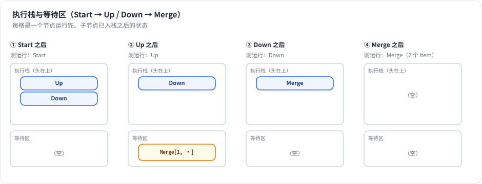
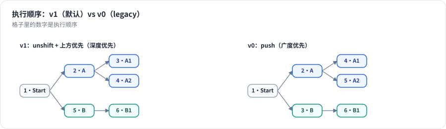

# 第 7 章 执行引擎：执行栈与等待区 ★★

> 本章目标：读完你能逐行解释 n8n 引擎主循环，说清 v0 / v1 两种执行顺序的差别、多输入节点（Merge）如何等待、循环为什么能工作，并能自己实现一个同等语义的引擎。前置：第 4–6 章。对应代码：mini-n8n v0.1 的 `packages/core/src/workflow-execute.ts`

## 1. 问题与概念

给你一张有分支、有合并、甚至有环的图，按什么顺序执行节点？

最自然的想法是 **拓扑排序**：先算出所有节点的顺序，再依次执行。但它对 n8n 不适用：

- **分支是动态的**。If 节点运行之前，不知道哪个分支会有数据。没数据的分支不应该执行。
- **图里可以有环**。Loop Over Items 的循环体会连回自己，拓扑排序无解。
- **执行要能暂停和恢复**。Wait 节点让执行停三天；“下一步做什么”必须能存进数据库。

n8n 的做法是一个 **工作列表算法**：

- **执行栈**（`nodeExecutionStack`）：一个列表，每项是“用这些输入数据运行这个节点”（`IExecuteData`）。
- **等待区**（`waitingExecution`）：有多个输入的节点（Merge），在所有输入到齐之前先停在这里。
- **运行数据**（`runData`）：已运行节点的输出。

主循环只做一件事：**从栈里取一项 → 运行 → 把它的输出按连接分发给下游（下游进栈或进等待区）→ 重复，直到栈空**。这三个结构都在 `IRunExecutionData` 里，都是纯 JSON，所以引擎在任意两个节点之间都可以停下来、存盘、恢复。



*图 7-1：并行分支汇入 Merge 的例子。Up 运行后，Merge 的输入 0 有了数据，输入 1 还没有，于是 Merge 进入等待区；Down 运行后输入到齐，Merge 进栈执行。*

## 2. n8n 是怎么做的

本节按执行的时间顺序读 `packages/core/src/execution-engine/workflow-execute.ts`。

### 2.1 初始化：栈里只有起始节点

```ts
// packages/core/src/execution-engine/workflow-execute.ts:204-218
// Initialize the data of the start nodes
const nodeExecutionStack: IExecuteData[] = [
	{
		node: startNode,
		data: triggerToStartFrom?.data?.data ?? {
			main: [
				[
					{
						json: {},
					},
				],
			],
		},
		source: null,
	},
];
```

起始节点的输入是一个空 item `{ json: {} }`。如果是 Webhook 触发的执行，`triggerToStartFrom.data` 就是收到的请求。

### 2.2 主循环的骨架

```ts
// packages/core/src/execution-engine/workflow-execute.ts:2289-2333（节选）
executionLoop: while (this.isExecutionStackNotEmpty()) {
	if (this.shouldStopExecuting()) {
		return;                                   // 取消或超时
	}
	...
	executionData = this.popExecutionStack();     // 从栈顶取一项
	executionNode = executionData.node;
	...
	runIndex = this.computeRunIndex(executionData);

	currentExecutionTry = `${executionNode.name}:${runIndex}`;
	if (currentExecutionTry === lastExecutionTry) {
		throw new UserError('Stopped execution because it seems to be in an endless loop');
	}

	if (this.isNodeFilteredOut(executionNode.name)) {
		continue;                                 // 部分执行时不在范围内的节点
	}

	const hasInputData = this.ensureInputData(workflow, executionNode, executionData);
	if (!hasInputData) {
		lastExecutionTry = currentExecutionTry;
		continue executionLoop;
	}
```

`popExecutionStack()` 是 `shift()`，取数组 **头部**（第 2211 行）。`runIndex` 就是这个节点已经运行过的次数：

```ts
// packages/core/src/execution-engine/workflow-execute.ts:1821-1829
private computeRunIndex(executionData: IExecuteData): number {
	if (executionData.runIndex !== undefined) {
		return executionData.runIndex;
	}
	const { runData } = this.runExecutionData.resultData;
	const nodeName = executionData.node.name;
	return Object.hasOwn(runData, nodeName) ? runData[nodeName].length : 0;
}
```

所以“一个节点运行多次”在数据结构里非常自然：`runData[name]` 是一个数组，每次运行追加一条。

“死循环检测”很朴素：如果同一个节点、同一个 `runIndex` 连续被取出两次，说明它被放回栈里却一直不能执行（例如等待永远不会到的输入），直接报错。

### 2.3 运行节点、记录结果

接下来是 `nodeExecuteBefore` 钩子、重试循环（第 8 章）、`runNode()`（第 2383 行），以及 Agent 专用的 `EngineRequest` 分支（第 19 章）。拿到 `nodeSuccessData` 后，引擎做几件通用的事：

- `assignPairedItems`：自动补全 `pairedItem`（第 6 章）。
- `ensureAlwaysOutputData`：节点设置了“总是输出数据”而输出为空时，补一个空 item。
- 输出为 `null` 时，这条分支到此结束（`continue executionLoop`，第 2452–2457 行）。
- 写入 `runData`，处理 `waitTill`（Wait 节点，第 8 章）和 `destinationNode`（部分执行的终点）。

### 2.4 分发输出：子节点进栈

```ts
// packages/core/src/execution-engine/workflow-execute.ts:2545-2594（节选）
for (outputIndex in workflow.connectionsBySourceNode[executionNode.name].main) {
	...
	for (connectionData of workflow.connectionsBySourceNode[executionNode.name].main[outputIndex] ?? []) {
		...
		if (
			nodeSuccessData![outputIndex] &&
			(nodeSuccessData![outputIndex].length !== 0 ||
				(connectionData.index > 0 && this.isLegacyExecutionOrder(workflow)))
		) {
			// Add the node only if it did execute or if connected to second "optional" input
			if (workflow.settings.executionOrder === 'v1') {
				const nodeToAdd = workflow.getNode(connectionData.node);
				nodesToAdd.push({ position: nodeToAdd?.position || [0, 0], connection: connectionData, outputIndex: parseInt(outputIndex, 10) });
			} else {
				this.addNodeToBeExecuted(workflow, connectionData, parseInt(outputIndex, 10), executionNode.name, nodeSuccessData!, runIndex);
			}
		}
	}
}
```

关键条件：**某个输出有 item，才把这个输出连着的节点加入执行**。If 的 false 输出为空，false 分支上的节点就不会进栈——动态分支就是这么实现的，没有任何“跳转”指令。

v1 顺序下，先收集所有要加的子节点，再按画布位置排序：

```ts
// packages/core/src/execution-engine/workflow-execute.ts:2595-2621（节选）
if (workflow.settings.executionOrder === 'v1') {
	// Always execute the node that is more to the top-left first
	nodesToAdd.sort((a, b) => {
		if (a.position[1] < b.position[1]) {
			return 1;
		}
		if (a.position[1] > b.position[1]) {
			return -1;
		}
		if (a.position[0] > b.position[0]) {
			return -1;
		}
		return 0;
	});
	for (const nodeData of nodesToAdd) {
		this.addNodeToBeExecuted(workflow, nodeData.connection, nodeData.outputIndex, executionNode.name, nodeSuccessData!, runIndex);
	}
}
```

排序是 **降序**（y 大的在前），因为接下来 `addNodeToBeExecuted` 在 v1 下用 `unshift` 把节点插到栈 **头部**。后插入的先执行，所以 y 最小（最靠上）的节点最后插入、最先执行。

全部子节点处理完，才调用 `nodeExecuteAfter` 钩子（第 2626–2634 行）。

### 2.5 addNodeToBeExecuted：进栈还是进等待区

```ts
// packages/core/src/execution-engine/workflow-execute.ts:469-487（节选）
addNodeToBeExecuted(workflow, connectionData, outputIndex, parentNodeName, nodeSuccessData, runIndex, newRunIndex?, metadata?): void {
	let stillDataMissing = false;
	const enqueueFn = workflow.settings.executionOrder === 'v1' ? 'unshift' : 'push';
	let waitingNodeIndex: number | undefined;

	// Check if node has multiple inputs as then we have to wait for all input data
	// to be present before we can add it to the node-execution-stack
	const numberOfInputs =
		workflow.connectionsByDestinationNode[connectionData.node]?.main?.length ?? 0;
	if (numberOfInputs > 1) {
```

两条路：

- **只有一个输入**：直接把 `{ node, data: { main: [输出数据] }, source }` 放进栈（v1 头部，v0 尾部）。
- **有多个输入**：在 `waitingExecution[节点名][runIndex].main` 里找一个“这个输入还空着（`null`）”的槽位，把数据放进去。然后检查所有输入是否都非 `null`（第 569 行起）：都到齐就放进栈并从等待区删除；否则留在等待区。

`waitingExecution` 的结构是“节点名 → runIndex → 每个输入的数据”。用 `runIndex` 作为第二层键，是为了在循环里区分“第一轮的 Merge”和“第二轮的 Merge”。

### 2.6 栈空了，但还有节点在等

回到 2.2 节 If + Merge 的例子：If 的 false 分支为空，Merge 的输入 1 **永远** 不会到。栈空时，主循环末尾会检查等待区：

```ts
// packages/core/src/execution-engine/workflow-execute.ts:2640-2700（节选）
if (
	this.runExecutionData.executionData!.nodeExecutionStack.length === 0 &&
	waitingNodes.length
) {
	// There are no more nodes in the execution stack. Check if there are
	// waiting nodes that do not require data on all inputs and execute them,
	// one by one.
	for (let i = 0; i < waitingNodes.length; i++) {
		...
		// Check if the node is only allowed execute if all inputs received data
		let requiredInputs =
			workflow.settings.executionOrder === 'v1' ? nodeType.description.requiredInputs : undefined;
		...
		const parentNodes = workflow.getParentNodes(nodeName);
		// Check if input nodes (of same run) got already executed
		const parentIsWaiting = parentNodes.some((value) => waitingNodes.includes(value));
		if (parentIsWaiting) {
			// Execute node later as one of its dependencies is still outstanding
			continue;
		}
```

逻辑是：

1. 如果某个等待节点的祖先也在等，先不动它（祖先以后可能还会产生数据）。
2. 检查 `requiredInputs`：Merge 在多数模式下是 `1`，有一个输入有数据就够了；“选择分支”模式是 `[0, 1]`，必须两个都到。
3. 满足条件就把它放进栈，缺的输入用空数组 `[]` 补齐（第 2741–2756 行）。每次只放一个，放完就 `break`，回到主循环。

这个机制让“If 之后再 Merge”这种最常见的写法能正确工作。

### 2.7 v0 与 v1：两种执行顺序

`workflow.settings.executionOrder` 有两个取值：

| | v0（legacy） | v1（默认） |
|---|---|---|
| 入栈方式 | `push`（尾部） | `unshift`（头部） |
| 遍历顺序 | 广度优先：先把同一层的节点跑完 | 深度优先：一条分支跑到底，再跑下一条 |
| 兄弟节点顺序 | 按连接顺序 | 按画布位置：上方优先，同高度时左边优先 |
| 多输入节点缺输入 | 主动去执行缺失输入的祖先（第 653–800 行的一大段） | 不追，等栈空时按 `requiredInputs` 放行 |



*图 7-2：同一棵树，v1 先把上面的 A 分支跑完（A → A1 → A2）再跑 B；v0 先跑完第一层（A、B），再跑第二层。*

v0 那一大段“主动追祖先”的代码在 v1 下直接跳过：

```ts
// packages/core/src/execution-engine/workflow-execute.ts:706-710
if (!this.isLegacyExecutionOrder(workflow)) {
	// Do not automatically follow all incoming nodes and force them
	// to execute
	continue;
}
```

v1 的好处是 **可预测**：用户看画布就知道顺序（从上到下、一条分支跑到底），分支内部的数据依赖也更自然。新工作流默认都是 v1。

### 2.8 循环

Loop Over Items 的 loop 输出连到循环体，循环体再连回 Loop 节点。引擎并不知道“这是个循环”，它只是照常执行：

1. Loop 第一次运行（runIndex 0）：把所有 item 存进节点上下文，输出第一批到 loop 输出。
2. 循环体运行，输出又连回 Loop → Loop 进栈。
3. Loop 第二次运行（runIndex 1）：收集上一批结果，输出下一批……
4. 没有剩余 item 时，把收集到的所有结果从 done 输出发出，loop 输出为空，循环结束。

节点状态存在 `this.getContext('node')` 里（`executionData.contextData`），和执行数据一起序列化，所以循环中途 Wait 也没问题（`packages/nodes-base/nodes/SplitInBatches/v3/SplitInBatchesV3.node.ts:93`）。

## 3. 从零实现

mini-n8n 的引擎保留了上面所有语义，主循环约 120 行。

### 3.1 主循环

```ts
// code/mini-n8n/packages/core/src/workflow-execute.ts（节选）
executionLoop: while (stack.length !== 0 || this.releaseWaitingNode(workflow)) {
	if (this.abortController.signal.aborted) break;

	const executionData = stack.shift()!;
	const node = executionData.node;
	const runIndex = runData[node.name]?.length ?? 0;

	const currentTry = `${node.name}:${runIndex}`;
	if (currentTry === lastExecutionTry) {
		throw new WorkflowOperationError('Stopped execution because it seems to be in an endless loop');
	}
	lastExecutionTry = currentTry;

	const filter = this.runExecutionData.startData.runNodeFilter;
	if (filter && !filter.includes(node.name)) continue;
	...
	await hooks.runHook('nodeExecuteBefore', [node.name, taskStarted]);
	// 重试循环 → runNode → assignPairedItems（第 8 章）
	...
	(runData[node.name] ??= []).push(taskData);
	...
	// 分发输出
	const outputs = workflow.connectionsBySourceNode[node.name]?.main ?? [];
	const toAdd = [];
	outputs.forEach((connections, outputIndex) => {
		if (!nodeSuccessData![outputIndex]?.length) return;      // 空输出：下游不执行
		for (const connection of connections ?? []) {
			toAdd.push({ connection, outputIndex, position: workflow.nodes[connection.node]?.position ?? [0, 0] });
		}
	});
	if (workflow.settings.executionOrder === 'v1') {
		// unshift reverses the order, so sort bottom-right first to run top-left first
		toAdd.sort((a, b) => b.position[1] - a.position[1] || b.position[0] - a.position[0]);
	}
	for (const { connection, outputIndex } of toAdd) {
		this.addNodeToBeExecuted(workflow, connection, outputIndex, node.name, nodeSuccessData, runIndex);
	}

	// Like n8n: the hook runs after the children were scheduled
	await hooks.runHook('nodeExecuteAfter', [node.name, taskData, this.runExecutionData]);
}
```

一个小改动：n8n 在循环 **末尾** 检查“栈空但有节点在等”，mini-n8n 把它放进了 `while` 条件里：`stack.length !== 0 || this.releaseWaitingNode(workflow)`。语义相同，读起来更直接：“栈里还有活，或者能从等待区放出一个，就继续”。

### 3.2 addNodeToBeExecuted

```ts
// code/mini-n8n/packages/core/src/workflow-execute.ts（节选）
addNodeToBeExecuted(workflow, connection, outputIndex, parentNodeName, nodeSuccessData, runIndex): void {
	const node = workflow.nodes[connection.node];
	const source = { previousNode: parentNodeName, previousNodeOutput: outputIndex, previousNodeRun: runIndex };
	const numberOfInputs = workflow.connectionsByDestinationNode[connection.node]?.main?.length ?? 0;

	if (numberOfInputs <= 1) {
		this.enqueue(workflow, { node, data: { main: [nodeSuccessData[outputIndex]] }, source: { main: [source] } });
		return;
	}

	const { waitingExecution, waitingExecutionSource } = this.runExecutionData.executionData;
	const waiting = (waitingExecution[connection.node] ??= {});
	const waitingSource = (waitingExecutionSource[connection.node] ??= {});

	// Use the oldest waiting run that still misses data on this input
	let slot = Object.keys(waiting).map(Number).sort((a, b) => a - b)
		.find((k) => waiting[k].main[connection.index] === null);
	if (slot === undefined) {
		slot = Math.max(this.runExecutionData.resultData.runData[connection.node]?.length ?? 0, ...Object.keys(waiting).map((k) => Number(k) + 1));
		waiting[slot] = { main: Array.from({ length: numberOfInputs }, () => null) };
		waitingSource[slot] = { main: Array.from({ length: numberOfInputs }, () => null) };
	}
	waiting[slot].main[connection.index] = nodeSuccessData[outputIndex];
	waitingSource[slot].main[connection.index] = source;

	if (waiting[slot].main.every((d) => d !== null)) {
		this.enqueue(workflow, { node, data: waiting[slot], source: waitingSource[slot] });
		delete waiting[slot];
		...
	}
}
```

`null` 表示“还没收到”，`[]` 表示“收到了，但是空的”。这个区别在 `releaseWaitingNode` 里很重要：只有 `null` 的输入才算缺失。

### 3.3 releaseWaitingNode

```ts
// code/mini-n8n/packages/core/src/workflow-execute.ts（节选）
private releaseWaitingNode(workflow: Workflow): boolean {
	const { waitingExecution, waitingExecutionSource } = this.runExecutionData.executionData;
	let waitingNodes = Object.keys(waitingExecution);
	for (let i = 0; i < waitingNodes.length; i++) {
		const nodeName = waitingNodes[i];
		...
		// a parent that is itself waiting will produce data later
		if (workflow.getParentNodes(nodeName).some((p) => waitingNodes.includes(p))) continue;

		const firstSlot = Math.min(...Object.keys(waitingExecution[nodeName]).map(Number));
		const inputs = waitingExecution[nodeName][firstSlot].main;
		const inputsWithData = inputs.map((d, idx) => (d === null ? null : idx)).filter((d) => d !== null);

		const required = nodeType.description.requiredInputs;
		if (Array.isArray(required) && !required.every((r) => inputsWithData.includes(r))) continue;
		if (typeof required === 'number' && inputsWithData.length < required) continue;

		const main = inputs.map((d) => d ?? []);
		...push to stack, delete slot, return true
	}
	return false;
}
```

### 3.4 差异

| 方面 | n8n | mini-n8n |
|---|---|---|
| v1 调度 | 位置排序 + `unshift` + 栈空放行 | 相同 |
| v0 调度 | `push` + 主动执行缺失输入的祖先 | 只有 `push`，**没有** 实现“追祖先” |
| `requiredInputs` | 数字、数组或表达式 | 数字或数组 |
| 栈空放行的位置 | 循环末尾 | `while` 条件 |
| 部分执行 | `runPartialWorkflow2`：基于 `DirectedGraph` 重建栈，支持“脏节点” | 只支持 `destinationNode` + 祖先过滤 |
| 取消 | `PCancelable` + `AbortController` | `cancel()` + `AbortController` |

## 4. 运行与验证

`examples/execution-order.ts` 在每个节点运行后打印栈和等待区（等待区里 `·` 表示该输入还没数据）：

```bash
cd code/mini-n8n && npx tsx examples/execution-order.ts
```

真实输出：

```text
=== tree (executionOrder v1) ===
ran Start    out 1    stack [A, B]  waiting {}
ran A        out 1    stack [A1, A2, B]  waiting {}
ran A1       out 1    stack [A2, B]  waiting {}
ran A2       out 1    stack [B]  waiting {}
ran B        out 1    stack [B1]  waiting {}
ran B1       out 1    stack []  waiting {}

=== tree (executionOrder v0) ===
ran Start    out 1    stack [A, B]  waiting {}
ran A        out 1    stack [B, A1, A2]  waiting {}
ran B        out 1    stack [A1, A2, B1]  waiting {}
ran A1       out 1    stack [A2, B1]  waiting {}
ran A2       out 1    stack [B1]  waiting {}
ran B1       out 1    stack []  waiting {}

=== parallel branches + merge (executionOrder v1) ===
ran Start    out 1    stack [Up, Down]  waiting {}
ran Up       out 1    stack [Down]  waiting {Merge[1,·]}
ran Down     out 1    stack [Merge]  waiting {}
ran Merge    out 2    stack []  waiting {}

=== if + merge, false branch empty (executionOrder v1) ===
ran Start    out 1    stack [If]  waiting {}
ran If       out 1/0  stack [Yes]  waiting {}
ran Yes      out 1    stack []  waiting {Merge[1,·]}
ran Merge    out 1    stack []  waiting {}

=== loop over items (executionOrder v1) ===
ran Start    out 1    stack [Data]  waiting {}
ran Data     out 3    stack [Loop]  waiting {}
ran Loop     out 0/2  stack [Body]  waiting {}
ran Body     out 2    stack [Loop]  waiting {}
ran Loop     out 0/1  stack [Body]  waiting {}
ran Body     out 1    stack [Loop]  waiting {}
ran Loop     out 3/0  stack [Done]  waiting {}
ran Done     out 3    stack []  waiting {}
```

逐段看：

- **tree v1**：A 运行后，A1、A2 被插到栈头，排在 B 前面——深度优先。
- **tree v0**：A 运行后，A1、A2 被追加到栈尾，B 先执行——广度优先。
- **parallel + merge**：Up 运行后 Merge 只收到输入 0（`[1,·]`），进等待区；Down 运行后输入到齐，Merge 进栈。
- **if + merge**：If 输出 `1/0`，No 分支没有进栈；Yes 运行后 Merge 进等待区；此时栈空，`releaseWaitingNode` 根据 `requiredInputs: 1` 放行 Merge，缺的输入补 `[]`。
- **loop**：Loop 运行了 3 次（`0/2`、`0/1`、`3/0`），前两次只有 loop 输出有数据，最后一次只有 done 输出有数据。

引擎的单元测试（`packages/core/test/workflow-execute.test.ts`）对这些场景都有断言：

```bash
npx vitest run packages/core
```

```text
 ✓ packages/core/test/workflow-execute.test.ts (17 tests)
```

## 5. 练习

1. **巩固**：在纸上模拟下面这个工作流在 v1 下的执行顺序，然后用 mini-n8n 验证：Start → If（true 有 2 个 item，false 有 1 个）→ 两个分支各接一个 Set → 都连到同一个 Merge → Code。
2. **扩展**：mini-n8n 的 v0 没有实现“追祖先”。构造一个例子，说明 v0 在 n8n 里和 mini-n8n 里会产生不同结果（提示：Merge 的输入 1 连在一个没有被任何节点触发的 Set 上）。
3. **读源码**：阅读 n8n 的 `runPartialWorkflow2`（同文件）和 `packages/core/src/execution-engine/partial-execution-utils/`，说明部分执行时引擎如何决定“从哪些节点开始”。

## 6. 延伸阅读

- `packages/core/src/execution-engine/workflow-execute.ts`：本章的全部内容，重点读 `addNodeToBeExecuted` 和 `processRunExecutionData`。
- `packages/core/src/execution-engine/partial-execution-utils/`：`DirectedGraph`、`findStartNodes`、`recreateNodeExecutionStack` 等部分执行工具。
- n8n 文档：*Flow logic* → *Execution order in multi-branch workflows*。
