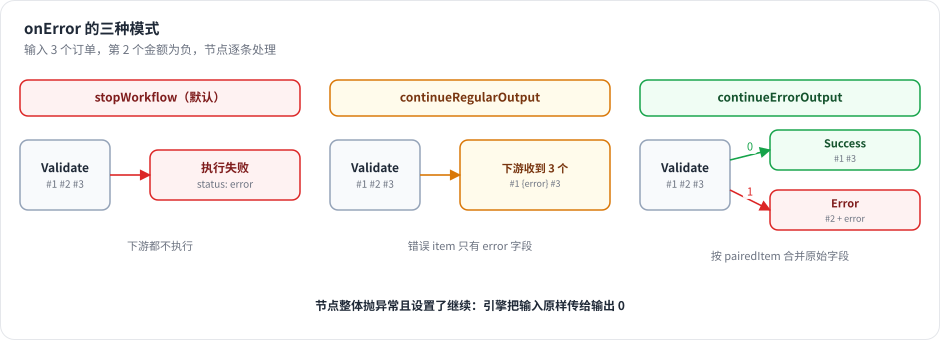

# 第 8 章 健壮性：错误输出、重试、取消、超时、等待

> 本章目标：读完你能说清 n8n 的三种 `onError` 模式和重试的具体规则，知道取消和超时如何在引擎里生效，Wait 节点如何让一次执行“睡三天”，并在 mini-n8n 里全部实现。前置：第 7 章。对应代码：mini-n8n v0.1 的 `workflow-execute.ts`、`execute-context.ts`、`Wait.node.ts`

## 1. 问题与概念

生产环境里，外部 API 会超时、数据会不合法、用户会想中途停止一次执行、有些流程需要等几天（“3 天后发送提醒邮件”）。工作流平台必须把这些情况变成 **用户可配置的节点设置**，而不是让每个节点自己处理。

n8n 在 `INode` 上提供了几项通用设置，由引擎统一实现：

| 设置 | 作用 |
|---|---|
| `retryOnFail` / `maxTries` / `waitBetweenTries` | 失败后重试 |
| `onError` | 失败后怎么办：停止 / 把错误当作普通输出继续 / 走专门的错误输出 |
| `alwaysOutputData` | 输出为空时也输出一个空 item，让下游继续 |
| `executeOnce` | 只用第一个 item 运行一次 |

工作流级别还有：`settings.executionTimeout`（超时）、`settings.errorWorkflow`（失败时触发的错误处理工作流）。



*图 8-1：同样 3 个输入、第 2 个出错。stopWorkflow 让整个执行失败；continueRegularOutput 把错误 item 和正常 item 一起送到下游；continueErrorOutput 给节点增加一个 Error 输出，出错的 item（带回原始字段）走这条线。*

## 2. n8n 是怎么做的

### 2.1 重试

```ts
// packages/core/src/execution-engine/workflow-execute.ts:1838-1849
private getRetryParams(executionData: IExecuteData): [number, number] {
	const isResumedError = executionData.metadata?.resumeError !== undefined;
	if (executionData.node.retryOnFail !== true || isResumedError) {
		return [1, 0];
	}

	// TODO: Remove the hardcoded default-values here and also in NodeSettings.vue
	return [
		Math.min(5, Math.max(2, executionData.node.maxTries || 3)),
		Math.min(5000, Math.max(0, executionData.node.waitBetweenTries || 1000)),
	];
}
```

规则很具体：最多尝试 2–5 次（默认 3），间隔 0–5000 毫秒（默认 1000）。上限是刻意的：重试期间节点占着执行线程，间隔太长会拖慢整个实例；真正需要长时间等待的场景应该用 Wait 节点。

主循环里的重试（第 2354 行起）有两种失败判定：节点 **抛异常**，或者节点 **返回了带 `json.error` 的 item**（`checkFailure`，第 2350–2351 行）。后者对应“节点自己吞了错误、输出 error item”的情况，也会触发重试。

### 2.2 onError 的三种模式

节点抛出异常后，进入 `handleNodeExecutionError`：

```ts
// packages/core/src/execution-engine/workflow-execute.ts:2082-2120（节选）
taskData.error = executionError;
taskData.executionStatus = 'error';
...
// AI tools default to continue-on-fail so the agent receives the
// error as a tool response. Explicit `onError: 'stopWorkflow'`
// still wins.
const isAiToolExecution = executionNode.rewireOutputLogTo === NodeConnectionTypes.AiTool;
const aiToolDefaultsToContinue = isAiToolExecution && executionData.node.onError !== 'stopWorkflow';

if (this.continuesOnError(executionData.node) || aiToolDefaultsToContinue) {
	// Workflow should continue running even if node errors
	if (isAiToolExecution) {
		// Surface the error on the ai_tool channel so the agent receives it
		nodeSuccessData = [[{ json: { error: executionError.message } }]];
	} else if (Object.hasOwn(executionData.data, 'main') && executionData.data.main.length > 0) {
		// Simply get the input data of the node if it has any and pass it through
		// to the next node
		if (executionData.data.main[0] !== null) {
			nodeSuccessData = [executionData.data.main[0]];
		}
	}
	return { continueExecution: true, nodeSuccessData };
}
```

三个要点：

1. **整个节点失败、但设置了继续**：引擎把 **输入原样传下去**。这是兜底行为。
2. **AI 工具默认继续**：Agent 调用的工具出错时，错误信息作为工具结果返回给模型，让模型自己决定换个参数重试或换个工具。除非用户显式设置 `stopWorkflow`。这是一个很有 Agent 思维的默认值（第 19 章会再见到）。
3. **否则停止**：记录错误，主循环 `break`，执行状态为 `error`。

更常见的情况是 **节点自己按 item 处理错误**。节点里的惯用写法：

```ts
try {
	...处理第 i 个 item
} catch (error) {
	if (this.continueOnFail()) {
		returnData.push({ json: { error: error.message }, pairedItem: { item: i } });
		continue;
	}
	throw error;
}
```

`continueOnFail()` 对 `continueRegularOutput` 和 `continueErrorOutput` 都返回 `true`（第 1060–1065 行的 `continuesOnError` 是引擎这边的同一判断）。

### 2.3 错误输出：continueErrorOutput

选了 `continueErrorOutput` 的节点，在画布上会多出一个红色的 “Error” 输出。节点成功返回后，引擎把其中的错误 item 挑出来，挪到这个输出：

```ts
// packages/core/src/execution-engine/workflow-execute.ts:1912-1914
if (nodeSuccessData && executionData.node.onError === 'continueErrorOutput') {
	this.handleNodeErrorOutput(workflow, executionData, nodeSuccessData, runIndex);
}
```

`handleNodeErrorOutput`（第 3027 行）的判定规则：item 有 `error` 字段，或者 `json` 里只有 `error`、`message`、`details` 这几个键。然后用 `$getPairedItem` 找到它对应的 **输入 item**，把输入的字段合并回来：

```ts
// packages/core/src/execution-engine/workflow-execute.ts:3073-3112（节选）
if (item.error) {
	errorData = item.error;
} else if (
	item.json.error &&
	Object.keys(item.json).every((key) => ['error', 'message', 'details'].includes(key))
) {
	errorData = item.json.error;
}
if (errorData) {
	...
	const constPairedItem = dataProxy.$getPairedItem(sourceData!.previousNode, sourceData, pairedItemData);
	...
	errorItems.push({ ...item, json: { ...constPairedItem.json, ...item.json } });
```

合并的意义在于：错误分支上的节点能直接用 `{{ $json.id }}` 拿到出错的订单号，而不是只有一句错误信息。这又是 `pairedItem` 的一个用处。

### 2.4 取消与超时

`WorkflowExecute.run()` 返回的是 `PCancelable<IRun>`（可取消的 Promise），`run` 方法上方有一条醒目的注释：“Do not add "async" to this function, it will then convert the PCancelable to a regular Promise”（第 163–165 行）。取消时，引擎通过 `AbortController` 通知正在运行的节点（HTTP 请求会被中止），主循环在下一个节点边界停下：

```ts
// packages/core/src/execution-engine/workflow-execute.ts:2221-2238
private hasExecutionTimedOut(): boolean {
	return (
		this.additionalData.executionTimeoutTimestamp !== undefined &&
		Date.now() >= this.additionalData.executionTimeoutTimestamp
	);
}

/**
 * True if the loop must stop now. Marks the execution as timed-out first if its
 * timeout has passed, so a timeout is reported as a cancellation.
 */
private shouldStopExecuting(): boolean {
	if (this.hasExecutionTimedOut()) {
		this.status = 'canceled';
		this.timedOut = true;
	}
	return this.status === 'canceled';
}
```

超时有两道：`WorkflowRunner.runMainProcess` 里的 `setTimeout` 到点后调用 `activeExecutions.stopExecution(..., new TimeoutExecutionCancelledError(...))`（第 2 章看过）；引擎每轮循环也检查 `executionTimeoutTimestamp`。两者都是 **软超时**：不会打断一个正在运行的节点（除非节点响应 abort 信号），只在节点边界停下。超时被报告为 **取消**，状态是 `canceled`，错误是 `TimeoutExecutionCancelledError`，消息为 “The execution was cancelled because it timed out”（`packages/workflow/src/errors/execution-cancelled.error.ts:25-29`）。

### 2.5 等待：让执行睡三天

Wait 节点调用 `putExecutionToWait`：

```ts
// packages/core/src/execution-engine/node-execution-context/base-execute-context.ts:139-157
async putExecutionToWait(waitTill: Date, options?: { acceptsResumeRequest?: boolean }): Promise<void> {
	const waitMs = Math.max(waitTill.getTime() - Date.now(), 0);

	// Suspending a short wait costs a write and a reload, and the tracker polls too
	// slowly to promise an on-time resume.
	if (options?.acceptsResumeRequest === false && waitMs < MAX_IN_PROCESS_WAIT_MS) {
		// A cancelled execution ends the wait, and the step still returns its input.
		return await sleep(waitMs, this.abortSignal).catch(() => undefined);
	}

	this.runExecutionData.waitTill = waitTill;
	if (this.additionalData.setExecutionStatus) {
		this.additionalData.setExecutionStatus('waiting');
	}
}
```

`MAX_IN_PROCESS_WAIT_MS` 是 65 秒（`packages/workflow/src/constants.ts:19`）。短等待直接在进程里 `sleep`；长等待只是在执行数据上写一个 `waitTill`。主循环看到 `waitTill` 后：

```ts
// packages/core/src/execution-engine/workflow-execute.ts:2503-2515（节选）
if (this.runExecutionData.waitTill) {
	await hooks.runHook('nodeExecuteAfter', [executionNode.name, taskData, this.runExecutionData]);

	// Add the node back to the stack that the workflow can start to execute again from that node
	this.pushExecutionStack(executionData);

	break;
}
```

把 Wait 节点 **放回栈顶**，然后退出循环。执行状态变成 `waiting`，整个 `IRunExecutionData` 被存进数据库。`WaitTracker` 每 60 秒查询一次“70 秒内要恢复的执行”，为它们设定时器；到点后用存储的执行数据新建 `WorkflowExecute`，调用 `processRunExecutionData` 继续。

恢复时有个问题：栈顶是 Wait 节点本身，再执行一遍又会等待。n8n 的解法是在恢复时 **把它禁用**：

```ts
// packages/core/src/execution-engine/workflow-execute.ts:1525-1557（节选）
private handleWaitingState(workflow: Workflow) {
	if (this.runExecutionData.waitTill) {
		this.runExecutionData.waitTill = undefined;
		...
		const executionStackEntry = this.runExecutionData.executionData.nodeExecutionStack[0];
		...
		if (!executionStackEntry.metadata?.resumeError) {
			executionStackEntry.node.disabled = true;
		}
		const lastNodeExecuted = this.runExecutionData.resultData.lastNodeExecuted as string;
		this.runExecutionData.resultData.runData[lastNodeExecuted].pop();
	}
}
```

禁用的节点会把输入原样传出去（`runNode` 里的 `handleDisabledNode`），于是 Wait 节点“通过”，下游继续。同时弹掉它之前那条“waiting”的运行记录，避免出现两条。Webhook 恢复（“等外部回调”）走同样的路径（`packages/cli/src/webhooks/waiting-webhooks.ts:72` 也是把栈顶节点设为 `disabled = true`）。

### 2.6 错误工作流

工作流设置里可以指定一个 **Error Workflow**。执行失败后，`executeErrorWorkflow`（`packages/cli/src/execution-lifecycle/execute-error-workflow.ts:42`）会启动那个工作流，并把失败的执行 ID、工作流名、错误信息、执行链接作为输入传给它的 Error Trigger 节点。常见用法是统一发告警到 Slack 或邮件。

## 3. 从零实现

### 3.1 重试与错误处理

```ts
// code/mini-n8n/packages/core/src/workflow-execute.ts（节选）
const [maxTries, waitBetweenTries] = this.getRetryParams(node);
for (let tryIndex = 0; tryIndex < maxTries; tryIndex++) {
	try {
		if (tryIndex > 0) {
			nodeError = undefined;
			await sleep(waitBetweenTries);
		}
		const pinned = this.runExecutionData.resultData.pinData?.[node.name];
		nodeSuccessData = pinned && !node.disabled ? [pinned] : await this.runNode(workflow, executionData, runIndex);
		nodeSuccessData = this.assignPairedItems(nodeSuccessData, executionData);
		break;
	} catch (error) {
		nodeError = toExecutionError(error, node);
		if (this.abortController.signal.aborted) break;
	}
}
...
if (nodeError) {
	taskData.error = nodeError.toJSON();
	taskData.executionStatus = 'error';
	if (!this.continuesOnError(node)) {
		...记录、调用钩子
		executionError = nodeError;
		break executionLoop;
	}
	// The whole node failed but should continue: pass the input through (as n8n does)
	nodeSuccessData = executionData.data.main?.[0] ? [executionData.data.main[0]] : null;
} else if (nodeSuccessData && node.onError === 'continueErrorOutput') {
	this.handleNodeErrorOutput(workflow, executionData, nodeSuccessData);
}
```

`getRetryParams` 照搬了 n8n 的上下限。mini-n8n 只把 **抛异常** 当作失败，不像 n8n 那样把“返回了 error item”也算作失败。

### 3.2 错误输出

```ts
// code/mini-n8n/packages/core/src/workflow-execute.ts（节选）
private handleNodeErrorOutput(workflow: Workflow, executionData: IExecuteData, output: INodeExecutionData[][]) {
	const mainOutputs = workflow.getNodeOutputs(executionData.node).filter((o) => o.type === 'main').length;
	const errorIndex = mainOutputs - 1;
	const errorItems: INodeExecutionData[] = [];
	for (let outputIndex = 0; outputIndex < errorIndex; outputIndex++) {
		const keep: INodeExecutionData[] = [];
		for (const item of output[outputIndex] ?? []) {
			const isError = item.json.error !== undefined && Object.keys(item.json).every((k) => ['error', 'message', 'details'].includes(k));
			if (!isError) { keep.push(item); continue; }
			const paired = normalizePairedItem(item.pairedItem)[0];
			const inputItem = paired ? executionData.data.main?.[paired.input ?? 0]?.[paired.item] : undefined;
			errorItems.push(inputItem ? { ...item, json: { ...inputItem.json, ...item.json } } : item);
		}
		output[outputIndex] = keep;
	}
	while (output.length < mainOutputs) output.push([]);
	output[errorIndex] = [...(output[errorIndex] ?? []), ...errorItems];
}
```

“多出一个 Error 输出”在 `Workflow.getNodeOutputs()` 里实现：节点 `onError === 'continueErrorOutput'` 时，在描述里的输出后面追加一个 `{ type: 'main', displayName: 'Error' }`。画布（v0.3）读同一个函数画端口。

### 3.3 取消、超时与等待

```ts
// code/mini-n8n/packages/core/src/workflow-execute.ts（节选）
cancel(): void {
	this.status = 'canceled';
	this.abortController.abort();
}
...
// Like n8n, a timeout is reported as a cancellation, not as a node error
if (this.abortController.signal.aborted && !(executionError && !(executionError instanceof ExecutionCancelledError))) {
	executionError = new ExecutionCancelledError(this.timedOut ? 'timeout' : 'manual');
}
```

超时用一个 `setTimeout` 触发同一个 `AbortController`。`putExecutionToWait` 的 65 秒阈值、`handleWaitingState` 的“禁用栈顶节点 + 弹出上一条记录”都和 n8n 一致：

```ts
// code/mini-n8n/packages/core/src/workflow-execute.ts（节选）
private handleWaitingState() {
	if (!this.runExecutionData.waitTill) return;
	this.runExecutionData.waitTill = undefined;
	const stack = this.runExecutionData.executionData.nodeExecutionStack;
	if (stack[0]) stack[0] = { ...stack[0], node: { ...stack[0].node, disabled: true } };
	const last = this.runExecutionData.resultData.lastNodeExecuted;
	if (last) this.runExecutionData.resultData.runData[last]?.pop();
}
```

一个小区别：n8n 直接修改栈项里的节点对象；mini-n8n 复制一份再设 `disabled`，避免在同一进程里恢复时改到 `Workflow` 里共享的节点对象。

| 方面 | n8n | mini-n8n |
|---|---|---|
| 重试判定 | 抛异常，或返回带 `json.error` 的 item | 只看抛异常 |
| AI 工具默认继续 | 是 | v0.4 实现 |
| 超时 | Runner 的定时器 + 引擎内时间戳检查 | 引擎内定时器 |
| Wait 恢复 | `WaitTracker` 轮询数据库 | v0.1 用测试模拟“存盘再恢复”；v1.0 实现 `WaitTracker` |
| 错误工作流 | `settings.errorWorkflow` + Error Trigger | 未实现（练习） |

## 4. 运行与验证

`examples/02-error-output.json`：3 个订单，Validate 节点（Code，逐 item 模式）对负数金额抛错，设置为 `continueErrorOutput`：

```bash
cd code/mini-n8n && npm run mini-n8n -- execute --file examples/02-error-output.json
```

真实输出：

```text
✓ Start                        items out: 1  (0 ms)
✓ Orders                       items out: 3  (8 ms)
✓ Validate                     items out: 2/1  (2 ms)
✓ Save                         items out: 2  (0 ms)
✓ Report problem               items out: 1  (2 ms)

status: success
last node: Report problem
[
  {
    "alert": "Order 2 rejected: order 2: amount must be positive"
  }
]
```

Validate 输出 `2/1`：2 个合法订单走正常输出，1 个走 Error 输出。Report problem 里的 `{{ $json.id }}` 能拿到 `2`，因为引擎把输入 item 的字段合并回了错误 item。

其余行为由单元测试覆盖（真实输出节选）：

```bash
npx vitest run packages/core --reporter=verbose
```

```text
 ✓ packages/core/test/workflow-execute.test.ts > WorkflowExecute > stops on error by default 3ms
 ✓ packages/core/test/workflow-execute.test.ts > WorkflowExecute > continueRegularOutput turns the error into an item 1ms
 ✓ packages/core/test/workflow-execute.test.ts > WorkflowExecute > continueErrorOutput moves failed items to the extra error output 2ms
 ✓ packages/core/test/workflow-execute.test.ts > WorkflowExecute > a node that fails as a whole passes its input through when it should continue 0ms
 ✓ packages/core/test/workflow-execute.test.ts > WorkflowExecute > retries a failing node 3ms
 ✓ packages/core/test/workflow-execute.test.ts > WorkflowExecute > parks a long Wait as "waiting" and resumes from the serialized state 0ms
 ✓ packages/core/test/workflow-execute.test.ts > WorkflowExecute > times out 1002ms
 ✓ packages/core/test/workflow-execute.test.ts > WorkflowExecute > can be canceled 102ms
```

“parks a long Wait” 这个测试值得一看：它把 `run.data` 用 `JSON.stringify` / `JSON.parse` 走一遍（模拟存进数据库再读出来），交给一个 **新的** `WorkflowExecute` 实例继续执行，断言后续节点正常运行、Wait 只有一条运行记录。

## 5. 练习

1. **巩固**：修改 `02-error-output.json`，把 Validate 的 `onError` 改成 `continueRegularOutput`，预测输出，再运行验证。
2. **扩展**：让 mini-n8n 的重试也把“返回了只含 `error` 字段的 item”视为失败（n8n 的 `checkFailure` 语义），并补一个测试。
3. **读源码**：阅读 `packages/cli/src/execution-lifecycle/execute-error-workflow.ts`，回答：如果失败的工作流 **自己** 就是自己的错误工作流，n8n 会怎么处理？

## 6. 延伸阅读

- `packages/core/src/execution-engine/workflow-execute.ts`：`getRetryParams`、`handleNodeExecutionError`、`handleNodeErrorOutput`、`handleWaitingState`。
- `packages/cli/src/wait-tracker.ts`：等待执行的恢复调度。
- n8n 文档：*Error handling*、*Wait node*。
