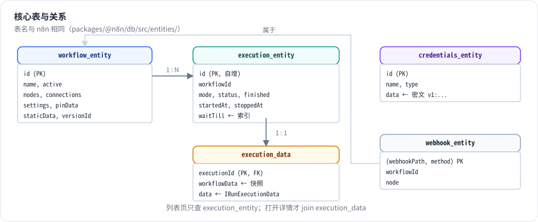

# 第 9 章 持久化：工作流、执行记录与运行数据

> 本章目标：读完你能设计一个工作流平台的核心表结构，理解为什么执行数据要和执行元数据分开存、为什么要能“只保存部分执行”，并在 mini-n8n 里用 `node:sqlite` 实现。前置：第 3、4 章。对应代码：mini-n8n v0.2 的 `packages/cli/src/databases/db.ts`

## 1. 问题与概念

第 4 章说过，`IRunExecutionData` 是纯 JSON，可以完整序列化。现在要回答：存到哪里？怎么存？

工作流平台的持久化有几个特点：

- **执行数据很大**。一个处理 1 万行表格的执行，`runData` 里有每个节点的全部输出，可能是几十 MB。而“执行列表”页面只需要状态、时间这些几十字节的字段。
- **执行数据只增不改**。执行结束后基本只读，很少更新。
- **数据量会无限增长**。定时任务每分钟跑一次，一年就是 50 多万条执行记录。
- **执行时的工作流定义要快照**。工作流明天会被修改，但今天这次执行要按今天的定义回放。

n8n 的核心表（`packages/@n8n/db/src/entities/`）：

| 表 | 实体 | 内容 |
|---|---|---|
| `workflow_entity` | `WorkflowEntity` | 工作流定义：nodes、connections、settings、pinData、staticData |
| `execution_entity` | `ExecutionEntity` | 执行 **元数据**：状态、模式、开始/结束时间、`waitTill`、存储位置 |
| `execution_data` | `ExecutionData` | 执行 **数据**：`IRunExecutionData` 的序列化文本 + 工作流定义快照 |
| `credentials_entity` | `CredentialsEntity` | 加密后的凭证 |
| `webhook_entity` | `WebhookEntity` | 已激活工作流的生产 Webhook 路由表 |



*图 9-1：执行被拆成两张表：`execution_entity` 小而频繁查询，`execution_data` 大而很少读取。`execution_data.workflowData` 是执行开始时的工作流快照。*

## 2. n8n 是怎么做的

### 2.1 执行元数据与执行数据分离

```ts
// packages/@n8n/db/src/entities/execution-data.ts:9-29（节选）
@Entity()
export class ExecutionData {
	@Column('text')
	data: string;

	// WARNING: the workflowData column has been changed from IWorkflowDb to IWorkflowBase
	// when ExecutionData was introduced as a separate entity.
	// This is because manual executions of unsaved workflows have no workflow id
	...
	@JsonColumn()
	workflowData: Omit<IWorkflowBase, 'pinData'> & { pinData?: ISimplifiedPinData };

	@PrimaryColumn({ transformer: idStringifier })
	executionId: string;
```

注释里的 “when ExecutionData was introduced as a separate entity” 说明了一段历史：早期执行数据和元数据在同一张表里，后来为了性能拆开。现在列表查询只碰 `execution_entity`，打开某个执行的详情时才 join `execution_data`。

`execution_entity` 上的几个字段值得注意：

- `status`：`new` / `running` / `success` / `error` / `canceled` / `waiting` / `crashed`。
- `waitTill`：等待中的执行什么时候恢复，有索引（第 27 行 `@Index(['waitTill', 'id'])`），供 `WaitTracker` 查询。
- `storedAt`（第 94 行）：执行数据存在哪里。值可以是 `db`，也可以是文件系统或对象存储——大执行数据可以不进数据库。

### 2.2 序列化用 flatted

```ts
// packages/cli/src/executions/execution-persistence.ts:99-118（节选）
async create(payload: CreateExecutionPayload, ctx: OperationContext = {}): Promise<string> {
	const { data: rawData, workflowData, ...rest } = payload;
	const { id } = workflowData;
	const workflowSnapshot = toWorkflowSnapshot(workflowData);
	const storedAt = this.storageConfig.modeTag;
	...
	const executionId = await this.executionRepository.runInTransaction(ctx, async (tx) => {
		...
		const { identifiers } = await tx.insert(ExecutionEntity, executionEntity);
		const executionId = String(identifiers[0].id);
		...
		const bundle: ExecutionDataPayload = {
			data: stringify(rawData),
			workflowData: workflowSnapshot,
			workflowVersionId,
		};
		return await this.writeData(storedAt, ref, bundle, tx);
```

两个细节：

- 元数据和数据在 **同一个事务** 里写入（`runInTransaction`），不会出现“有记录没数据”。这里用的就是根目录 `AGENTS.md` 里规定的 `TransactionRunner` 模式。
- `stringify` 来自 `flatted` 库（文件第 20 行 `import { stringify } from 'flatted'`），不是 `JSON.stringify`。`flatted` 能序列化 **循环引用**：运行数据里同一个对象可能被多处引用（例如节点把输入 item 原样传出），`flatted` 只存一份，用引用编号指向它，既能处理循环，也减小了体积。

### 2.3 保存什么、保存多久

不是每次执行都值得完整保存。工作流设置和全局配置决定保存策略（`packages/cli/src/execution-lifecycle/to-save-settings.ts`）：

| 设置 | 环境变量 | 含义 |
|---|---|---|
| `saveDataSuccessExecution` | `EXECUTIONS_DATA_SAVE_ON_SUCCESS` | 成功的执行是否保存 |
| `saveDataErrorExecution` | `EXECUTIONS_DATA_SAVE_ON_ERROR` | 失败的执行是否保存 |
| `saveManualExecutions` | `EXECUTIONS_DATA_SAVE_MANUAL_EXECUTIONS` | 手动执行是否保存 |
| `saveExecutionProgress` | `EXECUTIONS_DATA_SAVE_ON_PROGRESS` | 每个节点后都保存进度（崩溃可恢复） |

`hookFunctionsSave` 的 `workflowExecuteAfter` 处理函数据此决定是更新、软删除还是不存：

```ts
// packages/cli/src/execution-lifecycle/execution-lifecycle-hooks.ts:604-639（节选）
const isManualMode = this.mode === 'manual';
...
if (!isManualMode && isWorkflowIdValid(this.workflowData.id) && newStaticData) {
	// Workflow is saved so update in database
	await workflowStaticDataService.saveStaticDataById(this.workflowData.id, newStaticData);
}

if (isManualMode && !saveSettings.manual && !fullRunData.waitTill) {
	/**
	 * When manual executions are not being saved, we only soft-delete
	 * the execution so that the user can access its binary data
	 * while building their workflow.
	 ...
	 */
	await executionRepository.softDelete(this.executionId);
	return;
}

const shouldNotSave =
	(fullRunData.status === 'success' && !saveSettings.success) ||
	(fullRunData.status !== 'success' && !saveSettings.error);
```

注意 `staticData`：触发器（如轮询触发器记录“上次查到哪里”）会修改工作流的静态数据，执行结束后写回 `workflow_entity`。手动执行不写，避免测试污染生产状态。

保存多久由 **修剪（pruning）** 决定：

```ts
// packages/@n8n/config/src/configs/executions.config.ts:105-118（节选）
/** Whether to delete past executions on a rolling basis. */
@Env('EXECUTIONS_DATA_PRUNE')
pruneData: boolean = true;

/** How old (hours) a finished execution must be to qualify for soft-deletion. */
@Env('EXECUTIONS_DATA_MAX_AGE')
pruneDataMaxAge: number = 336;

/**
 * Max number of finished executions to keep in database. ...
 */
@Env('EXECUTIONS_DATA_PRUNE_MAX_COUNT')
pruneDataMaxCount: number = 10_000;
```

默认保留 336 小时（14 天）、最多 1 万条。`ExecutionsPruningService`（`packages/cli/src/services/pruning/executions-pruning.service.ts`）定期先 **软删除**（打 `deletedAt` 标记），过一段缓冲时间再 **硬删除** 并清理二进制数据。分两步是为了给正在查看这次执行的用户留时间。

### 2.4 工作流表

`workflow_entity` 除了定义本身，还有 `versionId`（每次保存换一个 UUID，用于检测并发编辑冲突）、`staticData`、`pinData`、`settings`。较新的版本还有 `workflow_history`（每次保存的历史版本）和“发布版本”相关的表（`workflow_published_version` 等）：生产环境运行的是 **已发布的版本**，编辑器里的修改不会立刻影响生产。mini-n8n 保持简单：只有一个版本，激活的工作流在保存时立即重新激活。

## 3. 从零实现

mini-n8n 用 Node.js 22 自带的 `node:sqlite`，不引入 ORM。表名和 n8n 一致：

```ts
// code/mini-n8n/packages/cli/src/databases/db.ts（节选）
`CREATE TABLE IF NOT EXISTS execution_entity (
	id INTEGER PRIMARY KEY AUTOINCREMENT,
	workflowId TEXT NOT NULL,
	mode TEXT NOT NULL,
	status TEXT NOT NULL,
	finished INTEGER NOT NULL DEFAULT 0,
	startedAt TEXT,
	stoppedAt TEXT,
	waitTill TEXT,
	createdAt TEXT NOT NULL
)`,
`CREATE INDEX IF NOT EXISTS idx_execution_workflow ON execution_entity (workflowId, id)`,
`CREATE INDEX IF NOT EXISTS idx_execution_wait ON execution_entity (waitTill)`,
`CREATE TABLE IF NOT EXISTS execution_data (
	executionId INTEGER PRIMARY KEY REFERENCES execution_entity(id) ON DELETE CASCADE,
	workflowData TEXT NOT NULL,
	data TEXT NOT NULL
)`,
```

仓储类按“用例”命名方法，而不是暴露通用的 `find(options)`——这也是 n8n `AGENTS.md` 对持久化层的要求：

```ts
// code/mini-n8n/packages/cli/src/databases/db.ts（节选）
export class ExecutionRepository {
	/** n8n: `ExecutionRepository.createNewExecution` - row + data in one go, status "new" */
	createNewExecution(workflowData, mode, data): string { ... }
	setRunning(id: string) { ... }
	/** Called from the workflowExecuteAfter hook */
	finish(id: string, run: { status; finished; stoppedAt?; data }) { ... }
	getWithData(id: string): ExecutionWithData | undefined { ... }
	list(filter: { workflowId?: string; limit?: number } = {}): ExecutionEntity[] { ... }
	/** Executions that should be resumed within the next `seconds` (n8n: getWaitingExecutions, 70s) */
	getWaitingExecutions(seconds = 70): ExecutionEntity[] { ... }
}
```

数据库只在钩子里被写入。v0.2 的 `hookFunctionsSave`：

```ts
// code/mini-n8n/packages/cli/src/execution-lifecycle-hooks.ts（节选）
function hookFunctionsSave(hooks: ExecutionLifecycleHooks, db: Database, data: IWorkflowExecutionDataProcess) {
	hooks.addHandler('workflowExecuteBefore', () => {
		db.executions.setRunning(hooks.executionId);
	});
	hooks.addHandler('workflowExecuteAfter', (run) => {
		db.executions.finish(hooks.executionId, run);
		// triggers and nodes may have changed the workflow's static data
		if (db.workflows.get(data.workflowData.id)) db.workflows.saveStaticData(data.workflowData.id, data.workflowData.staticData);
	});
}
```

ID 用 16 位随机字母数字（和 n8n 工作流 ID 的形状一样），执行 ID 用自增整数（n8n 也是）。

| 方面 | n8n | mini-n8n |
|---|---|---|
| 数据库 | SQLite / Postgres，TypeORM，迁移文件 | 只有 SQLite，`node:sqlite`，启动时执行 `CREATE TABLE IF NOT EXISTS` |
| 序列化 | `flatted`（支持循环引用、去重） | `JSON.stringify` |
| 执行数据位置 | `db` / 文件系统 / 对象存储（`storedAt`） | 只有 `db` |
| 保存策略 | 成功/失败/手动/进度四个开关 + 软删除 | 全部保存 |
| 修剪 | 按时间和数量，软删除 + 硬删除 | 未实现（练习） |
| 工作流版本 | `versionId` + 历史 + 发布版本 | 只有 `versionId` |

## 4. 运行与验证

启动服务器（数据目录用临时目录）并用 `examples/server-demo.sh` 跑一遍（脚本内容见第 12 章），然后直接查看数据库：

```bash
cd code/mini-n8n
MINI_N8N_USER_FOLDER=/tmp/mn-data MINI_N8N_PORT=5679 npm run mini-n8n -- start &
B=http://localhost:5679 ./examples/server-demo.sh
node -e "const {DatabaseSync}=require('node:sqlite');const d=new DatabaseSync('/tmp/mn-data/database.sqlite');
console.log(d.prepare('select * from webhook_entity').all());
console.log(d.prepare('select executionId, length(workflowData) wf, length(data) data from execution_data').all())"
```

真实输出（节选）：

```text
== 6. executions of this workflow
2 webhook  success
1 manual   success

[ [Object: null prototype] { workflowId: 'oXP3CHFfIR1J7XYa', webhookPath: 'orders', method: 'POST', node: 'Webhook' } ]
[
  [Object: null prototype] { executionId: 1, wf: 732, data: 782 },
  [Object: null prototype] { executionId: 2, wf: 731, data: 767 }
]
```

两次执行各有一份工作流快照（约 730 字节）和执行数据（约 770 字节）。`execution_entity` 里的同一次执行（REST 接口返回，真实输出）：

```json
{
  "id": "1",
  "workflowId": "3e5cd103-c724-41",
  "mode": "webhook",
  "status": "success",
  "finished": true,
  "startedAt": "2026-10-08T08:41:49.078Z",
  "stoppedAt": "2026-10-08T08:41:49.095Z",
  "waitTill": null,
  "createdAt": "2026-10-08T08:41:49.076Z"
}
```

（这条输出来自 ID 生成器改为字母数字之前的一次运行，所以 `workflowId` 的形状不同。）

## 5. 练习

1. **巩固**：用 `GET /rest/executions/:id` 取一次执行的详情，找到 `data.resultData.runData` 和 `workflowData`。修改工作流后再看旧执行的 `workflowData`，确认它没变。
2. **扩展**：实现执行修剪：启动时和每小时一次，删除 `stoppedAt` 早于 N 小时的执行（N 来自环境变量 `MINI_N8N_EXECUTIONS_MAX_AGE`），并写测试。
3. **读源码**：阅读 n8n 的 `ExecutionsPruningService`，说明“软删除”和“硬删除”分别在什么时候发生，硬删除时为什么还要单独清理二进制数据。

## 6. 延伸阅读

- `packages/@n8n/db/src/entities/`：所有实体定义。
- `packages/cli/src/executions/execution-persistence.ts`：执行数据的写入与读取（含文件/对象存储模式）。
- `packages/cli/src/services/pruning/`：修剪服务。
