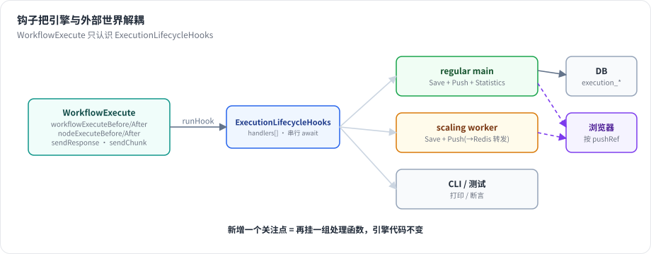

# 第 10 章 生命周期钩子与实时推送

> 本章目标：读完你能解释“引擎不知道数据库和浏览器”是如何靠钩子做到的，说清 n8n 的推送如何在单机、队列模式、多 main 下都把消息送到正确的浏览器标签页，并实现一个 SSE 推送。前置：第 3、9 章。对应代码：mini-n8n v0.2 的 `packages/core/src/execution-lifecycle-hooks.ts`、`packages/cli/src/execution-lifecycle-hooks.ts`、`packages/cli/src/push.ts`

## 1. 问题与概念

同一个引擎要在很多地方运行：

- 编辑器里的手动执行：要把每个节点的进度推给浏览器。
- 生产 Webhook / 定时任务：要写数据库、统计次数，不需要推送。
- 队列模式的 worker：没有浏览器连接，进度要转发给持有连接的 main 进程。
- 单元测试、CLI：什么都不要，或者打印到终端。

如果引擎里写死“执行完写数据库、推 WebSocket”，就没法复用。n8n 的做法是 **生命周期钩子**：引擎只在 4 个时刻（执行前后、节点前后）调用钩子，具体做什么由创建执行的那一方挂上去。



*图 10-1：引擎只认识 `ExecutionLifecycleHooks`。服务端按场景挂不同的处理函数组：regular main 挂“保存 + 推送 + 统计”，worker 挂“保存 + 通过 Redis 转发”，CLI 挂“打印”。*

推送的第二个问题是 **送给谁**。用户可能开了三个编辑器标签页，只有点击“执行”的那个标签页应该看到进度。n8n 用 `pushRef` 标识每个标签页的推送连接：前端连接时带上它，触发执行时在请求头里带上它，执行数据里记住它，钩子按它推送。

## 2. n8n 是怎么做的

### 2.1 钩子类

```ts
// packages/core/src/execution-engine/execution-lifecycle-hooks.ts:91-133（节选）
export class ExecutionLifecycleHooks {
	readonly handlers: ExecutionLifecycleHookHandlers = {
		nodeExecuteAfter: [],
		nodeExecuteBefore: [],
		nodeFetchedData: [],
		sendResponse: [],
		workflowExecuteAfter: [],
		workflowExecuteBefore: [],
		workflowExecuteResume: [],
		sendChunk: [],
	};
	...
	async runHook(hookName, parameters) {
		const hooks = this.handlers[hookName];
		for (const hookFunction of hooks) {
			...
			await typedHookFunction.apply(this, parameters);
		}
	}
}
```

整个类不到 140 行。几点设计：

- 处理函数 **串行 `await`**，按注册顺序执行。保存和推送的先后可控；代价是一个慢的处理函数会拖慢整个执行（所以推送是“发出即返回”，不等浏览器确认）。
- 处理函数里的 `this` 是钩子对象本身，可以拿到 `executionId`、`mode`、`workflowData`。
- 除了 4 个生命周期钩子，还有 3 个“通道”钩子：`sendResponse`（Respond to Webhook 节点回复 HTTP 请求）、`sendChunk`（流式响应，第 21 章）、`nodeFetchedData`（统计）。节点通过它们和外部通信，同样不需要知道外部是谁。

### 2.2 按场景组装

第 3 章看过 regular main 的组装函数。同一个文件里还有为 worker、队列模式的 main、子工作流准备的版本：

```text
packages/cli/src/execution-lifecycle/execution-lifecycle-hooks.ts
  getLifecycleHooksForSubExecutions()    子工作流
  getLifecycleHooksForScalingWorker()    队列模式 worker
  getLifecycleHooksForScalingMain()      队列模式 main
  getLifecycleHooksForRegularMain()      单进程（第 988 行）
```

它们只是把 `hookFunctionsSave`、`hookFunctionsPush`、`hookFunctionsSaveProgress`、`hookFunctionsStatistics` 等组合不同而已。例如 worker 上没有前端连接，但手动执行的进度仍要推给编辑器——worker 依然挂 `hookFunctionsPush`，由推送层决定通过 Redis 转发（见 2.4）。

### 2.3 推送层：一个接口，两种传输

`packages/cli/src/push/` 下：

| 文件 | 作用 |
|---|---|
| `abstract.push.ts` | 连接表（`pushRef → connection`）、`sendTo`、心跳 |
| `websocket.push.ts` | WebSocket 实现（默认） |
| `sse.push.ts` | Server-Sent Events 实现（`Content-Type: text/event-stream`，第 18 行） |
| `index.ts` | `Push` 服务：选择后端，决定直接发还是经 Redis 转发 |

```ts
// packages/cli/src/push/abstract.push.ts:79-94
private sendTo({ type, data }: PushMessage, pushRefs: string[], asBinary: boolean = false) {
	if (pushRefs.length === 0) return;
	...
	const stringifiedPayload = jsonStringify({ type, data }, { replaceCircularRefs: true });

	for (const pushRef of pushRefs) {
		const connection = this.connections[pushRef];
		assert(connection);
		this.sendToOneConnection(connection, stringifiedPayload, asBinary);
	}
}
```

消息是 `{ type, data }` 结构，类型定义在 `@n8n/api-types` 的 `push/` 目录下，前后端共享。WebSocket 是双向的（前端也能发消息，例如协作编辑的心跳）；SSE 只能服务端到客户端，但更简单、能穿过更多代理。

### 2.4 多进程：经 Redis 转发

```ts
// packages/cli/src/push/index.ts:180-188
send(pushMsg: PushMessage, pushRef: string, asBinary: boolean = false) {
	if (this.shouldRelayViaPubSub(pushRef)) {
		this.relayViaPubSub(pushMsg, pushRef, asBinary);
		return;
	}

	this.backend.sendToOne(pushMsg, pushRef, asBinary);
}
```

```ts
// packages/cli/src/push/index.ts:219-223
private shouldRelayViaPubSub(pushRef: string) {
	const { isWorker, isMultiMain } = this.instanceSettings;

	return isWorker || (isMultiMain && !this.hasPushRef(pushRef));
}
```

两种情况要转发：当前进程是 worker（没有任何浏览器连接）；或者有多个 main，而这个 `pushRef` 的连接在别的 main 上。转发就是往 Redis 的命令通道发布一条 `relay-execution-lifecycle-event`，每个 main 收到后检查自己是否持有这个 `pushRef`，持有就推送（第 225–233 行，`handleRelayExecutionLifecycleEvent`）。

转发路径还有个保护：`nodeExecuteAfterData` 太大（超过 `MAX_PUBSUB_PAYLOAD_BYTES`）时直接丢弃（第 244–259 行），因为前端已经从 `nodeExecuteAfter` 拿到了 item 数量，可以先显示占位，执行结束后再拉完整数据。第 3 章说的“推送拆成数量 + 数据两条”在这里体现出第二个好处：大数据可以安全丢弃。

### 2.5 前端

前端 `usePushConnection`（`packages/frontend/editor-ui/src/app/composables/usePushConnection/`）按 `type` 分发给 `handlers/` 下的处理函数。连接断开后自动重连；执行开始时如果连接还没建立，前端会在执行结束后通过 REST 拉取完整执行数据补上。

## 3. 从零实现

### 3.1 钩子

mini-n8n 的钩子类在 v0.1 就有了（`packages/core/src/execution-lifecycle-hooks.ts`），和 n8n 结构相同：处理函数数组、按顺序 `await`。

### 3.2 服务端的处理函数组

```ts
// code/mini-n8n/packages/cli/src/execution-lifecycle-hooks.ts（节选）
function hookFunctionsPush(hooks: ExecutionLifecycleHooks, push: Push, data: IWorkflowExecutionDataProcess) {
	const { pushRef } = data;
	if (!pushRef) return;
	const executionId = hooks.executionId;
	hooks.addHandler('workflowExecuteBefore', () => {
		push.send({ type: 'executionStarted', data: { executionId, workflowId: data.workflowData.id, mode: data.executionMode, startedAt: new Date().toISOString() } }, pushRef);
	});
	hooks.addHandler('nodeExecuteBefore', (nodeName) => {
		push.send({ type: 'nodeExecuteBefore', data: { executionId, nodeName } }, pushRef);
	});
	hooks.addHandler('nodeExecuteAfter', (nodeName, taskData) => {
		const itemCount = (taskData.data?.main ?? []).map((o) => o?.length ?? 0);
		push.send({ type: 'nodeExecuteAfter', data: { executionId, nodeName, itemCount, data: taskData } }, pushRef);
	});
	hooks.addHandler('workflowExecuteAfter', (run) => {
		if (run.status === 'waiting') push.send({ type: 'executionWaiting', data: { executionId } }, pushRef);
		else push.send({ type: 'executionFinished', data: { executionId, workflowId: data.workflowData.id, status: run.status } }, pushRef);
	});
}

export function getLifecycleHooksForRegularMain(data, executionId, deps): ExecutionLifecycleHooks {
	const hooks = new ExecutionLifecycleHooks(data.executionMode, executionId);
	hookFunctionsSave(hooks, deps.db, data);
	hookFunctionsPush(hooks, deps.push, data);
	return hooks;
}
```

没有 `pushRef`（生产执行）就不挂推送处理函数——和 n8n 的 `if (!pushRef) return;` 一样。

`WorkflowRunner.runMainProcess` 再额外挂一个 `sendResponse` 处理函数，把 Respond to Webhook 的回复交给等待中的 HTTP 请求（第 12 章）：

```ts
// code/mini-n8n/packages/cli/src/workflow-runner.ts（节选）
const hooks = getLifecycleHooksForRegularMain(data, executionId, { db, push });
hooks.addHandler('sendResponse', (response) => activeExecutions.resolveResponsePromise(executionId, response));
```

### 3.3 SSE 推送

```ts
// code/mini-n8n/packages/cli/src/push.ts（节选）
export class Push {
	private readonly connections = new Map<string, ServerResponse>();

	add(pushRef: string, res: ServerResponse) {
		this.connections.get(pushRef)?.end();
		this.connections.set(pushRef, res);
		res.writeHead(200, { 'content-type': 'text/event-stream', 'cache-control': 'no-cache', connection: 'keep-alive' });
		res.write(': connected\n\n');
		const heartbeat = setInterval(() => res.write(': ping\n\n'), 30_000);
		res.on('close', () => { ... });
	}

	/** Send to one tab (pushRef) or to all tabs */
	send(msg: PushMessage, pushRef?: string) {
		for (const l of this.listeners) l(msg, pushRef);
		const payload = `data: ${JSON.stringify(msg)}\n\n`;
		if (pushRef) this.connections.get(pushRef)?.write(payload);
		else for (const res of this.connections.values()) res.write(payload);
	}
}
```

SSE 协议非常简单：响应头 `text/event-stream`，每条消息是 `data: <文本>` 加一个空行；以冒号开头的行是注释，用作心跳，防止代理因为空闲断开连接。路由用 Fastify 的 `reply.hijack()` 接管原始响应：

```ts
// code/mini-n8n/packages/cli/src/server.ts（节选）
app.get('/rest/push', (req, reply) => {
	const { pushRef } = req.query as { pushRef?: string };
	if (!pushRef) return reply.code(400).send({ message: 'pushRef is required' });
	reply.hijack();
	push.add(pushRef, reply.raw);
});
```

`onMessage(listener)` 让测试不用开 HTTP 连接也能断言推送了什么。

| 方面 | n8n | mini-n8n |
|---|---|---|
| 钩子 | 8 种（含 `workflowExecuteResume`、`sendChunk`、`nodeFetchedData`） | 5 种（v0.4 加 `sendChunk`） |
| 传输 | WebSocket（默认）/ SSE | SSE |
| 节点完成消息 | `nodeExecuteAfter`（数量）+ `nodeExecuteAfterData`（数据，二进制帧） | 一条 `nodeExecuteAfter`，带数量和数据 |
| 多进程 | worker / 多 main 经 Redis 转发 | v1.0 实现 worker 转发 |
| 鉴权 | 推送连接需要登录 Cookie，按用户过滤 | v1.0 加入 |

## 4. 运行与验证

`examples/server-demo.sh` 第一步用 `curl -N` 打开一个 `pushRef=demo-tab` 的 SSE 连接，之后用同一个 `push-ref` 触发执行。最后打印这个“标签页”收到的消息（真实输出）：

```text
== 7. what the editor tab received over SSE
executionStarted
testWebhookReceived
nodeExecuteBefore    Webhook
nodeExecuteAfter     Webhook
nodeExecuteBefore    Total
nodeExecuteAfter     Total
executionFinished    success
workflowActivated
```

注意脚本里还有一次 **生产** Webhook 调用（第 5 步），它产生了执行，但这个标签页没有收到它的任何节点消息：生产执行没有 `pushRef`。`workflowActivated` 是广播消息（不带 `pushRef`），所有标签页都会收到。

单元测试断言了消息的精确顺序（`packages/cli/test/server.test.ts` 的第一个测试）：

```text
'executionStarted', 'nodeExecuteBefore', 'nodeExecuteAfter', 'nodeExecuteBefore', 'nodeExecuteAfter', 'executionFinished'
```

## 5. 练习

1. **巩固**：在浏览器开发者工具的控制台里执行 `new EventSource('/rest/push?pushRef=t1').onmessage = (e) => console.log(e.data)`，然后用 curl 带 `push-ref: t1` 触发一次执行，观察输出。
2. **扩展**：把推送拆成 n8n 的两条消息：`nodeExecuteAfter` 只带 `itemCount`，`nodeExecuteAfterData` 带数据；当数据超过 1 MB 时只发第一条，并在 `executionFinished` 后让客户端通过 `GET /rest/executions/:id` 拉取。
3. **读源码**：阅读 `packages/cli/src/push/websocket.push.ts`，找出它如何检测“死连接”（提示：ping / pong）。

## 6. 延伸阅读

- `packages/core/src/execution-engine/execution-lifecycle-hooks.ts`：钩子类。
- `packages/cli/src/push/`：推送层。
- `packages/@n8n/api-types/src/push/`：所有推送消息的类型定义。
- MDN：*Using server-sent events*。
