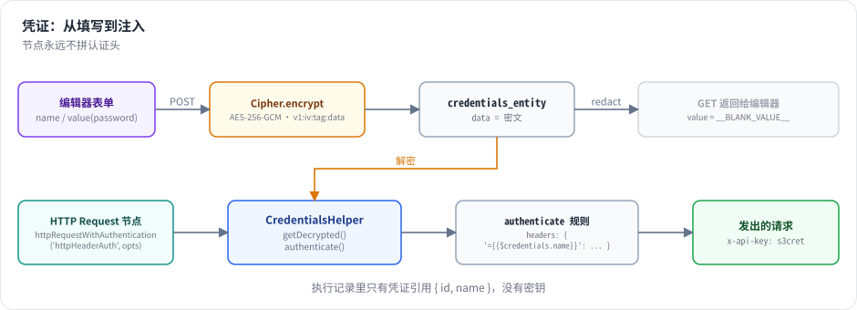

# 第 11 章 凭证：加密存储与注入

> 本章目标：读完你能说清 n8n 凭证从“用户填写”到“出现在 HTTP 请求头里”的完整路径，理解声明式认证、密钥轮换的信封加密，以及为什么节点代码永远看不到凭证的拼装方式。前置：第 5、9 章。对应代码：mini-n8n v0.2 的 `cipher.ts`、`credentials-helper.ts`、`nodes-base/src/credentials/`

## 1. 问题与概念

工作流要调用 GitHub、OpenAI、Slack……都需要密钥。凭证管理要满足几个互相拉扯的要求：

- **静态加密**：数据库泄露时，攻击者拿不到明文密钥。
- **不回显**：编辑器能修改凭证，但读接口不能把密码原样返回给浏览器。
- **不进运行数据**：执行记录会被保存、被分享给同事查看，里面不能出现密钥。
- **节点不关心认证细节**：500 个节点不应该各自实现“把 token 放进 `Authorization` 头”。
- **可轮换**：加密密钥本身也要能更换，而旧数据仍能解密。

n8n 的设计分成三层：

| 层 | 负责 | n8n 实现 |
|---|---|---|
| 凭证类型 | 声明“有哪些字段”“怎么放进请求” | `ICredentialType`（`packages/nodes-base/credentials/*.credentials.ts`） |
| 凭证实例 | 用户填写的值，加密存储 | `credentials_entity` + `Cipher` |
| 注入 | 运行时解密并套用到请求上 | `CredentialsHelper.getDecrypted()` / `authenticate()` |



*图 11-1：保存时加密进数据库；读取时把密码字段替换成占位符；执行时由服务端解密，按凭证类型的 `authenticate` 规则改写请求。节点只说“用 httpHeaderAuth”，它不拼请求头。*

## 2. n8n 是怎么做的

### 2.1 凭证类型：声明字段和认证规则

```ts
// packages/nodes-base/credentials/HttpHeaderAuth.credentials.ts（节选）
export class HttpHeaderAuth implements ICredentialType {
	name = 'httpHeaderAuth';
	displayName = 'Header Auth';
	...
	properties: INodeProperties[] = [
		{ displayName: 'Name', name: 'name', type: 'string', default: '' },
		{ displayName: 'Value', name: 'value', type: 'string', typeOptions: { password: true }, default: '' },
		...
	];

	authenticate: IAuthenticateGeneric = {
		type: 'generic',
		properties: {
			headers: {
				'={{$credentials.name}}': '={{$credentials.value}}',
			},
		},
	};
}
```

- `properties` 复用了节点参数的 `INodeProperties`，所以编辑器能用同一套组件渲染凭证表单。`typeOptions.password` 标记敏感字段。
- `authenticate` 是 **声明式** 的：键和值都是表达式，作用域里只有 `$credentials`。也可以写成函数，处理签名类认证（如 AWS SigV4）。

节点在 `description.credentials` 里声明自己接受哪些凭证类型（可以用 `displayOptions` 按“认证方式”参数切换），工作流 JSON 里节点的 `credentials` 字段只存 **引用**：

```json
"credentials": { "httpHeaderAuth": { "id": "SBx5mbAdpDnNBM07", "name": "GitHub token" } }
```

### 2.2 注入：authenticate

```ts
// packages/cli/src/credentials-helper.ts:139-198（节选）
async authenticate(credentials, typeName, incomingRequestOptions, workflow?, node?): Promise<IHttpRequestOptions> {
	const requestOptions = incomingRequestOptions;
	const credentialType = this.credentialTypes.getByName(typeName);

	if (credentialType.authenticate) {
		if (typeof credentialType.authenticate === 'function') {
			// Special authentication function is defined
			return await credentialType.authenticate(credentials, requestOptions as IHttpRequestOptions);
		}

		if (typeof credentialType.authenticate === 'object') {
			...
			if (authenticate.type === 'generic') {
				Object.entries(authenticate.properties).forEach(([outerKey, outerValue]) => {
					Object.entries(outerValue).forEach(([key, value]) => {
						keyResolved = this.resolveValue(key, { $credentials: credentials }, workflow, node);
						valueResolved = this.resolveValue(value as string, { $credentials: credentials }, workflow, node);
						...
						requestOptions[outerKey][keyResolved] = valueResolved;
```

节点里只需要一行 `this.helpers.httpRequestWithAuthentication.call(this, 'githubApi', options)`。认证逻辑集中在一处，修一个 bug 所有节点受益；更重要的是，**凭证类型可以限制自己能发往哪些域名**（`packages/workflow/src/credential-domain-restrictions.ts`），防止有人把 GitHub token 配到一个把请求转发到恶意服务器的节点上。

### 2.3 解密：getDecrypted

```ts
// packages/cli/src/credentials-helper.ts:568-620（节选）
async getDecrypted(additionalData, nodeCredentials, type, mode, executeData?, raw?, expressionResolveValues?, options?) {
	...
	const credentialsEntity = await this.getCredentialsEntity(nodeCredentials, type);
	...
	// Validate against the executing project's policy before any decryption happens.
	await this.policyEnforcementService.enforceCredentialDecrypt({ credentialType: type, credentialId: credentialsEntity.id, ... });

	const credentials = new Credentials({ id: credentialsEntity.id, name: credentialsEntity.name }, credentialsEntity.type, credentialsEntity.data, ...);
	...
	let decryptedDataOriginal = await credentials.getData();
```

解密之前先做 **策略检查**：这个项目能不能用这种凭证。`WorkflowRunner.run()` 在执行开始前还会调用 `credentialsPermissionChecker.check()`（`packages/cli/src/workflow-runner.ts:421`），确认工作流引用的每个凭证都被共享给了这个工作流的项目——否则任何人都能在自己的工作流里引用别人的凭证 ID（第 27 章）。

`getDecrypted` 之后还会 `applyDefaultsAndOverwrites`：填默认值，并应用 **凭证覆盖**（管理员可以为某种凭证类型预置值，例如统一的 OAuth Client ID）。

### 2.4 加密：信封加密与密钥轮换

`Credentials.getData()` 调用 `cipher.decryptV2()`（`packages/core/src/credentials.ts:55`）。根目录 `AGENTS.md` 明确规定：新代码只能通过 `encryptV2` / `decryptV2` 加解密，并用 ESLint 规则强制。原因在 `Cipher` 里：

```ts
// packages/core/src/encryption/cipher.ts:54-89（节选）
async encryptV2(data: string | object, customEncryptionKey?: string): Promise<string> {
	const plaintext = typeof data === 'string' ? data : JSON.stringify(data);
	...
	const keyInfo = await this.encryptionKeyProxy.getActiveKey();
	...
	const plaintextKey = this.decryptDEKWithInstanceKey(keyInfo.value);
	const ciphertext = this.encryptWithKey(plaintext, plaintextKey, keyInfo.algorithm as CipherAlgorithm);
	if (keyInfo.format === 'no-prefix') {
		return ciphertext;
	}
	return `${keyInfo.id}:${ciphertext}`;
}
```

这是 **信封加密**：

- 实例密钥（`N8N_ENCRYPTION_KEY`，首次启动时生成并存在 `~/.n8n/config`）只用来加密 **数据密钥**（DEK）。
- 数据用当前激活的 DEK 加密，密文前面加上 DEK 的 ID：`<keyId>:<ciphertext>`。
- 解密时按前缀找到对应 DEK（`decryptV2`，第 96 行起）；没有前缀的是老格式，用实例密钥直接解。

轮换时只需生成一个新的 DEK 并设为激活，新数据用新钥，旧数据仍能用旧钥解密。`AGENTS.md` 还特别强调：**部署密钥永远不能删除**，只能停用——删了，用它加密的数据就永远打不开了；数据库触发器会拒绝直接删除。

### 2.5 不回显

读取凭证给编辑器时，密码字段被替换成一个固定占位符：

```ts
// packages/workflow/src/constants.ts:35
export const CREDENTIAL_BLANKING_VALUE = '__n8n_BLANK_VALUE_e5362baf-c777-4d57-a609-6eaf1f9e87f6';
```

用户保存时，如果某个字段的值仍是这个占位符，服务端就保留原值。这样编辑器能修改其他字段，却永远拿不到旧密码。

### 2.6 OAuth2

OAuth2 凭证多了一段浏览器跳转：编辑器打开授权页 → 第三方回调 n8n 的 `/rest/oauth2-credential/callback` → n8n 用授权码换取 token，加密写入凭证的 `oauthTokenData` 字段。执行时，`requestOAuth2` 帮助函数自动带上 access token，过期时用 refresh token 刷新并写回数据库（`packages/core/src/execution-engine/node-execution-context/utils/request-helpers/authentication.ts`）。mini-n8n 不实现 OAuth2。

## 3. 从零实现

### 3.1 凭证类型

```ts
// code/mini-n8n/packages/nodes-base/src/credentials/index.ts（节选）
export const HttpHeaderAuth: ICredentialType = {
	name: 'httpHeaderAuth',
	displayName: 'Header Auth',
	properties: [
		{ displayName: 'Name', name: 'name', type: 'string', default: '', placeholder: 'Authorization' },
		{ displayName: 'Value', name: 'value', type: 'string', typeOptions: { password: true }, default: '' },
	],
	authenticate: { type: 'generic', properties: { headers: { '={{$credentials.name}}': '={{$credentials.value}}' } } },
};
```

还有 `httpBasicAuth`（`authenticate.properties.auth`）和 `httpQueryAuth`（`qs`）。HTTP Request 节点用一个 `authentication` 参数选择凭证类型，`description.credentials` 用 `displayOptions` 与之联动，执行时：

```ts
// code/mini-n8n/packages/nodes-base/src/nodes/HttpRequest.node.ts（节选）
// The credential is decrypted and applied by the server, the node never builds the header itself
if (authentication !== 'none') return await this.helpers.httpRequestWithAuthentication(authentication, request);
return await this.helpers.httpRequest(request);
```

### 3.2 加密

```ts
// code/mini-n8n/packages/cli/src/cipher.ts（节选）
encrypt(data: unknown): string {
	const iv = randomBytes(12);
	const cipher = createCipheriv('aes-256-gcm', this.key, iv);
	const encrypted = Buffer.concat([cipher.update(JSON.stringify(data), 'utf8'), cipher.final()]);
	return ['v1', iv.toString('base64'), cipher.getAuthTag().toString('base64'), encrypted.toString('base64')].join(':');
}
```

AES-256-GCM 自带完整性校验（auth tag），密文被篡改时解密直接失败。`v1:` 前缀为将来换算法或做轮换留了位置——和 n8n 的 `<keyId>:` 前缀是同一个思路。密钥来自 `MINI_N8N_ENCRYPTION_KEY`，没有就在用户目录生成并写入 `config` 文件（权限 `0600`）。

### 3.3 注入

`core` 不知道凭证存在哪里，只依赖一个接口：

```ts
// code/mini-n8n/packages/workflow/src/interfaces.ts（节选）
/** Implemented by the server (n8n: `CredentialsHelper` in packages/cli). */
export interface ICredentialsHelper {
	getDecrypted(details: INodeCredentialsDetails, type: string): Promise<ICredentialDataDecryptedObject>;
	authenticate(data: ICredentialDataDecryptedObject, type: string, options: IHttpRequestOptions): Promise<IHttpRequestOptions>;
}
```

服务端实现它，通过 `additionalData.credentialsHelper` 传给引擎：

```ts
// code/mini-n8n/packages/cli/src/credentials-helper.ts（节选）
async getDecrypted(details: INodeCredentialsDetails, type: string) {
	const entity = this.db.credentials.get(details.id);
	if (!entity) throw new UserError(`Credential with ID "${details.id}" does not exist for type "${type}"`);
	if (entity.type !== type) throw new UserError(`Credential "${entity.name}" is of type "${entity.type}", not "${type}"`);
	return this.cipher.decrypt<ICredentialDataDecryptedObject>(entity.data);
}

async authenticate(data, type, options) {
	const rule = this.credentialTypes.getByName(type).authenticate;
	if (!rule) return options;
	const out = { ...options, headers: { ...options.headers }, qs: { ...options.qs } };
	for (const [k, v] of Object.entries(rule.properties.headers ?? {})) out.headers![resolve(k, data)] = resolve(v, data);
	for (const [k, v] of Object.entries(rule.properties.qs ?? {})) out.qs![resolve(k, data)] = resolve(v, data);
	...
}
```

`resolve` 复用了第 6 章的 `evaluateCode`，作用域里只有 `$credentials`。

### 3.4 REST 接口里的不回显

```ts
// code/mini-n8n/packages/cli/src/server.ts（节选）
const redact = (type: string, data: IDataObject) => {
	const out: IDataObject = { ...data };
	for (const p of credentialTypes.getByName(type).properties) {
		if (p.typeOptions?.password && out[p.name]) out[p.name] = CREDENTIAL_BLANKING_VALUE;
	}
	return out;
};
...
// a blanked secret means "unchanged"
const merged = Object.fromEntries(Object.entries({ ...current, ...data }).map(([k, v]) => [k, v === CREDENTIAL_BLANKING_VALUE ? current[k] : v]));
```

| 方面 | n8n | mini-n8n |
|---|---|---|
| 算法 | AES-256-CBC（兼容老格式）等，信封加密 + 密钥 ID 前缀 | AES-256-GCM，单一密钥，`v1:` 前缀 |
| `authenticate` | 声明式（headers/qs/body/auth）或函数 | 声明式（headers/qs/auth） |
| 权限 | 凭证共享给项目 + 执行前检查 + 策略引擎 | v1.0 加入按用户隔离 |
| 域名限制 | 凭证类型可限制允许的域名 | 未实现 |
| OAuth2、凭证测试、覆盖、外部密钥库 | 有 | 无 |

## 4. 运行与验证

创建一个凭证，再读回来（真实输出）：

```bash
curl -s -X POST $B/rest/credentials -H 'content-type: application/json' \
  -d '{"name":"GitHub token","type":"httpHeaderAuth","data":{"name":"Authorization","value":"Bearer ghp_example123"}}'
curl -s $B/rest/credentials/SBx5mbAdpDnNBM07
```

```text
{"data":{"id":"SBx5mbAdpDnNBM07","name":"GitHub token","type":"httpHeaderAuth","createdAt":"2026-10-08T08:43:17.051Z","updatedAt":"2026-10-08T08:43:17.051Z","data":{"name":"Authorization","value":"__mini_n8n_BLANK_VALUE__"}}}
```

数据库里存的是（真实输出）：

```text
data: 'v1:qpFB4mEkdOVyhm6C:VUWcQ/mCbQN+i8M5K+ojuA==:P8rRhA6yARWfv1xGNlR0qs9nMCWDh/dAZ06+UGv9NTqXXNLyoF9zifAiru5lr+SA24W+PuY9SVU='
```

集成测试 `encrypts credentials at rest, redacts secrets and applies them to requests` 验证了完整链路：起一个本地 HTTP 服务记录收到的请求头 → 工作流里的 HTTP Request 节点引用凭证 → 执行后断言服务端收到了 `x-api-key: s3cret`，同时断言：数据库文件的二进制内容里找不到 `s3cret`，执行记录的 JSON 里也找不到。

## 5. 练习

1. **巩固**：创建一个 `httpBasicAuth` 凭证，用 HTTP Request 节点调用 `https://httpbin.org/basic-auth/user/pass` 验证。
2. **扩展**：给凭证类型增加 `test` 规则，实现 `POST /rest/credentials/test`：解密 → `authenticate` → 发出测试请求 → 返回 `{ status: 'OK' | 'Error', message }`。
3. **读源码**：阅读 `packages/workflow/src/credential-domain-restrictions.ts`，说明 n8n 如何阻止一个 GitHub 凭证被发往 `evil.example.com`。

## 6. 延伸阅读

- `packages/cli/src/credentials-helper.ts`：解密、默认值、覆盖、认证。
- `packages/core/src/encryption/`：`Cipher` 与 AES 实现；`packages/@n8n/eslint-config/src/configs/encryption-boundary.ts`：加密边界的 lint 规则。
- n8n 文档：*Credentials*、*Set a custom encryption key*。
