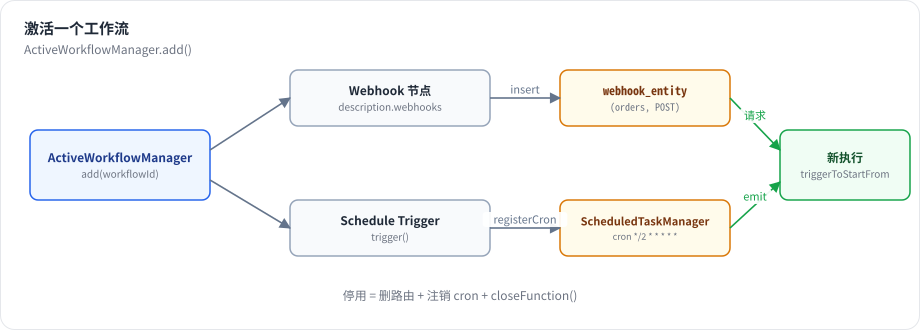
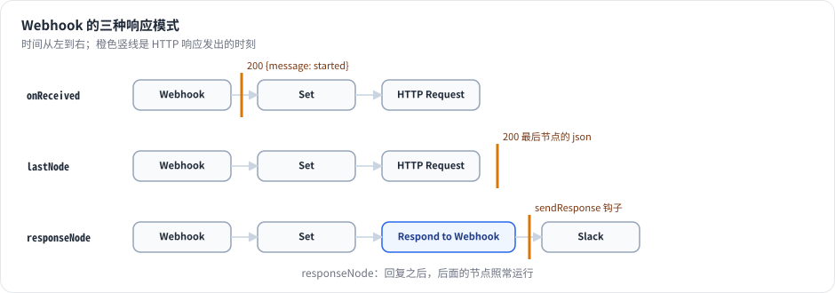

# 第 12 章 触发器：Webhook、Schedule 与激活

> 本章目标：读完你能说清“激活一个工作流”在服务端做了什么，Webhook 的测试模式和生产模式有何不同，三种响应模式如何决定 HTTP 请求何时返回，定时触发器如何在进程内、乃至集群里可靠地运行。前置：第 7、10 章。对应代码：mini-n8n v0.2 的 `webhooks/`、`active-workflow-manager.ts`、`Webhook.node.ts`、`ScheduleTrigger.node.ts`

## 1. 问题与概念

到目前为止，执行都是“点按钮”触发的。自动化平台真正的价值在于 **无人值守**：收到请求就跑、每天早上九点跑、新邮件到达就跑。

n8n 把“谁来启动执行”分成三类节点，对应 `INodeType` 的三个方法：

| 类型 | 方法 | 例子 | 激活时做什么 |
|---|---|---|---|
| Webhook 触发器 | `webhook()` | Webhook、Form、Chat Trigger、各种 SaaS 回调 | 在路由表里登记 `(path, method)` |
| 通用触发器 | `trigger()` | Schedule、MQTT、RabbitMQ、IMAP | 调用 `trigger()`，它注册定时器或监听器，通过 `emit` 启动执行 |
| 轮询触发器 | `poll()` | Gmail、Google Sheets 的“新行” | 按间隔调用 `poll()`，有新数据就启动执行 |

“激活”（n8n 2.x 的界面上叫“发布”）就是把这些都打开；“停用”就是全部关掉。



*图 12-1：激活时，Webhook 节点被写入 `webhook_entity`；trigger 节点的 `trigger()` 被调用，注册 cron 任务；之后每个请求或每次 `emit` 都启动一次新执行，起始数据就是请求内容或 emit 的数据。*

Webhook 还有两个特殊问题：

- **测试**。用户在编辑器里搭 Webhook 工作流时，需要先“听”一个真实请求，看看数据长什么样。但工作流还没激活。n8n 的答案是 **测试 Webhook**：点“执行”后临时注册一个 `/webhook-test/<path>`，只响应一次、2 分钟过期，执行进度推送到当前标签页。
- **响应时机**。调用方在等 HTTP 响应。是收到就回“已启动”？还是等工作流跑完把结果回给它？还是由工作流中间某个节点决定回什么？这就是 **响应模式**。

## 2. n8n 是怎么做的

### 2.1 Webhook 节点：只负责把请求变成 item

```ts
// packages/nodes-base/nodes/Webhook/Webhook.node.ts:324-364（节选）
const response: INodeExecutionData = {
	json: {
		headers: req.headers,
		params: req.params,
		query: req.query,
		body: req.body,
	},
	...
};
...
return {
	webhookResponse: options.responseData,
	workflowData: prepareOutput(response),
};
```

`webhook()` 返回的 `workflowData` 就是执行的起始数据。返回 `{}`（没有 `workflowData`）则不启动执行——例如认证失败、“仅当表达式为真时运行”不满足时（第 287–300 行）。节点 **没有 `execute`**：执行开始后，引擎在 `runNode` 里看到它是 webhook 节点，直接把输入（也就是请求数据）原样传出（`workflow-execute.ts:1495-1500`）。

节点的 `description.webhooks` 声明它需要的端点，`httpMethod`、`path`、`responseMode` 都是读参数的表达式。

### 2.2 三种响应模式

```ts
// packages/nodes-base/nodes/Webhook/description.ts:199-215
const responseModeOptions = [
	{ name: 'Immediately', value: 'onReceived', description: 'As soon as this node executes' },
	{ name: 'When Last Node Finishes', value: 'lastNode', description: 'Returns data of the last-executed node' },
	{ name: "Using 'Respond to Webhook' Node", value: 'responseNode', description: 'Response defined in that node' },
];
```



*图 12-2：onReceived 在执行开始时就回复；lastNode 等执行结束，用最后一个节点的输出回复；responseNode 在执行中途由 Respond to Webhook 节点通过 `sendResponse` 钩子回复，之后的节点继续运行。新版本还有第四种 streaming（第 21 章）。*

实现集中在 `executeWebhook()`（`packages/cli/src/webhooks/webhook-helpers.ts:958`）。responseNode 模式的关键是第 10 章的 `sendResponse` 钩子：`WorkflowRunner.runMainProcess` 挂上处理函数，把回复交给 `ActiveExecutions` 里等待的 Promise（`packages/cli/src/workflow-runner.ts:629-631`）：

```ts
lifecycleHooks.addHandler('sendResponse', (response) => {
	this.activeExecutions.resolveResponsePromise(executionId, response);
});
```

### 2.3 生产 Webhook：查表

```ts
// packages/cli/src/webhooks/live-webhooks.ts:88-117（节选）
async executeWebhook(request: WebhookRequest, response: Response, expectedNodeType?): Promise<IWebhookResponseCallbackData> {
	const httpMethod = request.method;
	const path = request.params.path;
	...
	const webhook = await this.findWebhook(path, httpMethod);
	...
	if (webhook.isDynamic) {
		const pathElements = path.split('/').slice(1);
		// extracting params from path
		webhook.webhookPath.split('/').forEach((ele, index) => {
			if (ele.startsWith(':')) {
				request.params[ele.slice(1)] = pathElements[index];
			}
		});
	}
	const { workflow: workflowData, publishedVersion } = await this.loadWebhookExecutionData(webhook.workflowId);
	const { nodes, connections, versionId } = publishedVersion;
```

几个要点：

- 路由表是数据库表 `webhook_entity`（主键 `(webhookPath, method)`，第 9 章），而不是进程内存。所以在队列模式下，**任何一个 webhook 进程** 都能处理请求，无需知道是哪个 main 激活了它。
- 支持动态路径：`user/:id/posts`，参数写进 `request.params`。
- 加载的是 **已发布版本**（`publishedVersion`）的节点和连接，而不是编辑器里正在改的草稿。

### 2.4 测试 Webhook

`TestWebhooks.needsWebhook()`（`packages/cli/src/webhooks/test-webhooks.ts:396`）在内存（以及多 main 时的 Redis）里登记注册信息，带上 `pushRef`、`destinationNode` 等，过期时间 `TEST_WEBHOOK_TIMEOUT`：

```ts
// packages/cli/src/constants.ts:129
export const TEST_WEBHOOK_TIMEOUT = 2 * Time.minutes.toMilliseconds;
```

请求到达 `/webhook-test/<path>` 后，执行模式是 `manual`，进度推到登记时的 `pushRef`，然后注销——每次点击只响应一次。第 3 章的 `executeManually` 返回 `{ waitingForWebhook: true }` 就是在这里登记的。

### 2.5 激活：ActiveWorkflowManager

`packages/cli/src/active-workflow-manager.ts` 的 `add()`（第 540 行）做两件事：

```ts
// packages/cli/src/active-workflow-manager.ts:150-187（节选）
async addWebhooks(workflow, additionalData, mode, activation, nodeIds?) {
	let webhooks = WebhookHelpers.getWorkflowWebhooks(workflow, additionalData, undefined, true);
	...
	for (const webhookData of webhooks) {
		...
		const webhook = this.webhookService.createWebhook({ workflowId: webhookData.workflowId, webhookPath: webhookData.path, node: node.name, method: webhookData.httpMethod }, node.webhookId);
		try {
			// `storeWebhook` registers the webhook atomically on the
			// (webhookPath, method) primary key and rejects a path already owned
			// by another workflow. ...
			await this.webhookService.storeWebhook(webhook);
			await this.webhookService.createWebhookIfNotExists(workflow, webhookData, mode, activation);
```

- Webhook：写入路由表；利用主键冲突检测“路径已被另一个工作流占用”（失败时抛 `WebhookPathTakenError`）。`createWebhookIfNotExists` 调用节点的 `webhookMethods`：很多 SaaS 触发器（如 GitHub Trigger）要在 **第三方** 那边注册回调地址，激活时创建、停用时删除。
- 触发器和轮询：`addTriggersAndPollers` 为每个 trigger/poll 节点调用 `trigger()` / 启动轮询，并把 `emit` 接到“启动一次执行”上（第 1110 行起）。

停用（`remove()`，第 985 行）反过来：删路由、关闭触发器（调用 `trigger()` 返回的 `closeFunction`）、删除第三方回调。

启动时 `init()`（第 103 行）重新激活所有已激活的工作流。

这个类的注释里有一句值得注意：“This legacy manager is slated for removal”。n8n 正在把激活迁移到基于“发布”的新路径（`packages/cli/src/workflows/publication/`）。

### 2.6 定时触发器

```ts
// packages/nodes-base/nodes/Schedule/ScheduleTrigger.node.ts:569-610（节选）
if (this.getMode() !== 'manual') {
	...
	for (const { interval, cronExpression, recurrence } of rules) {
		...
		this.helpers.registerCron(cron, (scheduledTime: Date) =>
			executeTrigger(recurrence, /* skipRecurrenceCheck= */ false, scheduledTime),
		);
	}
	return {};
} else {
	const manualTriggerFunction = async () => {
		...
		executeTrigger(recurrence, true);
	};
	return { manualTriggerFunction };
}
```

同一个 `trigger()`，激活时注册 cron，手动运行时返回 `manualTriggerFunction`（立即 emit 一次）。引擎手动运行触发器时，会调用 `trigger()`，再调用 `manualTriggerFunction`，等待第一次 `emit` 的数据作为节点输出（`packages/core/src/execution-engine/triggers-and-pollers.ts:98-122`）。

`registerCron` 背后是 `ScheduledTaskManager`。进程内的定时器有两个问题：进程重启时丢失；多 main 部署时每个 main 都会触发一次。前者由 `init()` 重新激活解决；后者 n8n 只让 **leader** main 运行触发器。更彻底的方案是新的 `@n8n/scheduler` 包，它的 README 开宗明义：

> Most schedulers keep their timers in memory ... This package takes a different approach: **write the work down before running it.**

先把每一次即将发生的运行写进共享的持久化存储，再从存储里取出执行，从而做到重启不丢、集群里“尽量只执行一次”。ScheduleTrigger 的 `emit` 第四个参数 `deduplicationKey`（`${workflowId}:${nodeId}:${scheduledTime}`）也是为此服务的：同一个计划时间只能产生一个执行。

## 3. 从零实现

### 3.1 节点

```ts
// code/mini-n8n/packages/nodes-base/src/nodes/Webhook.node.ts（节选）
webhooks: [
	{
		name: 'default',
		httpMethod: '={{$parameter["httpMethod"]}}',
		path: '={{$parameter["path"]}}',
		responseMode: '={{$parameter["responseMode"]}}',
	},
],
...
async webhook(this: IWebhookFunctions): Promise<IWebhookResponseData> {
	const req = this.getRequestObject();
	const responseData = this.getNodeParameter('responseData', '') as string;
	return {
		webhookResponse: responseData || undefined,
		workflowData: [[{ json: { headers: req.headers, params: req.params, query: req.query, body: req.body } }]],
	};
},
```

Schedule Trigger 把“每 N 秒/分/时”转成 6 段 cron 表达式，用 `croner` 库调度；Respond to Webhook 调用 `this.sendResponse(...)`。

### 3.2 读取 webhooks 描述

```ts
// code/mini-n8n/packages/cli/src/webhooks/webhook-helpers.ts（节选）
export function getWorkflowWebhooks(workflowData: IWorkflowDb, nodeTypes: NodeTypes): IWebhookData[] {
	...
	for (const hook of description.webhooks ?? []) {
		const evaluate = (v: string | undefined, fallback: string) =>
			String(v?.startsWith('=') ? evaluateDescriptionExpression(v, node.parameters) : (v ?? fallback));
		const path = evaluate(hook.path, '').replace(/^\/+|\/+$/g, '') || (node.webhookId ?? node.id);
		result.push({ node: node.name, httpMethod: evaluate(hook.httpMethod, 'GET').toUpperCase(), path, responseMode: ... });
	}
}
```

第 5 章为 `inputs` 引入的 `evaluateDescriptionExpression` 在这里又用上了。

### 3.3 executeWebhook：何时回复

```ts
// code/mini-n8n/packages/cli/src/webhooks/webhook-helpers.ts（节选）
const result = await nodeType.webhook!.call(context);
if (!result.workflowData) {
	return { reply: { statusCode: 200, body: result.webhookResponse ?? {} } };
}

const executionId = await deps.executionService.runWorkflow(workflowData, node.name, result.workflowData[0], mode, pushRef);
onExecutionStarted?.(executionId);
const responsePromise = webhook.responseMode === 'responseNode' ? deps.activeExecutions.attachResponsePromise(executionId) : undefined;

if (webhook.responseMode === 'onReceived') {
	return { executionId, reply: { statusCode: 200, body: result.webhookResponse ?? { message: 'Workflow was started' } } };
}

if (webhook.responseMode === 'responseNode') {
	const finished = deps.activeExecutions.getPostExecutePromise(executionId).then(() => undefined);
	const response = await Promise.race([responsePromise!, finished]);
	if (response) return { executionId, reply: toReply(response) };
	return { executionId, reply: { statusCode: 500, body: { message: 'Workflow finished without a "Respond to Webhook" node responding' } } };
}

// lastNode: wait for the end, answer with the first item of the last node
const run = await deps.activeExecutions.getPostExecutePromise(executionId);
...
```

`Promise.race` 处理了一个边界情况：工作流走了一条不经过 Respond to Webhook 的分支，执行结束了却没人回复——不能让调用方永远挂着。

### 3.4 激活

```ts
// code/mini-n8n/packages/cli/src/active-workflow-manager.ts（节选）
for (const webhook of webhooks) {
	const existing = db.webhooks.find(webhook.path, webhook.httpMethod);
	if (existing && existing.workflowId !== workflowId) {
		throw new UserError(`The URL path "${webhook.path}" (${webhook.httpMethod}) is already used by another active workflow`);
	}
	db.webhooks.insert({ workflowId, webhookPath: webhook.path, method: webhook.httpMethod, node: webhook.node });
}

for (const node of triggerNodes) {
	const response = await runTrigger(workflow, node, { executionId: '', credentialsHelper }, 'trigger', {
		scheduler: this.scheduler,
		emit: (data) => {
			// every emit = a new execution, started from this trigger with this data
			void executionService.runWorkflow({ ...workflowData, staticData: workflow.staticData }, node.name, data[0], 'trigger');
		},
		...
	});
	responses.push(response);
}
```

`runTrigger`（`packages/core/src/triggers-and-pollers.ts`）在手动模式下返回 `manualTriggerResponse`（第一次 emit 的数据），在激活模式下把 `emit` 接到“启动执行”上，和 n8n 的 `runTriggerFunction` 一致。

| 方面 | n8n | mini-n8n |
|---|---|---|
| 响应模式 | onReceived / lastNode / responseNode / streaming | 前三种（streaming 在 v0.4） |
| 动态路径 `:id` | 支持 | 不支持 |
| 第三方回调注册 `webhookMethods` | 支持 | 不支持 |
| 轮询触发器 `poll()` | 支持 | 不支持（练习） |
| 激活的版本 | 已发布版本，编辑不影响生产 | 当前版本；保存即重新激活 |
| 定时器 | 进程内 cron（leader）/ 持久化调度器 `@n8n/scheduler` | 进程内 cron |
| 测试 Webhook 注册 | 内存 + Redis（多 main） | 内存 |

## 4. 运行与验证

`examples/server-demo.sh` 依次：打开推送连接、创建 Webhook 工作流、手动运行（等待测试请求）、调用测试 Webhook、激活、调用生产 Webhook。真实输出：

```text
== 1. open a push connection (SSE) for tab "demo-tab"
== 2. create a workflow: Webhook -> Set
workflow id: oXP3CHFfIR1J7XYa
== 3. manual run: the editor would show "waiting for trigger event"
{"waitingForWebhook":true}
== 4. call the TEST webhook once
{"total":42}
== 5. activate, then call the PRODUCTION webhook
true
{"total":21}
== 6. executions of this workflow
2 webhook  success
1 manual   success
```

错误的 HTTP 方法（真实输出）：

```text
$ curl -s $B/webhook/orders
{"message":"This webhook is not registered for GET requests. Did you mean to make a POST request?"}
```

定时触发器由集成测试覆盖：激活一个“每秒”的工作流，等 2.3 秒，断言至少有 2 次 `mode: trigger` 的执行；停用后再等 1.2 秒，断言执行数不再增加。

```bash
npx vitest run packages/cli
```

```text
 ✓ packages/cli/test/server.test.ts (9 tests) 3769ms
   ✓ schedule trigger > starts executions on its own while the workflow is active  3517ms
```

## 5. 练习

1. **巩固**：搭一个 Webhook（responseNode）→ If → 两个 Respond to Webhook 的工作流，根据请求体里的 `vip` 字段返回不同状态码。
2. **扩展**：实现 `poll()` 支持：`description.polling = true` 的节点，激活时按 `pollInterval` 参数定时调用 `poll()`，返回非空数据时启动执行；用 `getWorkflowStaticData('node')` 记住“上次的游标”。
3. **读源码**：阅读 `packages/cli/src/webhooks/webhook-helpers.ts` 的 `executeWebhook`，找出 lastNode 模式下“响应哪个节点、哪个 item、哪个字段”可以由哪些参数配置。

## 6. 延伸阅读

- `packages/cli/src/webhooks/`：生产、测试、等待中（waiting）三类 Webhook。
- `packages/cli/src/active-workflow-manager.ts`、`packages/cli/src/workflows/publication/`：激活与发布。
- `packages/@n8n/scheduler/README.md`：持久化、集群安全的调度器设计。
