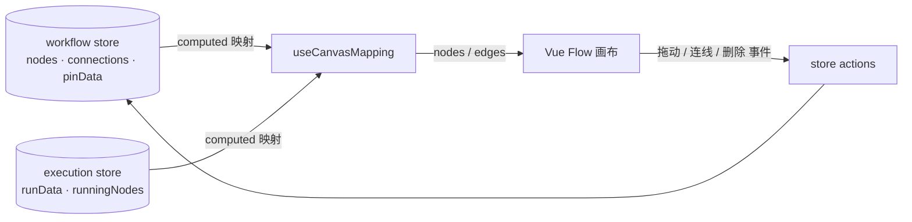
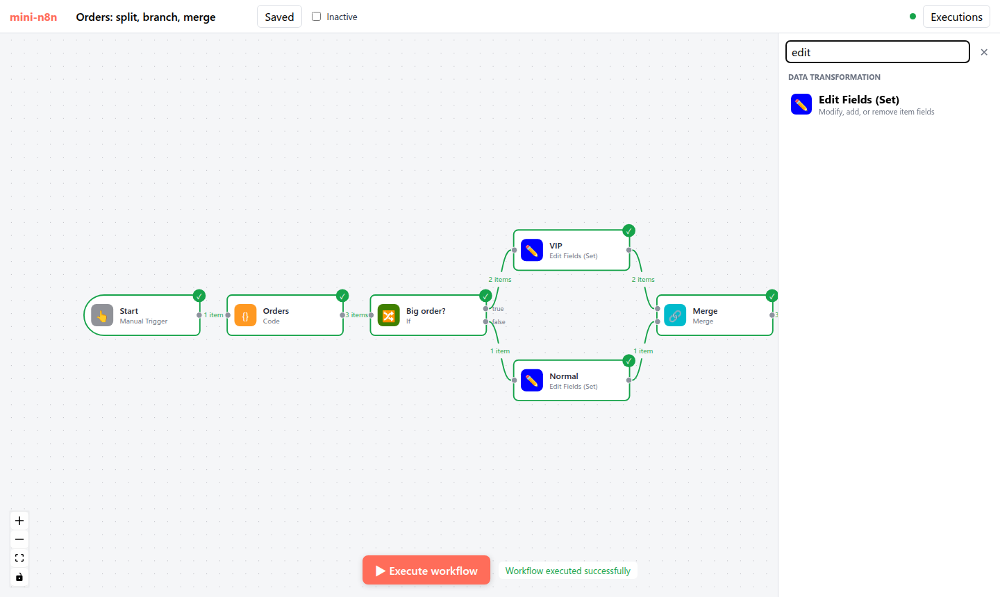

# 第 13 章 画布：Vue Flow 与工作流数据的映射

> 本章目标：读完你能解释 n8n 画布如何把“按名字索引的连接”映射成 Vue Flow 的节点和边，端口（handle）如何编码，拖拽、连线、删除如何变成对工作流数据的修改，并实现一个能编辑、能实时显示执行状态的画布。前置：第 4、10 章。对应代码：mini-n8n v0.3 的 `packages/editor/src/components/Canvas.vue`、`CanvasNode.vue`、`composables/useCanvasMapping.ts`、`stores/workflow.ts`

## 1. 问题与概念

画布是用户每天看得最多的界面，但它其实只是 **工作流数据的一个视图**。设计画布时最重要的一条原则是：**数据只有一份**，在 store 里；画布从 store 计算出来，用户的操作（拖动、连线、删除）变成对 store 的修改，再由 store 驱动画布更新。



两边的数据模型并不一样：

| | 工作流（n8n-workflow） | Vue Flow |
|---|---|---|
| 节点标识 | `name`（连接、表达式都用名字） | `id` |
| 连接 | `connections[源名][类型][输出号] = [{node: 目标名, type, index}]` | `edges = [{ source, target, sourceHandle, targetHandle }]` |
| 端口 | 由节点描述的 `inputs`/`outputs` 决定 | 节点组件里渲染的 `<Handle id=...>` |
| 状态 | 执行数据在另一个 store | 节点 `data` 里的任意字段 |

映射层负责双向翻译。图 13-1 是 mini-n8n v0.3 执行完订单工作流后的画布：


*图 13-1：mini-n8n v0.3 画布（headless Chrome 截图）。节点边框变绿表示成功，右上角对勾，边上标注每条连接传了几个 item；If 节点的两个输出标注了 true / false。*

## 2. n8n 是怎么做的

### 2.1 端口编码：`outputs/main/0`

n8n 把每个端口编码成一个字符串：

```ts
// packages/frontend/editor-ui/src/features/workflows/canvas/canvas.utils.ts:257-267
export function createCanvasConnectionHandleString({
	mode,
	type = NodeConnectionTypes.Main,
	index = 0,
}: {
	mode: 'inputs' | 'outputs';
	type?: NodeConnectionType;
	index?: number;
}) {
	return `${mode}/${type}/${index}`;
}
```

`mode` 是 `inputs` 或 `outputs`（`canvas.types.ts:32-35` 的 `CanvasConnectionMode`），`type` 是连接类型，`index` 是同类型端口的序号。有了这个编码，一条 Vue Flow 边的 `sourceHandle`/`targetHandle` 就完整描述了 n8n 的一条连接，可以无损地互相转换。

### 2.2 连接映射

```ts
// packages/frontend/editor-ui/src/features/workflows/canvas/canvas.utils.ts:132-177（节选）
export function mapLegacyConnectionsToCanvasConnections(legacyConnections: IConnections, nodes: INodeUi[]): CanvasConnection[] {
	const mappedConnections: CanvasConnection[] = [];
	const nodeIdByName = new Map(nodes.map((n) => [n.name, n.id]));

	Object.keys(legacyConnections).forEach((fromNodeName) => {
		const fromId = nodeIdByName.get(fromNodeName) ?? '';
		...
		fromConnectionTypes.forEach((fromConnectionType) => {
			const fromPorts = legacyConnections[fromNodeName][fromConnectionType];
			fromPorts?.forEach((toPorts, fromIndex) => {
				toPorts?.forEach((toPort) => {
					...
					const sourceHandle = createCanvasConnectionHandleString({ mode: CanvasConnectionMode.Output, type: fromConnectionType, index: fromIndex });
					const targetHandle = createCanvasConnectionHandleString({ mode: CanvasConnectionMode.Input, type: toConnectionType, index: toIndex });
```

函数名里的 “legacy” 很说明问题：`IConnections` 这种按名字索引、三层嵌套的格式是 n8n 早期就定下的，保存在数据库里的几十万个工作流都是这个格式，不能改。画布换成 Vue Flow 时，n8n 选择在前端加一层映射，而不是改数据格式。

### 2.3 节点映射

```ts
// packages/frontend/editor-ui/src/features/workflows/canvas/composables/useCanvasMapping.ts:152-208（节选）
const mappedNodes = computed<CanvasNode[]>(() => {
	const connectionsBySourceNode = connections.value;
	const connectionsByDestinationNode = workflowUtils.mapConnectionsByDestination(connectionsBySourceNode);
	...
	return nodes.value.map<CanvasNode>((node) => {
		...
		const data: CanvasNodeData = {
			id: node.id,
			name: node.name,
			subtitle: rd.subtitleByNodeId.get(node.id)?.value ?? '',
			type: node.type,
			disabled: node.disabled,
			connections: { [CanvasConnectionMode.Input]: inputConnections, [CanvasConnectionMode.Output]: outputConnections },
			issues: { validation: ..., visible: ... },
			execution: { status: executionSnapshot.status, waiting: ..., running: executionSnapshot.running },
			runData: { outputMap: ..., iterations: executionSnapshot.iterations, visible: !!runData },
			render: ...,
		};
		...
		return { id: node.id, label: getCanvasNodeLabel(node), type: 'canvas-node', position: applyOffset(node.position, offset), data, ... };
```

一个 `computed` 同时读工作流 store 和执行状态 store：节点参数一变、某个节点开始执行、某个节点出错，画布都会自动重算。边的 `label`（“3 items”）由 `getConnectionLabel()`（第 288 行）根据运行数据生成。

### 2.4 端口位置：main 在左右，AI 在上下

```ts
// packages/frontend/editor-ui/src/features/workflows/canvas/components/elements/nodes/CanvasNode.vue:225-247
const mainInputsMappingFn = createEndpointMappingFn({ mode: CanvasConnectionMode.Input, position: Position.Left, offsetAxis: 'top' });
const nonMainInputsMappingFn = createEndpointMappingFn({ mode: CanvasConnectionMode.Input, position: Position.Bottom, offsetAxis: 'left' });
const mainOutputsMappingFn = createEndpointMappingFn({ mode: CanvasConnectionMode.Output, position: Position.Right, offsetAxis: 'top' });
const nonMainOutputsMappingFn = createEndpointMappingFn({ mode: CanvasConnectionMode.Output, position: Position.Top, offsetAxis: 'left' });
```

数据从左往右流；AI 能力（模型、记忆、工具）从下往上“插”进 Agent。这就是第 1 章那张 Agent 图的视觉来源，也是第 16 章 Cluster Node 的画布表现。

### 2.5 受控画布：事件向上冒泡

```vue
<!-- packages/frontend/editor-ui/src/features/workflows/canvas/components/Canvas.vue:2046-2076（节选） -->
<VueFlow
	:id="id"
	:nodes="vueFlowNodes"
	:edges="connections"
	:apply-changes="false"
	...
	:delete-key-code="null"
	@connect="onConnect"
	@node-drag-stop="onNodeDragStop"
	...
>
```

`:apply-changes="false"` 让 Vue Flow **不要自己修改** 节点和边，只发事件。`Canvas.vue` 把事件包装后 `emit` 出去（例如 `onConnect` 发出 `create:connection`，第 1419–1424 行），由上层调用 `useCanvasOperations`（`packages/frontend/editor-ui/src/app/composables/useCanvasOperations.ts`）修改 store：

```ts
// packages/frontend/editor-ui/src/app/composables/useCanvasOperations.ts:2439-2465（节选）
function createConnection(connection: Connection, { trackHistory = false, ... } = {}) {
	const sourceNode = workflowDocumentStore.value.getNodeById(connection.source);
	const targetNode = workflowDocumentStore.value.getNodeById(connection.target);
	...
	const mappedConnection = mapCanvasConnectionToLegacyConnection(sourceNode, targetNode, connection);

	if (!isConnectionAllowed(sourceNode, targetNode, mappedConnection[0], mappedConnection[1])) {
		return;
	}
	if (workflowDocumentStore.value.hasConnection({ connection: mappedConnection })) return;
	...
	if (trackHistory) {
		historyStore.pushCommandToUndo(new AddConnectionCommand(mappedConnection, Date.now()));
	}
```

所有画布操作都集中在这里，带来两个好处：

- **校验集中**：`isConnectionAllowed` 检查类型是否匹配（`ai_tool` 输出不能连到 `main` 输入）、是否超过 `maxConnections` 等。
- **撤销/重做**：每个操作向 `history.store.ts` 推一个命令对象（`AddConnectionCommand`、`RemoveNodeCommand`、`RenameNodeCommand`……），撤销就是执行它的逆命令。

重命名节点（第 535 行 `renameNode`）也在这里，它调用 `Workflow.renameNode()`——不仅改连接，还会改写其他节点表达式里的 `$('旧名字')`。

## 3. 从零实现

### 3.1 工作流 store

```ts
// code/mini-n8n/packages/editor/src/stores/workflow.ts（节选）
function addConnection(source: ConnectionEnd, target: ConnectionEnd) {
	const byType = (connections.value[source.node] ??= {});
	const outputs = (byType[source.type] ??= []);
	while (outputs.length <= source.index) outputs.push([]);
	const list = (outputs[source.index] ??= []);
	const connection: IConnection = { node: target.node, type: target.type, index: target.index };
	if (list.some((c) => c.node === connection.node && c.index === connection.index && c.type === connection.type)) return;
	list.push(connection);
	dirty.value = true;
	markNodeDirty(target.node);
}

/** Rename a node and every place that refers to it by name (connections, pin data). */
function renameNode(oldName: string, newName: string) { ... }
```

store 直接以 n8n 的格式保存 `connections`，保存时原样 PATCH 给服务端。`markNodeDirty` 记录“上次运行后改过的节点”，第 15 章的部分执行要用。

### 3.2 映射

```ts
// code/mini-n8n/packages/editor/src/composables/useCanvasMapping.ts（节选）
/** Handle ids follow n8n: "outputs/main/0", "inputs/ai_tool/0" */
export const handleId = (mode: 'inputs' | 'outputs', type: string, index: number) => `${mode}/${type}/${index}`;

const edges = computed<Edge[]>(() => {
	const result: Edge[] = [];
	for (const [sourceName, byType] of Object.entries(workflow.connections)) {
		for (const [type, outputs] of Object.entries(byType)) {
			outputs.forEach((list, outputIndex) => {
				for (const c of list ?? []) {
					...
					const count = type === 'main' ? execution.runData[sourceName]?.at(-1)?.data?.main?.[outputIndex]?.length : undefined;
					result.push({
						id: `${sourceName}|${type}|${outputIndex}|${c.node}|${c.index}`,
						source, target,
						sourceHandle: handleId('outputs', type, outputIndex),
						targetHandle: handleId('inputs', c.type, c.index),
						label: count !== undefined ? `${count} item${count === 1 ? '' : 's'}` : undefined,
						class: type === 'main' ? (count ? 'edge-success' : '') : 'edge-ai',
						data: { sourceName, targetName: c.node, type, outputIndex, inputIndex: c.index },
					});
```

节点的状态（running / success / error / pinned / waiting）由执行 store 推导。端口列表来自 `normalizeConnectionList(description.inputs, node.parameters)`——第 5 章那个表达式字符串在浏览器里求值，所以 Agent 的端口会随参数变化（v0.4）。

### 3.3 节点组件

```vue
<!-- code/mini-n8n/packages/editor/src/components/CanvasNode.vue（节选） -->
<Handle v-for="{ item, pct } in mainInputs" :id="handleId('inputs', item.type, item.index)" type="target" :position="Position.Left" :style="{ top: pct }" />
<template v-for="{ item, i, pct } in mainOutputs" :key="`out-${item.index}`">
	<Handle :id="handleId('outputs', item.type, item.index)" type="source" :position="Position.Right" :style="{ top: pct }" />
	<span v-if="outputLabel(item, i)" class="handle-label out" :style="{ top: pct }">{{ outputLabel(item, i) }}</span>
</template>
<Handle v-for="{ item, pct } in aiInputs" ... :position="Position.Bottom" class="ai-handle" :style="{ left: pct }" />
<Handle v-for="{ item, pct } in aiOutputs" ... :position="Position.Top" class="ai-handle" :style="{ left: pct }" />
```

多个端口按 `(i+1)/(n+1)` 均匀分布。输出标签来自描述的 `outputNames`（If 的 true/false），或者 `onError: continueErrorOutput` 追加的 “Error” 输出。

### 3.4 画布事件 → store

```ts
// code/mini-n8n/packages/editor/src/components/Canvas.vue（节选）
/** Only same-type handles can be connected: main->main, ai_tool->ai_tool ... */
function isValidConnection(c: Connection) {
	if (!c.sourceHandle || !c.targetHandle || c.source === c.target) return false;
	return parseHandleId(c.sourceHandle).type === parseHandleId(c.targetHandle).type;
}

function onConnect(c: Connection) {
	if (!isValidConnection(c)) return;
	const source = parseHandleId(c.sourceHandle!);
	const target = parseHandleId(c.targetHandle!);
	workflow.addConnection(
		{ node: nameOf(c.source)!, type: source.type as NodeConnectionType, index: source.index },
		{ node: nameOf(c.target)!, type: target.type as NodeConnectionType, index: target.index },
	);
}
```

拖动结束（`node-drag-stop`）写回位置；按 Delete 删除时，Vue Flow 发出 `remove` 类型的变更，我们翻译成 `removeNode` / `removeConnection`。双击节点打开 NDV（第 14 章）。

### 3.5 添加节点

```ts
// code/mini-n8n/packages/editor/src/App.vue（节选）
/** Add a node right of the selected (or right-most) node and connect it, like n8n does */
function addNode(type: string) {
	const from = (selectedNode.value && workflow.nodesByName[selectedNode.value]) || [...workflow.nodes].sort((a, b) => b.position[0] - a.position[0])[0];
	const position: [number, number] = from ? [from.position[0] + 240, from.position[1]] : [0, 0];
	const node = workflow.addNode(type, position);
	if (from) { ...main 输出接 main 输入 }
	showCreator.value = false;
	openNode.value = node.name;
}
```

n8n 对应的是 `createConnectionToLastInteractedWithNode`（`useCanvasOperations.ts:1459`）：新节点自动接到“最后交互过的节点”后面，并立刻打开 NDV。新节点的参数由 `getNodeParameters(description.properties, {})` 填默认值，名字由 `uniqueName` 保证唯一（“Edit Fields”、“Edit Fields1”……）。



*图 13-2：节点创建面板（右侧），按 Triggers / AI / Flow / Data transformation / Actions 分组并支持搜索。*

| 方面 | n8n | mini-n8n |
|---|---|---|
| Vue Flow 模式 | 受控（`apply-changes=false`），事件交给 `useCanvasOperations` | 默认模式，删除/连线事件翻译成 store 动作 |
| 撤销/重做 | 命令模式 `history.store` | 无（练习） |
| 重命名 | 同时改写表达式里的 `$('旧名')` | 只改连接和 pin 数据 |
| 节点渲染 | 按类型渲染（默认节点、Sticky、Agent、配置节点……） | 一个通用组件，按状态换边框 |
| 其它 | 分组、对齐网格、自动布局、拖线时插入节点、复制粘贴 | 无 |

## 4. 运行与验证

```bash
cd code/mini-n8n && git checkout v0.3 && npm install
npm start                      # 构建编辑器并启动，打开 http://localhost:5678
npm run test:e2e               # 另一个终端：用 headless Chrome 操作编辑器
```

`e2e/editor.e2e.mjs` 和画布相关的断言（真实输出）：

```text
✓ canvas shows the 7 nodes of the workflow
✓ push connection (SSE) is open
✓ all nodes turn green after the run
✓ edges show item counts (1 item, 3 items, 2 items, 1 item, 2 items, 1 item, 3 items)
✓ new node: "Execute step" runs up to it and shows its output
✓ the new node and its connection were saved
```

最后两条验证了“画布操作 → store → 保存”的链路：脚本选中 Summary、用节点面板添加 Edit Fields，然后检查服务端保存的工作流里 `connections.Summary.main[0][0].node === 'Edit Fields'`。

## 5. 练习

1. **巩固**：在画布上把 If 的 false 输出改连到一个新的 No Operation 节点，保存后用 `GET /rest/workflows/:id` 查看 `connections` 的变化。
2. **扩展**：实现撤销/重做：为 `addNode`、`removeNode`、`addConnection`、`removeConnection` 各写一个命令对象（`do()` / `undo()`），用 Ctrl+Z / Ctrl+Shift+Z 触发。
3. **读源码**：阅读 n8n 的 `Workflow.renameNode()`（`packages/workflow/src/workflow.ts:384`）和 `renameNodeInParameterValue()`，说明它如何找出并改写参数里对旧节点名的引用，为什么要特别小心字符串里的引号。

## 6. 延伸阅读

- `packages/frontend/editor-ui/src/features/workflows/canvas/`：画布的全部组件和映射。
- `packages/frontend/editor-ui/src/app/composables/useCanvasOperations.ts`：所有画布操作。
- Vue Flow 文档：<https://vueflow.dev/>（受控流程、自定义节点、Handle）。
