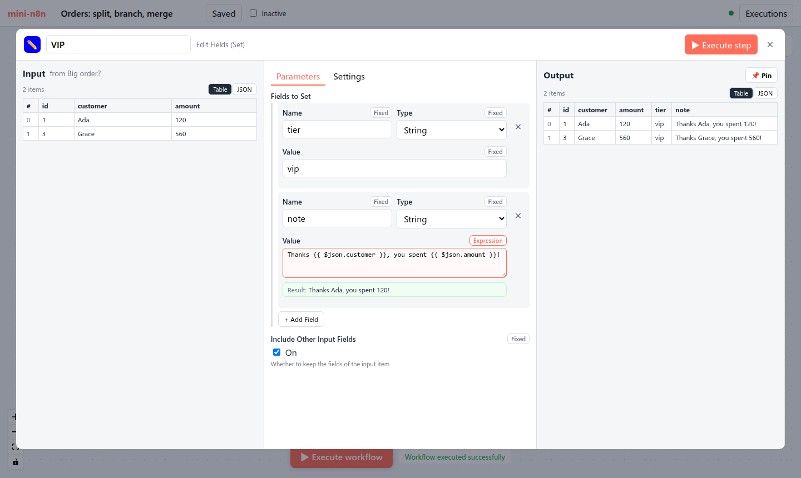
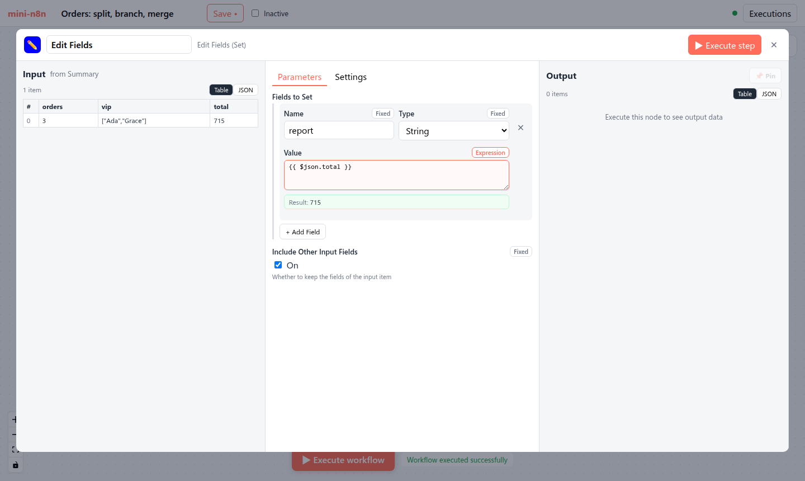

# 第 14 章 节点详情视图（NDV）：参数渲染与表达式编辑

> 本章目标：读完你能实现 n8n 的“输入 | 参数 | 输出”三栏节点面板：参数表单完全由节点描述生成，表达式在浏览器里用上次运行的数据实时预览，输入表格的列可以拖到参数上自动生成表达式。前置：第 5、6、13 章。对应代码：mini-n8n v0.3 的 `NodeDetailsView.vue`、`ParameterInput.vue`、`RunDataView.vue`、`composables/useNodeRunContext.ts`

## 1. 问题与概念

双击画布上的节点，打开的是 n8n 最核心的交互界面：**Node Details View（NDV）**。



*图 14-1：mini-n8n 的 NDV。左栏是输入（上游节点上次运行的输出），中栏是由节点描述生成的参数表单，右栏是本节点上次运行的输出。中栏第二个字段是表达式，下面绿色的 “Result” 是用左栏第一个 item 实时算出的结果。*

这个界面背后有三个关键设计：

1. **表单是数据驱动的**。500 个节点没有一个手写的表单组件，中栏全部由 `description.properties` 递归生成（第 5 章）。
2. **表达式在浏览器里求值**。预览用的是和服务端 **同一个** `n8n-workflow` 包、同一个 `WorkflowDataProxy`，喂给它的是上次执行的运行数据。所以预览结果和真正执行的结果一致。
3. **数据就在手边**。输入和输出摆在参数两边，用户能看着真实数据写表达式，还能直接把输入的字段拖到参数上。

## 2. n8n 是怎么做的

### 2.1 组件结构

| 组件 | 路径（`packages/frontend/editor-ui/src/features/ndv/`） | 作用 |
|---|---|---|
| `NodeDetailsView.vue` | `shared/views/` | 三栏容器，可拖动调整宽度 |
| `ParameterInputList.vue` | `parameters/components/` | 遍历 `properties`，按 `displayOptions` 决定显示哪些 |
| `ParameterInput.vue` | `parameters/components/` | 一个参数：按 `type` 渲染输入框 / 下拉 / 开关 / 代码编辑器 |
| `FixedCollectionParameter.vue` | `parameters/components/FixedCollection/` | 可重复的结构化行 |
| `NodeCredentials.vue` | `features/credentials/components/` | 节点的凭证选择 |
| `InlineExpressionEditorInput.vue` | `features/shared/editors/components/InlineExpressionEditor/` | 基于 CodeMirror 的表达式编辑器（语法高亮、自动补全） |

`ParameterInputList` 对每个参数调用 `shouldDisplayNodeParameter`（第 207、541 行），最终就是第 5 章的 `displayParameter`。还有一个 `disabledOptions`（第 199 行）：字段可见但不可编辑。

### 2.2 表达式预览：useResolvedExpression

```ts
// packages/frontend/editor-ui/src/app/composables/useResolvedExpression.ts:30-95（节选）
export function useResolvedExpression({ expression, additionalData, isForCredential, stringifyObject, contextNodeName }) {
	...
	const targetItem = computed(() => ndvStore.value.expressionTargetItem ?? undefined);
	const activeNode = computed(() => ndvStore.value.activeNode);
	...
	async function resolve(ctx?: ExpressionLocalResolveContext): Promise<Result<unknown, Error>> {
		...
		const options = ctx ?? {
			isForCredential: toValue(isForCredential),
			additionalKeys: toValue(additionalData),
			contextNodeName: toValue(contextNodeName),
			...(contextNodeName === undefined && ndvStore.value.isInputParentOfActiveNode
				? {
						targetItem: targetItem.value ?? undefined,
						inputNodeName: ndvStore.value.ndvInputNodeName,
						inputRunIndex: ndvStore.value.ndvInputRunIndex,
						inputBranchIndex: ndvStore.value.ndvInputBranchIndex,
					}
				: {}),
		};
		try {
			const resolvedValue = (await resolveExpression(expressionString, undefined, options, toValue(stringifyObject) ?? true)) as unknown;
			return createResultOk(resolvedValue);
		} catch (error) {
			return createResultError(error);
		}
	}
```

`targetItem` 很有意思：用户在左栏把鼠标悬停在第 3 个 item 上，预览就切换成用第 3 个 item 计算。`inputNodeName` / `inputRunIndex` / `inputBranchIndex` 对应左栏顶部的“选择哪个上游节点、哪次运行、哪个分支”。

最终落到 `resolveParameter()`：

```ts
// packages/frontend/editor-ui/src/app/composables/useWorkflowHelpers.ts:77-116（节选）
export async function resolveParameter<T = IDataObject>(parameter, workflowDocumentId, opts_ = {}): Promise<T | null> {
	...
	const workflowObject = workflowDocumentStore.getWorkflowObjectAccessorSnapshot();
	const executionData = useWorkflowExecutionStateStore(workflowDocumentId).activeExecution as IExecutionResponse | null;
	const pinData = workflowDocumentStore.getPinDataSnapshot();
	let itemIndex = opts?.targetItem?.itemIndex || 0;
	...
	const additionalKeys: IWorkflowDataProxyAdditionalKeys = {
		$execution: {
			id: PLACEHOLDER_FILLED_AT_EXECUTION_TIME,
			mode: 'test',
			resumeUrl: PLACEHOLDER_FILLED_AT_EXECUTION_TIME,
			...
```

它拿到工作流对象（`Workflow` 实例）、当前的执行数据、pin 数据，然后调用 `workflowObject.expression.getParameterValue(...)`——和服务端 `ExecuteContext.getNodeParameter()` 调用的是同一个方法。只有运行时才知道的值（执行 ID、恢复 URL）用占位符 `PLACEHOLDER_FILLED_AT_EXECUTION_TIME` 显示。

### 2.3 拖拽映射

在左栏拖动一个字段，放到参数上，n8n 会生成对应的表达式：

```ts
// packages/frontend/editor-ui/src/app/utils/mappingUtils.ts:33-67（节选）
export function getMappedExpression({ nodeName, distanceFromActive, path, binaryMode }) {
	const root = getNodeParentExpression({ nodeName, distanceFromActive, binaryMode });
	if (typeof path === 'string') {
		return `{{ ${root}${path} }}`;
	}
	return `{{ ${generatePath(root, path)} }}`;
}

export function getNodeParentExpression({ nodeName, distanceFromActive, binaryMode }) {
	const path = binaryMode === BINARY_MODE_COMBINED ? ['item'] : ['item', 'json'];
	const immidiateParent = binaryMode === BINARY_MODE_COMBINED ? '$item' : '$json';

	return distanceFromActive === 1
		? immidiateParent
		: generatePath(`$('${escapeMappingString(nodeName)}')`, path);
}
```

拖的是直接上游的字段，生成 `{{ $json.total }}`；拖的是更远祖先的字段，生成 `{{ $('Webhook').item.json.body.total }}`——第 6 章的 paired item 回溯就是为这种表达式准备的。

## 3. 从零实现

### 3.1 递归的参数组件

```vue
<!-- code/mini-n8n/packages/editor/src/components/ParameterInput.vue（节选） -->
<template v-else-if="property.type === 'string'">
	<textarea v-if="property.typeOptions?.editor === 'code' || (property.typeOptions?.rows ?? 1) > 1" class="code" ... />
	<input v-else :type="property.typeOptions?.password ? 'password' : 'text'" ... />
</template>
<input v-else-if="property.type === 'number'" type="number" ... />
<label v-else-if="property.type === 'boolean'" class="switch">...</label>
<select v-else-if="property.type === 'options'" ...>...</select>
<div v-else-if="property.type === 'collection'" class="collection">
	<div v-for="option in collectionOptions.filter((o) => o.name in collectionValue)" :key="option.name" class="row">
		<ParameterInput :property="option" :model-value="collectionValue[option.name]" @update:model-value="setCollection(option.name, $event)" />
		...
	</div>
	<select v-if="missingOptions.length" class="add" @change="addCollection">...</select>
</div>
<div v-else-if="property.type === 'fixedCollection'" class="fixed-collection">
	<div v-for="group in groups" :key="group.name">
		<div v-for="(row, index) in fixedValue[group.name] ?? []" :key="index" class="fc-row">
			<template v-for="sub in group.values" :key="sub.name">
				<ParameterInput v-if="displayParameter(row, sub)" :property="sub" :model-value="row[sub.name]" @update:model-value="updateRow(group, index, sub.name, $event)" />
			</template>
			...
```

组件自己调用自己：`collection` 的每个选项、`fixedCollection` 每一行的每个子字段，都还是一个 `ParameterInput`。`displayOptions` 在每一层都生效（行内字段按行内的值判断）。

参数的值是一棵 JSON 树，修改时组件不直接改，而是 `emit('update:modelValue', 新值)` 一路冒泡到 NDV，由 `workflow.setParameters()` 统一写回 store——它会再跑一次 `getNodeParameters()`，处理默认值和被隐藏的字段。

### 3.2 Fixed / Expression 切换

每个参数右上角有一个开关：

```ts
// code/mini-n8n/packages/editor/src/components/ParameterInput.vue（节选）
const isExpression = computed(() => typeof props.modelValue === 'string' && props.modelValue.startsWith('='));
const canBeExpression = computed(() => !props.property.noDataExpression && !['collection', 'fixedCollection', 'notice'].includes(props.property.type));

function toggleExpression() {
	if (isExpression.value) emit('update:modelValue', (props.modelValue as string).slice(1));
	else emit('update:modelValue', `=${...当前值转成字符串}`);
}
```

“是不是表达式”就是第 6 章的规则：值是以 `=` 开头的字符串。所以切换开关只是在值前面加或去掉一个 `=`。数字、布尔、下拉框也能切换成表达式——这就是为什么节点里取参数一律要过 `getNodeParameter`，不能假设类型。

### 3.3 在浏览器里预览表达式

```ts
// code/mini-n8n/packages/editor/src/composables/useNodeRunContext.ts（节选）
/** The node + output that feeds main input 0 */
const parent = computed(() => { ...在 connections 里找连到本节点输入 0 的节点和输出号 });

const inputItems = computed<INodeExecutionData[]>(() => {
	if (!parent.value) return [];
	const run = execution.runData[parent.value.node]?.at(-1);
	return run?.data?.main?.[parent.value.outputIndex] ?? workflow.pinData[parent.value.node] ?? [];
});

function preview(value: string, itemIndex = 0): { ok: boolean; text: string } {
	try {
		const definition = JSON.parse(JSON.stringify(workflow.toJSON())) as IWorkflowBase;
		const wf = new Workflow({ ...definition, id: workflow.id, nodeTypes: nodeTypes.browserNodeTypes, pinData: definition.pinData });
		const result = wf.expression.resolveSimpleParameterValue(value, context(itemIndex));
		return { ok: true, text: typeof result === 'object' && result !== null ? JSON.stringify(result) : String(result) };
	} catch (error) {
		return { ok: false, text: (error as Error).message };
	}
}
```

`context(itemIndex)` 构造的 `IExpressionContext` 和服务端引擎构造的一模一样：运行数据、当前节点名、`connectionInputData`（左栏的 items）、`executeData.source`（来自哪个父节点的哪个输出、哪次运行）。所以 `$('Users').item` 的 paired item 回溯在预览里同样成立。

浏览器里需要一个 `INodeTypes` 来构造 `Workflow`。浏览器没有节点代码，只有服务端通过 `/rest/node-types` 发来的描述，于是 `nodeTypes` store 提供一个只含 `description` 的实现：

```ts
// code/mini-n8n/packages/editor/src/stores/nodeTypes.ts（节选）
/** An INodeTypes good enough for `new Workflow(...)` in the browser (expressions, defaults) */
const browserNodeTypes = computed<INodeTypes>(() => ({
	getByNameAndVersion: (name: string) => {
		const description = byName.value[name];
		if (!description) throw new Error(`Unknown node type ${name}`);
		return { description } as INodeType;
	},
	...
}));
```

预览函数通过 Vue 的 `provide('expressionPreview', ...)` 交给任意深度的 `ParameterInput`。

### 3.4 拖拽映射

```ts
// code/mini-n8n/packages/editor/src/components/RunDataView.vue（节选）
/** Dragging a column header gives the expression that reads it (n8n: getMappedExpression) */
function onDragStart(event: DragEvent, column: string) {
	const path = /^[A-Za-z_$][\w$]*$/.test(column) ? `.${column}` : `['${column.replace(/'/g, "\\'")}']`;
	event.dataTransfer?.setData('text/plain', `{{ $json${path} }}`);
}
```

```ts
// code/mini-n8n/packages/editor/src/components/ParameterInput.vue（节选）
/** Drop a mapped field: switch to expression mode and append "{{ $json.x }}" */
function onDrop(event: DragEvent) {
	const text = event.dataTransfer?.getData('text/plain');
	if (!text || !canBeExpression.value) return;
	event.preventDefault();
	const current = isExpression.value ? (props.modelValue as string).slice(1) : String(props.modelValue ?? '');
	emit('update:modelValue', `=${current}${text}`);
}
```

列名不是合法标识符时（例如 `Readable date`），生成 `$json['Readable date']`。mini-n8n 只映射直接上游，所以总是 `$json`。



*图 14-2：把左栏 `total` 列拖到 Value 参数上，参数自动切换为表达式 `{{ $json.total }}`，预览显示 715。*

### 3.5 Webhook URL 与凭证

带 `webhooks` 描述的节点，NDV 顶部显示测试和生产 URL（用 `evaluateDescriptionExpression` 算出路径，见第 12 章的 `ss-15-waiting-webhook.png`）。带 `credentials` 描述的节点，显示凭证选择器，可以就地新建凭证：表单字段同样由凭证类型的 `properties` 用 `ParameterInput` 渲染。节点只保存 `{ id, name }` 引用（第 11 章）。

| 方面 | n8n | mini-n8n |
|---|---|---|
| 表达式编辑器 | CodeMirror：高亮、`$json.` 自动补全、函数提示 | `<textarea>` |
| 预览数据 | 可选上游节点、运行、分支、悬停的 item | 输入 0 的父节点、最后一次运行、item 0 |
| 拖拽映射 | 表格 / JSON / Schema 视图，任意深度字段，任意祖先 | 表格列头，直接上游 |
| 参数类型 | 20 多种（resourceLocator、filter、assignmentCollection、credentialsSelect…） | 8 种 |
| 布局 | 三栏可拖动、可折叠，输入栏可切换显示对象 | 固定三栏 |

## 4. 运行与验证

`e2e/editor.e2e.mjs` 里和 NDV 相关的断言（真实输出）：

```text
✓ expression preview uses the input of the last run: "Result: Thanks Ada, you spent 120!"
✓ preview updates while typing: "Result: Hi ADA (240)"
✓ drag & drop mapping wrote "{{ $json.total }}" (preview: Result: 715)
```

第二条：脚本把表达式改成 `Hi {{ $json.customer.toUpperCase() }} ({{ $json.amount * 2 }})`，**不用执行**，预览就已经是 `Hi ADA (240)`。这是因为预览完全在浏览器里计算。


*图 14-3：修改 note 字段的表达式后，预览立即更新为 “Hi ADA (240)”；右栏输出仍是上次运行的旧结果，点 Execute step 才会更新。*

## 5. 练习

1. **巩固**：给 HTTP Request 节点的 URL 参数写一个表达式 `https://httpbin.org/anything/{{ $json.id }}`，观察预览；再把 Method 切换成 Expression 模式，写 `{{ $json.amount > 100 ? 'POST' : 'GET' }}`。
2. **扩展**：让预览支持“选择 item”：在左栏表格行上悬停时，把该行下标传给 `preview(value, itemIndex)`。
3. **读源码**：阅读 n8n 的 `InlineExpressionEditorInput.vue` 及其 CodeMirror 扩展，找出 `$json.` 后面的自动补全候选项是从哪里来的（提示：上游节点的运行数据和 schema）。

## 6. 延伸阅读

- `packages/frontend/editor-ui/src/features/ndv/`：NDV 的全部组件和 store。
- `packages/frontend/editor-ui/src/app/composables/useWorkflowHelpers.ts`：`resolveParameter`、`resolveExpression`。
- n8n 文档：*Data mapping in the UI*。
