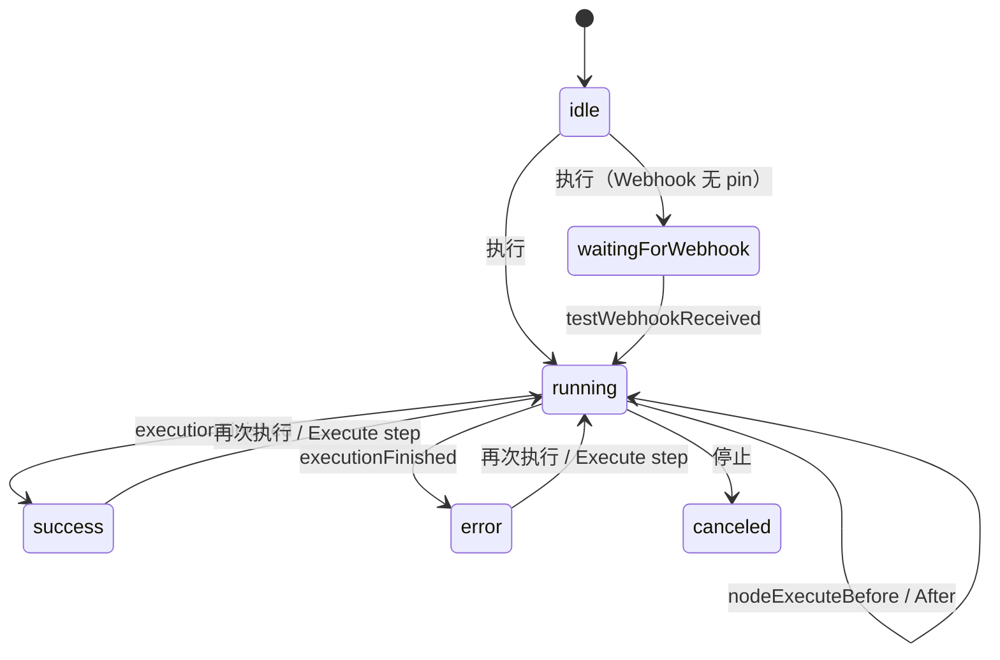
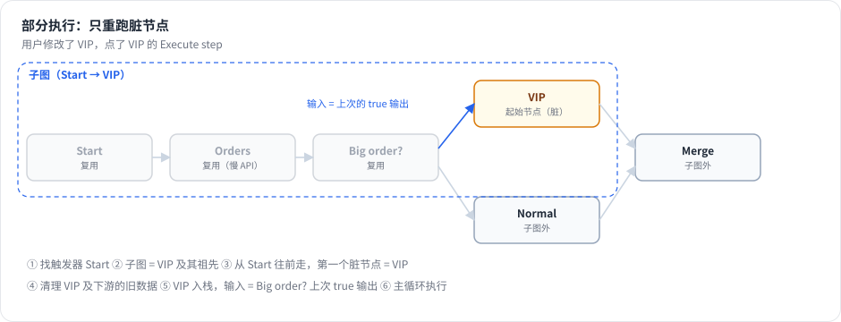
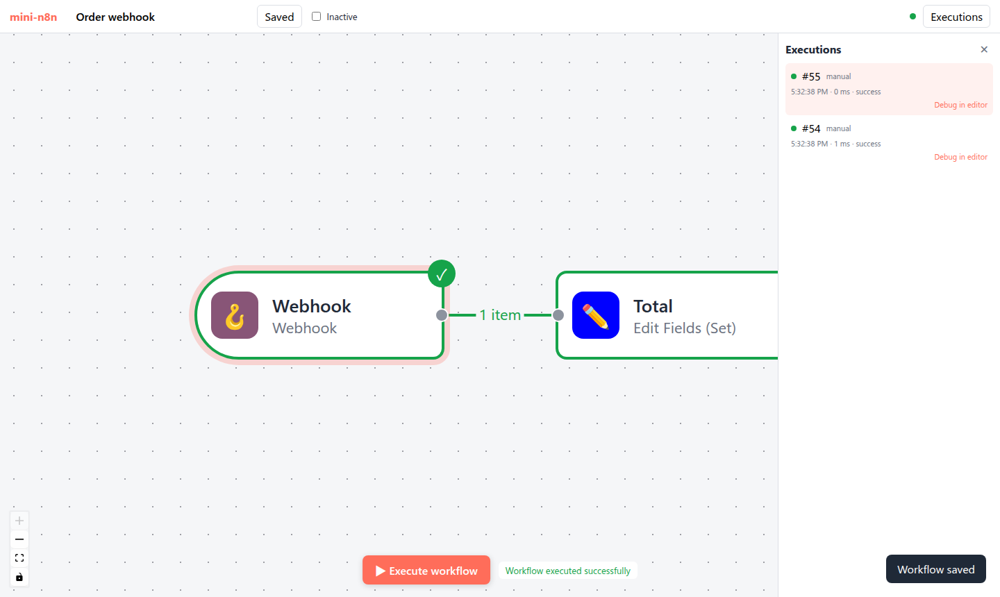

# 第 15 章 运行与调试：实时状态、Pin 数据与部分执行

> 本章目标：读完你能说清编辑器里“点执行 → 节点逐个变绿”背后的状态流转，理解 Pin 数据为什么能让开发不依赖外部系统，并实现 n8n 的部分执行（只重跑改过的节点）和 “Debug in editor”（把一次生产执行的真实输入搬进编辑器重放）。前置：第 7、10、14 章。对应代码：mini-n8n v0.3 的 `stores/execution.ts`、`stores/push.ts`、`packages/core/src/partial-execution.ts`

## 1. 问题与概念

搭工作流的过程其实是不断地“改一点、跑一下、看结果”。好的调试体验要解决几个问题：

- **看得见**：哪个节点在跑、跑完输出了几条、哪个节点失败了、失败原因是什么。
- **跑得快**：工作流前面有一个慢 API 调用（或者要花钱的 LLM 调用），只改了最后一个节点，不应该从头再跑一遍。
- **不依赖外部**：Webhook 触发的工作流，每次调试都要真的发一个请求吗？上游 API 今天挂了，还能继续开发下游吗？
- **能复现**：生产环境凌晨三点失败了一次，能不能拿那次的真实输入在编辑器里重现？

n8n 的四个答案：**推送驱动的执行状态**、**部分执行**、**Pin 数据**、**Debug in editor**。



## 2. n8n 是怎么做的

### 2.1 执行状态在前端怎么流转

第 3、10 章已经看过推送消息的来源。前端每个处理函数只做一件小事，例如 `nodeExecuteAfter` 先用 item 数量填占位数据，让节点立即变绿、边上立即显示 “3 items”；`nodeExecuteAfterData` 再换成真实数据（`packages/frontend/editor-ui/src/app/composables/usePushConnection/handlers/nodeExecuteAfter.ts`）。所有状态集中在 `workflowExecutionState.store.ts`，画布的 `useCanvasMapping` 和 NDV 都只读这个 store。

处理函数开头都有一个检查：

```ts
// packages/frontend/editor-ui/src/app/composables/usePushConnection/handlers/nodeExecuteAfter.ts:23-30（节选）
// Ignore node events that don't belong to the execution this document is
// tracking — a concurrent execution's node must not write into this
// document's data or fire its side effects (form popups, tracking, assistant).
const activeExecutionId = workflowExecutionStateStore.activeExecutionId;
if (activeExecutionId !== pushData.executionId) {
	return;
}
```

同一个标签页可能有多个执行的消息到达（例如上一次执行还没结束就又点了执行），只处理当前跟踪的那个。

### 2.2 Pin 数据

Pin 数据是 **保存在工作流里的、某个节点的固定输出**（`workflow.pinData[节点名] = items`）。引擎遇到被 pin 的节点，不执行它，直接用 pin 的数据作为输出：

```ts
// packages/core/src/execution-engine/workflow-execute.ts:1852-1860（节选）
/** The pinned output of a node, or undefined if the node has none. */
private getPinnedOutput(node: INode): INodeExecutionData[][] | undefined {
	const { pinData } = this.runExecutionData.resultData;
	if (!pinData || node.disabled || pinData[node.name] === undefined) {
		return undefined;
	}
	return [pinData[node.name]]; // always zeroth runIndex
}
```

几个约束：

- **只在手动执行时生效**。`WorkflowRunner` 只给手动执行传 `pinData`，生产执行永远真实运行。所以 pin 数据可以放心地留在工作流里。
- **有大小上限**。前端 `usePinnedData.isValidSize()`（`packages/frontend/editor-ui/src/app/composables/usePinnedData.ts:175`）检查 `MAX_PINNED_DATA_SIZE`，因为 pin 数据跟着工作流一起保存、一起加载。
- **Webhook 被 pin 后不再等待请求**。第 3 章的 `executeManually` 里有 `triggerHasNoPinnedData(...)` 的判断：有 pin 数据就直接执行。

### 2.3 部分执行

用户点某个节点的 “Execute step”，前端发送 `destinationNode`、上次的 `runData` 和 `dirtyNodeNames`（改过的节点，`useRunWorkflow.ts:406`）。后端走 `runPartialWorkflow2`：

```ts
// packages/core/src/execution-engine/workflow-execute.ts:282-339（节选）
// 1. Find the Trigger
let trigger = findTriggerForPartialExecution(workflow, destinationNode.nodeName, runData);
...
// 2. Find the Subgraph
const filteredGraph = filterDisabledNodes(graph);
...
graph = findSubgraph({ graph: filteredGraph, destination, trigger });
const filteredNodes = graph.getNodes();

// 3. Find the Start Nodes
const dirtyNodes = graph.getNodesByNames(dirtyNodeNames);
runData = cleanRunData(runData, graph, dirtyNodes);
let startNodes = findStartNodes({ graph, trigger, destination, runData, pinData });

// 4. Detect Cycles
// 5. Handle Cycles
startNodes = handleCycles(graph, startNodes, trigger);

// 6. Clean Run Data
runData = cleanRunData(runData, graph, startNodes);

// 7. Recreate Execution Stack
const { nodeExecutionStack, waitingExecution, waitingExecutionSource } =
	recreateNodeExecutionStack(graph, startNodes, runData, pinData ?? {});

// 8. Execute
```

代码里的编号注释把算法写得很清楚：

1. **找触发器**：目标节点依赖哪个触发器。
2. **找子图**：触发器到目标节点之间的所有节点（`DirectedGraph` 是专门为部分执行写的图结构，`partial-execution-utils/directed-graph.ts`）。
3. **找起始节点**：从触发器往前走，每条路径上遇到的 **第一个“脏”节点** 就是起始节点。“脏”的定义在 `find-start-nodes.ts` 的 `isDirty()`：参数改过、没有运行数据也没有 pin 数据、上次运行出错。
4. **处理环**：起始节点在循环里时，要从循环入口开始跑（`handle-cycles.ts`）。
5. **清理运行数据**：起始节点及其下游的旧数据作废；子图之外的数据也去掉（`clean-run-data.ts`）。
6. **重建执行栈**：每个起始节点放进栈，输入取自它父节点 **上次** 的输出；多输入节点数据不全时放进等待区（`recreate-node-execution-stack.ts`）。
7. 交给普通的主循环执行。

第 4 章强调过“执行状态是可序列化的”，这里就是收获：部分执行只是 **人为构造一个执行中途的状态**，然后让引擎从那里继续。

### 2.4 Debug in editor

在执行列表里打开一次（通常是失败的生产）执行，点 “Debug in editor”：

```ts
// packages/frontend/editor-ui/src/features/execution/executions/composables/useExecutionDebugging.ts:133-171（节选）
// Set execution data
useWorkflowExecutionStateStore(...).setWorkflowExecutionData(execution);

// Pin data of all nodes which do not have a parent node
let pinnableNodes = workflowNodes.filter((node: INodeUi) => !workflowDocumentStore.value.getParentNodes(node.name).length);
...
pinnableNodes.forEach((node: INodeUi) => {
	const taskData = runData[node.name]?.[0];
	if (taskData?.data?.main) {
		// Get the first main output that has data, preserving all execution data including binary
		const nodeData = taskData.data.main.find((output) => output && output.length > 0);
		if (nodeData) {
			...
			workflowDocumentStore.value.pinNodeData(node.name, nodeData);
```

把那次执行的运行数据载入编辑器，并 **把所有没有父节点的节点（触发器）的输出 pin 住**。之后点执行，工作流就用那次的真实输入重跑——不需要重新触发 Webhook，也不需要等定时器。如果这些节点上已有 pin 数据，会先弹窗确认是否覆盖（第 98–129 行）。

## 3. 从零实现

### 3.1 执行状态 store

```ts
// code/mini-n8n/packages/editor/src/stores/execution.ts（节选）
function onNodeExecuteAfter(executionId: string, nodeName: string, taskData: ITaskData) {
	if (executionId !== activeExecutionId.value) return;
	const next = new Set(runningNodes.value);
	next.delete(nodeName);
	runningNodes.value = next;
	const previous = seenInExecution.has(nodeName) ? (runData.value[nodeName] ?? []) : [];
	seenInExecution.add(nodeName);
	runData.value = { ...runData.value, [nodeName]: [...previous, taskData] };
}

async function onExecutionFinished(executionId: string, finalStatus: string) {
	if (executionId !== activeExecutionId.value) return;
	runningNodes.value = new Set();
	status.value = finalStatus as ExecutionUiStatus;
	// fetch the whole execution: authoritative data for previews and error messages
	const execution = await api.getExecution(executionId);
	lastExecutionData.value = execution.data;
	runData.value = { ...partialBase, ...execution.data.resultData.runData };
	...
}
```

两个细节：

- `seenInExecution`：一个节点在本次执行里第一次上报时，**替换** 它的旧运行记录；之后（循环里的第二、三次运行）才追加。否则部分执行时，没被重跑的节点会和重跑的节点混在一起。
- 结束时拉取完整执行数据，作为表达式预览的数据源。部分执行时合并上一次的运行数据（`partialBase`），子图之外的节点继续显示上次的输出。

`push` store 只负责把 SSE 消息分发给这几个处理函数。

### 3.2 部分执行

前端在 store 里记录脏节点（`markNodeDirty`：改参数、改设置、改连接、新增节点），点 Execute step 时一起发出：

```ts
// code/mini-n8n/packages/editor/src/stores/execution.ts（节选）
// "Execute step" with data of a previous run = partial execution: send what we have
const previousRunData = destinationNode && Object.keys(runData.value).length ? JSON.parse(JSON.stringify(runData.value)) : undefined;
const dirtyNodeNames = [...workflow.dirtyNodeNames];
...
const result = await api.run(workflow.id, { destinationNode, runData: previousRunData, dirtyNodeNames }, pushRef);
```

后端的实现照着 n8n 的步骤，但每一步都更简单：

```ts
// code/mini-n8n/packages/core/src/workflow-execute.ts（节选）
async runPartialWorkflow(workflow, runData, pinData, dirtyNodeNames, destinationNode): Promise<IRun> {
	const subgraph = findSubgraph(workflow, destinationNode);                       // 2. 子图
	const trigger = findTrigger(workflow, destinationNode);                          // 1. 触发器
	const dirty = new Set(dirtyNodeNames);
	const startNodes = findStartNodes(workflow, subgraph, trigger, runData, pinData, dirty); // 3. 起始节点
	// nothing is dirty: run the destination again with its old input
	if (startNodes.length === 0) startNodes.push(destinationNode);
	const cleaned = cleanRunData(workflow, runData, startNodes, subgraph);           // 6. 清理
	const executionData = recreateNodeExecutionStack(workflow, startNodes, cleaned, pinData); // 7. 重建栈

	this.runExecutionData = createRunExecutionData({
		startData: { destinationNode, runNodeFilter: [...subgraph] },
		resultData: { runData: cleaned, pinData },
		executionData,
	});
	return await this.processRunExecutionData(workflow);                           // 8. 执行
}
```

```ts
// code/mini-n8n/packages/core/src/partial-execution.ts（节选）
export function findStartNodes(workflow, subgraph, trigger, runData, pinData, dirtyNodeNames): string[] {
	const start = new Set<string>();
	const seen = new Set<string>();
	const visit = (name: string) => {
		if (seen.has(name) || !subgraph.has(name)) return;
		seen.add(name);
		if (isDirty(workflow.getNode(name)!, runData, pinData, dirtyNodeNames)) {
			start.add(name);
			return;
		}
		for (const child of workflow.getChildNodes(name, 'main', 1)) visit(child);
	};
	visit(trigger);
	return [...start];
}
```



*图 15-1：用户只改了 VIP 节点。子图是 Start → Orders → Big order? → VIP；从 Start 往前走，第一个脏节点是 VIP，于是它是唯一的起始节点，输入取自 Big order? 上次的 true 输出。Orders（可能是一个慢 API）不会重跑。*

### 3.3 Pin 与 Debug in editor

NDV 右栏的 “Pin” 按钮调用 `workflow.setPinData(nodeName, items)`，保存后进入 `workflow_entity.pinData`。引擎早在 v0.1 就支持 pin 数据（第 7 章的测试 `uses pinned data instead of running the node`）；服务端只在手动执行时传入（`WorkflowExecutionService.executeManually` 和 `runWorkflow` 里的 `pinData: mode === 'manual' ? ... : undefined`）。

```ts
// code/mini-n8n/packages/editor/src/stores/execution.ts（节选）
async function debugInEditor(executionId: string) {
	const workflow = useWorkflowStore();
	await openExecution(executionId);
	for (const node of workflow.nodes) {
		const hasParent = ...有连接指向它;
		if (hasParent) continue;
		const items = runData.value[node.name]?.[0]?.data?.main?.find((o) => o && o.length > 0);
		if (items) workflow.setPinData(node.name, items);
	}
}
```

| 方面 | n8n | mini-n8n |
|---|---|---|
| 部分执行 | 8 步，`DirectedGraph`，处理环、子节点、工具节点重接线 | 6 步，不处理环 |
| 脏节点 | 参数修改时间戳、无数据、出错、父节点被禁用 | 改过、无数据、出错 |
| Pin 数据 | 大小限制、可在 JSON 视图编辑、二进制、覆盖确认 | 一键 pin/unpin |
| Debug in editor | 覆盖确认、AI 模拟数据保护 | 直接 pin |
| 停止 | 停止执行、取消测试 Webhook | 相同 |

## 4. 运行与验证

`npm run test:e2e` 的完整真实输出（17 项）：

```text
✓ canvas shows the 7 nodes of the workflow
✓ push connection (SSE) is open
✓ all nodes turn green after the run
✓ edges show item counts (1 item, 3 items, 2 items, 1 item, 2 items, 1 item, 3 items)
✓ expression preview uses the input of the last run: "Result: Thanks Ada, you spent 120!"
✓ preview updates while typing: "Result: Hi ADA (240)"
✓ "Execute step" created execution #24
✓ partial execution: "Orders" was reused from the previous run, only "VIP" ran again
✓ drag & drop mapping wrote "{{ $json.total }}" (preview: Result: 715)
✓ new node: "Execute step" runs up to it and shows its output
✓ the new node and its connection were saved
✓ executions panel lists past runs
✓ webhook workflow: the editor waits for a test request
✓ test request answered with the last node: {"total":100}
✓ canvas updated live from the pushed execution
✓ Debug in editor: the pinned webhook data was replayed without a new request
✓ no errors in the browser console
```

“partial execution” 这一条的验证方法：比较前后两次执行的运行数据，`Orders` 的 `startTime` 完全相同（数据是从上一次带过来的），`VIP` 的 `startTime` 更新了（重跑了）。

引擎层的部分执行有独立的单元测试，用一个会计数的节点证明上游没有重跑：

```bash
npx vitest run packages/core/test/partial-execution.test.ts
```

```text
 ✓ packages/core/test/partial-execution.test.ts (3 tests)
```



*图 15-2：在执行列表点 “Debug in editor” 后，Webhook 节点的输出被 pin 住；再点执行，工作流用那次请求的数据立即重跑，不再等待新请求。*

## 5. 练习

1. **巩固**：在订单工作流里 pin 住 Orders 节点的输出，然后把 Orders 的代码改成抛异常，再执行整个工作流，观察结果并解释。
2. **扩展**：让部分执行处理 Loop Over Items 里的环：如果起始节点在循环体内，就把起始节点改成循环入口（Loop 节点）。参考 n8n 的 `handle-cycles.ts`。
3. **读源码**：阅读 `packages/core/src/execution-engine/partial-execution-utils/recreate-node-execution-stack.ts`，说明当一个起始节点有两个输入、只有一个父节点有运行数据时，它被放到了哪里。

## 6. 延伸阅读

- `packages/core/src/execution-engine/partial-execution-utils/`：部分执行的全部算法，每个文件都有对应测试。
- `packages/frontend/editor-ui/src/app/composables/useRunWorkflow.ts`：前端如何决定发送完整执行还是部分执行。
- n8n 文档：*Data pinning*、*Debug and re-run past executions*。
