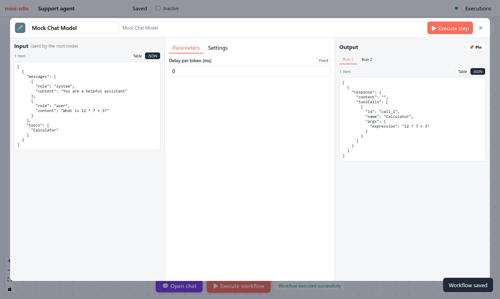

# 第 16 章 AI 连接类型与 Cluster Node：`supplyData` 的设计 ★

> 本章目标：读完你能解释 n8n 如何用“普通节点 + 特殊连接类型”表达“Agent 使用一个模型、一份记忆和三个工具”，`supplyData` 和 `execute` 的分工，以及子节点的每一次被调用为什么会出现在执行日志里。前置：第 4、5、7 章。对应代码：mini-n8n v0.4 的 `packages/core/src/get-input-connection-data.ts`、`supply-data-context.ts`、`packages/nodes-ai/src/models/log-wrapper.ts`

## 1. 问题与概念

到目前为止，连接只表达一件事：**数据从左往右流**。一个 Agent 需要的东西不是数据，而是 **能力**：

- 一个 **模型**（调用哪个 LLM、什么温度）
- 一份 **记忆**（这个会话之前说过什么）
- 若干 **工具**（计算器、HTTP 接口、数据库查询……）

最直接的设计是把它们都做成 Agent 节点的参数：一个“模型”下拉框、一个“工具”多选框。n8n 没有这样做，而是让模型、记忆、工具 **各自成为一个节点**，用新的连接类型挂到 Agent 下面：


*图 16-1：mini-n8n 画布上的一个 Cluster Node。AI Agent 是根节点（root node），下面三个圆角节点是子节点（sub-node），用紫色虚线（`ai_languageModel`、`ai_memory`、`ai_tool`）连到 Agent 底部的菱形端口。*

这样做的好处：

1. **可组合**：任何模型都能配任何工具。新增一个模型供应商，只是新增一个节点，Agent 一行不改。
2. **可配置**：每个子节点有自己的参数面板、自己的凭证。一个工具的描述、一个模型的温度，都在各自的 NDV 里改。
3. **可观测**：每次模型调用、每次工具调用，都作为子节点的一次 **运行** 记录下来，能在画布和执行日志里逐个查看（第 3 节）。

n8n 把这种结构叫 **Cluster Node**：一个 root node 加若干 sub-node。

## 2. n8n 是怎么做的

### 2.1 连接类型

第 4 章看过 `NodeConnectionTypes`，除了 `main` 还有 `ai_languageModel`、`ai_memory`、`ai_tool`、`ai_outputParser`、`ai_embedding`、`ai_vectorStore`、`ai_document`、`ai_textSplitter`、`ai_retriever` 等。保存格式和 `main` 完全一样：

```json
"OpenAI Chat Model": {
  "ai_languageModel": [[{ "node": "AI Agent", "type": "ai_languageModel", "index": 0 }]]
}
```

方向是 **子节点 → 根节点**：子节点是“源”，根节点是“目标”。这和数据流的直觉相反，但很合理：能力是由子节点“提供”给根节点的。

根节点在 `inputs` 里声明它接受哪些 AI 连接。Agent V3 的 `inputs` 是一段表达式（第 5 章提过），展开后大致是：

```text
[ 'main',
  { type: 'ai_languageModel', displayName: 'Chat Model', required: true, maxConnections: 1 },
  { type: 'ai_memory', displayName: 'Memory', maxConnections: 1 },
  { type: 'ai_tool', displayName: 'Tool' },
  ...（启用输出解析器时还有 ai_outputParser）]
```

`required` 和 `maxConnections` 由引擎在运行时校验。

### 2.2 两个方法：supplyData 和 execute

```ts
// packages/workflow/src/interfaces.ts:2568-2571
export interface INodeType {
	description: INodeTypeDescription;
	supplyData?(this: ISupplyDataFunctions, itemIndex: number): Promise<SupplyData>;
	execute?(this: IExecuteFunctions, response?: EngineResponse): Promise<NodeOutput>;
```

```ts
// packages/workflow/src/interfaces.ts:2555-2560
export interface SupplyData {
	metadata?: IDataObject;
	response: unknown;
	closeFunction?: CloseFunction;
	hints?: NodeExecutionHint[];
}
```

- `execute()` 是“处理数据”：输入 item，输出 item。
- `supplyData()` 是“提供能力”：返回一个 **对象**（`response`），类型由连接类型约定——模型节点返回 LangChain 的 `BaseChatModel`，记忆节点返回 `BaseChatMemory`，工具节点返回 `Tool`。

子节点不会被引擎的主循环调度（它们没有 `main` 输入，没人把它们压栈）。它们是被根节点 **按需拉取** 的。

### 2.3 拉取：getInputConnectionData

根节点在 `execute()` 里调用：

```ts
const model = await this.getInputConnectionData(NodeConnectionTypes.AiLanguageModel, 0);
const tools = await this.getInputConnectionData(NodeConnectionTypes.AiTool, 0);
```

实现（`packages/core/src/execution-engine/node-execution-context/utils/get-input-connection-data.ts:393`，第 3 章之后我们第二次读这个文件）的流程：

```ts
// get-input-connection-data.ts:408-429（节选）
const parentNode = this.getNode();
const inputConfigurations = this.nodeInputs.filter((input) => input.type === connectionType);
...
const maxConnections = inputConfigurations.reduce(
	(acc, currentItem) => (currentItem.maxConnections !== undefined ? acc + currentItem.maxConnections : acc),
	0,
);

const connectedNodes = this.getConnectedNodes(connectionType);
validateInputConfiguration(this, connectionType, inputConfigurations, connectedNodes);

// Nothing is connected or required
if (connectedNodes.length === 0) {
	return maxConnections === 1 ? undefined : [];
}
```

然后对每个连着的子节点，创建一个 `SupplyDataContext` 并调用它的 `supplyData()`（第 471–527 行）。返回值的形状由 `maxConnections` 决定：为 1 时返回 **单个对象**（模型、记忆），否则返回 **数组**（工具）。

必需的连接缺失时报错（第 368–371 行）：

```ts
throw new NodeOperationError(
	parentNode,
	`A ${inputConfiguration?.displayName ?? connectionType} sub-node must be connected and enabled`,
);
```

子节点自己出错时，错误被包装成 “Error in sub-node X”，并 **同时记录在子节点和父节点上**，用户在画布上能直接看到是哪个子节点坏了（第 528–575 行）。

一个容易忽略的细节在第 488–506 行：如果连着的节点 **没有** `supplyData`、但输出类型是 `ai_tool`，引擎会调用 `createNodeAsTool()` 把它当场包装成工具——第 20 章“节点即工具”就从这里开始。

### 2.4 SupplyDataContext：参数从哪里取值

`SupplyDataContext`（`packages/core/src/execution-engine/node-execution-context/supply-data-context.ts:44`）和执行上下文几乎一样，关键区别是：**它拿的是根节点的输入数据**。所以记忆节点的参数 `Session Key = {{ $json.sessionId }}` 里的 `$json`，是 Agent 当前处理的那个 item——通常来自 Chat Trigger。

这也解释了 `supplyData(itemIndex)` 为什么带 `itemIndex`：Agent 处理第 3 个 item 时，记忆节点要用第 3 个 item 的 sessionId。

### 2.5 让每一次“使用”可见：logWrapper

子节点只被调用一次 `supplyData()`，但它返回的模型可能被调用好几次（Agent 每轮循环一次）。n8n 希望 **每次模型调用都是模型节点的一次运行**，这样用户能在 NDV 里逐次查看“发了什么消息、回了什么”。

做法是包装返回的对象：

```ts
// packages/@n8n/ai-utilities/src/utils/log-wrapper.ts（节选，第 109 行起）
export function logWrapper<T>(originalInstance: T, executeFunctions: ISupplyDataFunctions): T {
	return new Proxy(originalInstance, {
		get: (target, prop) => {
			...
			if (isBaseChatMemory(originalInstance)) {
				if (prop === 'loadMemoryVariables' && 'loadMemoryVariables' in target) {
					return async (values: InputValues): Promise<MemoryVariables> => {
						const { index } = executeFunctions.addInputData(connectionType, [[{ json: { action: 'loadMemoryVariables', values } }]]);
						const response = await callMethodAsync.call(target, { ... });
						...
						executeFunctions.addOutputData(connectionType, index, [[{ json: { action: 'loadMemoryVariables', chatHistory } }]]);
						return response;
```

用 `Proxy` 拦截方法调用，前后分别调用 `addInputData` / `addOutputData`。这两个方法在子节点的 `runData` 里新增一条运行记录，并触发 `nodeExecuteBefore/After` 钩子——于是画布上的记忆节点会“亮一下”。模型节点用的是同样思路的另一种实现：LangChain 回调 `N8nLlmTracing`（`packages/@n8n/ai-utilities/src/utils/n8n-llm-tracing.ts:87`），在 `handleLLMStart` / `handleLLMEnd` 里记录，顺带统计 token 用量。

## 3. 从零实现

### 3.1 接口

```ts
// code/mini-n8n/packages/workflow/src/interfaces.ts（v0.4 节选）
/** What a sub-node (model, memory, tool) hands to its root node. n8n: SupplyData */
export interface SupplyData {
	response: unknown;
	closeFunction?: () => Promise<void>;
}

export interface INodeType {
	description: INodeTypeDescription;
	/** `response` is set when the engine calls the node again after an EngineRequest */
	execute?(this: IExecuteFunctions, response?: EngineResponse): Promise<NodeOutput>;
	/** Sub-nodes: give the root node an object (model, memory, tool...) */
	supplyData?(this: ISupplyDataFunctions, itemIndex: number): Promise<SupplyData>;
	...
}
```

### 3.2 getInputConnectionData

```ts
// code/mini-n8n/packages/core/src/get-input-connection-data.ts（节选）
export async function getInputConnectionData(this: ExecuteContext, workflow, parentNode, type, itemIndex): Promise<unknown> {
	const inputs = workflow.getNodeInputs(parentNode).filter((i) => i.type === type);
	...
	// like n8n: the sum of the defined maxConnections; 1 means "return a single object"
	const maxConnections = inputs.reduce((sum, i) => sum + (i.maxConnections ?? 0), 0);
	const connected = workflow
		.getParentNodes(parentNode.name, type, 1)
		.map((name) => workflow.getNode(name)!)
		.filter((n) => n && !n.disabled);

	if (connected.length === 0) {
		if (inputs.some((i) => i.required)) {
			throw new NodeOperationError(parentNode, `A ${LABELS[type] ?? type} sub-node must be connected and enabled`);
		}
		return maxConnections === 1 ? undefined : [];
	}
	...
	for (const subNode of connected) {
		const subType = workflow.nodeTypes.getByNameAndVersion(subNode.type, subNode.typeVersion);
		const context = new SupplyDataContext(workflow, subNode, subType, additionalData, mode, runExecutionData, runIndex, { ...executeData, node: subNode }, abortSignal);
		context.parentNodeName = parentNode.name;
		try {
			responses.push((await subType.supplyData.call(context, itemIndex)).response);
		} catch (error) {
			throw new NodeOperationError(subNode, `Error in sub-node ${subNode.name}`, { description: (error as Error).message, itemIndex });
		}
	}
	return maxConnections === 1 ? responses[0] : responses;
}
```

找子节点用的是第 4 章的 `getParentNodes(name, type, 1)`——AI 连接也存在 `connectionsByDestinationNode` 里，按类型过滤即可。`{ ...executeData, node: subNode }` 让子节点继承根节点的输入数据和 `source`，所以 `$json` 和 `$('Chat Trigger').item` 都能用。

### 3.3 SupplyDataContext 与日志包装

```ts
// code/mini-n8n/packages/core/src/supply-data-context.ts（节选）
addInputData(type: AINodeConnectionType, data: INodeExecutionData[][]): number {
	const runs = (runExecutionData.resultData.runData[this.node.name] ??= []);
	const task: ITaskData = {
		startTime: Date.now(), executionTime: 0, executionIndex: runs.length, executionStatus: 'running',
		source: [{ previousNode: this.parentNodeName }],
		inputOverride: { [type]: data },
	};
	runs.push(task);
	void additionalData.hooks?.runHook('nodeExecuteBefore', [this.node.name, { startTime: task.startTime, executionIndex: task.executionIndex }]);
	return runs.length - 1;
}
```

`addOutputData` 把结果写进 `task.data[type]` 并触发 `nodeExecuteAfter`。记录用 `inputOverride` 而不是普通输入：子节点的“输入”不是上游节点的输出，而是根节点交给它的东西（消息列表、工具参数）。

mini-n8n 的模型接口只有一个方法，不需要 `Proxy`，一个普通的包装对象就够了：

```ts
// code/mini-n8n/packages/nodes-ai/src/models/log-wrapper.ts（节选）
export function logModel(ctx: ISupplyDataFunctions, model: ChatModel): ChatModel {
	return {
		provider: model.provider,
		modelName: model.modelName,
		async invoke(messages, options) {
			const runIndex = ctx.addInputData('ai_languageModel', [[{ json: { messages, tools: options?.tools?.map((t) => t.name) ?? [] } }]]);
			try {
				const response = await model.invoke(messages, options);
				ctx.addOutputData('ai_languageModel', runIndex, [[{ json: { response } }]]);
				return response;
			} catch (error) {
				ctx.addOutputData('ai_languageModel', runIndex, error as Error);
				throw error;
			}
		},
	};
}
```

### 3.4 编辑器：子节点的形状和自动连接

画布上，子节点没有 `main` 端口，输出端口在顶部（第 13 章），所以 `CanvasNode` 把“只有 AI 输出”的节点画成圆角胶囊。选中 Agent 后从节点面板添加模型或工具，新节点会放在 Agent 下方并自动用对应类型连上（`App.vue` 的 `addNode`）。

端口编号有一个坑，第 4 节会讲：`inputs/ai_tool/0` 的 `0` 是 **同类型内** 的序号，而不是在全部输入里的序号。

| 方面 | n8n | mini-n8n |
|---|---|---|
| 子节点返回的对象 | LangChain 的 `BaseChatModel` / `BaseChatMemory` / `Tool` | 自定义的 `ChatModel` / `ChatMemory` / `AiTool` |
| 记录每次使用 | `logWrapper`（Proxy）+ `N8nLlmTracing`（回调，含 token 统计） | 普通包装对象，记录消息和响应 |
| 没有 supplyData 的工具节点 | `createNodeAsTool` 当场包装 | 在 `NodeTypes` 里合成 `xxxTool` 类型（第 20 章） |
| 子节点出错 | 记录到子节点和父节点，父节点报 “Error in sub-node” | 父节点报 “Error in sub-node” |

## 4. 运行与验证

`packages/nodes-ai/test/agent.test.ts` 里有两个测试直接验证本章的机制（真实输出节选）：

```text
✓ AI Agent > remembers the conversation per session
✓ AI Agent > fails clearly without a model
```

第一个测试断言记忆节点的两次“使用”被记录成两次运行：

```ts
expect(second.runData.Memory.map((r) => r.data?.ai_memory?.[0]?.[0]?.json.action)).toEqual(['loadMemoryVariables', 'saveContext']);
```

第二个测试断言缺少模型时的错误消息：`A Chat Model sub-node must be connected and enabled`。

在编辑器里打开模型节点的 NDV（图 16-2），左栏是 Agent 发给模型的消息（`inputOverride`），右栏是模型的回答；顶部的 Run 1 / Run 2 对应 Agent 循环里的两次调用。



*图 16-2：Mock Chat Model 的 Run 1：输入是 system + user 两条消息和可用工具列表，输出是一个调用 Calculator 的 tool call。*

**踩坑记录**：第一次在画布上画 Cluster Node 时，三条紫色虚线全部绕到了 Agent 顶部再折回来（截图里很明显）。原因是 `CanvasNode` 用节点 **全部输入里的序号** 生成端口 ID：Agent 的输入是 `[main, ai_languageModel, ai_memory, ai_tool]`，模型端口于是成了 `inputs/ai_languageModel/1`；而连接里的序号是 **同类型内的序号**（`index: 0`），边的 `targetHandle` 是 `inputs/ai_languageModel/0`，Vue Flow 找不到这个端口，就把边连到了节点默认位置。改为按类型分别计数后正常（`withTypeIndex`）。

## 5. 练习

1. **巩固**：把 Simple Memory 的 Session Key 改成固定字符串 `"global"`，用两个不同的聊天会话测试，解释结果。
2. **扩展**：实现一个 “Window Buffer Memory (SQLite)” 子节点：`supplyData` 返回的记忆对象把消息存进数据库表，重启服务器后仍然记得。
3. **读源码**：阅读 n8n 的 `N8nLlmTracing.handleLLMEnd`，说明当供应商不返回 token 用量时，n8n 如何估算 token 数。

## 6. 延伸阅读

- `packages/core/src/execution-engine/node-execution-context/utils/get-input-connection-data.ts`
- `packages/@n8n/ai-utilities/src/utils/log-wrapper.ts`、`n8n-llm-tracing.ts`
- n8n 文档：*Cluster nodes*（root nodes 与 sub-nodes 的用户视角说明）。
