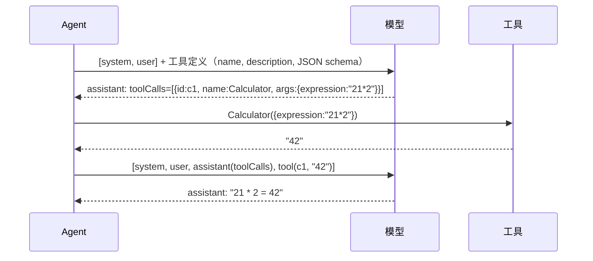
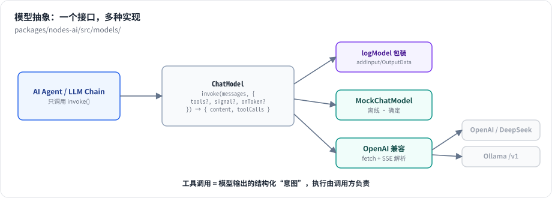

# 第 17 章 Chat Model 抽象：Mock、Ollama 与流式

> 本章目标：读完你能设计一个能接入任意 LLM 供应商的模型接口，理解函数调用（tool calling）在协议层是什么样子、流式响应如何解析，并知道 n8n 的模型节点为了安全和可观测多做了哪些事。前置：第 16 章。对应代码：mini-n8n v0.4 的 `packages/nodes-ai/src/models/`、`nodes/models.ts`、`nodes/chain-llm.ts`

## 1. 问题与概念

Agent 需要的模型能力只有一件事：**给一组消息，返回下一条消息**。但这条“下一条消息”有两种：

- 普通文本回答：`{ content: "Red, Yellow, Blue." }`
- 工具调用：`{ content: "", toolCalls: [{ id, name: "Calculator", args: { expression: "21 * 2" } }] }`

消息有四种角色：

| role | 谁说的 | 例子 |
|---|---|---|
| `system` | 开发者 | “You are a helpful assistant” |
| `user` | 用户 | “What is 21 * 2?” |
| `assistant` | 模型 | 文本，或者带 `toolCalls` |
| `tool` | 工具 | 某个 `toolCallId` 的执行结果 |

工具调用的往返是这样的：



模型并不执行工具，它只是 **输出一段结构化的“我想调用 X，参数是 Y”**；执行由调用方负责。这是第 18、19 章的基础。



*图 17-1：Agent 只依赖 `ChatModel.invoke(messages, { tools, onToken })`。Mock 模型离线、确定，用于测试和本书；OpenAI 兼容实现覆盖 OpenAI、Ollama、DeepSeek、vLLM 等。日志包装让每次调用都成为模型节点的一次运行。*

## 2. n8n 是怎么做的

### 2.1 一个供应商一个节点，背后都是 LangChain

`packages/@n8n/nodes-langchain/nodes/llms/` 下有二十多个 Chat Model 节点：OpenAI、Anthropic、Gemini、Bedrock、Azure、Ollama、Groq、DeepSeek、Mistral、OpenRouter……每个节点的 `supplyData()` 构造一个 LangChain 的 `BaseChatModel` 子类实例。以 OpenAI 为例：

```ts
// packages/@n8n/nodes-langchain/nodes/llms/LMChatOpenAi/LmChatOpenAi.node.ts:753-844（节选）
async supplyData(this: ISupplyDataFunctions, itemIndex: number): Promise<SupplyData> {
	const credentials = await this.getCredentials('openAiApi');
	...
	const configuration: ClientOptions = {
		fetch: aiClientFetch,
		defaultHeaders,
	};

	if (options.baseURL) {
		assertOpenAiCredentialAllowsUrl(this.getNode(), credentials, options.baseURL);
		configuration.baseURL = options.baseURL;
	} else if (credentials.url) {
		configuration.baseURL = credentials.url as string;
	}
	...
	configuration.fetchOptions = {
		dispatcher: getProxyAgent(configuration.baseURL ?? 'https://api.openai.com/v1', { headersTimeout: timeout, bodyTimeout: timeout }, this.helpers.getSecureEgressFilter()),
	};
	...
	const fields: ChatOpenAIFields = {
		apiKey: credentials.apiKey as string,
		model: modelName,
		...includedOptions,
		timeout,
		maxRetries: options.maxRetries ?? 2,
		configuration,
		callbacks: [new N8nLlmTracing(this, { redactedHeaders: customHeader ? [customHeader.name] : [] })],
		modelKwargs,
		onFailedAttempt: makeN8nLlmFailedAttemptHandler(this, openAiFailedAttemptHandler),
	};
	...
	const model = new ChatOpenAI(fields);
```

除了“把参数传给 LangChain”，这段代码还做了好几件生产级别的事：

1. **`aiClientFetch`：限制响应大小**。`packages/@n8n/nodes-langchain/AGENTS.md` 专门要求：模型客户端必须用 `@n8n/ai-utilities` 提供的 fetch，不能用 SDK 默认的。原因是一个恶意的“兼容端点”可以返回无限大或压缩炸弹式的响应，把 n8n 进程的内存撑爆（配置项 `N8N_AI_MAX_RESPONSE_SIZE`）。
2. **`assertOpenAiCredentialAllowsUrl`**：如果节点里改了 baseURL，检查凭证是否允许发往这个地址——防止把 API Key 发给第三方（第 11 章的“凭证域名限制”）。
3. **代理与出站过滤**：`getProxyAgent` + `getSecureEgressFilter()`，统一走代理、阻止访问内网地址。
4. **重试**：`maxRetries` 和 `onFailedAttempt`（例如 429 限流时退避重试，并把错误整理成用户能看懂的信息）。
5. **追踪**：`N8nLlmTracing` 回调记录每次调用的输入输出和 token 用量（第 16 章）。

### 2.2 流式

Agent 开启流式时，不调用 `invoke`，而是调用 LangChain 的 `streamEvents`，再把事件转成 n8n 的“块”：

```ts
// packages/@n8n/nodes-langchain/utils/agent-execution/processEventStream.ts（第 34–60 行附近，节选）
ctx.sendChunk('begin', itemIndex);
for await (const event of eventStream) {
	switch (event.event) {
		case 'on_chat_model_stream':
			...
			ctx.sendChunk('item', itemIndex, chunkText);
			break;
		case 'on_chat_model_end':
			...
			if (output?.tool_calls && output.tool_calls.length > 0) {
				for (const toolCall of output.tool_calls) { ... }
```

`sendChunk` 调用第 10 章的 `sendChunk` 钩子，钩子再把块写给 HTTP 响应（流式 Webhook）或推给编辑器（第 21 章）。注意 `on_chat_model_end` 分支：流式过程中模型也可能决定调用工具，这时收集 `tool_calls`，按非流式的流程返回 `EngineRequest`。

## 3. 从零实现

### 3.1 接口

```ts
// code/mini-n8n/packages/nodes-ai/src/models/types.ts（节选）
export interface ChatMessage {
	role: ChatRole;
	content: string;
	/** assistant messages that call tools */
	toolCalls?: ToolCall[];
	/** tool messages: which call they answer */
	toolCallId?: string;
}

export interface ChatModelCallOptions {
	tools?: AiTool[];
	signal?: AbortSignal;
	/** called for every streamed piece of text */
	onToken?: (token: string) => void;
}

export interface ChatModel {
	provider: string;
	modelName: string;
	invoke(messages: ChatMessage[], options?: ChatModelCallOptions): Promise<AIMessage>;
}
```

一个方法覆盖了三种需求：普通调用、带工具调用、流式（传 `onToken`）。`signal` 把第 8 章的取消信号一路传到 HTTP 请求。

### 3.2 OpenAI 兼容实现

几乎所有供应商和本地推理服务都提供 OpenAI Chat Completions 兼容接口，所以一个实现能覆盖大部分场景。消息格式转换：

```ts
// code/mini-n8n/packages/nodes-ai/src/models/openai-compatible.ts（节选）
function toOpenAI(messages: ChatMessage[]): OpenAIMessage[] {
	return messages.map((m) => {
		if (m.role === 'tool') return { role: 'tool', content: m.content, tool_call_id: m.toolCallId! };
		if (m.role === 'assistant') {
			return {
				role: 'assistant',
				content: m.content || null,
				tool_calls: m.toolCalls?.length ? m.toolCalls.map((c) => ({ id: c.id, type: 'function', function: { name: c.name, arguments: JSON.stringify(c.args) } })) : undefined,
			};
		}
		return { role: m.role, content: m.content };
	});
}

function toolsToOpenAI(tools: AiTool[]) {
	return tools.map((t) => ({ type: 'function', function: { name: t.name, description: t.description, parameters: t.schema } }));
}
```

协议细节：工具调用的 `arguments` 是 **JSON 字符串**，不是对象——模型可能生成不合法的 JSON，所以 `parseArgs` 解析失败时退化为 `{ input: 原文 }`，而不是抛错。

流式时，服务端返回 SSE（`data: {...}` 行，最后一行 `data: [DONE]`），每块只带一点增量。文本增量直接拼接；**工具调用也是分块到达的**：第一块带 `id` 和 `name`，之后的块逐段带 `arguments` 字符串，需要按 `index` 拼起来：

```ts
// code/mini-n8n/packages/nodes-ai/src/models/openai-compatible.ts（节选）
if (delta?.content) {
	content += delta.content;
	call.onToken!(delta.content);
}
for (const tc of delta?.tool_calls ?? []) {
	const slot = (calls[tc.index] ??= { id: '', name: '', args: '' });
	if (tc.id) slot.id = tc.id;
	if (tc.function?.name) slot.name += tc.function.name;
	if (tc.function?.arguments) slot.args += tc.function.arguments;
}
```

Ollama 节点复用这个实现，`baseUrl` 指向 Ollama 的 `/v1`；没有选择凭证时默认 `http://localhost:11434`。

### 3.3 Mock 模型：离线、确定的“假 ReAct”

测试和本书的大部分例子不能依赖网络和随机性，于是有了 Mock 模型。它的规则很简单：

1. 如果有工具、且这一轮还没有工具结果：工具名或描述里的词出现在用户消息里，就调用它；有算式（`(19 + 23) * 2`）就调用计算器类工具。参数按 schema 填：`expression` 填算式，`number` 填消息里的数字，其余填整句话。
2. 如果这一轮已经有工具结果：回答 `Based on the tools: X returned ...`。
3. 否则：如果问“what is my name”，就去历史消息里找 “my name is X”（用来演示记忆）；其余回答 `You said: ...`。
4. 传了 `onToken` 时按词“流式”输出，可配置每个词的延迟。

它不聪明，但 **完全可预测**：同样的输入永远得到同样的工具调用和同样的回答，所以第 18–21 章的测试可以精确断言 Agent 的每一步。

### 3.4 Basic LLM Chain

最简单的 LLM 用法——提示词进、文本出——也值得一个节点：

```ts
// code/mini-n8n/packages/nodes-ai/src/nodes/chain-llm.ts（节选）
const model = (await this.getInputConnectionData('ai_languageModel', 0)) as ChatModel;
for (const [i, item] of this.getInputData().entries()) {
	const prompt = String((this.getNodeParameter('promptType', i) === 'auto' ? item.json.chatInput : this.getNodeParameter('text', i)) ?? '');
	...
	const answer = await model.invoke([...(system ? [{ role: 'system' as const, content: system }] : []), { role: 'user', content: prompt }], { signal: this.getExecutionCancelSignal() });
	out.push({ json: { text: answer.content }, pairedItem: { item: i } });
}
```

它是“在工作流的某一步调用 LLM”（第 1 章的形态三），和 Agent 共用同一个模型子节点。

| 方面 | n8n | mini-n8n |
|---|---|---|
| 抽象 | LangChain `BaseChatModel`（`bindTools`、`streamEvents`、回调） | 一个 `invoke` 方法 |
| 供应商 | 20+ 个节点，各用官方 SDK | OpenAI 兼容（含 Ollama）+ Mock |
| 安全 | 响应大小上限、凭证域名检查、出站过滤、代理 | 无 |
| 可靠性 | 重试、限流退避、备用模型（`needsFallback`） | 无 |
| 可观测 | token 用量、费用、LangSmith 追踪 | 记录消息和响应 |

## 4. 运行与验证

`examples/model-stream.ts` 直接调用两个模型实现：先带一个计算器工具问 “What is 21 * 2?”，再流式回答一个问题。真实输出（第二部分需要本地 Ollama 和 `qwen2.5:0.5b`）：

```text
== mock / mock-react
tool call  : [{"id":"call_1","name":"Calculator","args":{"expression":"21 * 2"}}]
streamed   : 4ms:"You " 9ms:"said: " 14ms:"Name " 19ms:"three " 26ms:"primary " 31ms:"colors, " ... (8 chunks)
final text : "You said: Name three primary colors, comma separated."

== ollama / qwen2.5:0.5b
tool call  : [{"id":"call_ej8keom9","name":"Calculator","args":{"expression":"21 * 2"}}]
streamed   : 61ms:"Red" 63ms:"," 65ms:" Yellow" 68ms:"," 71ms:" Blue" 74ms:"." 
final text : "Red, Yellow, Blue."
```

两点观察：真实的 0.5B 小模型也能正确产生工具调用（`"expression":"21 * 2"`）；它的流式块比 Mock 的更细（逗号单独一块）。

## 5. 练习

1. **巩固**：在 mini-n8n 里搭 Manual Trigger → Set（`chatInput`）→ Basic LLM Chain + Ollama Chat Model，执行并在模型节点的 NDV 里查看发送的消息。
2. **扩展**：给 `OpenAICompatibleChatModel` 加上重试：遇到 429 或 5xx 时按 1s、2s、4s 退避，最多 3 次；用一个本地假服务器写测试。
3. **读源码**：阅读 `packages/@n8n/ai-utilities/AGENTS.md` 的 “Bounding AI response sizes” 一节，说明为什么“限制响应大小”必须在 fetch 层做，而不能在拿到响应后检查。

## 6. 延伸阅读

- `packages/@n8n/nodes-langchain/nodes/llms/`：所有模型节点。
- `packages/@n8n/nodes-langchain/utils/agent-execution/processEventStream.ts`：流式事件到块的转换。
- OpenAI 文档：*Function calling*、*Streaming*；Ollama 文档：*OpenAI compatibility*。
