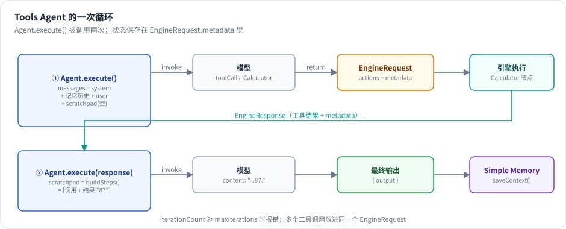

# 第 18 章 Tools Agent：函数调用循环 ★★

> 本章目标：读完你能写出一个工具调用型 Agent 的完整循环，说清它的“短期记忆”（scratchpad）、“长期记忆”（memory）和迭代上限分别在哪里，并读懂 n8n Agent V3 的执行代码。前置：第 16、17 章。对应代码：mini-n8n v0.4 的 `packages/nodes-ai/src/agent/execute.ts`、`nodes/agent.ts`

## 1. 问题与概念

“Agent” 的核心就是一个循环：

```text
messages = [system, ...历史, user]
loop:
    answer = model(messages, tools)
    if answer 没有工具调用:  return answer.content
    for call in answer.toolCalls:
        result = 执行工具(call)
        messages += [assistant(call), tool(result)]
```

早期的 **ReAct** 让模型在文本里写 “Thought: … Action: … Action Input: …”，再由程序用正则解析；现在主流模型都支持 **原生函数调用**，工具调用作为结构化字段返回，不再需要解析文本。n8n 的 Agent 节点经历了这个演进：老版本有 ReAct Agent、Conversational Agent、OpenAI Functions Agent 等多种（`packages/@n8n/nodes-langchain/nodes/agents/Agent/agents/` 下还能看到），新版本统一为 **Tools Agent**。



*图 18-1：一次两轮的 Agent 执行。第一轮模型决定调用工具，Agent 不自己执行，而是返回一个 EngineRequest 交给引擎；引擎执行工具节点后把结果作为 EngineResponse 交还给 Agent；Agent 把“调用 + 结果”拼进 scratchpad，第二轮模型给出最终回答。*

三种“记忆”要分清：

| | 存在哪里 | 生命周期 | n8n 中的名字 |
|---|---|---|---|
| scratchpad | 本次执行的 steps（工具调用及结果） | 一次 Agent 执行 | `steps` / `intermediateSteps` |
| 对话历史 | Memory 子节点 | 跨执行，按 sessionId | `chat_history` |
| 系统提示词 | Agent 参数 | 每次都发 | `systemMessage` |

## 2. n8n 是怎么做的

### 2.1 入口：toolsAgentExecute

```ts
// packages/@n8n/nodes-langchain/nodes/agents/Agent/agents/ToolsAgent/V3/execute.ts（节选）
export async function toolsAgentExecute(this: IExecuteFunctions | ISupplyDataFunctions, response?: EngineResponse<RequestResponseMetadata>) {
	let request: EngineRequest<RequestResponseMetadata> | undefined = undefined;
	const returnData: INodeExecutionData[] = [];
	...
	// Build execution context with shared configuration
	const executionContext = await buildExecutionContext(this);
	const { items, batchSize, delayBetweenBatches, model, fallbackModel, memory } = executionContext;
	...
	// Process items in batches
	for (let i = 0; i < items.length; i += batchSize) {
		const batch = items.slice(i, i + batchSize);
		const { returnData: batchReturnData, request: batchRequest, memoryHits } = await executeBatch(this, batch, i, model, fallbackModel, memory, response);
		...
		// Collect requests from batch
		if (batchRequest) {
			...
			if (!request) { request = batchRequest; } else { request.actions.push.apply(request.actions, batchRequest.actions); }
		}
	}

	// Return tool call request if any tools need to be executed
	if (request) {
		if (isExecuteFunctions(this)) {
			// Top-level execution — hand the request to the engine, which
			// schedules the requested tool nodes and resumes us with an
			// EngineResponse.
			return request;
		}
		// Sub-agent execution ...
		return await resolveSubAgentRequest(this, request, { runAgentBatch: async (engineResponse) => await toolsAgentExecute.call(this, engineResponse) });
	}
	...
	return [returnData];
```

注意 `execute` 的两个返回类型：要么是普通的 `[returnData]`，要么是一个 `EngineRequest`。Agent **从不自己执行工具**——它只把“我要调这些工具”交给引擎。这是 Agent V3 最重要的设计，第 19 章专门讲。唯一的例外是 Agent 自己作为另一个 Agent 的工具运行时（`ISupplyDataFunctions`），这时没有引擎可以调度，只能就地解决（`resolveSubAgentRequest`，第 23 章）。

### 2.2 每个 item：准备上下文

`executeBatch` 对批次里的每个 item 调用 `prepareItemContext` 和 `runAgent`：

```ts
// packages/@n8n/nodes-langchain/nodes/agents/Agent/agents/ToolsAgent/V3/helpers/prepareItemContext.ts:41-75（节选）
export async function prepareItemContext(ctx, itemIndex, response?, model?): Promise<ItemContext> {
	const steps = buildSteps(response, itemIndex);

	const input = getPromptInputByType({ ctx, i: itemIndex, inputKey: 'text', promptTypeKey: 'promptType' });
	if (input === undefined) {
		throw new NodeOperationError(ctx.getNode(), 'The "text" parameter is empty.');
	}

	const outputParser = await getOptionalOutputParser(ctx, itemIndex);
	const tools = await getTools(ctx, outputParser);
	const options = ctx.getNodeParameter('options', itemIndex) as AgentOptions;
	...
	// Prepare the prompt messages and prompt template.
	const messages = await prepareMessages(ctx, itemIndex, { systemMessage: options.systemMessage, ... });
	const prompt: ChatPromptTemplate = preparePrompt(messages);
```

- `buildSteps(response, itemIndex)`：从 EngineResponse 重建 scratchpad（2.4 节）。
- `getPromptInputByType`：提示词来自上游的 `chatInput` 字段（连着 Chat Trigger 时），或者参数里写死的文本。
- `getTools`：`getInputConnectionData('ai_tool')` 拿到所有工具（第 16 章）；如果接了输出解析器，还会加一个 `format_final_json_response` 工具（第 23 章）。
- `prepareMessages`：system 消息（默认 `'You are a helpful assistant'`，见 `ToolsAgent/prompt.ts:1`）、`chat_history` 占位、用户输入、`agent_scratchpad` 占位。

### 2.3 调用模型：runAgent

`createAgentSequence`（`V3/helpers/createAgentSequence.ts`）用 LangChain 的 `createToolCallingAgent` 把模型、工具和提示词模板组装成一个 runnable，`runAgent` 调用它：

```ts
// packages/@n8n/nodes-langchain/nodes/agents/Agent/agents/ToolsAgent/V3/helpers/runAgent.ts（非流式分支，节选）
const chatHistory = await loadMemory(memory, model, options.maxTokensFromMemory);
...
const modelResponse = await executorWithTracing.invoke({ ...invokeParams, chat_history: chatHistory }, executeOptions);

if ('returnValues' in modelResponse) {
	...
	// Save conversation to memory including any tool call context
	if (memory && input && modelResponse.returnValues.output) {
		const previousCount = response?.metadata?.previousRequests?.length;
		await saveToMemory(input, modelResponse.returnValues.output, memory, steps, previousCount);
		...
	}
	...
	return result;
}

// If response contains tool calls, we need to return this in the right format
const actions = createEngineRequests(modelResponse, itemIndex, tools);

return {
	actions,
	metadata: buildResponseMetadata(response, itemIndex),
};
```

两条出路：

- `returnValues`：模型给出最终回答。保存到记忆（只在最终回答时保存，中间的工具调用不会单独写入），返回 `{ output }`。
- 工具调用：`createEngineRequests` 把每个调用翻译成一个 action——关键是 `nodeName: foundTool.metadata?.sourceNodeName`（`utils/agent-execution/createEngineRequests.ts:232-236`），也就是 **哪个节点** 要被执行。

### 2.4 跨“轮”的状态：metadata

Agent 每返回一次 EngineRequest，它的 `execute()` 就 **结束** 了；引擎执行完工具再 **重新调用** 它。两次调用之间不共享任何 JavaScript 变量，状态全在 request 的 `metadata` 里：

```ts
// packages/@n8n/nodes-langchain/utils/agent-execution/buildResponseMetadata.ts:17-28
export function buildResponseMetadata(response: EngineResponse<RequestResponseMetadata> | undefined, itemIndex: number): RequestResponseMetadata {
	const currentIterationCount = response?.metadata?.iterationCount ?? 0;

	return {
		previousRequests: buildSteps(response, itemIndex),
		itemIndex,
		iterationCount: currentIterationCount + 1,
	};
}
```

- `previousRequests`：截至目前的所有 steps。下一次被调用时，`buildSteps` 用它加上新到达的工具结果，得到完整的 scratchpad：

```ts
// packages/@n8n/nodes-langchain/utils/agent-execution/buildSteps.ts:345-367（节选）
export function buildSteps(response, itemIndex): ToolCallData[] {
	const steps: ToolCallData[] = [];
	if (!response) return steps;
	const responses = response.actionResponses ?? [];
	if (response.metadata?.previousRequests) {
		steps.push(...response.metadata.previousRequests);
	}
	for (const tool of responses) {
		if (tool.action?.metadata?.itemIndex !== itemIndex) continue;
		...
		const existingStep = steps.find((s) => s.action.toolCallId === tool.action.id);
		if (existingStep) continue;
```

- `iterationCount`：已经循环了几轮。每次进入时检查：

```ts
// packages/@n8n/nodes-langchain/nodes/agents/Agent/agents/ToolsAgent/V3/helpers/checkMaxIterations.ts（节选）
if (response.metadata.iterationCount >= maxIterations) {
	throw new NodeOperationError(node, `Max iterations (${maxIterations}) reached. The agent could not complete the task within the allowed number of iterations.`);
}
```

为什么状态不放在内存里？因为第 19 章会看到，工具节点是引擎调度的普通节点，执行过程可能被暂停、存进数据库、在另一个进程里恢复（人工审批工具就是这样，第 23 章）。只有放在可序列化的 metadata 里，Agent 才能在任何地方继续。

`buildSteps.ts` 的大部分代码在处理供应商差异：Anthropic 的 thinking 块、Gemini 的 thought signature、DeepSeek 的 reasoning content——它们要求下一轮请求原样带回上一轮的“思考”内容。这是生产级 Agent 实现里很容易被低估的部分。

## 3. 从零实现

mini-n8n 的 Agent 不依赖 LangChain，循环逻辑全在一个约 150 行的文件里。

### 3.1 状态

```ts
// code/mini-n8n/packages/nodes-ai/src/agent/execute.ts（节选）
/** One finished tool call: what the LLM asked for and what the tool returned */
export interface ToolCallStep {
	toolCallId: string;
	tool: string;
	toolInput: IDataObject;
	observation: string;
}

/** Kept in the EngineRequest so the Agent can continue where it stopped (n8n: RequestResponseMetadata) */
export interface AgentRequestMetadata extends IDataObject {
	/** item index -> steps of earlier iterations */
	previousRequests: Record<number, ToolCallStep[]>;
	iterationCount: number;
	/** item index -> final output, for items that are already done */
	finishedItems: Record<number, IDataObject>;
}
```

比 n8n 多一个 `finishedItems`：Agent 一次处理多个 item 时，有的 item 第一轮就答完了，有的还要调工具。已经完成的 item 记在 metadata 里，下一轮直接跳过，不重复调用模型。

### 3.2 scratchpad

```ts
// code/mini-n8n/packages/nodes-ai/src/agent/execute.ts（节选）
export function buildSteps(response: EngineResponse<AgentRequestMetadata> | undefined, itemIndex: number): ToolCallStep[] {
	if (!response) return [];
	const steps = [...(response.metadata.previousRequests?.[itemIndex] ?? [])];
	for (const { action, data } of response.actionResponses) {
		if (action.metadata.itemIndex !== itemIndex || steps.some((s) => s.toolCallId === action.id)) continue;
		steps.push({ toolCallId: action.id, tool: String(action.metadata.toolName ?? action.nodeName), toolInput: action.input, observation: observation(data) });
	}
	return steps;
}

/** The scratchpad: each step = an assistant message with the call + a tool message with the result */
function stepsToMessages(steps: ToolCallStep[]): ChatMessage[] {
	return steps.flatMap((s) => [
		{ role: 'assistant' as const, content: '', toolCalls: [{ id: s.toolCallId, name: s.tool, args: s.toolInput }] },
		{ role: 'tool' as const, content: s.observation, toolCallId: s.toolCallId },
	]);
}
```

`observation()` 把工具节点的运行记录（`ITaskData`）变成模型能读的字符串：取 `data.ai_tool[0]` 的 item；单个 `{ response }` 字段就直接用它的值；出错时是 `Error: <消息>`。

### 3.3 主循环（一轮）

```ts
// code/mini-n8n/packages/nodes-ai/src/agent/execute.ts（节选）
const model = (await this.getInputConnectionData('ai_languageModel', 0)) as ChatModel;
// undefined when no memory sub-node is connected
const memory = (await this.getInputConnectionData('ai_memory', 0)) as ChatMemory | undefined;
const maxIterations = Number(this.getNodeParameter('options.maxIterations', 0, 10));
checkMaxIterations(response, maxIterations, this);
...
for (let i = 0; i < items.length; i++) {
	if (finishedItems[i]) continue;
	...
	const tools = flattenTools((await this.getInputConnectionData('ai_tool', i)) as unknown[]);
	const steps = buildSteps(response, i);
	const history = memory ? await memory.loadMessages() : [];
	const messages: ChatMessage[] = [{ role: 'system', content: systemMessage }, ...history, { role: 'user', content: prompt }, ...stepsToMessages(steps)];
	...
	const answer = await model.invoke(messages, { tools, signal: this.getExecutionCancelSignal(), onToken: ... });

	const calls = answer.toolCalls.filter((c) => tools.some((t) => t.name === c.name));
	if (calls.length) {
		previousRequests[i] = steps;
		for (const call of calls) {
			const tool = tools.find((t) => t.name === call.name)!;
			actions.push({
				actionType: 'ExecutionNodeAction',
				nodeName: tool.metadata.sourceNodeName,
				// a toolkit node (MCP) needs to know which of its tools was meant
				input: tool.metadata.isFromToolkit ? { ...call.args, tool: call.name } : call.args,
				type: 'ai_tool',
				id: call.id,
				metadata: { itemIndex: i, toolName: call.name },
			});
		}
		continue;
	}

	if (memory) await memory.saveContext(prompt, answer.content);
	finishedItems[i] = { output: answer.content, ... };
}

if (actions.length) {
	const metadata: AgentRequestMetadata = { previousRequests, iterationCount: (response?.metadata?.iterationCount ?? 0) + 1, finishedItems };
	return { actions, metadata };
}
```

一个模型回答里有多个工具调用时（并行调用），它们进入 **同一个** EngineRequest，引擎会依次执行完所有工具再恢复 Agent。

模型可能“幻想”出一个不存在的工具名，`calls` 先过滤掉这些调用；如果全被过滤掉，就把模型的文本当作最终回答。

| 方面 | n8n Agent V3 | mini-n8n |
|---|---|---|
| 组装 | LangChain `createToolCallingAgent` + `RunnableSequence` | 手写消息列表 |
| 批处理 | `batchSize` + `delayBetweenBatches` | 逐 item，已完成的 item 记入 metadata |
| 记忆 | `loadMemory` 按 token 裁剪；保存时保留工具调用上下文 | 按轮数窗口；只存问答 |
| 备用模型 | `fallbackModel`（`withFallbacks`） | 无 |
| 供应商的思考内容 | thinking / thought signature / reasoning content 回传 | 无 |
| 输出解析器、HITL | 支持 | v0.5 |

## 4. 运行与验证

单元测试用 Mock 模型和计算器跑完整循环，并记录每个钩子事件（`packages/nodes-ai/test/agent.test.ts`）：

```ts
expect(events).toEqual(['▶ Start', '✓ Start', '▶ Input', '✓ Input', '▶ AI Agent', '▶ Model', '✓ Model', '▶ Calculator', '✓ Calculator', '▶ Model', '✓ Model', '✓ AI Agent']);
```

读这个序列：Agent 开始 → 第一次模型调用（决定调用工具）→ **Calculator 作为一个节点执行** → 第二次模型调用（给出答案）→ Agent 结束。Agent 只有一个开始事件和一个结束事件，虽然它的 `execute()` 实际被调用了两次。其余断言（真实输出）：

```text
✓ AI Agent > lets the engine run the tool node and resumes with its result
✓ AI Agent > runs several tools requested in one step
✓ AI Agent > gives a tool error back to the model instead of failing
✓ AI Agent > stops after maxIterations
```

用真实的本地小模型跑同样的结构（`examples/ollama-agent.ts`，Ollama + `qwen2.5:0.5b`），真实输出：

```text
[    0 ms] Start      out={}
[    1 ms] Question   out={"chatInput":"A shirt costs 25 dollars. How much do 17 shirts cost?"}
[  129 ms] Ollama     out={"content":"","toolCalls":[{"id":"call_o7rr88cc","name":"Calculator","args":{"expression":"17 * 25"}}],"usage":{"promptTokens":188,"completionTokens":25}}
[  130 ms] Calculator in={"expression":"17 * 25"} out={"response":"425"}
[  225 ms] Ollama     out={"content":"The cost of 17 shirts is 425 dollars.","toolCalls":[],"usage":{"promptTokens":232,"completionTokens":15}}
[  225 ms] AI Agent   out={"output":"The cost of 17 shirts is 425 dollars."}

status: success
answer: The cost of 17 shirts is 425 dollars.
```

模型自己把应用题翻译成了算式 `17 * 25`。另一次问 “What is 1234 * 5678?” 时（真实输出）：

```text
[  178 ms] Calculator in={"expression":"1234 * 5678"} out={"response":"7006652"}
[  319 ms] Ollama     out={"content":"The result of 1234 * 5678 is 700,665,200.","toolCalls":[],...}
```

工具算对了（7006652），但 0.5B 的小模型在复述结果时 **抄错了**（700,665,200）。这是一个真实的提醒：Agent 的可靠性受最弱的一环限制。生产中要么用更强的模型，要么让工具结果直接进入输出（例如用结构化输出解析器，第 23 章），而不是让模型复述。

## 5. 练习

1. **巩固**：把 Agent 的 Max Iterations 设为 1，用 “What is 2 + 2?” 测试，解释为什么会失败、在第几次调用时失败。
2. **扩展**：实现 n8n 的 “Return Intermediate Steps” 选项在流式模式下的行为：最终输出里带上 `intermediateSteps`，并在编辑器的输出面板里用表格展示每一步。
3. **读源码**：阅读 n8n 的 `saveToMemory()`（`utils/agent-execution/memoryManagement.ts:294`），说明它在保存时如何处理带工具调用的轮次，`previousCount` 参数的作用是什么。

## 6. 延伸阅读

- `packages/@n8n/nodes-langchain/nodes/agents/Agent/agents/ToolsAgent/V3/`：Agent V3 全部代码。
- `packages/@n8n/nodes-langchain/utils/agent-execution/`：steps、请求、记忆、流式等共用工具。
- Yao et al., *ReAct: Synergizing Reasoning and Acting in Language Models*（2022）。
