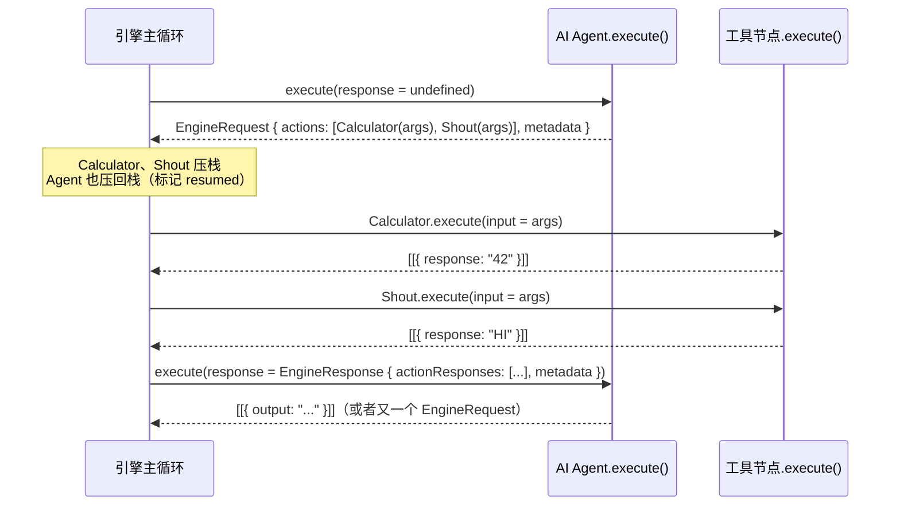
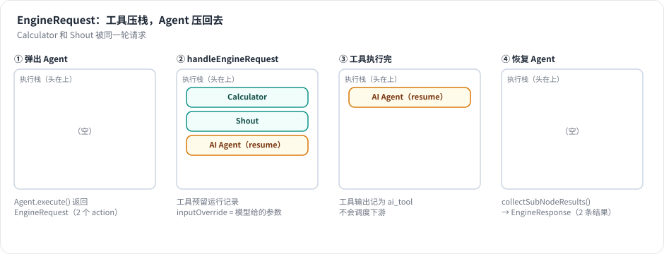

# 第 19 章 EngineRequest：让引擎来调度工具 ★★

> 本章目标：读完你能解释 n8n Agent V3 最核心的设计——Agent 不自己执行工具，而是请求引擎执行工具节点、再把结果交还给它——并逐步说清这个过程中执行栈、运行数据和元数据的变化。你会在自己的引擎里实现同样的机制。前置：第 7、16、18 章。对应代码：mini-n8n v0.4 的 `packages/core/src/workflow-execute.ts`（`handleEngineRequest`、`collectSubNodeResults`）

## 1. 问题与概念

最简单的 Agent 实现，是在 Agent 节点的 `execute()` 里直接调用工具：

```ts
const result = await tool.invoke(args);   // 工具在 Agent 内部执行
```

n8n 早期版本就是这样做的（LangChain 的 `AgentExecutor` 自己跑循环、自己调工具）。问题是：工具常常 **本身就是一个 n8n 节点**（HTTP Request、Gmail、Postgres……），在 Agent 内部调用它，就绕过了引擎：

- 工具节点的执行 **不会出现在运行数据里**，用户看不到它收到了什么、返回了什么。
- 引擎的 **重试、错误处理、超时、取消** 对它都不生效。
- 无法 **暂停**：一个“需要人工批准才执行”的工具，必须让整个执行停下来等几个小时——在 `execute()` 内部 `await` 几个小时显然不行。
- 无法 **pin 数据、部分执行**、在 Worker 上调度……

Agent V3 的回答是 **请求–响应**：



工具变回了 **普通节点**，由引擎按普通规则执行；Agent 变成了一个“会暂停的节点”。



*图 19-1：Agent 第一次运行返回 EngineRequest 后，引擎把两个工具节点放到栈顶、把 Agent 放在它们下面（带着“这是一次恢复，结果在哪里”的元数据）。工具依次执行完，Agent 再次被弹出，拿到两条结果。*

## 2. n8n 是怎么做的

### 2.1 主循环里的分叉

第 7 章读主循环时跳过了一个分支：

```ts
// packages/core/src/execution-engine/workflow-execute.ts:2374-2425（节选）
} else {
	this.collectSubNodeResults(executionData, subNodeExecutionResults);
	...
	let runNodeData = await this.runNode(workflow, executionData, this.runExecutionData, runIndex, this.additionalData, this.mode, this.abortController.signal, subNodeExecutionResults);
	...
	// if runNodeData is Request
	if (isEngineRequest(runNodeData)) {
		this.handleEngineRequest({ workflow, currentNode: executionNode, request: runNodeData, runIndex, executionData, runData: this.runExecutionData.resultData.runData });

		continue executionLoop;
	}
```

三件事：

1. 运行节点之前，`collectSubNodeResults` 检查这个栈项是否是“恢复”的；是的话，从运行数据里取出工具的结果，组装成 `EngineResponse`，作为 `execute()` 的第二个参数传进去。
2. 节点返回的是请求而不是数据时，交给 `handleEngineRequest`。
3. `continue executionLoop`：**不记录运行数据、不调用 `nodeExecuteAfter`、不调度下游**。在引擎看来，这次运行“还没结束”。

还有一个小细节在第 2346 行：恢复的栈项跳过 `nodeExecuteBefore` 钩子，否则前端会收到两次“开始”、一次“结束”，节点上的转圈图标就停不下来了（注释里引用了问题编号 AI-1414）。

### 2.2 handleRequest：工具压栈，自己压回去

```ts
// packages/core/src/execution-engine/requests-response.ts:238-287（节选）
export function handleRequest({ workflow, currentNode, request, runIndex, executionData, runData }) {
	// 1. collect nodes to be put on the stack
	const { nodesToBeExecuted, subNodeExecutionData } = prepareRequestedNodesForExecution(workflow, currentNode, request, runIndex, runData, executionData);

	// 2. create metadata for current node
	const result = prepareRequestingNodeForResuming(workflow, request, executionData);
	...
	// 3. under executionOrder v1 reverse the actions to run the requests in the order the root requested them to run
	if (workflow.settings.executionOrder === 'v1') {
		nodesToBeExecuted.reverse();
	}

	// 4. add current node back to the bottom of the stack
	nodesToBeExecuted.unshift({
		inputConnectionData: result.connectionData,
		parentOutputIndex: 0,
		parentNode: result.parentNode,
		parentOutputData: executionData.data.main as INodeExecutionData[][],
		runIndex,
		nodeRunIndex: runIndex,
		metadata: { nodeWasResumed: true, subNodeExecutionData, ...result.metadata },
	});

	return { nodesToBeExecuted };
}
```

`handleEngineRequest`（`workflow-execute.ts:1612`）随后对列表里的每一项调用 `addNodeToBeExecuted`。v1 顺序下每次都是 `unshift`（插到栈头），所以先插入的 Agent 最终在最底下，后插入的工具在上面；第 3 步的 `reverse()` 让工具按模型请求的顺序执行。

`prepareRequestedNodesForExecution`（第 89 行）为每个 action 做三件事：

- **构造工具的输入**：`{ ...Agent 的输入 item, ...action.input, toolCallId: action.id }`（第 123–127 行）。工具节点能用 `$json` 读到 Agent 的输入字段（例如 sessionId），也能读到模型给的参数。
- **预先创建工具的运行记录**（`initializeNodeRunData`，第 55 行）：把模型给的参数存为 `inputOverride: { ai_tool: ... }`，`source` 指向 Agent。画布的日志面板据此把工具调用显示为 Agent 的“子步骤”。
- **设置 `rewireOutputLogTo`**（第 114 行 `node.rewireOutputLogTo = action.type`）：工具执行完，引擎会把它的输出记为 `ai_tool` 而不是 `main`（`rewireOutputLog`，第 2189 行），这样它不会被当成主数据流去调度下游节点。

### 2.3 恢复：collectSubNodeResults

```ts
// packages/core/src/execution-engine/workflow-execute.ts:1865-1882
private collectSubNodeResults(executionData: IExecuteData, subNodeExecutionResults: EngineResponse): void {
	const { subNodeExecutionData } = executionData.metadata ?? {};
	if (!subNodeExecutionData) return;

	subNodeExecutionResults.metadata = subNodeExecutionData.metadata;
	for (const subNode of subNodeExecutionData.actions) {
		const nodeRunData = this.runExecutionData.resultData.runData[subNode.nodeName];
		if (nodeRunData?.[subNode.runIndex]) {
			subNodeExecutionResults.actionResponses.push({
				data: nodeRunData[subNode.runIndex],
				action: subNode.action,
			});
		}
	}
}
```

“结果在哪里”早在压栈时就记好了：`subNodeExecutionData.actions` 里每个 action 对应 `(nodeName, runIndex)`——工具节点那次运行在 `runData` 里的位置。恢复时按图索骥取出，**连同请求时的 metadata**（第 18 章的 `previousRequests`、`iterationCount`）一起交给 Agent。

整个过程中，Agent 的“状态”全部在 `IRunExecutionData` 里：栈项的 metadata 和工具的运行数据。这意味着在工具执行期间，**执行可以被暂停、存盘、恢复**——第 23 章的人工审批工具正是利用这一点。

### 2.4 Agent 只有一次运行

恢复的 Agent 栈项带着原来的 `runIndex`（`nodeRunIndex: runIndex`），而 `computeRunIndex` 优先使用栈项上的 `runIndex`（第 7 章看过）。于是 Agent 最终写入运行数据时覆盖的是同一个位置（`upsertTaskData`，第 2155 行）——无论循环几轮，Agent 在 `runData` 里只有 **一次** 运行，模型节点和工具节点则每次调用一次运行。

### 2.5 工具出错：默认继续

```ts
// packages/core/src/execution-engine/workflow-execute.ts:2099-2110（节选）
// AI tools default to continue-on-fail so the agent receives the
// error as a tool response. Explicit `onError: 'stopWorkflow'`
// still wins.
const isAiToolExecution = executionNode.rewireOutputLogTo === NodeConnectionTypes.AiTool;
const aiToolDefaultsToContinue = isAiToolExecution && executionData.node.onError !== 'stopWorkflow';

if (this.continuesOnError(executionData.node) || aiToolDefaultsToContinue) {
	// Workflow should continue running even if node errors
	if (isAiToolExecution) {
		// Surface the error on the ai_tool channel so the agent receives it
		nodeSuccessData = [[{ json: { error: executionError.message } }]];
```

一个工具调用失败（参数错误、接口超时），整个工作流就失败，这对 Agent 来说太脆弱了。默认把错误作为工具结果交给模型，模型可以换个参数重试，或者告诉用户“查询失败”。第 8 章讲 onError 时提过这一点，现在可以看到它的完整上下文。

### 2.6 工具节点的两张脸

引擎执行工具节点时调用的是它的 `execute()`，而 Agent 构造工具列表时调用的是它的 `supplyData()`。所以每个工具节点 **两个方法都要实现**：

```ts
// packages/@n8n/nodes-langchain/nodes/tools/ToolCalculator/ToolCalculator.node.ts:55-79（节选）
async supplyData(this: ISupplyDataFunctions): Promise<SupplyData> {
	return {
		response: logWrapper(getTool(this), this),
	};
}

async execute(this: IExecuteFunctions): Promise<INodeExecutionData[][]> {
	const calculator = getTool(this);
	const input = this.getInputData();
	const response: INodeExecutionData[] = [];
	for (let i = 0; i < input.length; i++) {
		const inputItem = input[i];
		const result = await calculator.invoke(inputItem.json);
		response.push({ json: { response: result }, pairedItem: { item: i } });
	}
	return [response];
}
```

`supplyData` 给模型看“我是谁、要什么参数”；`execute` 是引擎真正运行的代码，输入 item 就是模型给的参数。工具节点在 Agent 之外也能单独执行和测试。

## 3. 从零实现

### 3.1 主循环的改动

```ts
// code/mini-n8n/packages/core/src/workflow-execute.ts（节选）
// tools and resumed Agents carry their run index; everything else appends a run
const runIndex = executionData.runIndex ?? runData[node.name]?.length ?? 0;
const executedAsTool = executionData.metadata?.executedAsTool === true;
...
// a resumed Agent already announced itself the first time
if (!executionData.metadata?.nodeWasResumed) await hooks.runHook('nodeExecuteBefore', [node.name, taskStarted]);
...
const result = pinned && !node.disabled ? [pinned] : await this.runNode(workflow, executionData, runIndex, this.collectSubNodeResults(executionData));
if (isEngineRequest(result)) {
	this.handleEngineRequest(workflow, executionData, result, runIndex);
	continue executionLoop;
}
```

写运行数据时，工具的输出记为 `ai_tool`，并保留预先写好的 `inputOverride`：

```ts
if (executedAsTool) {
	// the output belongs to the Agent, not to the main flow (n8n: rewireOutputLogTo)
	taskData.data = { ai_tool: nodeSuccessData ?? [] };
	taskData.inputOverride = runData[node.name]?.[runIndex]?.inputOverride;
	taskData.source = runData[node.name]?.[runIndex]?.source ?? taskData.source;
} else {
	taskData.data = { main: nodeSuccessData ?? [] };
}
(runData[node.name] ??= [])[runIndex] = taskData;
```

`runData[name][runIndex] = taskData`（而不是 `push`）统一了三种情况：普通节点（`runIndex` 等于当前长度，相当于追加）、工具（覆盖预留的记录）、恢复的 Agent（写到原来的位置）。

### 3.2 handleEngineRequest

```ts
// code/mini-n8n/packages/core/src/workflow-execute.ts（节选）
private handleEngineRequest(workflow: Workflow, executionData: IExecuteData, request: EngineRequest, runIndex: number) {
	const { node } = executionData;
	if (request.actions.length === 0) throw new WorkflowOperationError(`Node "${node.name}" sent an empty engine request`);
	...
	for (const action of request.actions) {
		const toolNode = workflow.getNode(action.nodeName);
		...
		// Reserve the tool's run record now: it shows the arguments the LLM chose (n8n: inputOverride)
		const runs = (runData[toolNode.name] ??= []);
		const nodeRunIndex = runs.length;
		runs.push({
			startTime: Date.now(), executionTime: 0, executionIndex: this.executionIndex++, executionStatus: 'running',
			source: [{ previousNode: node.name, previousNodeRun: runIndex }],
			inputOverride: { ai_tool: [[{ json: action.input }]] },
		});
		const itemIndex = action.metadata.itemIndex ?? 0;
		entries.push({
			node: toolNode,
			// the tool sees the Agent's input item + the arguments, like in n8n
			data: { main: [[{ json: { ...(agentInput[itemIndex]?.json ?? {}), ...action.input, toolCallId: action.id }, pairedItem: { item: itemIndex } }]] },
			source: executionData.source,
			runIndex: nodeRunIndex,
			metadata: { executedAsTool: true },
		});
		subNodeExecutionData.actions.push({ action, nodeName: toolNode.name, runIndex: nodeRunIndex });
	}

	this.runExecutionData.executionData.nodeExecutionStack.unshift(...entries, {
		...executionData,
		runIndex,
		metadata: { ...executionData.metadata, nodeWasResumed: true, subNodeExecutionData },
	});
}
```

和 n8n 的差别：n8n 通过 `addNodeToBeExecuted`（一次插一个）实现，所以需要 `reverse()`；mini-n8n 一次性 `unshift(...entries, agent)`，顺序天然正确。另外，工具栈项的 `source` 用的是 **Agent 的 source**：这样工具里的 `$('Chat Trigger').item` 能沿着 Agent 的输入链回溯（n8n 用 `sourceOverwrite` 达到同样效果）。

空请求会导致死循环（Agent 不断请求、引擎什么也不做），所以直接报错。

### 3.3 工具出错

```ts
// AI tools default to "continue": the Agent gets the error as the tool result
if (executedAsTool && node.onError !== 'stopWorkflow') {
	nodeSuccessData = [[{ json: { error: nodeError.message } }]];
}
```

| 方面 | n8n | mini-n8n |
|---|---|---|
| 压栈 | `addNodeToBeExecuted` × N，v1 下 `reverse()` | 一次 `unshift(...)` |
| 工具输出重定向 | 节点上的 `rewireOutputLogTo` 字段 | 栈项 metadata 的 `executedAsTool` |
| 工具里的 paired item | `sourceOverwrite` / `preservedSourceOverwrite` | 工具栈项继承 Agent 的 `source` |
| 子 Agent（Agent 作为工具） | `resolveSubAgentRequest` 就地执行 | v0.5（第 23 章） |
| HITL 工具（执行前要人批准） | `isHitlToolType` 特殊路径 | v0.5（第 23 章） |

## 4. 运行与验证

`examples/agent-stack-trace.ts` 让 Agent 同时调用两个工具，在每个钩子里打印执行栈（`resume: 2 results` 表示带着两个待收集结果的 Agent 栈项）。真实输出：

```text
▶ Start      stack after pop: []
✓ Start      output as main             stack: [Question]
▶ Question   stack after pop: []
✓ Question   output as main             stack: [AI Agent]
▶ AI Agent   stack after pop: []
▶ Model      stack after pop: []
✓ Model      output as ai_languageModel stack: []
▶ Calculator stack after pop: [Shout, AI Agent(resume: 2 results)]
✓ Calculator output as ai_tool          stack: [Shout, AI Agent(resume: 2 results)]
▶ Shout      stack after pop: [AI Agent(resume: 2 results)]
✓ Shout      output as ai_tool          stack: [AI Agent(resume: 2 results)]
▶ Model      stack after pop: []
✓ Model      output as ai_languageModel stack: []
✓ AI Agent   output as main             stack: []

answer: Based on the tools: Calculator returned 42; Shout returned SHOUT HI AND COMPUTE 6 * 7.
runs  : Start=1 Question=1 Model=2 Calculator=1 Shout=1 AI Agent=1
```

逐行对照图 19-1：

- 第 5–7 行：Agent 被弹出，调用模型（模型是子节点，所以它的开始/结束发生在 Agent 的 `execute()` 内部）。模型返回两个工具调用，Agent 返回 EngineRequest——注意这里 **没有** “✓ AI Agent”。
- 第 8 行：栈里出现了 `[Calculator, Shout, AI Agent(resume)]`，Calculator 已被弹出，所以打印的是剩下的 `Shout, AI Agent(...)`。
- 第 12 行：Agent 恢复，没有第二次 “▶ AI Agent”，直接再次调用模型。
- 最后一行：Agent 只有 1 次运行，模型 2 次，两个工具各 1 次。

## 5. 练习

1. **巩固**：在 `agent-stack-trace.ts` 里把 Workflow 的 `executionOrder` 改成 `v0`，预测工具的执行顺序会不会变，然后运行验证。
2. **扩展**：给工具调用加上超时：如果某个工具节点设置了 “Timeout (ms)”，引擎在超时后把 `Error: timed out` 作为工具结果交给 Agent，而不是让整个执行超时。
3. **读源码**：阅读 n8n `requests-response.ts` 的 `prepareRequestedNodesForExecution`，说明 `actionMetadata.parentNodeName` 存在时（子 Agent 的工具），`parentRunIndex` 是怎么计算的，为什么。

## 6. 延伸阅读

- `packages/core/src/execution-engine/requests-response.ts`：请求–响应机制的全部代码（约 300 行）。
- `packages/workflow/src/interfaces.ts`：`EngineRequest`、`EngineResponse`、`EngineResult` 的类型定义。
- `packages/@n8n/nodes-langchain/nodes/tools/`：所有工具节点，注意它们都同时实现了 `supplyData` 和 `execute`。
