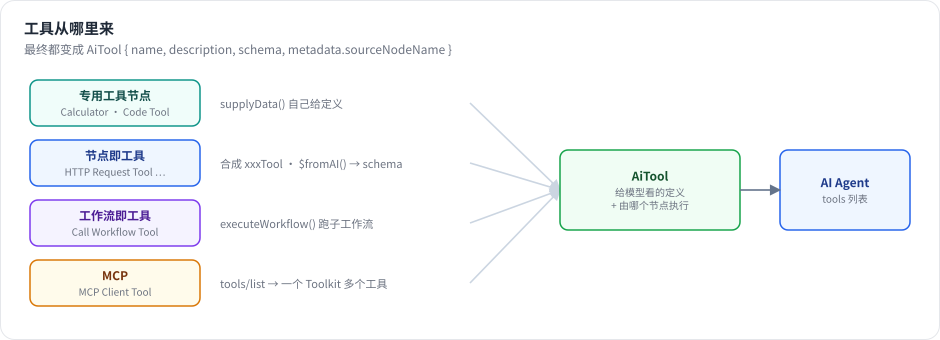

# 第 20 章 工具体系：节点即工具、`$fromAI`、Workflow Tool、MCP

> 本章目标：读完你能把任何一个已有节点变成 Agent 的工具，用 `$fromAI()` 让模型填写参数，把一个子工作流或一整个 MCP 服务器的工具接给 Agent，并理解 n8n 反过来把自己的工作流暴露成 MCP 工具的方式。前置：第 19 章。对应代码：mini-n8n v0.4 的 `packages/core/src/node-as-tool.ts`、`node-types.ts`、`packages/nodes-ai/src/nodes/tools.ts`、`mcp-client.ts`

## 1. 问题与概念

Agent 有多强，取决于它能用的工具。n8n 有 400 多个集成节点，如果每个都要专门写一个“工具版”，工作量不可想象。n8n 用了四种方式获得工具：

| 方式 | 例子 | 工具定义从哪来 |
|---|---|---|
| 专用工具节点 | Calculator、Code Tool、Wikipedia、Vector Store Tool | 节点自己的 `supplyData()` |
| **节点即工具** | Gmail Tool、Slack Tool、HTTP Request Tool…… | 从普通节点 **自动合成**，参数用 `$fromAI()` 声明 |
| 工作流即工具 | Call n8n Workflow Tool | 子工作流，输入由模型填写 |
| MCP | MCP Client Tool | 外部 MCP 服务器的 `tools/list` |

反过来，n8n 也能 **提供** 工具：MCP Server Trigger 把连在它上面的工具暴露成一个 MCP 服务器，供 Claude Desktop、Cursor 等外部 Agent 使用。



*图 20-1：四种工具来源最后都变成同一种东西：一个带名字、描述和参数 schema 的工具定义，加上一个“谁来执行”的节点名（`sourceNodeName`）。*

## 2. n8n 是怎么做的

### 2.1 节点即工具：合成 `xxxTool` 类型

节点描述里写了 `usableAsTool: true` 的节点（`packages/nodes-base/nodes` 下有 272 个文件声明了它），在节点列表里会多出一个 “xxx Tool” 版本。这个类型并不存在于任何源文件里，是加载时 **合成** 的。第 5 章提过 `NodeTypes.getByNameAndVersion` 里的这段：

```ts
// packages/cli/src/node-types.ts:100-158（节选）
getByNameAndVersion(nodeType: string, version?: number): INodeType {
	const origType = nodeType;
	const { baseName, isSyntheticTool } = this.resolveBaseName(nodeType);
	// If an existing node name ends in `Tool`, then return that node, instead of creating a fake Tool node
	if (nodeType.endsWith('Tool') && !isSyntheticTool) {
		const node = this.loadNodesAndCredentials.getNode(nodeType);
		return NodeHelpers.getVersionedNodeType(node.type, version);
	}
	const node = this.loadNodesAndCredentials.getNode(baseName);
	const versionedNodeType = NodeHelpers.getVersionedNodeType(node.type, version);
	...
	// Instead of modifying the existing type, we extend it into a new type object
	const clonedProperties = Object.create(versionedNodeType.description.properties) as INodeTypeDescription['properties'];
	const clonedDescription = Object.create(versionedNodeType.description, { properties: { value: clonedProperties, writable: isHitlTool } }) as INodeTypeDescription;
	const clonedNode = Object.create(versionedNodeType, { description: { value: clonedDescription } }) as INodeType;

	// For HITL tools, use convertNodeToHitlTool; for regular AI tools, use convertNodeToAiTool
	const tool = isHitlTool ? convertNodeToHitlTool(clonedNode) : convertNodeToAiTool(clonedNode);

	loadedNodes[cacheKey] = { sourcePath: '', type: tool };
	return tool;
}
```

`Object.create(原型)` 是一个巧妙的写法：新类型 **继承** 原节点的一切（包括 `execute`），只覆盖描述。描述的改造在 `convertNodeToAiTool`：

```ts
// packages/cli/src/tool-generation/ai-tools.ts:29-79（节选）
export function convertNodeToAiTool(item) {
	if (isFullDescription(item.description)) {
		item.description.name += 'Tool';
		item.description.inputs = [];
		item.description.outputs = [NodeConnectionTypes.AiTool];
		item.description.displayName += ' Tool';
		delete item.description.usableAsTool;
		...
		if (!item.description.properties.map((prop) => prop.name).includes('toolDescription')) {
			...
			const descProp: INodeProperties = {
				displayName: 'Description',
				name: 'toolDescription',
				type: 'string',
				default: item.description.description,
				required: true,
				typeOptions: { rows: 2 },
				description: 'Explain to the LLM what this tool does, a good, specific description would allow LLMs to produce expected results much more often',
			};
```

改造只有三点：没有输入、输出改为 `ai_tool`、增加一个“工具描述”参数（给模型看的）。节点原有的所有参数和 `execute()` 都保留。

合成的工具节点没有 `supplyData`。第 16 章提到，`getInputConnectionData` 遇到这种节点时调用 `createNodeAsTool()` 当场生成工具定义。

### 2.2 `$fromAI()`：让模型填参数

工具定义需要参数 schema，但一个 Slack 节点有几十个参数，哪些该由模型填写？n8n 的答案是：**用户在参数里写 `$fromAI()` 表达式**。

```text
Channel:  #support                              ← 固定值
Message:  {{ $fromAI('message', 'The text to post', 'string') }}   ← 模型填
```

`createNodeAsTool` 扫描节点的所有参数，收集 `$fromAI` 调用，生成 schema：

```ts
// packages/core/src/execution-engine/node-execution-context/utils/create-node-as-tool.ts:43-80（节选）
export function getSchema(node: INode) {
	const collectedArguments: FromAIArgument[] = [];
	try {
		traverseNodeParameters(node.parameters, collectedArguments);
	} catch (error) {
		throw new NodeOperationError(node, error as Error);
	}
	// Validate each collected argument
	const nameValidationRegex = /^[a-zA-Z0-9_-]{1,64}$/;
	const keyMap = new Map<string, FromAIArgument>();
	for (const argument of collectedArguments) {
		if (argument.key.length === 0 || !nameValidationRegex.test(argument.key)) {
			...
		}
		if (keyMap.has(argument.key)) {
			// If the key already exists in the Map
			const existingArg = keyMap.get(argument.key)!;
			// Check if the existing argument has the same description and type
			if (existingArg.description !== argument.description || existingArg.type !== argument.type) {
				throw new NodeOperationError(node, `Duplicate key '${argument.key}' found with different description or type`, ...);
```

解析 `$fromAI('key', 'description', 'type', default)` 的四个参数由 `packages/workflow/src/from-ai-parse-utils.ts` 负责（`extractFromAICalls`，第 251 行），它要正确处理参数里的引号、转义和嵌套括号——手写过表达式解析器的人都知道这不简单。schema 被转成 Zod（`generateZodSchema`，第 27 行），再交给 LangChain 的 `DynamicStructuredTool`。

运行时，引擎执行这个工具节点（第 19 章），输入 item 是模型给的参数；表达式求值时 `$fromAI('message')` 从输入里取 `message` 字段。

### 2.3 工作流即工具

Call n8n Workflow Tool（`nodes/tools/ToolWorkflow`）让 Agent 调用另一个工作流。它的价值在于：**把一段确定性的流程封装成一个原子能力**。例如“查询客户订单”可能涉及鉴权、两次 API 调用、数据清洗——与其让 Agent 一步步摸索，不如做成一个工作流，Agent 只需决定“要不要查、查谁”。

子工作流以 Execute Workflow Trigger 开始，执行记录单独保存，并和父执行关联（第 24 章）。

### 2.4 MCP：一个协议，任意工具

Model Context Protocol 是一个开放协议：工具提供方实现一个 **MCP 服务器**，任何 **MCP 客户端**（Claude Desktop、Cursor、n8n……）都能列出并调用它的工具。协议基于 JSON-RPC 2.0，核心方法只有三个：`initialize`、`tools/list`、`tools/call`；传输层目前主流是 “Streamable HTTP”（POST 请求，响应可以是 JSON 或 SSE 流）。

**MCP Client Tool** 节点连接一个 MCP 服务器，把它的所有工具作为一个 **Toolkit** 交给 Agent。Toolkit 是“一个节点提供多个工具”：每个工具的 `sourceNodeName` 都是同一个 MCP 节点，引擎执行这个节点时，输入里带一个 `tool` 字段说明调用的是哪个工具（第 18 章的 `isFromToolkit` 分支）。

**MCP Server Trigger** 反过来：

```ts
// packages/@n8n/nodes-langchain/nodes/mcp/McpTrigger/McpTrigger.node.ts:65-112（节选）
description: INodeTypeDescription = {
	...
	description: 'Expose n8n tools as an MCP Server endpoint',
	...
	inputs: [
		{
			type: NodeConnectionTypes.AiTool,
			displayName: 'Tools',
		},
	],
	outputs: [],
```

它的输入是 `ai_tool`：任何能接给 Agent 的工具，都能接给它，从而被外部 Agent 使用。`McpTrigger/` 目录下有完整的会话管理、SSE / Streamable HTTP 传输实现（见同目录 `README.md` 的架构图）。

## 3. 从零实现

### 3.1 合成工具类型

```ts
// code/mini-n8n/packages/core/src/node-types.ts（节选）
getByNameAndVersion(name: string): INodeType {
	const type = this.types[name];
	if (type) return type;
	// "n8n-nodes-base.httpRequestTool": synthesize a tool from the base node (n8n does the same)
	if (name.endsWith('Tool')) {
		const base = this.types[name.slice(0, -4)];
		if (base?.description.usableAsTool && base.execute) {
			const tool = convertNodeToAiTool(base);
			this.types[name] = tool;
			return tool;
		}
	}
	throw new UserError(`Unrecognized node type: ${name}`);
}
```

```ts
// code/mini-n8n/packages/core/src/node-as-tool.ts（节选）
export function convertNodeToAiTool(base: INodeType): INodeType {
	const { description } = base;
	return {
		description: {
			...description,
			name: `${description.name}Tool`,
			displayName: `${description.displayName} Tool`,
			inputs: [],
			outputs: ['ai_tool'],
			...
			properties: [toolDescriptionProperty, ...description.properties],
		},
		async supplyData(this: ISupplyDataFunctions): Promise<{ response: AiTool }> {
			const node = this.getNode();
			const tool: AiTool = {
				name: nodeNameToToolName(node.name),
				description: (node.parameters.toolDescription as string) || description.description,
				schema: extractFromAIParameters(node.parameters),
				metadata: { sourceNodeName: node.name },
			};
			return { response: tool };
		},
		async execute(this: IExecuteFunctions) {
			return await base.execute!.call(this);
		},
	};
}
```

mini-n8n 直接在合成的类型上实现 `supplyData`（n8n 是在 `getInputConnectionData` 里用 `createNodeAsTool` 现场生成），效果相同。HTTP Request 节点加上 `usableAsTool: true`，编辑器的节点列表里就出现了 “HTTP Request Tool”。

### 3.2 `$fromAI()`

收集 schema 用一个正则扫描所有以 `=` 开头的参数（`extractFromAIParameters`）。运行时的取值放在 `ExecuteContext.additionalKeys`：

```ts
// code/mini-n8n/packages/core/src/execute-context.ts（节选）
/** Extra `$variables` for expressions. A tool node run for an Agent gets `$fromAI`. */
protected additionalKeys(itemIndex: number): IDataObject {
	const outputs = normalizeConnectionList(this.nodeType.description.outputs, this.node.parameters);
	if (outputs.some((o) => o.type === 'ai_tool')) return fromAIKeys(this.getInputData()[itemIndex]?.json ?? {});
	return {};
}
```

```ts
// code/mini-n8n/packages/core/src/node-as-tool.ts（节选）
export function fromAIKeys(args: IDataObject) {
	return {
		$fromAI: (key: string, _description?: string, _type?: string, defaultValue?: unknown) => (key in args ? args[key] : defaultValue),
	};
}
```

在编辑器里预览时没有模型参数，`WorkflowDataProxy` 提供一个默认的 `$fromAI`，返回占位符 `[filled by the model: key]`。

### 3.3 Workflow Tool

```ts
// code/mini-n8n/packages/nodes-ai/src/nodes/tools.ts（节选）
async execute(this: IExecuteFunctions) {
	const out: INodeExecutionData[] = [];
	for (const [i, item] of this.getInputData().entries()) {
		const workflowId = this.getNodeParameter('workflowId', i) as string;
		const result = await this.executeWorkflow(workflowId, [{ json: toolArgs(this, item, ['query']) }]);
		const values = result.map((r) => r.json);
		out.push({ json: { response: values.length === 1 ? values[0] : values }, pairedItem: { item: i } });
	}
	return [out];
}
```

`this.executeWorkflow` 由服务端通过 `additionalData.executeWorkflow` 提供：`WorkflowRunner.runSubWorkflow` 从数据库加载工作流，以 `integrated` 模式启动一次执行并等待它结束，返回最后一个节点的输出（`packages/cli/src/workflow-runner.ts`）。

### 3.4 MCP 客户端

不到 80 行的最小客户端：

```ts
// code/mini-n8n/packages/nodes-ai/src/mcp-client.ts（节选）
private async rpc(method: string, params?: unknown, notification = false): Promise<unknown> {
	const body = notification ? { jsonrpc: '2.0', method, params } : { jsonrpc: '2.0', id: this.nextId++, method, params };
	const res = await fetch(this.url, {
		method: 'POST',
		headers: {
			'content-type': 'application/json',
			accept: 'application/json, text/event-stream',
			...(this.sessionId ? { 'mcp-session-id': this.sessionId } : {}),
			...this.headers,
		},
		body: JSON.stringify(body),
	});
	this.sessionId = res.headers.get('mcp-session-id') ?? this.sessionId;
	...
	const json = (res.headers.get('content-type') ?? '').includes('text/event-stream')
		? JSON.parse(text.split('\n').filter((l) => l.startsWith('data:')).map((l) => l.slice(5)).at(-1) ?? '{}')
		: JSON.parse(text);
```

要点：服务器在 `initialize` 的响应头里给出 `mcp-session-id`，之后每个请求都要带上；响应可能是 JSON，也可能是 SSE 流（取最后一条 `data:`）。

MCP Client Tool 节点的 `supplyData` 列出工具、包装成 Toolkit；`execute` 再连接一次，按输入里的 `tool` 字段调用。`execute` 只把该工具 schema 里声明的字段作为参数传过去，因为引擎给工具的输入里还混着 Agent 的输入字段（`chatInput`、`sessionId`……）。

`examples/mcp-server.ts` 是一个 60 行的 MCP 服务器，提供 `get_weather` 和 `get_time` 两个工具，供测试和演示使用。

| 方面 | n8n | mini-n8n |
|---|---|---|
| 节点即工具 | 数百个节点；`Object.create` 继承原型；资源/操作自动生成描述 | HTTP Request；展开复制描述 |
| `$fromAI` | 完整解析器，Zod schema，校验重复键 | 正则提取，JSON schema |
| Workflow Tool | 选择工作流、映射输入字段（含 `$fromAI`）、等待子执行 | 固定一个 `query` 参数 |
| MCP Client | 官方 SDK，SSE / Streamable HTTP，鉴权，工具过滤 | 最小 Streamable HTTP 客户端 |
| MCP Server Trigger | 有 | 无（练习） |

## 4. 运行与验证

节点即工具（`packages/nodes-ai/test/agent.test.ts`）：一个 HTTP Request Tool 的 URL 写成

```text
={{ "http://127.0.0.1:PORT/forecast?q=" + encodeURIComponent($fromAI("question", "what the user asked", "string")) }}
```

测试断言：工具定义的 schema 里有 `question`；本地测试服务器收到的请求是 `/forecast?q=What%20is%20the%20weather%20like%3F`；工具运行记录的 `inputOverride` 是 `{ question: 'What is the weather like?' }`。

MCP（`examples/mcp-agent.ts`，在进程内启动示例 MCP 服务器），真实输出：

```text
tools/list -> get_weather(city), get_time()
MCP Client  in={"city":"How is the weather in Paris?","tool":"get_weather"} out={"response":"Sunny, 22°C in Paris"}
answer     : Based on the tools: get_weather returned Sunny, 22°C in Paris.
```

Workflow Tool 由服务端集成测试覆盖（`packages/cli/test/ai.test.ts`）：子工作流的执行被单独保存，`mode` 为 `integrated`。

```text
✓ workflow tool > runs another workflow as a tool and stores it as its own execution
```

## 5. 练习

1. **巩固**：在编辑器里给 Agent 接一个 HTTP Request Tool，URL 用 `https://httpbin.org/anything?city={{ $fromAI('city', 'the city name', 'string') }}`，用 Ollama 模型问 “What is the weather in Tokyo?”，在工具节点的 NDV 里看模型填了什么。
2. **扩展**：实现 MCP Server Trigger：一个 Webhook 类触发器，`inputs` 是 `ai_tool`；收到 `tools/list` 时返回连着的工具定义（通过 `getInputConnectionData`），收到 `tools/call` 时执行对应的工具节点并返回结果。
3. **读源码**：阅读 n8n 的 `extractFromAICalls()`（`packages/workflow/src/from-ai-parse-utils.ts:251`），找出它如何处理描述里含有逗号和引号的情况，例如 `$fromAI('q', 'a "quoted", text')`。

## 6. 延伸阅读

- `packages/cli/src/tool-generation/`：节点即工具的描述改造。
- `packages/@n8n/nodes-langchain/nodes/mcp/`：MCP 客户端与服务器。
- MCP 规范：<https://modelcontextprotocol.io/>
