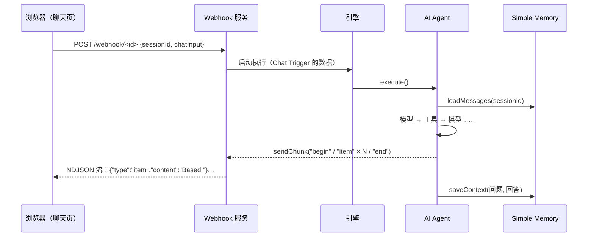
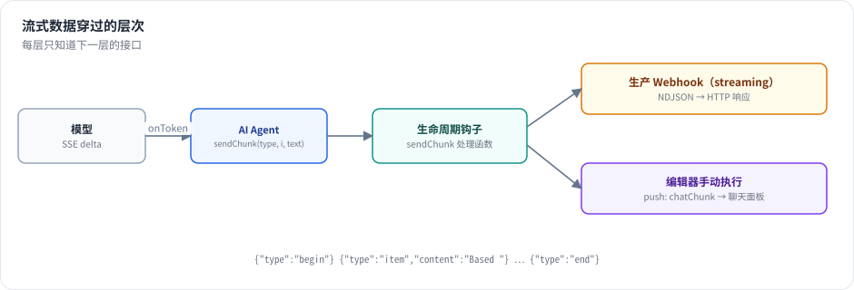
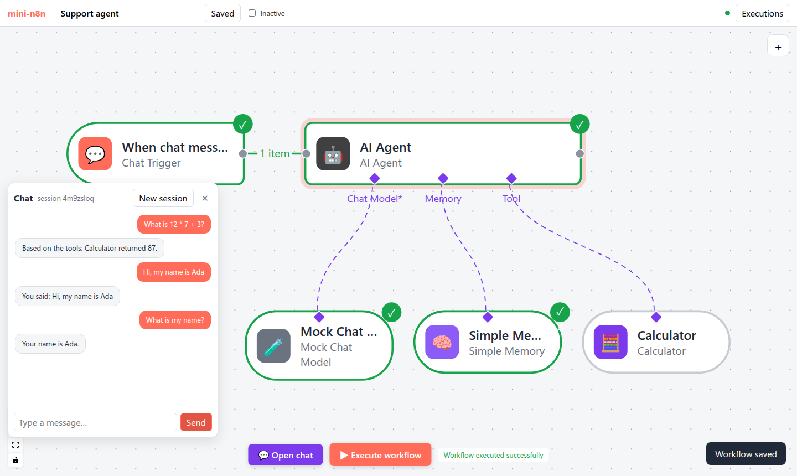
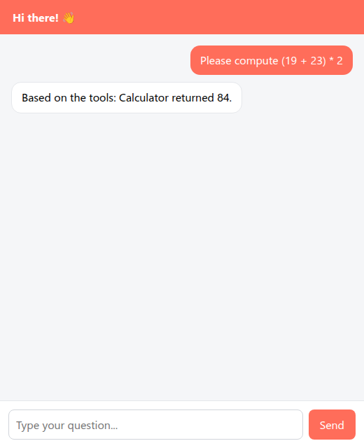

# 第 21 章 记忆、Chat Trigger 与流式响应

> 本章目标：读完你能搭一个完整的聊天机器人链路：用户在网页里打字 → Chat Trigger 启动执行 → Agent 读取会话记忆、调用工具 → 答案逐字流回浏览器；并理解记忆按会话隔离的方式、流式数据如何穿过引擎和 HTTP。前置：第 12、18、19 章。对应代码：mini-n8n v0.4 的 `memory/buffer-window.ts`、`nodes/chat-trigger.ts`、`webhooks/webhook-helpers.ts`（streaming 分支）、`editor/src/components/ChatPanel.vue`

## 1. 问题与概念

聊天是 Agent 最常见的入口。一次聊天消息在系统里的旅程：



三个要点：

1. **会话（session）**：同一个用户的多条消息共享一段历史，不同用户互不干扰。区分它们的是 Chat Trigger 输出的 `sessionId`，记忆节点用它作为键。
2. **一条消息 = 一次执行**：每条消息都是一次独立的工作流执行。“对话”的连续性完全靠记忆子节点。
3. **流式**：模型生成一个词，就立刻送到浏览器，而不是等整个执行结束。数据要穿过三层：模型 → Agent（`sendChunk`）→ 生命周期钩子 → HTTP 响应。



*图 21-1：模型的每个 token 通过 `onToken` 回调到达 Agent；Agent 调用 `sendChunk`；`sendChunk` 钩子由创建执行的一方注册——生产 Webhook 写进 HTTP 响应（NDJSON），编辑器里的手动执行则通过推送发给标签页。*

## 2. n8n 是怎么做的

### 2.1 Simple Memory：进程内的会话缓存

```ts
// packages/@n8n/nodes-langchain/nodes/memory/MemoryBufferWindow/MemoryBufferWindow.node.ts:22-72（节选）
class MemoryChatBufferSingleton {
	private static instance: MemoryChatBufferSingleton;
	private memoryBuffer: Map<string, { buffer: BufferWindowMemory; created: Date; last_accessed: Date }>;
	...
	async getMemory(sessionKey: string, memoryParams: BufferWindowMemoryInput): Promise<BufferWindowMemory> {
		await this.cleanupStaleBuffers();

		let memoryInstance = this.memoryBuffer.get(sessionKey);
		if (memoryInstance) {
			memoryInstance.last_accessed = new Date();
		} else {
			const newMemory = new BufferWindowMemory(memoryParams);
			memoryInstance = { buffer: newMemory, created: new Date(), last_accessed: new Date() };
			this.memoryBuffer.set(sessionKey, memoryInstance);
		}
		return memoryInstance.buffer;
	}

	private async cleanupStaleBuffers(): Promise<void> {
		const oneHourAgo = new Date(Date.now() - 60 * 60 * 1000);
		for (const [key, memoryInstance] of this.memoryBuffer.entries()) {
			if (memoryInstance.last_accessed < oneHourAgo) {
				await this.memoryBuffer.get(key)?.buffer.clear();
				this.memoryBuffer.delete(key);
			}
		}
	}
}
```

一个进程级单例，`sessionKey → 记忆` 的 Map，一小时没访问就清理。“Window” 指只保留最近 K 轮（参数 Context Window Length）。

它的局限也很明显：**进程重启就丢；队列模式下多个 worker 各有一份，同一个会话的消息落到不同 worker 上就“失忆”**。所以 n8n 还提供 Postgres、Redis、MongoDB 等持久化记忆节点（`nodes/memory/` 下）。Simple Memory 适合开发和单进程部署。

Session Key 参数默认是 `{{ $json.sessionId }}`：记忆节点的参数在 Agent 的输入 item 上求值（第 16 章的 `SupplyDataContext`），而 Agent 的输入来自 Chat Trigger。

### 2.2 Chat Trigger：两个 Webhook

```ts
// packages/@n8n/nodes-langchain/nodes/trigger/ChatTrigger/ChatTrigger.node.ts:379-396（节选）
webhooks: [
	{
		name: 'setup',
		httpMethod: 'GET',
		responseMode: 'onReceived',
		path: CHAT_TRIGGER_PATH_SUFFIX,
		ndvHideUrl: true,
	},
	{
		name: 'default',
		httpMethod: 'POST',
		responseMode: '={{$parameter.options?.["responseMode"] ?? ($parameter.availableInChat ? "streaming" : "lastNode") }}',
		path: CHAT_TRIGGER_PATH_SUFFIX,
		ndvHideMethod: true,
		ndvHideUrl: isPublicChatTriggerDisabled() ? true : '={{ !$parameter.public }}',
	},
],
```

同一个路径，`GET` 返回托管的聊天页面（公开聊天，`public` 参数开启时），`POST` 接收消息并启动执行。`POST` 的响应模式是第 12 章的四种之一，聊天场景首选 `streaming`。节点描述里给 AI 工作流构建器的提示（第 141 行起的 `responseModeBuilderHint`）把规则写得很清楚：`lastNode` 模式下最后一个节点必须输出 `{ output: '...' }`，`streaming` 模式下 Agent 直接把回复流给聊天窗口。

编辑器里还有一个 “Open chat” 面板：它不走生产 URL，而是触发一次 **手动执行**，消息作为 Chat Trigger 的数据，画布照常显示执行过程（`packages/cli/src/chat/` 下的聊天执行管理）。

### 2.3 流式：sendChunk 钩子写进 HTTP 响应

第 17 章看到 Agent 在流式模式下调用 `ctx.sendChunk('begin' | 'item' | 'end', itemIndex, text)`。`sendChunk` 只是调用生命周期钩子；真正写 HTTP 的处理函数是 `WorkflowRunner` 注册的：

```ts
// packages/cli/src/workflow-runner.ts:633-638
if (data.streamingEnabled) {
	lifecycleHooks.addHandler('sendChunk', (chunk) => {
		data.httpResponse?.write(JSON.stringify(chunk) + '\n');
		if (data.httpResponse) flushResponse(data.httpResponse);
	});
}
```

每个块是一行 JSON（NDJSON），`flushResponse` 确保它立刻发出，而不是被缓冲。块的结构是 `{ type, content, metadata: { nodeName, itemIndex, runIndex } }`；`metadata` 让客户端区分多个 Agent 的输出（一个工作流里可以有几个 Agent 先后流式输出）。

Agent 怎么知道“有没有人在听”？`ctx.isStreaming()` 检查是否注册了 `sendChunk` 处理函数。没人听时（定时触发、`lastNode` 模式），Agent 走普通的 `invoke`。

## 3. 从零实现

### 3.1 记忆

```ts
// code/mini-n8n/packages/nodes-ai/src/memory/buffer-window.ts（节选）
const sessions = new Map<string, ChatMessage[]>();

export class BufferWindowMemory implements ChatMemory {
	constructor(readonly sessionKey: string, private readonly windowSize: number) {}

	async loadMessages(): Promise<ChatMessage[]> {
		return (sessions.get(this.sessionKey) ?? []).slice(-this.windowSize * 2);
	}

	async saveContext(input: string, output: string): Promise<void> {
		const history = sessions.get(this.sessionKey) ?? [];
		history.push({ role: 'user', content: input }, { role: 'assistant', content: output });
		sessions.set(this.sessionKey, history);
	}
}
```

一轮 = 一问一答两条消息，所以窗口是 `K * 2` 条。Agent 在拼消息时把历史放在 system 之后、本轮用户消息之前（第 18 章）。

### 3.2 Chat Trigger

```ts
// code/mini-n8n/packages/nodes-ai/src/nodes/chat-trigger.ts（节选）
webhooks: [
	{ name: 'default', httpMethod: 'GET', path: '={{ $parameter.path }}', responseMode: 'onReceived' },
	{ name: 'default', httpMethod: 'POST', path: '={{ $parameter.path }}', responseMode: '={{ $parameter.responseMode }}' },
],
...
async webhook(this: IWebhookFunctions): Promise<IWebhookResponseData> {
	const req = this.getRequestObject();
	if (req.method === 'GET') {
		return { webhookResponse: chatPage(String(this.getNodeParameter('title', 'Chat'))), webhookResponseContentType: 'text/html; charset=utf-8' };
	}
	const body = (typeof req.body === 'string' ? JSON.parse(req.body || '{}') : req.body) as IDataObject;
	return {
		workflowData: [[{ json: { sessionId: body.sessionId ?? 'default', action: body.action ?? 'sendMessage', chatInput: body.chatInput ?? '' } }]],
	};
},
```

`GET` 返回一个内嵌的单文件聊天页面：它生成随机 `sessionId`，用 `fetch` 发送消息，读取 NDJSON 流并把 `item` 块的文字逐个追加到气泡里。路径参数为空时，Webhook 路径退回到节点的 `webhookId`（编辑器添加带 Webhook 的节点时生成一个随机 ID）。

### 3.3 流式 Webhook

`executeWebhook` 增加 `streaming` 分支：

```ts
// code/mini-n8n/packages/cli/src/webhooks/webhook-helpers.ts（节选）
if (webhook.responseMode === 'streaming') {
	// chunks (Agent tokens) are queued as NDJSON lines until the HTTP response picks them up
	const queue: string[] = [];
	let wake: (() => void) | undefined;
	let streamedItems = 0;
	const enqueue = (line: string) => { queue.push(line); wake?.(); };
	const executionId = await deps.executionService.runWorkflow(workflowData, node.name, result.workflowData[0], mode, pushRef, {
		streamTo: (chunk) => {
			if (chunk.type === 'item') streamedItems++;
			enqueue(`${JSON.stringify(chunk)}\n`);
		},
	});
	...
	void deps.activeExecutions.getPostExecutePromise(executionId).then((run) => {
		// nothing was streamed (no Agent, or streaming off): send the final answer as one item
		if (!streamedItems) enqueue(`${JSON.stringify({ type: 'item', content: lastNodeText(run) })}\n`);
		done = true;
		wake?.();
	});
	const stream = async (write: (line: string) => void) => {
		for (;;) {
			while (queue.length) write(queue.shift()!);
			if (done) return;
			await new Promise<void>((r) => (wake = r));
			wake = undefined;
		}
	};
	return { executionId, reply: { statusCode: 200, headers: { 'content-type': 'application/x-ndjson; charset=utf-8' }, stream } };
}
```

`WorkflowRunner` 看到 `streamTo` 就注册 `sendChunk` 处理函数（和 n8n 一样只在需要时注册，所以 `isStreaming()` 能判断有没有人在听）。一个小的生产者–消费者队列把“引擎产生块”和“HTTP 写出块”解耦：块可能在响应开始之前就产生了。如果整个执行都没有流式输出（例如工作流里没有 Agent），最后把结果作为一个块发出，客户端不需要区分两种情况。

### 3.4 编辑器里的聊天面板

手动执行时，`hookFunctionsPush` 也注册了 `sendChunk`，把块变成 `chatChunk` 推送消息发给标签页。聊天面板（`ChatPanel.vue`）把属于自己发起的执行的块拼成回答。

**踩坑记录**（真实遇到）：第一版聊天面板在发送第二条消息后一直显示 “…”。原因是 **推送比 HTTP 响应先到**：面板在 `POST /rest/workflows/:id/chat` 返回之后才知道 `executionId`，而对于很快的执行，所有 `chatChunk` 和 `executionFinished` 推送在此之前就到了，被当作“不认识的执行”丢弃。修复是按执行 ID 缓存早到的消息，拿到 ID 后再应用。同样的竞态也让画布在聊天执行后卡在 “Executing…”：执行状态 store 收到 `executionFinished` 时还不认识这个执行。修复方式相同（`finishedEarly`）。第一条消息没有触发这个问题，第二条才触发，正说明它取决于时序——这类 bug 只有用真实浏览器反复跑才容易暴露。

| 方面 | n8n | mini-n8n |
|---|---|---|
| Simple Memory | 进程单例，1 小时清理，LangChain `BufferWindowMemory` | 进程内 Map，不清理 |
| 持久化记忆 | Postgres / Redis / MongoDB / Zep… | 无（第 16 章练习） |
| 记忆裁剪 | 按 token（`maxTokensFromMemory`） | 按轮数 |
| Chat Trigger | 公开聊天页（`@n8n/chat` 组件）、鉴权、初始消息、文件上传、Chat Hub | 内嵌单文件页面 |
| 流式协议 | NDJSON 块，带节点名和运行序号 | 相同格式 |

## 4. 运行与验证

服务端集成测试（`packages/cli/test/ai.test.ts`）激活一个 Chat Trigger（streaming）→ Agent（Mock 模型 + 计算器）的工作流，`POST /webhook/support`：

```text
✓ chat > streams the agent answer as NDJSON from the production chat URL
✓ chat > answers with JSON in lastNode mode
✓ chat > the editor chat runs a manual execution and pushes the streamed tokens
```

第一个测试断言响应头是 `application/x-ndjson`，最后一块是 `end`，所有 `item` 块拼起来正好是 `Based on the tools: Calculator returned 437.`。

浏览器端的端到端测试（`e2e/ai.e2e.mjs`，真实输出）：

```text
✓ sub-nodes added from the node creator were connected to the Agent with AI connections
✓ chat answer streamed into the panel: "Based on the tools: Calculator returned 87."
✓ canvas shows the trigger, the Agent and its 3 sub-nodes as executed
✓ Simple Memory: the third message remembers the second ("Your name is Ada.")
✓ the model node shows 2 runs (ask for tool, then answer)
✓ the Calculator NDV shows the arguments chosen by the model as its input
✓ public chat page (streaming webhook): "Based on the tools: Calculator returned 84."
✓ no errors in the browser console
```



*图 21-2：编辑器聊天面板里的三轮对话。第二轮说 “my name is Ada”，第三轮问 “What is my name?”，Agent 从 Simple Memory 里读到了上一轮。第三轮没有调用工具，所以 Calculator 是灰色的。*



*图 21-3：工作流激活后，`GET /webhook/<id>` 返回的公开聊天页。回答是通过 NDJSON 流逐词显示出来的。*

## 5. 练习

1. **巩固**：用 curl 体验流式：`curl -N -X POST localhost:5678/webhook/<id> -H 'content-type: application/json' -d '{"sessionId":"a","chatInput":"What is 6 * 7?"}'`，观察每一行到达的时间（给 Mock Chat Model 设置 100ms 的 Delay per token）。
2. **扩展**：给 Simple Memory 加上 n8n 的过期清理：一小时没访问的会话自动删除；写一个用假时钟的测试。
3. **读源码**：阅读 n8n 的 `ChatTrigger.node.ts` 中 `responseMode` 为 `responseNodes` 的分支和 `Chat.node.ts`，说明“一个工作流里多次向聊天窗口回复”是怎么实现的。

## 6. 延伸阅读

- `packages/@n8n/nodes-langchain/nodes/memory/`：所有记忆节点。
- `packages/@n8n/nodes-langchain/nodes/trigger/ChatTrigger/`：Chat Trigger 与托管聊天页。
- `packages/frontend/@n8n/chat/`：n8n 的可嵌入聊天组件（可以单独用 npm 安装到任何网站）。
