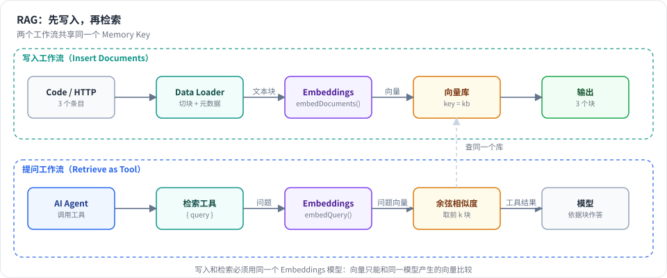
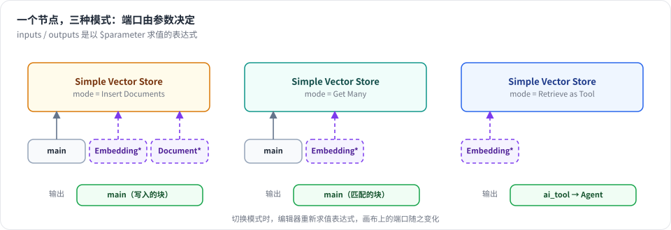
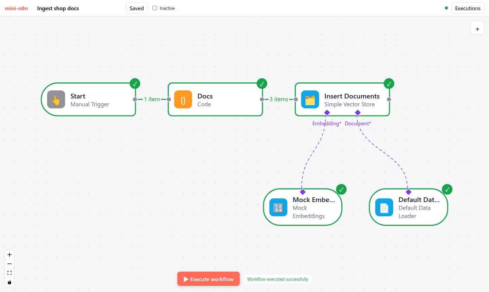
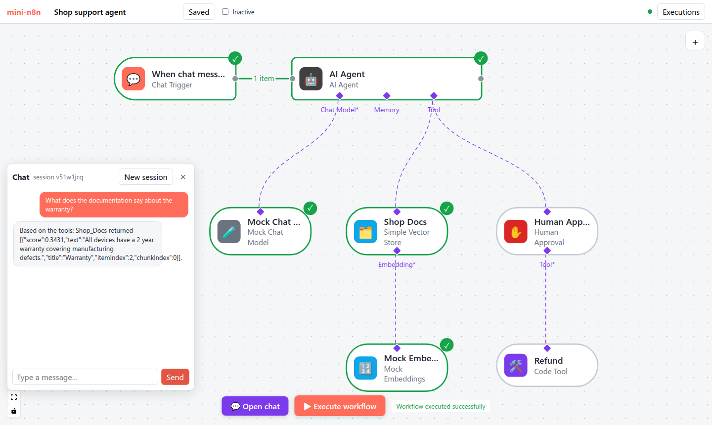

# 第 22 章 RAG：Embeddings、向量存储与检索工具

> 本章目标：读完你能给 Agent 接上一个“知识库”：把文档切块、向量化、存进向量库，再让 Agent 把检索当成一个工具来调用；并理解 n8n 怎样用 **一个节点、多种模式** 覆盖写入和检索。前置：第 16、18、19 章。对应代码：mini-n8n v0.5 的 `nodes-ai/src/rag/`、`nodes-ai/src/nodes/rag.ts`

## 1. 问题与概念

模型只知道训练时见过的东西。你店铺的退货政策、内部文档、昨天才更新的价格表，它都不知道。直接把所有文档塞进提示词又太长、太贵。

**RAG（Retrieval-Augmented Generation，检索增强生成）** 的做法是：先从知识库里找出和问题最相关的几段文字，只把这几段交给模型。“找出最相关”靠的是 **向量相似度**：

- **Embedding（向量化）**：一个模型把一段文字变成一个固定长度的数字数组（比如 768 维）。意思相近的文字，向量的方向也相近。
- **向量库**：保存“文本块 + 向量 + 元数据”。查询时把问题也向量化，按 **余弦相似度** 排序，取前 k 个。
- **切块（chunking）**：一篇长文档要切成几百字的小块再向量化。块太大，检索不准；块太小，丢失上下文。相邻块之间通常重叠一部分。

RAG 由两条流水线组成：



*图 22-1：写入工作流把条目切块、向量化后存入向量库；提问工作流里，Agent 调用检索工具，工具把问题向量化，在同一个库里取前 k 块，作为工具结果交给模型。*

在 n8n 里，这些都是 Cluster Node 的子节点（第 16 章）：

| 角色 | 连接类型 | n8n 节点举例 | mini-n8n |
|---|---|---|---|
| 向量化 | `ai_embedding` | Embeddings OpenAI、Embeddings Ollama | Mock Embeddings、Embeddings Ollama |
| 文档加载 + 切块 | `ai_document`（+ `ai_textSplitter`） | Default Data Loader + Recursive Character Text Splitter | Default Data Loader（内置切块） |
| 向量库 | `main` / `ai_tool` / `ai_vectorStore` | Simple Vector Store、PGVector、Qdrant、Pinecone… | Simple Vector Store |

## 2. n8n 是怎么做的

### 2.1 一个工厂函数，几十个向量库

n8n 支持十几种向量库（PGVector、Qdrant、Pinecone、Supabase、Milvus……），但每个节点的代码都很短：新版向量库节点都由 `createVectorStoreNode()` 生成（旧版的 `…Insert` / `…Load` 节点除外）。Simple Vector Store 的定义：

```ts
// packages/@n8n/nodes-langchain/nodes/vector_store/VectorStoreInMemory/VectorStoreInMemory.node.ts:54
export class VectorStoreInMemory extends createVectorStoreNode<MemoryVectorStore>({
	meta: {
		displayName: 'Simple Vector Store',
		name: 'vectorStoreInMemory',
		...
```

每种向量库只需要提供几个函数：`getVectorStoreClient`（拿到一个 LangChain `VectorStore`）、`populateVectorStore`（写入）等。模式切换、参数、端口、日志都由工厂处理。工厂在 `packages/@n8n/ai-utilities/src/utils/vector-store/createVectorStoreNode/createVectorStoreNode.ts`，各模式的实现在同目录的 `operations/` 下。

### 2.2 端口由模式决定

同一个节点有 5 种模式：`load`（Get Many）、`insert`、`update`、`retrieve`（作为 Vector Store 给 Retriever 用）、`retrieve-as-tool`（作为 Agent 的工具）。不同模式需要不同的连接，所以 `inputs` 和 `outputs` 不是数组，而是一个以 `$parameter` 求值的表达式：

```ts
// packages/@n8n/ai-utilities/src/utils/vector-store/createVectorStoreNode/createVectorStoreNode.ts:234
inputs: `={{
((parameters) => {
	const mode = parameters?.mode;
	const useReranker = parameters?.useReranker;
	const inputs = [{ displayName: "Embedding", type: "${NodeConnectionTypes.AiEmbedding}", required: true, maxConnections: 1}]
	...
	if (mode === 'retrieve-as-tool') {
		return inputs;
	}
	if (['insert', 'load', 'update'].includes(mode)) {
		inputs.push({ displayName: "", type: "${NodeConnectionTypes.Main}"})
	}
	if (['insert'].includes(mode)) {
		inputs.push({ displayName: "Document", type: "${NodeConnectionTypes.AiDocument}", required: true, maxConnections: 1})
	}
	return inputs
})($parameter)
}}`,
```

`outputs`（同文件 `:258`）也一样：`retrieve-as-tool` 输出 `ai_tool`，`retrieve` 输出 `ai_vectorStore`，其余输出 `main`。第 16 章已经见过这个机制：AI Agent 用它在勾选 “Require Specific Output Format” 时多出一个 Output Parser 端口。



*图 22-2：mini-n8n 实现的三种模式。编辑器在参数变化时重新求值表达式，画布上的端口随之变化。*

### 2.3 execute 与 supplyData 各管几种模式

一个节点既可以是普通节点（有 `main` 输入，被引擎调用 `execute`），也可以是子节点（被父节点通过 `supplyData` 拉取）。工厂按模式分派：

```ts
// createVectorStoreNode.ts:417
async execute(this: IExecuteFunctions): Promise<INodeExecutionData[][]> {
	const mode = this.getNodeParameter('mode', 0) as NodeOperationMode;
	const embeddings = (await this.getInputConnectionData(NodeConnectionTypes.AiEmbedding, 0)) as Embeddings;
	if (mode === 'load') { ... }
	if (mode === 'insert') { ... }
	if (mode === 'update') { ... }
	if (mode === 'retrieve-as-tool') { ... handleRetrieveAsToolExecuteOperation(...) }
	...
}

// createVectorStoreNode.ts:479
async supplyData(this: ISupplyDataFunctions, itemIndex: number): Promise<SupplyData> {
	...
	if (mode === 'retrieve') return await handleRetrieveOperation(...);
	if (mode === 'retrieve-as-tool') return await handleRetrieveAsToolOperation(...);
}
```

注意 `retrieve-as-tool` **两边都有**。这正是第 19 章讲的两代工具执行方式：

- `supplyData` 版本（`operations/retrieveAsToolOperation.ts:16`）返回一个带 `func` 的 LangChain 工具，旧版 Agent 在自己内部调用 `func`。
- `execute` 版本（`operations/retrieveAsToolExecuteOperation.ts:16`）供 Agent V3 使用：Agent 返回 EngineRequest，引擎把模型给的参数作为输入条目，调用这个节点的 `execute`。查询从 `item.json.input` 读取（同文件 `:35`）。

### 2.4 写入：先收集，再分批向量化

```ts
// operations/insertOperation.ts:17 起（节选）
const documentInput = await context.getInputConnectionData(NodeConnectionTypes.AiDocument, 0);
for (let itemIndex = 0; itemIndex < items.length; itemIndex++) {
	const processedDocuments = await processDocument(documentInput, itemData, itemIndex);
	resultData.push(...processedDocuments.serializedDocuments);
	documentsForEmbedding.push(...processedDocuments.processedDocuments);
	...
}
// :70
const embeddingBatchSize = (context.getNodeParameter('embeddingBatchSize', 0, 200) as number) ?? 200;
for (let i = 0; i < documentsForEmbedding.length; i += embeddingBatchSize) {
	const nextBatch = documentsForEmbedding.slice(i, i + embeddingBatchSize);
	await args.populateVectorStore(context, embeddings, nextBatch, 0);
}
```

先让文档加载器把所有条目变成文本块，再每 200 块调用一次 Embeddings。批量调用比逐块调用快得多，也更省 API 请求次数。

Default Data Loader 的 “Simple” 切块模式固定使用 `RecursiveCharacterTextSplitter({ chunkSize: 1000, chunkOverlap: 200 })`（`DocumentDefaultDataLoader.node.ts:341`）。选 “Custom” 时才多出一个 Text Splitter 子节点端口。

### 2.5 Simple Vector Store 存在哪里

`MemoryVectorStoreManager`（`packages/@n8n/ai-utilities/src/utils/vector-store/MemoryManager/MemoryVectorStoreManager.ts:15`）是进程内单例，用 `Map<memoryKey, MemoryVectorStore>` 保存所有库，`getInstance()` 在 `:69`。两个节点只要 Memory Key 相同就共享同一个库——写入工作流和提问工作流就是这样连通的。

单例意味着：n8n 重启后数据丢失；多个实例（队列模式）之间不共享。节点上有一条警告说明这一点。为了防止内存被撑爆，可以用环境变量 `N8N_VECTOR_STORE_MAX_MEMORY`（MB）和 `N8N_VECTOR_STORE_TTL_HOURS` 限制大小和闲置时间（`MemoryManager/config.ts:13`、`:22`），默认都是 `-1`（不限制）。生产环境应该换成 PGVector、Qdrant 这样的外部向量库。

## 3. 从零实现

### 3.1 三个接口

~~~~ts
// packages/nodes-ai/src/rag/embeddings.ts
export interface Embeddings {
	modelName: string;
	embedDocuments(texts: string[]): Promise<number[][]>;
	embedQuery(text: string): Promise<number[]>;
}

// packages/nodes-ai/src/rag/documents.ts
export interface Document { pageContent: string; metadata: IDataObject }
export interface DocumentLoader { load(items: INodeExecutionData[]): Promise<Document[]> }
~~~~

和 LangChain 的接口同名同义，只保留了用到的方法。

### 3.2 离线的 Mock Embeddings：哈希技巧

测试和 e2e 不能依赖真实模型，于是需要一个确定的、离线的向量化方法。`MockEmbeddings`（`rag/embeddings.ts:27`）用“哈希技巧”：每个词（和相邻词对）哈希到 256 个桶之一，桶的计数加一，最后归一化。

```ts
private embed(text: string): number[] {
	const v = new Array<number>(DIMENSIONS).fill(0);
	const t = tokens(text);
	t.forEach((tok, i) => {
		v[hash(tok) % DIMENSIONS] += 1;
		if (i > 0) v[hash(`${t[i - 1]} ${tok}`) % DIMENSIONS] += 0.5;
	});
	const norm = Math.hypot(...v) || 1;
	return v.map((x) => x / norm);
}
```

它不懂语义（“refund” 和 “money back” 毫无关系），但共享词语的文本方向相近，足够演示检索。真实向量化用 `OpenAICompatibleEmbeddings`（`:51`），调用 `POST {baseUrl}/embeddings`，OpenAI 和 Ollama 的 `/v1` 都支持。

### 3.3 切块

`splitText(text, size, overlap)`（`rag/documents.ts:18`）是一个简化的递归切块器：每次取 `size` 个字符，尽量在段落、句号或空格处断开，下一块从 `end - overlap` 开始。`DefaultDataLoader`（`:41`）把每个条目的 `textField` 字段切块，其余字段放进元数据，并记下 `itemIndex`、`chunkIndex`：

```ts
const { [this.options.textField]: text, ...rest } = item.json;
splitText(String(text ?? ''), this.options.chunkSize, this.options.chunkOverlap).forEach((chunk, chunkIndex) => {
	docs.push({ pageContent: chunk, metadata: { ...rest, itemIndex, chunkIndex } });
});
```

我们把 n8n 的 Text Splitter 子节点合并进了加载器，少一个节点。

### 3.4 向量库

`rag/memory-vector-store.ts` 只有 57 行：一个 `Map<string, InMemoryVectorStore>`，每个库是一个 `{ vector, document }` 数组；`search()`（`:31`）对所有条目算余弦相似度、排序、取前 k。这是暴力搜索，几千块以内足够快。真正的向量库用 HNSW 等近似最近邻索引，把查询从 O(n) 降到接近 O(log n)。

### 3.5 一个节点，三种模式

`VectorStoreInMemory`（`nodes/rag.ts:82`）照搬 n8n 的动态端口：

```ts
inputs: `={{ (() => {
	const mode = $parameter.mode;
	const inputs = [{ displayName: 'Embedding', type: 'ai_embedding', required: true, maxConnections: 1 }];
	if (mode === 'retrieve-as-tool') return inputs;
	return ['main', ...inputs, ...(mode === 'insert' ? [{ displayName: 'Document', type: 'ai_document', required: true, maxConnections: 1 }] : [])];
})() }}`,
outputs: `={{ $parameter.mode === 'retrieve-as-tool' ? [{ displayName: 'Tool', type: 'ai_tool' }] : ['main'] }}`,
```

`Workflow.getNodeInputs()` 在 v0.4 就会对字符串形式的 `inputs` 求值（`packages/workflow/src/workflow.ts:29`），所以引擎、`getInputConnectionData` 和编辑器都不用改。

`supplyData`（`:120`）只在 `retrieve-as-tool` 模式下被 Agent 调用，返回工具定义：名字由节点名生成（`Shop Docs` → `Shop_Docs`），参数只有一个 `query`。

`execute`（`:129`）处理其余情况：

```ts
if (mode === 'insert') {
	if (this.getNodeParameter('clearStore', 0)) store.clear();
	const loader = (await this.getInputConnectionData('ai_document', 0)) as DocumentLoader;
	const documents = await loader.load(items);
	store.add(await embeddings.embedDocuments(documents.map((d) => d.pageContent)), documents);
	return [documents.map((d) => ({ json: { pageContent: d.pageContent, metadata: d.metadata }, pairedItem: { item: Number(d.metadata.itemIndex ?? 0) } }))];
}
// load / retrieve-as-tool：每个输入条目做一次相似度搜索
...
	// 工具结果：模型读到的是匹配的文本块
	out.push({ json: { response: results.map((r) => ({ score: r.score, text: r.document.pageContent, ...r.document.metadata })) }, pairedItem: { item: i } });
```

在 `retrieve-as-tool` 模式下，这个 `execute` 由引擎通过 EngineRequest 调用（第 19 章），输入条目就是模型给的参数 `{ query }`。n8n 用的字段名是 `input`，我们用 `query`，和其他工具保持一致。

写入时每个块的 `pairedItem` 指回它来自的条目（第 4 章）。这样在 NDV 里点一个块，能高亮它的源条目。

### 3.6 子节点的运行记录

Embeddings 和 Default Data Loader 都是子节点，它们不会被引擎直接执行。为了让画布显示它们“执行过”、让 NDV 能看到输入输出，`logEmbeddings()`（`rag/embeddings.ts`）和加载器的包装（`nodes/rag.ts:58` 起）在每次调用时执行 `addInputData` / `addOutputData`，和第 17 章的 `logModel` 一样。

### 3.7 裁剪了什么

| n8n 有 | mini-n8n | 原因 |
|---|---|---|
| 5 种模式（含 `update`、`retrieve`） | 3 种 | `retrieve` 需要 Retriever / QA Chain 节点；`update` 需要按 ID 更新 |
| 元数据过滤、Reranker | 无 | 不影响理解主流程 |
| 分批向量化（200 一批） | 一次性 | 文档少 |
| 二进制文件加载（PDF 等） | 只支持 JSON 字段 | 需要 PDF 解析库 |
| 内存上限和 TTL | 无 | 同上 |

## 4. 运行与验证

### 4.1 单元测试

```bash
npx vitest run packages/nodes-ai/test/advanced.test.ts --reporter=verbose
```

真实输出（RAG 部分）：

```text
 ✓ packages/nodes-ai/test/advanced.test.ts > RAG > splits long text into overlapping chunks 1ms
 ✓ packages/nodes-ai/test/advanced.test.ts > RAG > inserts documents with their metadata 15ms
 ✓ packages/nodes-ai/test/advanced.test.ts > RAG > finds the right chunk with a prompt (Get Many) 1ms
 ✓ packages/nodes-ai/test/advanced.test.ts > RAG > lets an Agent search the store as a tool 3ms
```

第三个测试用 Mock Embeddings 搜索 “How long is the warranty on devices?”，取第 1 名，断言它是 `Warranty` 那块。第四个测试让 Agent 通过工具检索，断言回答里包含退款政策原文和它的标题元数据。

### 4.2 在编辑器里

`e2e/advanced.e2e.mjs` 先创建并执行写入工作流：



*图 22-3：写入工作流执行后。Code 节点输出 3 个条目，Insert Documents 输出 3 个块；两个子节点都显示为已执行。*

然后在客服工作流的聊天面板里提问：



*图 22-4：问 “What does the documentation say about the warranty?”。Mock 模型发现问题里有工具描述中的 “documentation”，于是调用 Shop Docs；工具返回相似度最高的 Warranty 块（score 0.3431）；Mock 模型把工具结果原样写进回答。*

e2e 的前两项真实输出：

```text
✓ ingest: the vector store stored and returned 3 chunks (1 item, 3 items)
✓ RAG: the answer is grounded in the retrieved Warranty chunk
```

### 4.3 真实模型

```bash
ollama pull nomic-embed-text
npx tsx examples/rag-ollama.ts                                   # 聊天模型默认 qwen2.5:0.5b
OLLAMA_MODEL=qwen2.5:3b npx tsx examples/rag-ollama.ts
```

脚本先写入三段店铺政策，再让 Agent（Ollama 聊天模型 + Simple Vector Store 作为工具，`topK: 1`）回答问题。三次真实运行：

**qwen2.5:0.5b**，问 “How many days do I have to ask for a refund?”：

```text
ingest: success, 3 chunks, vector size {"action":"embedDocuments","count":3,"dimensions":768}
answer: success -> To determine the number of days you have to ask for a refund, I need to know the current date and the status of your order. Could you please provide me with the current date and the status of your order?
```

没有 `tool :` 这一行——0.5B 的模型 **根本没有调用检索工具**，系统提示词里明确写了 “Always search the knowledge base first” 也没用。

**qwen2.5:3b**，同一个问题：

```text
tool  : in={"query":"refund days"} out={"response":[{"score":0.7424,"text":"Customers can request a refund within 30 days of purchase. Refunds go back to the original payment method.","title":"Refund policy","itemIndex"
answer: success -> The refund policy states that customers can request a refund within 30 days of purchase. Refunds will be processed and returned to the original payment method.
```

模型把问题改写成了检索词 `refund days`，检索到了正确的块（相似度 0.7424），回答完全基于原文。

**qwen2.5:3b 与 qwen2.5:7b**，问一个需要推理的问题 “Is my laptop covered if the screen breaks by itself after 18 months?”。两者都检索到了 Warranty 块（3b：0.6113，7b：0.6016），但结论不同：

```text
3b: ... your laptop is covered by a 2-year warranty for manufacturing defects. However, the question specifically asks about a screen that breaks by itself after 18 months. The knowledge base does not provide specific information about partial coverage or defects that occur after the initial warranty period. ...
7b: ... your laptop is covered under a 2-year warranty for manufacturing defects. Since the screen breaking by itself occurred after 18 months, it falls within the coverage period. ...
```

3b 没有意识到 18 个月在 2 年之内。**检索对了，不等于回答对了**：RAG 只负责把对的材料放到模型面前，推理还要靠模型本身。

### 4.4 踩坑记录

1. **用聊天模型做 Embeddings，每个问题都检索到同一块**。v0.5 第一版的 Embeddings Ollama 节点默认模型是 `qwen2.5:0.5b`（一个聊天模型，Ollama 也能用它输出 896 维向量）。用它跑三个不同的问题，真实结果：

   ```text
   tool  : in={"query":"refund days"} out={"response":[{"score":0.3214,"text":"All devices have a 2 year warranty ...","title":"Warranty",...
   tool  : in={"query":"international shipping"} out={"response":[{"score":0.4917,"text":"All devices have a 2 year warranty ...","title":"Warranty",...
   tool  : in={"query":"warranty"} out={"response":[{"score":0.1908,"text":"All devices have a 2 year warranty ...","title":"Warranty",...
   ```

   三个问题都返回 Warranty，而且问 “warranty” 时相似度反而最低（0.1908）。聊天模型的隐藏状态不是为“语义相近 → 向量相近”训练的。换成专门的 Embedding 模型 `nomic-embed-text`（768 维）后检索正确。修复：把节点默认值改为 `nomic-embed-text`，并在参数说明里写明 “Chat models give poor embeddings”（commit `8e836ef`）。
2. **Default Data Loader 在画布上一直是灰色**。写入成功了，但加载器节点没有绿色对勾：它是子节点，引擎不执行它，而我们只给 Embeddings 包了日志。对照 n8n 发现 `logWrapper` 也会记录加载器的 `processAll` / `processItem`（`packages/@n8n/ai-utilities/src/utils/log-wrapper.ts:354`、`:373`）。补上包装后，图 22-3 里两个子节点都显示为已执行（commit `dbc7f0e`）。

## 5. 练习

1. **巩固**：在写入工作流里把 Chunk Size 改成 40，重新执行。Insert Documents 输出多少块？每块的 `chunkIndex` 和 `itemIndex` 是什么？再问同样的问题，检索结果有什么变化？
2. **扩展**：实现 `update` 模式，或者实现元数据过滤：给 `retrieve-as-tool` 加一个 “Metadata Filter” 参数（比如 `title = Shipping`），搜索时先过滤再排序。写一个测试。
3. **读源码**：阅读 n8n 的 `operations/retrieveOperation.ts` 和 `nodes/retrievers/RetrieverVectorStore/`，说明 `retrieve` 模式输出的 `ai_vectorStore` 是怎样被 Question and Answer Chain 使用的，它和 `retrieve-as-tool` 有什么不同（提示：谁决定什么时候检索）。

## 6. 延伸阅读

- `packages/@n8n/ai-utilities/src/utils/vector-store/createVectorStoreNode/README.md`：向量库工厂的说明。
- `packages/@n8n/nodes-langchain/nodes/vector_store/`：所有向量库节点，比较 `VectorStorePGVector` 和 `VectorStoreInMemory` 需要实现的函数。
- `packages/@n8n/nodes-langchain/nodes/embeddings/`、`nodes/document_loaders/`、`nodes/text_splitters/`：其他 RAG 子节点。
