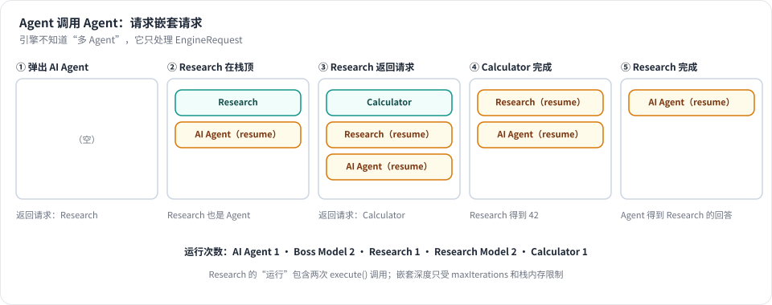
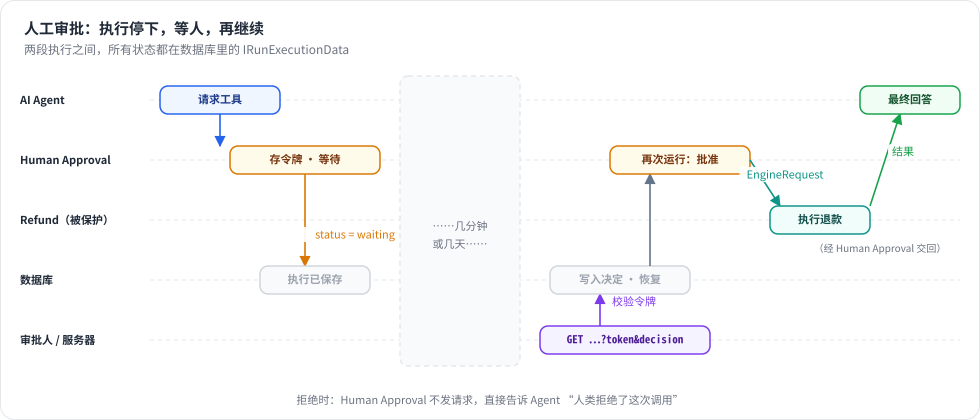
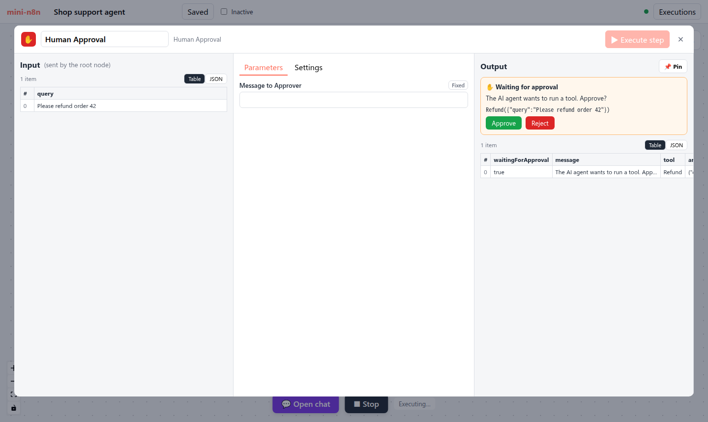
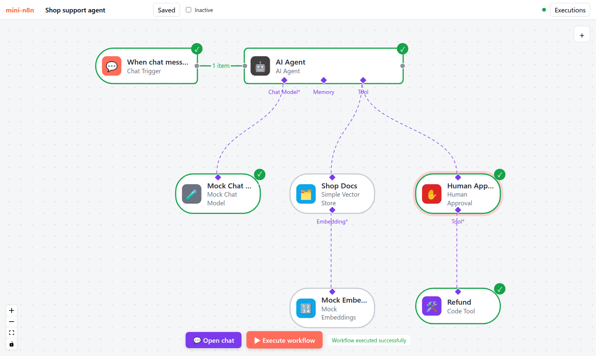

# 第 23 章 多 Agent、人工审批与结构化输出

> 本章目标：读完你能搭出三种“生产级”Agent 模式：一个 Agent 把任务交给另一个 Agent；危险的工具调用先停下来等人批准，批准后再继续；Agent 的回答必须是固定格式的 JSON。三者都建立在第 19 章的 EngineRequest 之上，你会看到引擎本身几乎不用改。前置：第 10、12、19 章。对应代码：mini-n8n v0.5 的 `nodes/agent-tool.ts`、`nodes/approval-tool.ts`、`nodes/output-parser.ts`、`cli/src/webhooks/waiting-webhooks.ts`

## 1. 问题与概念

第 18–21 章的 Agent 能调工具、有记忆、能流式回答。放到生产环境，还会遇到三个问题：

| 问题 | 例子 | 模式 |
|---|---|---|
| 一个 Agent 的提示词和工具太多，效果变差 | 客服 Agent 既要查订单，又要写报告，又要算账 | **多 Agent**：拆成几个专职 Agent，主 Agent 把它们当工具调用 |
| 有些动作不能让模型自己决定 | 退款、发邮件给客户、删除数据 | **人工审批（Human in the Loop，HITL）**：调用前停下来，等人批准 |
| 下游节点需要确定的字段 | 把回答写进表格、按 `priority` 字段分支 | **结构化输出**：回答必须符合一个 JSON Schema |

它们的共同点：**都不需要引擎知道“Agent”是什么**。引擎只认识第 19 章的 EngineRequest：节点返回“请帮我执行这些节点”，引擎执行完再带着结果调用它一次。

- 多 Agent：子 Agent 也是一个节点，它被调用时又可以返回 EngineRequest → 请求嵌套请求。
- HITL：审批节点在 EngineRequest 里被执行，它让整个执行进入 `waiting` 状态（第 8 章的 Wait 机制），人批准后执行从数据库恢复。
- 结构化输出：不涉及引擎，只是 Agent 多给模型一个“格式化工具”。

## 2. n8n 是怎么做的

### 2.1 AI Agent Tool：Agent 也是工具

n8n 的 “AI Agent Tool” 节点（`AgentToolV3`）和 AI Agent 用的是同一个执行函数：

```ts
// packages/@n8n/nodes-langchain/nodes/agents/Agent/V3/AgentToolV3.node.ts:101
async execute(
	this: IExecuteFunctions | ISupplyDataFunctions,
	response?: EngineResponse<RequestResponseMetadata>,
): Promise<INodeExecutionData[][] | EngineRequest<RequestResponseMetadata>> {
	return await toolsAgentExecute.call(this, response);
}
```

它没有 `supplyData`，输出是 `ai_tool`。第 20 章讲过：这样的节点会被“节点即工具”机制自动包装。当顶层 Agent 请求它时，引擎把它压栈，像执行普通节点一样调用 `execute`（`packages/core/src/execution-engine/requests-response.ts:114` 起，给节点设置 `rewireOutputLogTo`，把模型给的参数并进输入条目）。这时 `this` 是 `IExecuteFunctions`，子 Agent 需要调用自己的工具时，也直接把 EngineRequest 交给引擎：

```ts
// packages/@n8n/nodes-langchain/nodes/agents/Agent/agents/ToolsAgent/V3/execute.ts:127
if (request) {
	if (isExecuteFunctions(this)) {
		// Top-level execution — hand the request to the engine, which
		// schedules the requested tool nodes and resumes us with an
		// EngineResponse.
		return request;
	}
	// Sub-agent execution (running through `makeHandleToolInvocation`):
	// the engine can't fulfil EngineRequests from inside a tool callback,
	// so resolve the sub-agent's tools inline ...
	return await resolveSubAgentRequest(this, request, { ... });
}
```

第二个分支用于另一种调用方式：子 Agent 在一个工具回调里运行（`ISupplyDataFunctions`），比如被旧版 Agent 调用。那时引擎不在调用链上，`resolveSubAgentRequest()`（`helpers/resolveSubAgentRequest.ts:25`）就在原地循环执行工具。这条路径不支持人工审批，`assertNoHitlActions()`（同文件 `:49`）会报错：“Human-in-the-Loop nodes cannot be used inside a sub-agent”。

### 2.2 结构化输出：多给模型一个工具

AI Agent 勾选 “Require Specific Output Format” 后，多出一个 `ai_outputParser` 端口（第 16 章的动态端口）。接上 Structured Output Parser，Agent 会做两件事。

**第一，多加一个工具**：

```ts
// packages/@n8n/nodes-langchain/nodes/agents/Agent/agents/ToolsAgent/common.ts:542 起
if (outputParser) {
	const schema = getOutputParserSchema(outputParser);
	const structuredOutputParserTool = new DynamicStructuredTool({
		schema,
		name: 'format_final_json_response',
		description: 'Use this tool to format your final response to the user in a structured JSON format. ...',
		// We do not use a function here because we intercept the output with the parser.
		func: async () => '',
	});
	tools.push(structuredOutputParserTool);
}
```

**第二，在系统提示词后面追加一段指令**（`V3/helpers/runAgent.ts:87`）：“IMPORTANT: For your response to user, you MUST use the `format_final_json_response` tool ...”。

模型调用这个工具时，参数就是结构化的回答。Agent 拦截这次调用，不去“执行”它，而是交给解析器校验（`common.ts:419`），校验通过就作为最终输出。为什么不直接让模型输出 JSON 文本？因为工具调用的参数本来就是按 JSON Schema 生成的，主流模型对它做过专门训练，比“请输出 JSON”可靠得多。

Structured Output Parser 可以写一个 JSON 示例，由 `generateSchemaFromExample()` 推出 Schema（`utils/schemaParsing.ts:53`，基于 `generate-schema` 库）；也可以直接写 JSON Schema。从 1.3 版开始，示例里的字段全部是必填的（`OutputParserStructured.node.ts:207`）。注意：从示例推出的 Schema **只有类型**，示例里的值（比如 `"currency": "USD"`）不会告诉模型。要限制取值，应该手写 JSON Schema，用 `enum` 或 `description`。

### 2.3 人工审批：被保护的工具

n8n 的 HITL 节点不是手写的，而是合成出来的。所有带 “Send and Wait” 操作的节点（Slack、Gmail、Telegram……）在加载时会多生成一个 `xxxHitlTool` 类型：

```ts
// packages/cli/src/tool-generation/hitl-tools.ts:245
export function createHitlTools(types: Types, known: KnownNodesAndCredentials): void {
	const sendAndWaitNodes = types.nodes.filter(hasSendAndWaitOperation);
	for (const sendAndWaitNode of sendAndWaitNodes) {
		const description = deepCopy(sendAndWaitNode);
		const wrapped = convertNodeToHitlTool({ description }).description;
		types.nodes.push(wrapped);
		...
```

`convertNodeToHitlTool()`（同文件 `:162`）把名字加上 `HitlTool` 后缀，输入改成 “Tool”（要保护的工具接在这里），输出改成 `ai_tool`（连到 Agent）。引擎靠后缀识别它：`isHitlToolType()`（`packages/workflow/src/node-helpers.ts:2026`）。

Agent 拉取工具时，HITL 节点的处理很巧妙（`packages/core/src/execution-engine/node-execution-context/utils/get-input-connection-data.ts:64`，`createHitlToolkit`）：Agent 看到的是 **被保护工具本身**（同样的名字、描述），但每个工具的 `metadata.sourceNodeName` 指向 HITL 节点，另外记下 `gatedToolNodeName`：

```ts
return new DynamicStructuredTool({
	name: tool.name,
	description: tool.description,
	schema,                                  // { toolParameters, hitlParameters }
	func: async () => await Promise.resolve(''),
	metadata: {
		sourceNodeName: hitlNode.name,           // EngineRequest 会执行 HITL 节点
		gatedToolNodeName: tool.metadata?.sourceNodeName as string | undefined,
		originalSchema: tool.schema,
	},
});
```

同文件 `:105` 起的注释写明了完整流程：

1. Agent 调用被保护的工具 → EngineRequest 路由到 HITL 节点。
2. HITL 节点执行 sendAndWait（比如发一条带 “Approve / Decline” 按钮的 Slack 消息），然后 `putExecutionToWait` → 执行进入 `waiting` 状态，存入数据库。
3. 审批人点按钮，打开 `/webhook-waiting/<executionId>?approved=true&signature=...`。
4. 批准：Agent 生成一个新的 EngineRequest，执行被保护的工具，结果交回 Agent。
5. 拒绝：Agent 收到一条拒绝消息，知道不要再试。

第 3 步的服务器端在 `packages/cli/src/webhooks/waiting-webhooks.ts`。它先校验 URL 里的令牌，用的是常数时间比较 `timingSafeEqual`（`:190`，`validateToken`）。然后 **禁用** 栈顶的 HITL 节点（`:366`），调用节点的 `webhook()` 方法。sendAndWait 的 `webhook()` 返回 `{ data: { approved } }`（`packages/nodes-base/utils/sendAndWait/utils.ts:488`），这就是 HITL 节点这次运行的输出。执行恢复时，被禁用的节点直接把这份数据传下去，不会再发一次消息。

第 4、5 步在 Agent 里：恢复后的 Agent 拿到 EngineResponse，`processHitlResponses()`（`packages/@n8n/nodes-langchain/utils/agent-execution/processHitlResponses.ts:106`）逐个检查 HITL 的响应。批准的，按 `gatedToolNodeName` 生成新的 action（`:141`）；拒绝的，把工具结果改写成 “User rejected the tool call to ... STOP what you are doing ...”。

## 3. 从零实现

### 3.1 AI Agent Tool

`AgentTool`（`packages/nodes-ai/src/nodes/agent-tool.ts`）有三个输入（模型、记忆、工具），一个 `ai_tool` 输出。`supplyData` 给出工具定义（参数只有 `query`），`execute` 复用 AI Agent 的执行函数：

```ts
async execute(this: IExecuteFunctions, response?: EngineResponse) {
	const result = await agentExecute.call(this, response as EngineResponse<AgentRequestMetadata> | undefined);
	if (!Array.isArray(result)) return result; // 嵌套的 EngineRequest：让引擎执行我们的工具
	// 工具用 { response } 回答
	return [result[0].map((item) => ({ json: { response: item.json.output ?? item.json }, pairedItem: item.pairedItem }))];
}
```

“Prompt” 参数默认是 `={{ $json.query }}`：引擎把模型给的参数 `{ query }` 作为输入条目，子 Agent 用表达式读出来作为自己的用户消息。

**引擎一行都没改**。第 19 章的 `handleEngineRequest` 把工具节点压在 Agent 上面；如果工具节点自己也返回 EngineRequest，就再压一层。下图是测试里的真实运行：



*图 23-1：外层 AI Agent 请求 Research（一个 AI Agent Tool）；Research 请求 Calculator；引擎先执行 Calculator，恢复 Research，再恢复外层 Agent。*

### 3.2 结构化输出

`OutputParserStructured`（`nodes/output-parser.ts`）从 JSON 示例推出 Schema（所有字段必填），返回一个 `{ schema, parse }` 对象。`parse` 检查必填字段，缺字段时抛出 “Model output doesn't fit required format: missing ...”。

Agent 这边（`packages/nodes-ai/src/agent/execute.ts`）和 n8n 一样，加一个工具、追加一段指令：

```ts
const formatTool: AiTool | undefined = outputParser && {
	name: FORMAT_TOOL_NAME,                         // 'format_final_json_response'
	description: 'Use this tool to give the final answer to the user in the required format',
	schema: outputParser.schema,
	metadata: { sourceNodeName: node.name },
};
...
if (formatTool) tools.push(formatTool);
const systemMessage = String(this.getNodeParameter('options.systemMessage', i, DEFAULT_SYSTEM_MESSAGE)) + (formatTool ? `\n\n${FORMATTING_INSTRUCTIONS}` : '');
...
// 模型通过格式工具回答：这就是最终的结构化回答
const formatCall = formatTool && answer.toolCalls.find((c) => c.name === FORMAT_TOOL_NAME);
if (formatCall) {
	const output = outputParser!.parse(formatCall.args);
	if (memory) await memory.saveContext(prompt, JSON.stringify(output));
	finishedItems[i] = { output };
	...
	continue;
}
```

`finishedItems` 放进 EngineRequest 的元数据。有多个输入条目时，已经完成的条目在下一轮不会再调用模型。

### 3.3 人工审批

我们的 Human Approval 节点（`nodes/approval-tool.ts`）是一个手写的工具“包装器”：它的 Tool 输入接被保护的工具，输出连到 Agent。`supplyData` 把被保护工具的定义转交给 Agent，但把 `sourceNodeName` 换成自己：

```ts
async supplyData(this: ISupplyDataFunctions) {
	const gated = (await this.getInputConnectionData('ai_tool', 0)) as AiTool;
	const tool: AiTool = {
		...gated,
		description: `${gated.description} (a human must approve each call)`,
		// 引擎为这次调用执行的是本节点；由本节点决定真正的工具是否运行
		metadata: { ...gated.metadata, sourceNodeName: this.getNode().name, gatedNode: gated.metadata.sourceNodeName },
	};
	return { response: tool };
},
```

`execute` 被调用三次，用节点的 `getContext('node')` 保存状态（第 7 章：它保存在 `IRunExecutionData.executionData.contextData` 里，随执行一起存库）：

```ts
async execute(this: IExecuteFunctions, response?: EngineResponse) {
	const item = this.getInputData()[0];
	const state = this.getContext('node') as IDataObject & { token?: string; decision?: string };

	// 3b. 真正的工具执行完了：它的结果就是我们的结果
	if (response) { ... return [[{ json, pairedItem: { item: 0 } }]]; }

	// 1. 第一次运行：等人
	if (!state.decision) {
		state.token = randomBytes(8).toString('hex');
		const url = `${this.getResumeUrl()}?token=${state.token}`;
		await this.putExecutionToWait(new Date('3000-01-01T00:00:00Z'));
		return [[{ json: { waitingForApproval: true, message: ..., tool: gated.name, args, approveUrl: `${url}&decision=approve`, rejectUrl: `${url}&decision=reject` }, ... }]];
	}

	// 2. 带着决定恢复
	const decision = state.decision;
	delete state.decision;
	delete state.token;
	if (decision === 'reject') {
		return [[{ json: { response: `A human rejected the call to ${gated.name}. Do not retry it; tell the user.` }, ... }]];
	}
	// 3a. 批准：请引擎执行真正的工具，然后带着结果再调用我们
	return {
		actions: [{ actionType: 'ExecutionNodeAction', nodeName: String(gated.metadata.sourceNodeName), input: args, type: 'ai_tool', ... }],
		metadata: {},
	};
},
```

恢复执行的入口是新的路由 `/webhook-waiting/:executionId`（`cli/src/webhooks/waiting-webhooks.ts:25`，`executeWebhook`）：

```ts
const execution = this.deps.db.executions.getWithData(executionId);
if (!execution) return { statusCode: 404, ... };
if (execution.status !== 'waiting') return { statusCode: 409, ... };   // 链接只能用一次

const data = execution.data;
const head = data.executionData.nodeExecutionStack[0];
const state = data.executionData.contextData?.[`node:${head?.node.name}`] as IDataObject | undefined;
if (!state?.token || !sameToken(state.token, query.token)) return { statusCode: 403, ... };

state.decision = String(query.decision ?? '');                // 把决定交给等待中的节点
data.waitReason = 'resume-node';
const { finished } = this.runner.start({ executionMode: execution.mode, workflowData: ..., executionData: data }, executionId);
```

最后一个问题：第 8 章的 Wait 节点恢复时，引擎会 **禁用** 栈顶节点，让它直接把上次的输出传下去（`core/src/workflow-execute.ts:416`，`handleWaitingState`）。Human Approval 恰恰需要 **再运行一次**。于是给 `IRunExecutionData` 加一个字段 `waitReason`：

```ts
private handleWaitingState() {
	if (!this.runExecutionData.waitTill) return;
	this.runExecutionData.waitTill = undefined;
	// 等待中的节点要再运行一次，自己处理恢复（Human Approval）
	if (this.runExecutionData.waitReason === 'resume-node') {
		this.runExecutionData.waitReason = undefined;
		return;
	}
	... // 原来的逻辑：禁用栈顶节点
}
```

n8n 也有 `waitReason`，但只有一个值 `'suspended'`（`packages/core/src/execution-engine/workflow-execute.ts:1536`），用于引擎在节点边界被挂起、栈顶节点还没执行的情况。它的 HITL 节点走的是另一条路：节点被禁用，审批结果来自 `webhook()` 的返回值。



*图 23-2：一次审批跨两段执行。两段之间可以隔几天，所有状态（执行栈、Human Approval 的令牌、Agent 的 EngineRequest 元数据）都在数据库里的 `IRunExecutionData` 中。*

### 3.4 和 n8n 的差异

| | n8n | mini-n8n | 说明 |
|---|---|---|---|
| HITL 节点 | 由 Send and Wait 节点合成（Slack、Gmail……） | 一个手写的 Human Approval 节点，审批链接显示在 NDV 和聊天面板里 | 不需要接 Slack |
| 批准后谁请求被保护的工具 | Agent（`processHitlResponses`） | Human Approval 自己返回 EngineRequest | 我们复用了嵌套请求，Agent 不用知道 HITL |
| 恢复方式 | 禁用 HITL 节点，结果来自 `webhook()` | `waitReason: 'resume-node'`，HITL 节点再运行一次 | 少一个“节点 webhook 方法”的概念 |
| 令牌 | 执行级 `resumeToken` 或 HMAC 签名 | 节点 context 里的一次性令牌 | 都用常数时间比较 |
| 子 Agent 里的 HITL | 工具回调路径下报错 | 能用（嵌套请求） | 没有测试覆盖，见练习 2 |
| 结构化输出 | Zod Schema、可选 Auto-fix（再调一次模型修正） | 只检查必填字段 | 够演示原理 |

## 4. 运行与验证

### 4.1 单元测试

```bash
npx vitest run packages/nodes-ai/test/advanced.test.ts --reporter=verbose
```

真实输出（本章部分）：

```text
 ✓ packages/nodes-ai/test/advanced.test.ts > multi-agent > an Agent hands a task to another Agent (nested engine requests) 2ms
 ✓ packages/nodes-ai/test/advanced.test.ts > structured output > returns an object in the format of the output parser 1ms
 ✓ packages/nodes-ai/test/advanced.test.ts > human in the loop > waits for a human, then runs the tool when approved 2ms
 ✓ packages/nodes-ai/test/advanced.test.ts > human in the loop > tells the Agent when the human rejects 1ms
```

多 Agent 测试断言了最终输出 `Based on the tools: Research returned Based on the tools: Calculator returned 42..`（两层 Mock 模型的回答套在一起），以及每个节点的运行次数 `{ 'AI Agent': 1, 'Boss Model': 2, Research: 1, 'Research Model': 2, Calculator: 1 }`。结构化输出测试断言第二次模型调用看到的工具是 `['Calculator', 'format_final_json_response']`，系统消息里有格式指令，最终输出是 `{ answer: 'Based on the tools: Calculator returned 42.', result: 42 }`。

`packages/cli/test/ai.test.ts` 里还有一个服务器级测试：执行进入 `waiting` 并存库；错误令牌（长度不同、长度相同但内容不同）返回 403；正确链接返回 “✅ Approved”，执行变为 `success`；同一个链接再打开一次返回 409。

### 4.2 在编辑器里

`e2e/advanced.e2e.mjs` 在聊天面板里发 “Please refund order 42”。Mock 模型从工具描述 “Refund an order” 里找到了 “refund”，调用 Refund——实际执行的是 Human Approval。执行停下，聊天面板显示 “Waiting for a human”。双击 Human Approval：



*图 23-3：Human Approval 的 NDV。输入是模型给的参数，输出区显示要调用的工具、参数和两个按钮。底部仍是 “Executing…”：执行在等待。*

e2e 读出 Approve 按钮的链接，在新标签页打开，然后在执行列表里打开这次执行：



*图 23-4：批准后恢复的执行。触发器、Agent、模型、Human Approval、Refund 都执行了；这次没有检索文档，所以 Shop Docs 和 Mock Embeddings 是灰色的。*

e2e 后五项的真实输出：

```text
✓ HITL: the chat shows that the execution waits for approval
✓ opening the approve link resumes the execution
✓ after approval the agent finished: "Based on the tools: Refund returned refunded: Please refund order 42."
✓ the resumed execution shows trigger, Agent, model, approval and the refund tool as executed
✓ no errors in the browser console
```

### 4.3 真实模型的结构化输出

```bash
OLLAMA_MODEL=qwen2.5:7b npx tsx examples/structured-ollama.ts
```

工作流：Agent + Ollama + Calculator + Structured Output Parser，示例是 `{ "answer": "a short sentence", "total": 0, "currency": "USD" }`，问题是 “A shirt costs 25 dollars. How much do 17 shirts cost?”。三个模型的真实输出：

```text
== qwen2.5:0.5b
model call 1: format_final_json_response({"expression":"(25 * 17) * 100","total_currency":"USD","answer total currency":"USD","total":42500})
status: error (Model output doesn't fit required format: missing answer, currency)
output: undefined
== qwen2.5:3b
model call 1: Calculator({"expression":"25 * 17"}), format_final_json_response({"answer":"425","total":425,"currency":""})
status: success
output: {"answer":"425","total":425,"currency":""}
== qwen2.5:7b
model call 1: Calculator({"expression":"25 * 17"})
model call 2: format_final_json_response({"answer":"425","currency":"dollars","total":425})
status: success
output: {"answer":"425","currency":"dollars","total":425}
```

三个值得注意的地方：

1. **解析器拦住了胡编的输出**。0.5b 编造了字段名（`"answer total currency"`），数字也错了（42500）。执行以错误结束，而不是把错误数据交给下游。在 n8n 里，这时可以打开 Auto-fix，让另一个模型修正格式。
2. **3b 在同一次回复里同时调用了计算器和格式工具**。它没有等计算器的结果就给出了最终答案（碰巧算对了）。我们的 Agent 和 n8n 一样：只要看到格式工具的调用，就把它当作最终答案，同时请求的其他工具不再执行。
3. **示例里的值不会传给模型**。7b 把 `currency` 填成了 `"dollars"`，3b 填了空字符串，都不是示例里的 `"USD"`——从示例推出的 Schema 只有 `{ "type": "string" }`。n8n 也一样（见 2.2 节）。要固定取值，需要在 JSON Schema 里写 `enum`。

### 4.4 踩坑记录

1. **结构化输出的 `result` 是 7，不是 42**。第一版 Mock 模型填格式工具的数字字段时，从用户问题里取数字。测试 “What is 6 * 7?” 的真实失败：

   ```text
   AssertionError: expected { …(2) } to deeply equal { …(2) }
   -   "result": 42,
   +   "result": 7,
   ```

   Mock 应该像真实模型那样“用工具算出来的数”。修复：先从工具结果里取数字，再从问题里取（`models/mock.ts` 第 84–85 行）。
2. **审批页显示 “Rejected”，但链接是 approve**。服务器级测试的真实失败：`expected '<!doctype html>…' to contain '✅ Approved'`。原因：等待 Webhook 在执行 **结束后** 读 `state.decision` 来决定页面文字，而 Human Approval 运行时已经把 `state.decision` 删掉了（防止下次误用），于是读到 `undefined`，走了 “Rejected” 分支。修复：在启动执行 **之前** 就把决定保存到局部变量 `decision`。
3. **（对照 n8n 发现）令牌比较不是常数时间**。写 2.3 节时读到 n8n 用 `timingSafeEqual` 比较恢复令牌，而我们用的是 `!==`。字符串比较遇到第一个不同字符就返回，理论上可以通过响应时间逐位猜出令牌。改为 `sameToken()`（长度不同直接拒绝，否则 `timingSafeEqual`），并补了“长度相同但内容不同”的测试（commit `8a3afc9`）。同一次对照还发现 `interfaces.ts` 里“n8n has a similar waitReason”的注释说得不准确，一并修正。

## 5. 练习

1. **巩固**：在 e2e 的客服工作流里点 Reject 链接。Agent 的最终回答是什么？Refund 节点有没有运行？再打开一次同一个链接，返回什么状态码？
2. **扩展**：把 Human Approval 放到 Research 子 Agent 下面（保护子 Agent 的工具），写一个测试：执行进入 `waiting`，批准后外层 Agent 拿到正确结果。执行栈在等待时有几层？
3. **读源码**：阅读 n8n 的 `processHitlResponses.ts` 的 `getDenialMessage()` 和 `getChatInput()`。当审批人不是点 “Decline”，而是输入了一段反馈时，Agent 收到的消息有什么不同？在我们的实现里加上这个功能需要改哪些地方？

## 6. 延伸阅读

- `packages/@n8n/nodes-langchain/nodes/agents/Agent/agents/ToolsAgent/V3/`：V3 Agent 的执行、批处理、HITL 和子 Agent 处理。
- `packages/cli/src/tool-generation/`：`xxxTool` 和 `xxxHitlTool` 两种合成节点类型。
- `packages/nodes-base/utils/sendAndWait/`：发送并等待（审批按钮、表单、自由文本）的公共实现。
- `packages/@n8n/nodes-langchain/nodes/output_parser/`：结构化、列表、Auto-fixing 三种输出解析器。
