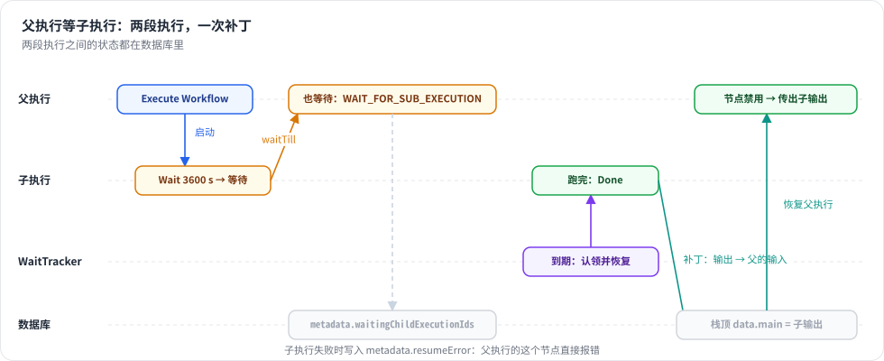

# 第 24 章 子工作流与等待/恢复

> 本章目标：读完你能把一个大工作流拆成几个可复用的子工作流；并理解一个执行怎样“停下来几天、再接着跑”：Wait 节点到期后由 WaitTracker 恢复，子工作流在等待时它的父执行也跟着等待，子执行结束后再把结果交给父执行。前置：第 7、8、23 章。对应代码：mini-n8n v1.0 的 `nodes-base/src/nodes/ExecuteWorkflow.node.ts`、`cli/src/wait-tracker.ts`、`cli/src/workflow-runner.ts`

## 1. 问题与概念

前面的版本里已经有两种“暂停”：

- 第 8 章的 Wait 节点：65 秒以内在进程里睡；更长的等待把执行写进数据库，状态为 `waiting`，记下 `waitTill`。**可是 v0.5 里没有人去恢复它**——`getWaitingExecutions()` 查询早就写好了，却没有调用方。
- 第 23 章的人工审批：执行停在 `WAIT_INDEFINITELY`（3000 年），等人打开链接。

平台化之后还有第三种：**子工作流在等待**。比如“处理订单”工作流调用“申请退款审批”子工作流，子工作流停下来等经理批准。这时父执行该怎么办？

| 方案 | 问题 |
|---|---|
| 父执行在内存里等着 | 可能等几天；进程重启就丢了；在队列模式下还占着一个 worker 的并发槽 |
| 父执行直接失败 | 子工作流的设计目的就是复用，不能因为它要等就不能用 |
| **父执行也进入等待，子执行结束后再恢复父执行** | n8n 的做法，也是本章要实现的 |

三个概念：

1. **Execute Workflow 节点**：调用另一个已保存的工作流，子工作流从 “When Executed by Another Workflow” 触发器开始。子执行是一个独立的执行（mode 为 `integrated`），在执行数据里记下它的父执行 `parentExecution`。
2. **WaitTracker**：每隔一段时间查一次数据库，把接下来 70 秒内到期的等待执行挑出来，给每个设一个定时器，到点就恢复。
3. **恢复父执行**：子执行结束时，把它最后一个节点的输出写进父执行栈顶那个节点（就是 Execute Workflow 节点）的输入，再恢复父执行。恢复时这个节点以禁用状态运行，于是它把这份输入原样传下去——看起来就像它刚刚调用完子工作流。



*图 24-1：子执行等待时，父执行以 `WAIT_FOR_SUB_EXECUTION`（2999-12-31）停下并记下子执行 ID；WaitTracker 恢复子执行；子执行结束时给父执行打补丁并恢复它。*

## 2. n8n 是怎么做的

### 2.1 子执行等待，父执行也等待

调用子工作流的入口在所有执行上下文的基类里：

```ts
// packages/core/src/execution-engine/node-execution-context/base-execute-context.ts:207
// If a sub-workflow execution goes into the waiting state
if (result.waitTill) {
	this.setMetadata({
		waitingChildExecutionIds: [
			...(this.executeData.metadata?.waitingChildExecutionIds ?? []),
			result.executionId,
		],
	});
	// then put the parent workflow execution also into the waiting state,
	// but do not use the sub-workflow `waitTill` to avoid WaitTracker resuming the parent execution at the same time as the sub-workflow
	await this.putExecutionToWait(WAIT_FOR_SUB_EXECUTION);
}
```

注释说明了为什么不用子执行的 `waitTill`：否则 WaitTracker 会在同一时刻把父子两个都恢复，父执行拿不到子执行的结果。`WAIT_FOR_SUB_EXECUTION` 是一个遥远的日期（`packages/workflow/src/constants.ts:9`，2999-12-31），WaitTracker 永远不会主动恢复它。

`metadata` 是执行栈条目（`IExecuteData`）上的字段，会随执行一起存进数据库。记下 `waitingChildExecutionIds`，是为了恢复时确认“来打补丁的确实是我在等的那个子执行”。

Execute Workflow 节点（`packages/nodes-base/nodes/ExecuteWorkflow/ExecuteWorkflow/ExecuteWorkflow.node.ts`）有两种模式：`once` 把所有条目交给一次子执行；`each` 对每个条目调用一次。选项 “Wait For Sub-Workflow Completion”（`:351`）关掉时，节点不等子执行，直接把输入传下去。它传给子执行的 `parentExecution` 是 `{ executionId, workflowId, shouldResume }`（`:403` 起）。

### 2.2 WaitTracker

```ts
// packages/cli/src/wait-tracker.ts:81
private startTracking() {
	// Poll every 60 seconds a list of upcoming executions
	this.mainTimer = setInterval(() => {
		void this.getWaitingExecutions();
		void this.resumeParentsOfFinishedSubExecutions();
	}, 60000);
	...
}
```

查询本身在执行仓库里：

```ts
// packages/@n8n/db/src/repositories/execution.repository.ts:766
async getWaitingExecutions() {
	// Find all the executions which should be triggered in the next 70 seconds
	const waitTill = new Date(Date.now() + 70000);
	const where: FindOptionsWhere<ExecutionEntity> = {
		waitTill: LessThanOrEqual(waitTill),
		status: 'waiting',
	};
	...
```

每 60 秒查一次“70 秒内到期的”，两个窗口有 10 秒重叠，保证不漏；已经设过定时器的执行不会重复设（`getWaitingExecutions()` 里检查 `this.waitingExecutions[executionId]`）。到点后 `startExecution()`（`:145`）从数据库读出完整的执行数据，交给 `WorkflowRunner.run()`，并带上 `expectedStatus: 'waiting'`——如果另一个进程已经恢复了它，这一步会抛出 `ExecutionAlreadyResumingError`，被安静地忽略。

两个细节：

- **只有 leader 跑 WaitTracker**（`init()` 里的 `isLeader`）。多 main 部署时，只有一个实例负责轮询，避免重复恢复。
- `startExecution()` 结束时检查 `shouldRestartParentExecution(parentExecution)`（`:191`），如果是要恢复父执行的子执行，就调用 `resumeParentExecution()`（`:212`）：等子执行结束，给父执行打补丁，再“认领”父执行。

### 2.3 给父执行打补丁

```ts
// packages/cli/src/workflow-helpers.ts:448 updateParentExecutionWithChildResults（节选）
if (parent?.status !== 'waiting') return false;
...
const waitingChildExecutionIds = nodeExecutionStack[0].metadata?.waitingChildExecutionIds;
if (childExecution && waitingChildExecutionIds?.length && !waitingChildExecutionIds.includes(childExecution.executionId)) {
	return false;
}
...
if (subworkflowError) {
	nodeExecutionStack[0].metadata = { ...nodeExecutionStack[0].metadata, resumeError: subworkflowError, ... };   // :533
} else if (lastExecutedNodeData?.data) {
	// Copy the sub workflow result to the parent execution's Execute Workflow node inputs   // :537
	// so that the Execute Workflow node returns the correct data when parent execution is resumed
	// and the Execute Workflow node is executed again in disabled mode.
	...
}
```

子执行失败时写入 `resumeError`；引擎的 `runNode()` 在检查 `node.disabled` **之前** 先检查它，于是被禁用的节点也会报错，父执行以错误结束，而不是假装成功。

## 3. 从零实现

### 3.1 类型

~~~~ts
// packages/workflow/src/interfaces.ts
export interface IRunExecutionData {
	...
	/** Set on a sub-workflow execution: who started it, and whether to resume that parent when it ends */
	parentExecution?: RelatedExecution;   // :360
}
export interface RelatedExecution { executionId: string; workflowId: string; shouldResume?: boolean }
export const WAIT_INDEFINITELY = new Date('3000-01-01T00:00:00.000Z');        // :371
export const WAIT_FOR_SUB_EXECUTION = new Date('2999-12-31T00:00:00.000Z');   // :373
export interface ExecuteWorkflowResult { executionId: string; data?: INodeExecutionData[]; waitTill?: string }
~~~~

`executeWorkflow()` 原来直接返回子工作流的输出（`INodeExecutionData[]`），现在返回 `ExecuteWorkflowResult`：子执行等待时没有 `data`，只有 `waitTill`。

### 3.2 父执行跟着等待

`ExecuteContext.executeWorkflow()`（`packages/core/src/execute-context.ts:182`）照搬 n8n：

```ts
const result = await this.additionalData.executeWorkflow(workflowId, items, { executionId, workflowId: this.workflow.id ?? '', nodeName }, { waitForSubWorkflow: options.waitForSubWorkflow ?? true });
if (result.waitTill) {
	const waiting = (this.executeData.metadata?.waitingChildExecutionIds as string[] | undefined) ?? [];
	this.setMetadata({ waitingChildExecutionIds: [...waiting, result.executionId] });
	await this.putExecutionToWait(WAIT_FOR_SUB_EXECUTION);
}
return result;
```

服务器端的 `WorkflowRunner.runSubWorkflow()`（`cli/src/workflow-runner.ts:136`）启动子执行时带上 `parentExecution`。子执行结束得太快（状态不是 `waiting`）就直接返回输出；进入等待就返回 `{ executionId, waitTill }`。

Execute Workflow 节点（`ExecuteWorkflow.node.ts:10`）很薄：`once` 模式调用一次；`each` 模式逐条调用。子执行在 `each` 模式下等待时，我们直接报错——n8n 为此在一个等待里收集多个子执行 ID，逻辑复杂得多，我们裁掉了。

### 3.3 恢复父执行

子执行（被 WaitTracker 或等待 Webhook 恢复的那一段）结束时，`runMainProcess()` 的收尾代码检查它是否有要恢复的父执行（`workflow-runner.ts:250`）：

```ts
const parent = run.data.parentExecution;
if (data.executionData && parent?.shouldResume && run.status !== 'waiting') this.resumeParent(parent, executionId, run);
```

`data.executionData` 不为空，说明这是一次 **恢复**，不是首次运行——首次运行时父执行还在内存里等着 `runSubWorkflow()` 返回，不能去打补丁。

`resumeParent()`（`:168`）就是 n8n 的 `updateParentExecutionWithChildResults()` 加上“认领并恢复”：

```ts
const parent = db.executions.getWithData(parentExecution.executionId);
if (parent?.status !== 'waiting') return false;
const head = parent.data.executionData.nodeExecutionStack[0];
const waitingFor = (head?.metadata?.waitingChildExecutionIds as string[] | undefined) ?? [];
if (!head || !waitingFor.includes(childExecutionId)) return false;   // 父执行在等别的东西

if (run.status === 'error') {
	head.metadata = { ...head.metadata, resumeError: { message: `Sub-workflow execution ${childExecutionId} failed: ${run.data.resultData.error?.message}` } };
} else {
	head.data = { ...head.data, main: [lastNodeOutput(run)] };
}
db.executions.saveData(parent.id, parent.data);
if (!db.executions.claimWaiting(parent.id)) return false;   // 有人抢先恢复了
this.start({ executionMode: parent.mode, workflowData: ..., executionData: parent.data }, parent.id);
```

引擎这边只加了几行：`runNode()` 先检查 `metadata.resumeError`（`core/src/workflow-execute.ts:276`），再处理禁用节点。

### 3.4 WaitTracker 与“认领”

`cli/src/wait-tracker.ts` 只有 60 行：

```ts
poll() {
	for (const execution of this.deps.db.executions.getWaitingExecutions(70)) {
		if (this.timers.has(execution.id)) continue;
		const delay = Math.max(new Date(execution.waitTill!).getTime() - Date.now(), 0);
		this.timers.set(execution.id, setTimeout(() => void this.resume(execution.id), delay));
	}
}

resume(executionId: string): boolean {
	this.timers.delete(executionId);
	const execution = db.executions.getWithData(executionId);
	if (!execution || !db.executions.claimWaiting(executionId)) return false;
	this.runner.start({ executionMode: execution.mode, workflowData: ..., executionData: execution.data }, executionId);
	return true;
}
```

到期时间已经过去的执行（服务器停机期间到期的）`delay` 为 0，启动后第一次 `poll()` 就恢复。

“认领”是一条带条件的 UPDATE（`cli/src/databases/db.ts:323`）：

```ts
claimWaiting(id: string): boolean {
	return this.db.prepare("UPDATE execution_entity SET status = 'running' WHERE id = ? AND status = 'waiting'").run(id).changes === 1;
}
```

两个定时器、两次点击审批链接、两个 main 实例同时恢复同一个执行，只有一个能把 `waiting` 改成 `running`。第 23 章的等待 Webhook 也改成了先认领再恢复。

### 3.5 裁剪了什么

| n8n 有 | mini-n8n | 说明 |
|---|---|---|
| leader 选举，只有 leader 跑 WaitTracker | 每个 main 都跑 | 靠 `claimWaiting()` 保证不重复恢复 |
| 补丁和认领失败时重试；定期扫描“子执行已结束但父执行还在等”的情况（`resumeParentsOfFinishedSubExecutions`） | 无 | 进程恰好在两步之间崩溃时，父执行会一直等 |
| `each` 模式下多个子执行同时等待 | 报错 | 见 3.2 |
| 子工作流可以来自数据库、本地文件、URL、参数 | 只支持数据库里的工作流 ID | |

## 4. 运行与验证

```bash
npx vitest run packages/cli/test/platform.test.ts --reporter=verbose
```

真实输出：

```text
 ✓ packages/cli/test/platform.test.ts > Execute Workflow > runs the sub-workflow and outputs what its last node returned
 ✓ packages/cli/test/platform.test.ts > Execute Workflow > passes the input on at once when it does not wait for the sub-workflow
 ✓ packages/cli/test/platform.test.ts > waiting and resuming > the WaitTracker resumes a parked execution when it is due, once
 ✓ packages/cli/test/platform.test.ts > waiting and resuming > a parent waits for a waiting sub-workflow and resumes with its result
 ✓ packages/cli/test/platform.test.ts > waiting and resuming > a parent fails on its Execute Workflow node when the resumed sub-workflow fails
```

测试不能真的等一小时，于是用一个小技巧“快进时间”：把数据库里 `waitTill` 改到过去，再调用一次 `waitTracker.poll()`。

第三个测试的断言值得一看：

```ts
expect(new Date(parked.waitTill!).getTime() - Date.now()).toBeGreaterThan(3500_000);   // Wait 3600 s：存进了数据库
ctx.waitTracker.poll();                                                                  // 70 s 内不到期：不设定时器
expect(ctx.db.executions.get(executionId)!.status).toBe('waiting');
makeDue(executionId);
ctx.waitTracker.poll();                                                                  // 到期：恢复
await until(() => ctx.db.executions.get(executionId)!.status === 'success');
expect(ctx.db.executions.getWithData(executionId)!.data.resultData.runData.Wait).toHaveLength(1);
expect(ctx.waitTracker.resume(executionId)).toBe(false);                                 // 第二次认领失败
```

第四个测试：父工作流 `Manual → Number(n=7) → Call(子工作流) → After`，子工作流 `Start → Wait 3600 s → Done`。先断言父执行的 `waitTill` 恰好是 `WAIT_FOR_SUB_EXECUTION`，栈顶的 `waitingChildExecutionIds` 是子执行 ID；子执行到期恢复后，父执行最终输出 `{ n: 7, done: true, parentDone: true }`。

第五个测试把子工作流的最后一步换成 Stop and Error（“out of stock”），父执行以错误结束，错误信息是 `Sub-workflow execution <子执行 ID> failed: out of stock`。

### 4.1 踩坑记录

1. **`waitingChildExecutionIds` 没有存进数据库**。第一次运行第四个测试，断言 `expected undefined to deeply equal [ '2' ]` 失败：父执行停下了，栈顶条目却没有 `metadata`。原因：引擎创建 `ExecuteContext` 时传的是栈条目的 **浅拷贝**（`{ ...executionData, data: inputData }`，为了处理 “Execute Once” 时裁剪后的输入），`setMetadata()` 改的是拷贝；引擎随后把原条目压回栈里存库。修复：创建上下文前先 `executionData.metadata ??= {}`，让拷贝和原条目共享同一个 `metadata` 对象，`setMetadata()` 用 `Object.assign` 就地修改（`workflow-execute.ts:305`）。
2. **（自查发现）v0.5 的 WaitTracker 是空的**。写本章时重读第 8 章才发现：Wait 节点超过 65 秒会存库，`getWaitingExecutions()` 也写好了，但没有任何代码调用它——长等待的执行永远不会恢复。v0.5 的测试只覆盖了短等待，所以一直没暴露。

## 5. 练习

1. **巩固**：在编辑器里搭父子两个工作流，子工作流里放一个 120 秒的 Wait。手动执行父工作流，观察两个执行在执行列表里的状态；等两分钟（WaitTracker 每 60 秒轮询一次），再看一次。
2. **扩展**：实现 `resumeParentsOfFinishedSubExecutions()`：在 `WaitTracker.poll()` 里找出 “栈顶在等子执行、而子执行已经结束” 的父执行并恢复它。写一个测试：先让子执行结束，再手动把父执行改成 `waiting`，模拟“补丁之前进程崩溃”。
3. **读源码**：阅读 n8n 的 `packages/cli/src/webhooks/waiting-webhooks.ts`，找出等待 Webhook 恢复子执行之后，父执行是怎样被恢复的（提示：搜索 `resumeParentExecution`）。

## 6. 延伸阅读

- `packages/cli/src/wait-tracker.ts`：完整的 WaitTracker，包括重试和 leader 切换。
- `packages/cli/src/workflow-helpers.ts`：`updateParentExecutionWithChildResults()` 的完整版本，包括动态凭证的标记。
- `packages/cli/src/workflow-execute-additional-data.ts`：`executeWorkflow()`，子执行是怎样被创建和运行的。
