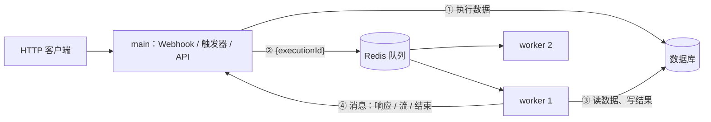
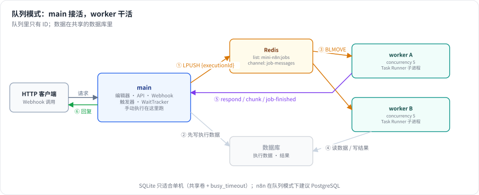

# 第 25 章 队列模式与横向扩展

> 本章目标：读完你能把 mini-n8n 拆成“一个 main + 多个 worker”：main 负责编辑器、API、Webhook 和触发器，worker 负责执行；执行越多，加越多的 worker。你会看到为什么队列里只放执行 ID、worker 怎样把 Webhook 响应和流式输出交回 main，以及多进程共享一个数据库会遇到什么。前置：第 9、10、12、24 章。对应代码：mini-n8n v1.0 的 `cli/src/scaling/`、`cli/src/commands/worker.ts`、`cli/src/workflow-runner.ts`

## 1. 问题与概念

到 v0.5 为止，所有执行都在 main 进程里运行。一个进程的问题：

- **CPU 只能用一个核**：Node.js 是单线程的，一个 Code 节点在算大数据，其他执行（还有编辑器的 API）就得等。
- **执行和服务互相拖累**：执行把内存用光、或者一个死循环卡住事件循环，编辑器和 Webhook 都会一起停摆。
- **不能横向扩展**：流量大了，只能换更大的机器。

n8n 的 **队列模式（queue mode）** 把“接活”和“干活”分开：



几个关键决定：

1. **队列里只放执行 ID**。执行数据可能有几十 MB（上一个节点的全部输出），放进 Redis 既慢又占内存。main 先把执行写进数据库，队列里只有一个引用；worker 拿到 ID 再去数据库读。代价是：**main 和所有 worker 必须连同一个数据库，用同一个加密密钥**（worker 要解密凭证）。
2. **手动执行留在 main**。编辑器里点 “Execute workflow” 需要实时推送每个节点的进度、支持部分执行和 pin data，放在 main 里最简单。n8n 也是这样，除非设置 `OFFLOAD_MANUAL_EXECUTIONS_TO_WORKERS=true`。
3. **HTTP 请求在 main 手里**。Webhook 的调用者连的是 main，可执行在 worker 上。worker 要通过消息告诉 main：“Respond to Webhook 节点要回复这些内容”、“Agent 吐出了这几个 token”、“执行结束了”。



*图 25-1：main 先写执行数据，再把执行 ID 放进 Redis；worker 用 BLMOVE 取任务，跑完后通过 pub/sub 把消息发回 main。*

## 2. n8n 是怎么做的

### 2.1 何时入队

```ts
// packages/cli/src/workflow-runner.ts:460
const shouldEnqueue =
	process.env.OFFLOAD_MANUAL_EXECUTIONS_TO_WORKERS === 'true'
		? this.executionsConfig.mode === 'queue'
		: this.executionsConfig.mode === 'queue' && data.executionMode !== 'manual';
```

`enqueueExecution()`（同文件 `:735`）组装 `jobData`（执行 ID、工作流 ID、pushRef 等），调用 `scalingService.addJob(jobData, { priority: realtime ? 50 : 100 })`。`realtime` 是需要立即回复的 Webhook，优先级更高。

### 2.2 Bull 队列

```ts
// packages/cli/src/scaling/scaling.service.ts:102 setupQueue（节选）
const { default: BullQueue } = await import('bull');
...
this.createBullQueue = (name: string) =>
	new BullQueue(name, { prefix, settings, createClient: (type) => service.createClient({ type: `${type}(bull)` }) });
```

n8n 用的是 Bull（基于 Redis 的任务队列库）。worker 调用 `setupWorker(concurrency)`（`:172`），即 `queue.process(JOB_TYPE_NAME, concurrency, handler)`：同时最多处理 `concurrency` 个任务（`--concurrency`，默认 10）。

### 2.3 worker 处理任务

```ts
// packages/cli/src/scaling/job-processor.ts:117
async processJob(job: Job): Promise<JobResult> { ... return await this.runJob(job); }
```

`runJob()` 先用 `findSingleExecution(executionId, { includeData: true })` 从数据库读出执行，再创建 worker 专用的生命周期钩子（`getLifecycleHooksForScalingWorker`，`:222`）。三个钩子把事情交回 main：

```ts
// job-processor.ts（节选）
lifecycleHooks.addHandler('sendResponse', async (response) => {
	const msg: RespondToWebhookMessage = { kind: 'respond-to-webhook', executionId, response: relayed, workerId };
	await job.progress(msg);
});
lifecycleHooks.addHandler('sendChunk', async (chunk) => {
	const msg: SendChunkMessage = { kind: 'send-chunk', executionId, chunkText: chunk, workerId };
	await job.progress(msg);
});
// 执行结束：:412
const msg: JobFinishedMessage = { kind: 'job-finished', executionId, success, status, ... };
await job.progress(msg);
```

`job.progress()` 本来是 Bull 用来报告进度百分比的，n8n 借它传任意消息。main 这边监听 `global:progress`（`scaling.service.ts:583`，`registerMainOrWebhookListeners`）：

```ts
switch (msg.kind) {
	case 'send-chunk':         this.activeExecutions.sendChunk(msg.executionId, msg.chunkText); break;
	case 'respond-to-webhook': this.activeExecutions.resolveResponsePromise(msg.executionId, decodedResponse); break;
	case 'job-finished':       ... this.jobOutcomeTracker.recordFinished(msg.executionId, ...); break;
}
```

### 2.4 编辑器的实时推送

手动执行默认不进队列，但如果开启了 `OFFLOAD_MANUAL_EXECUTIONS_TO_WORKERS`，或者有多个 main（浏览器连的不是启动执行的那个），推送消息要经过 Redis pub/sub 中转：`relay-execution-lifecycle-event` 命令（`packages/cli/src/push/index.ts:225`）。持有该 `pushRef` 的 main 收到后再发给浏览器。

### 2.5 数据库

```ts
// packages/cli/src/commands/base-command.ts:224
if (this.globalConfig.executions.mode === 'queue' && this.globalConfig.database.type === 'sqlite') {
	this.logger.warn('Scaling mode is not officially supported with sqlite. Please use PostgreSQL instead.');
}
```

队列模式的 main 和 worker 通常在不同机器上，SQLite 是一个本地文件，没法共享。n8n 只给警告，不禁止。

## 3. 从零实现

### 3.1 队列接口

```ts
// packages/cli/src/scaling/queue.ts:26
export interface JobQueue {
	add(data: JobData): Promise<string>;
	/** Worker side: run up to `concurrency` jobs at the same time */
	process(concurrency: number, handler: JobHandler): void;
	/** Main side: messages from workers */
	onMessage(listener: (jobId: string, message: JobMessage) => void): void;
	waitingCount(): Promise<number>;
	close(): Promise<void>;
}
```

`JobData` 只有 `{ executionId, workflowId }`；`JobMessage`（`:18`）是 n8n 那三种消息：`respond-to-webhook`、`send-chunk`、`job-finished`。

两个实现：

- `MemoryQueue`（`:42`）：数组 + 等待者列表，main 和 worker 在同一个进程里共享一个实例。用于测试，也方便读懂语义。
- `RedisQueue`（`scaling/redis-queue.ts`）：两个 Redis 列表和一个 pub/sub 频道。

### 3.2 Redis 上的队列

```ts
async add(data: JobData): Promise<string> {
	const id = String(await client.incr(KEY.nextId));
	await client.lpush(KEY.waiting, JSON.stringify({ id, data }));
	return id;
}
// worker 的每个并发槽一个循环，每个循环一个连接（BLMOVE 会阻塞连接）
const raw = await slot.connection.blmove(KEY.waiting, KEY.active, 'RIGHT', 'LEFT', 5);   // :54
...
await handler(job, progress);          // progress = PUBLISH 到 mini-n8n:job-messages
await client.lrem(KEY.active, 1, raw); // :62，做完才从 active 删除
```

`BLMOVE` 把任务从 “waiting” 原子地移到 “active”：两个 worker 不会拿到同一个任务；worker 处理到一半崩溃，任务还留在 “active” 里，没有丢。Bull 会检测这种 “stalled” 任务并交给别的 worker，我们没做（见练习 2）。

### 3.3 main：入队与收消息

```ts
// packages/cli/src/workflow-runner.ts:66
const freshSubWorkflow = !!data.parentExecution && !data.executionData;
if (this.queueMode && data.executionMode !== 'manual' && !freshSubWorkflow) return this.enqueue(data, existingExecutionId);
```

刚启动的子工作流也不入队：父执行正在某个进程里等它返回，就地运行最简单（n8n 也是在父执行所在的进程里运行子工作流）。

`enqueue()`（`:81`）要先把 worker 需要的一切写进数据库。新执行还没有执行栈，于是用第 24 章抽出来的 `createStartRunExecutionData()` 准备好：触发节点和它的数据（Webhook 请求）放在栈上。恢复执行（WaitTracker、审批链接）时，数据可能刚被改过（审批决定），也要先存回去：

```ts
const executionId = existingExecutionId ?? db.executions.createNewExecution(data.workflowData, data.executionMode, executionData);
if (existingExecutionId) db.executions.saveData(executionId, executionData);
activeExecutions.register(executionId);
const finished = activeExecutions.getPostExecutePromise(executionId);
if (data.streamTo) this.streams.set(executionId, data.streamTo);
void queue!.add({ executionId, workflowId: data.workflowData.id });
return { executionId, finished };
```

返回值和本地运行完全一样：调用者（Webhook、WaitTracker、等待 Webhook）拿到 `finished`，不知道执行在哪里跑。`onJobMessage()`（`:101`）在收到 `job-finished` 时从数据库读回结果，组装成 `IRun`，`finalizeExecution()`——于是 “lastNode” 模式的 Webhook 照样能拿到最后一个节点的输出。

### 3.4 worker

```ts
// packages/cli/src/scaling/job-processor.ts:18
async processJob(job: Job, progress: (message: JobMessage) => Promise<void>) {
	const execution = this.deps.db.executions.getWithData(executionId);
	...
	const { finished } = this.runner.start({
		executionMode: execution.mode,
		workflowData: { ...execution.workflowData, id: execution.workflowId },
		executionData: execution.data,
		respondTo: (response) => void progress({ kind: 'respond-to-webhook', executionId, response, workerId }),
		streamTo: (chunk) => void progress({ kind: 'send-chunk', executionId, chunk, workerId }),
	}, executionId);
	const run = await finished;
	await progress({ kind: 'job-finished', executionId, status: run?.status ?? 'crashed', workerId });
}
```

worker 里的 `WorkflowRunner` 是普通模式：执行就在这里跑，保存到数据库的钩子和 main 一样。`mini-n8n worker`（`commands/worker.ts`）不注册路由、不激活触发器，只有一个给健康检查用的小 HTTP 服务（第 28 章）。

### 3.5 裁剪了什么

| n8n 有 | mini-n8n |
|---|---|
| Bull：优先级、重试、stalled 任务检测、任务保留数量 | 两个列表，没有优先级和 stalled 检测 |
| 停止执行：main 发命令，worker 收到后取消 | 队列模式下 “Stop” 不可用 |
| 多 main、leader 选举、专门的 webhook 进程 | 一个 main |
| 手动执行可以交给 worker，推送经 pub/sub 中转 | 手动执行总在 main |
| PostgreSQL | SQLite（单机共享文件） |

## 4. 运行与验证

### 4.1 测试

`queue.test.ts` 在一个进程里启动 main 和 worker：两个 `createContext`（两个数据库连接，同一个文件），共享一个 `MemoryQueue`。

```text
 ✓ packages/cli/test/queue.test.ts > queue mode > a production webhook runs on the worker; main answers the HTTP request
 ✓ packages/cli/test/queue.test.ts > queue mode > Respond to Webhook on the worker is relayed to main
 ✓ packages/cli/test/queue.test.ts > queue mode > streamed chunks of an Agent on the worker reach the chat client
 ✓ packages/cli/test/queue.test.ts > queue mode > manual executions stay in the main process
 ✓ packages/cli/test/queue.test.ts > queue mode > a waiting execution parks on the worker and resumes on a worker
```

最后一个测试串起了第 24 章：Webhook 触发的执行在 worker 上遇到 Wait 3600 s，存库后停下；main 的 WaitTracker 到期恢复它——恢复也是入队，于是又回到 worker。`worker.processor.completed` 里同一个执行 ID 出现两次。

### 4.2 真实进程 + Redis

```bash
./examples/queue-demo.sh
```

脚本用 Docker 启动 Redis，再启动 1 个 main 和 2 个 worker（各 `--concurrency 5`），创建一个 “Webhook → Wait 0.2 s → Code” 工作流，同时发 20 个请求。真实输出：

```text
responses: {"n":2}{"n":4}{"n":6}... (20 of 20 ok)
20 requests took 565 ms
worker-a ran 10 executions, worker-b ran 10
main log: 2026-10-08T11:04:31.877Z info  Execution finished on a worker executionId=6 jobId=6 workerId=worker-b status=success
```

每个执行要等 0.2 秒，20 个串行至少 4 秒；两个 worker 共 10 个并发槽，实际 565 毫秒。

### 4.3 踩坑记录

这一章的坑最多，都和“多个进程”有关。

1. **三个进程同时打开 SQLite，两个直接退出**。第一次运行 `queue-demo.sh`，main 和 worker-a 的日志只有一行 `database is locked`。三个进程同时执行建表语句和 `PRAGMA journal_mode = WAL`，抢不到锁的立即失败。修复：打开数据库后第一件事设置 `PRAGMA busy_timeout = 5000`，抢不到锁时最多等 5 秒（`databases/db.ts:176`）；并像 n8n 一样在队列模式下打印 SQLite 警告。Docker Compose 里还让 worker 等 main 健康之后再启动（第 28 章）。
2. **被中断的上一次演示，留下了会“偷”任务的 worker**。脚本超时被杀之后，`kill $!` 只杀掉了 `npx` 进程，下面的 `tsx` 和 `node` 成了孤儿。下一次运行时，这些旧 worker 自动重连到新的 Redis 容器（端口相同），抢走了一半任务——可它们连的是已删除的旧数据库，日志全是 `execution 36 (job 16) not found`。这正好说明了“队列里只有 ID”的含义：worker 必须和 main 共享同一个数据库。修复脚本：直接用 `node --import tsx` 启动，让 `$!` 就是真正的进程；再加 `INT`/`TERM` 陷阱确保清理。
3. **worker 收到 SIGTERM 后永远不退出**。上面那些孤儿进程连 `kill` 都杀不掉：Redis 容器已经删了，worker 阻塞在 `BLMOVE` 上，而 ioredis 设置了无限重试，`queue.close()` 永远等不到循环结束。修复：`close()` 先断开 **空闲** 循环的阻塞连接（让 `BLMOVE` 立即返回），正在处理任务的循环做完当前任务再退出（`redis-queue.ts:85`）。
4. **测试结束后报 “database is not open”**。5 个测试都通过了，vitest 却报了一个未处理的错误。用 `process.stderr.write` 打印每条消息后发现：Respond to Webhook 测试在收到 `respond-to-webhook` 时就结束了，`afterEach` 关闭数据库，之后 `job-finished` 才到，main 去读已关闭的数据库。生产环境里 main 关闭时也会这样。修复：关闭时先让 runner 忽略后续消息（`workflow-runner.ts:47`，`close()`），再关数据库。
5. **演示工作流报 `setTimeout is not defined`**。第一版演示用 Code 节点 `await new Promise(r => setTimeout(r, 200))` 模拟耗时，20 个执行全部失败：v0.5 的 Code 节点在 `node:vm` 里运行，上下文里没有 `setTimeout`。n8n 的 Task Runner 会提供它（`getNativeVariables()`）。演示先改用 Wait 节点，第 26 章的 runner 补上了这些全局对象。
6. **（自查发现）`MemoryQueue` 只记得一个等待者**。第一版用一个 `wake` 变量唤醒空闲循环，并发数大于 1 时，后来的循环会覆盖前面的，导致有的循环永远醒不过来。写完还没运行就发现了，改成等待者列表。

## 5. 练习

1. **巩固**：在 `queue-demo.sh` 里把 worker 的 `--concurrency` 改成 1，再跑一次。20 个请求大约要多久？为什么？
2. **扩展**：实现 stalled 任务恢复：worker 每 10 秒给自己正在处理的任务续一个 Redis 键（`SET mini-n8n:lock:<jobId> <workerId> EX 30`）；main 定期扫描 “active” 列表，锁已过期的任务放回 “waiting”。用 `kill -9` 杀掉一个正在处理任务的 worker 来测试。
3. **读源码**：阅读 n8n 的 `packages/cli/src/scaling/job-outcome-tracker.ts`，说明 main 错过了 `job-finished` 消息（比如 Redis 连接短暂断开）时是怎样从数据库补回来的。

## 6. 延伸阅读

- `packages/cli/src/scaling/`：ScalingService、JobProcessor、pub/sub、多 main 的 leader 选举。
- `packages/cli/src/commands/worker.ts`：worker 进程的启动和关闭。
- n8n 文档 “Queue mode” 一节：生产部署时 Redis、PostgreSQL 和 webhook 进程的推荐配置。
