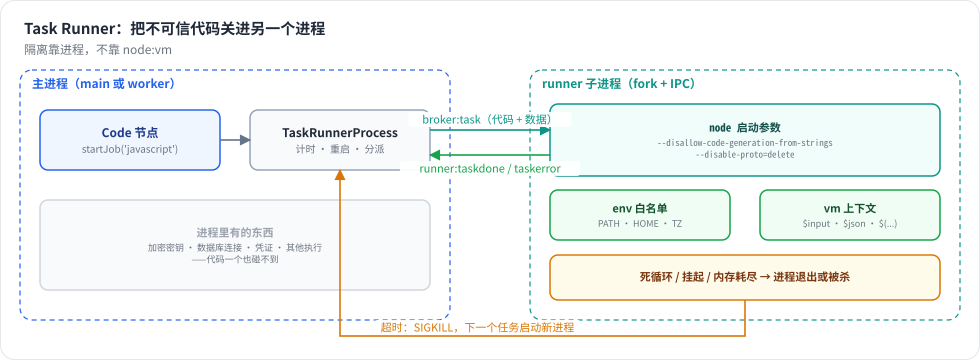

# 第 26 章 Code 节点的安全：Task Runner

> 本章目标：读完你能解释为什么 `node:vm` 不能用来隔离不可信代码，并动手把 Code 节点的代码放进一个独立的子进程：受限的启动参数、白名单环境变量、任务超时、死循环和内存耗尽后自动重启。前置：第 6、8、25 章。对应代码：mini-n8n v1.0 的 `packages/task-runner/`、`cli/src/task-runners/task-runner-process.ts`

## 1. 问题与概念

从第 5 章起，Code 节点一直在主进程里用 `node:vm` 运行用户代码：`runInNewContext` 给代码一个新的全局对象，看起来像沙箱。但 Node.js 文档写得很清楚：**`node:vm` 不是安全机制**。新上下文里的对象仍然来自同一个 V8 堆，顺着原型链就能从一个普通对象拿到宿主的函数构造器，再拿到 `process`。

`examples/code-escape.ts` 把同一段“越狱”代码分别在主进程和 Task Runner 里跑。它顺着原型链取到 `process`，读出 `process.pid` 和加密密钥环境变量。在主进程里的真实输出（密钥是演示用的假值）：

```text
main process (main pid 2395629): [{"json":{"pid":2395629,"key":"super-secret-key"}, ...}]
```

一段节点代码就读到了主进程给凭证加解密用的密钥（第 11 章）。拿到 `process` 之后，读写文件、连数据库、发网络请求都不在话下。除了安全，还有稳定性：

| 用户代码 | 在主进程里的后果 |
|---|---|
| 同步死循环 | `vm` 的 `timeout` 能打断 |
| 永不 settle 的 `await` | 永远挂起；`timeout` 只管同步部分 |
| 不断分配大数组 | 把主进程内存耗尽，所有执行一起崩 |

根治办法是**换一个进程**：让代码在一个单独的子进程里跑，这个子进程没有密钥、没有数据库连接，内存和 CPU 都和主进程分开。它崩了，主进程重启它就行。这就是 n8n 的 **Task Runner**。



*图 26-1：Code 节点把代码和数据交给 TaskRunnerProcess，由它转发给一个 fork 出来的子进程；子进程以受限参数启动、只带白名单环境变量；超时或崩溃时主进程重启它。*

## 2. n8n 是怎么做的

### 2.1 两种模式

Task Runner 有两种模式（`packages/@n8n/config/src/configs/runners.config.ts:17`）：

- `internal`（默认）：n8n 用 `child_process` fork 出一个 runner 子进程。
- `external`：runner 是另一个容器，通过 WebSocket 连到 n8n 里的一个 “broker”。生产和多租户环境用它，可以把 runner 放到隔离更强的沙箱里。

两种模式下，Code 节点的代码都不在主进程（或 worker 进程）里运行。

### 2.2 启动参数

```ts
// packages/cli/src/task-runners/task-runner-process-js.ts:36
const flags = this.runnerConfig.insecureMode
	? []
	: ['--disallow-code-generation-from-strings', '--disable-proto=delete'];
return spawn('node', [...flags, startScript], { env: this.getProcessEnvVars(grantToken, taskBrokerUri, runnerId) });
```

- `--disallow-code-generation-from-strings`：禁止 `eval` 和 `Function('...')`。即使代码顺着原型链拿到了 `Function` 构造器，也造不出新函数。
- `--disable-proto=delete`：删掉 `__proto__` 访问器，堵住一类原型链攻击。

环境变量是一个**白名单**（`getProcessEnvVars()`，`:52`）：只有 `PATH`、`HOME`、时区、几个 runner 自己的配置。`process.env` 里不会有 `N8N_ENCRYPTION_KEY`、数据库连接串或任何 API token——就算代码拿到了 `process`，也读不到秘密。

### 2.3 协议和超时

runner 和 broker 用一套消息协议（`packages/@n8n/task-runner/src/message-types.ts`）：broker 发 `broker:tasksettings`（代码和设置），runner 回 `runner:taskdone` 或 `runner:taskerror`。代码本身仍然用 `node:vm` 运行（`js-task-runner.ts:304`，带 `timeout: taskTimeout * 1000`）——但这一次 vm 的作用只是**超时**，不是隔离；隔离由进程边界负责。

broker 这边也有一个定时器（`task-broker.service.ts:617`）。任务超过 `N8N_RUNNERS_TASK_TIMEOUT`（默认 300 秒）还没完成，broker 放弃它，并在内部模式下发出 `runner:timed-out-during-task` 事件，进程监督器据此**重启 runner**（`task-runner-process-base.ts:64`）——这就能收拾掉那个永不 settle 的 `await`。还有一个心跳（`heartbeatInterval`，默认 30 秒）：runner 卡死、连心跳都发不出来时，一样会被重启。

Code 节点通过 `startJob()` 把任务交给 runner：

```ts
// packages/nodes-base/nodes/Code/Code.node.ts:215
const sandbox = new JsTaskRunnerSandbox(workflowMode, this);
return nodeMode === 'runOnceForAllItems'
	? [await sandbox.runCodeAllItems(code)]
	: [await sandbox.runCodeForEachItem(code, numInputItems)];
```

`runCodeAllItems()` 调用 `this.executeFunctions.startJob('javascript', { code, nodeMode, ... }, itemIndex)`（`JsTaskRunnerSandbox.ts:33`）。

## 3. 从零实现

我们做 `internal` 模式：主进程用 `child_process.fork()` 启动一个子进程，通过它的 IPC 通道收发消息。

### 3.1 协议

~~~~ts
// packages/task-runner/src/protocol.ts
export interface JsTaskSettings { code: string; nodeMode: 'runOnceForAllItems' | 'runOnceForEachItem'; continueOnFail: boolean }
export interface JsTaskData {
	workflow: Pick<IWorkflowBase, 'id' | 'name' | 'nodes' | 'connections' | 'settings' | 'pinData'>;
	runExecutionData: IRunExecutionData;
	runIndex: number; activeNodeName: string; connectionInputData: INodeExecutionData[];
	executeData?: IExecuteData; mode: WorkflowExecuteMode; executionId?: string; additionalKeys?: IDataObject;
}
export type BrokerMessage = { type: 'broker:task'; taskId: string; settings: JsTaskSettings; data: JsTaskData };
export type RunnerMessage =
	| { type: 'runner:ready' }
	| { type: 'runner:taskdone'; taskId: string; result: INodeExecutionData[] }
	| { type: 'runner:taskerror'; taskId: string; error: TaskError }
	| { type: 'runner:log'; taskId: string; message: string };
~~~~

`JsTaskData` 是代码可能读到的一切：输入条目、其他节点的输出、`$execution` 等。n8n 一开始只发一部分，runner 需要更多时再回头问（`runner:taskdatarequest`）；我们一次全发过去，省一轮往返。

### 3.2 runner 子进程

`packages/task-runner/src/js-task-runner.ts` 从 `JsTaskData` 重建一个 `WorkflowDataProxy`（第 6 章），拼出 `$json`、`$input`、`$('节点名')`，再在 vm 上下文里运行代码：

```ts
// :80
return await runInContext(`(async () => {\n${settings.code}\n})()`, context, { timeout: timeoutMs, filename: `${data.activeNodeName}.js` });
```

上下文里放了 Node.js 的常用全局对象（`nativeVariables`，`:16`：`Buffer`、`setTimeout`、`TextEncoder` 等）——第 25 章演示脚本里缺的 `setTimeout` 就是在这里补上的。runner 没有节点类型（`noNodeTypes`，`:8`）：参数的默认值在主进程里已经填好了。

入口 `start.ts` 很短：收到 `broker:task` 就运行，把结果或错误发回去；并用 `process.on('unhandledRejection')` 兜底，不让一个任务的异常掀翻整个 runner。

### 3.3 主进程里的 TaskRunnerProcess

`packages/cli/src/task-runners/task-runner-process.ts` 管理子进程的生命周期。启动（`:46` 起）：

```ts
const flags = ['--disallow-code-generation-from-strings', '--disable-proto=delete'];
if (this.config.runnersMaxOldSpaceSize) flags.push(`--max-old-space-size=${this.config.runnersMaxOldSpaceSize}`);
const child = fork(START_SCRIPT, [], {
	execArgv: ['--import', require.resolve('tsx'), ...flags],
	// 白名单，不是 process.env：没有加密密钥、数据库 URL、API token
	env: { PATH: process.env.PATH, HOME: process.env.HOME, TZ: process.env.TZ, MINI_N8N_RUNNERS_TASK_TIMEOUT: String(this.config.runnersTaskTimeout) },
	stdio: ['ignore', 'inherit', 'inherit', 'ipc'],
});
```

和 n8n 同样的两个 Node 参数，同样的白名单环境变量。`--max-old-space-size` 给 runner 设内存上限：代码想撑爆内存时，是 runner 先被 V8 杀掉，而不是主进程。

`runTask()`（`:89`）给每个任务设一个计时器：

```ts
const timer = setTimeout(() => {
	this.tasks.delete(taskId);
	reject(new TaskTimeoutError(seconds));
	this.forceRestart();   // 卡在这个任务上（死循环）：重启，像 n8n 的内部模式
}, seconds * 1000);
this.tasks.set(taskId, { resolve, reject, timer });
this.child!.send({ type: 'broker:task', taskId, settings, data });
```

子进程退出时（崩溃、被 OOM 杀、被 `forceRestart()` 杀），所有还在它上面跑的任务都 reject（`:63` 起），下一个任务会 `fork` 一个新进程。

### 3.4 Code 节点的分支

```ts
// packages/nodes-base/src/nodes/Code.node.ts:66
if (this.isRunnerAvailable()) {
	try {
		return [await this.startJob('javascript', { code, nodeMode: mode, continueOnFail: this.continueOnFail() }, 0)];
	} catch (error) { ... }
}
// 没有 runner（execute 命令、引擎的单元测试）：在本进程里，和以前一样。
```

`ExecuteContext.startJob()`（`core/src/execute-context.ts:206`）把工作流、执行数据和表达式上下文打包发给 runner。`isRunnerAvailable()`（`:201`）在服务器注入了 runner 时才为 true——所以命令行 `mini-n8n execute` 和引擎单元测试仍然走进程内的 vm，不必为了测试去 fork 一个进程。

### 3.5 裁剪了什么

| n8n 有 | mini-n8n |
|---|---|
| internal + external（WebSocket broker，可放进独立容器） | 只有 internal（fork + IPC） |
| Python runner | 只有 JavaScript |
| 心跳、`runner:taskdatarequest` 按需取数据、并发限制 | 一次发全部数据，一个任务一个 fork 池（串行复用一个进程） |
| `isolated-vm`（真正的独立堆，可选） | `node:vm` + 进程隔离 |
| grant token 认证 runner | 同进程 fork，不需要 |

一个诚实的说明：我们的 runner 用 `node:vm` 运行代码，vm 本身仍然能被越狱。但越狱之后拿到的是 **runner 子进程** 的 `process`——没有密钥、没有数据库、内存受限。安全性来自进程边界和白名单，不是来自 vm。n8n 在这之上还可以用 `isolated-vm`（真正独立的 V8 堆）和 external 模式进一步加固。

## 4. 运行与验证

### 4.1 测试

```bash
npx vitest run packages/cli/test/task-runner.test.ts --reporter=verbose
```

真实输出：

```text
 ✓ task runner > runs Code node code in another process, with $input, $json and $(...)
 ✓ task runner > cannot reach the process through the Function constructor
 ✓ task runner > stops an endless loop: the timer in main fires first and restarts the runner
 ✓ task runner > restarts the runner when a task hangs, and the next task works
 ✓ task runner > survives a runner that runs out of memory
```

- 第一个测试断言 runner 的 PID 不是主进程的 PID，`$input.all()`、`$('节点名')` 都能用。
- 第二个测试把本章开头那段越狱代码交给 runner，得到的错误是 `Code generation from strings disallowed for this context`——`--disallow-code-generation-from-strings` 生效了。
- 第三、四个测试：死循环和永不 settle 的 `await` 都由主进程的计时器收拾，runner 重启，`restarts` 加一，下一个任务用新进程正常完成。
- 第五个测试给 runner 设 `--max-old-space-size=64`，代码不停分配数组；runner 被 V8 杀掉，任务以 `Task runner exited (...) while running the task` 失败，主进程照常服务下一个任务。

### 4.2 亲眼看一次

```bash
MINI_N8N_ENCRYPTION_KEY=super-secret-key npx tsx examples/code-escape.ts
```

同一段越狱代码，先在主进程跑（v0.5 的行为），再在 Task Runner 里跑（v1.0）。真实输出：

```text
main process (main pid 2395629): [{"json":{"pid":2395629,"key":"super-secret-key"}, ...}]
task runner  (main pid 2395629): error: Code generation from strings disallowed for this context
```

同一个主进程 PID：第一行里代码就在它里面运行、读到了密钥；第二行代码被挡在了 runner 子进程外，连函数都造不出来。

### 4.3 踩坑记录

1. **endless-loop 测试的报错和预期不一致**。我本来断言死循环的错误是 vm 的 `Script execution timed out after 1000ms`，实际收到的是主进程的 `Task execution timed out after 1 second`。原因：主进程的计时器和 runner 里 vm 的 timeout 时长一样，但主进程的先开始计时（任务一发出就开始），vm 的要等任务送达 runner 才开始，于是主进程的计时器总是先到、先 `forceRestart()`。这反而是对的——它同时覆盖了同步死循环和异步挂起。改了断言。
2. **测试文件里的单引号**。给测试起名 “main's timer fires first” 时，单引号提前结束了字符串，`tsc` 报了一串莫名其妙的语法错误。改成 “the timer in main fires first”。小坑，但说明测试名也是代码。

## 5. 练习

1. **巩固**：把 `MINI_N8N_RUNNERS_TASK_TIMEOUT` 设成 2，在编辑器里写一个 `while(true){}` 的 Code 节点并执行。多久后报错？报什么错？执行列表里这次执行是什么状态？
2. **扩展**：给 runner 加一个并发限制：同时最多处理 N 个任务，超出的排队。（提示：主进程里给 `runTask` 加一个信号量；或者像 n8n 那样让一个 runner 进程处理多个任务。）
3. **读源码**：阅读 n8n 的 `packages/@n8n/task-runner/src/js-task-runner/built-ins-parser/`，说明 n8n 怎样**静态分析**代码、只把它真正用到的那部分数据发给 runner（而不是像我们这样全发）。这对大数据量的执行有什么好处？

## 6. 延伸阅读

- Node.js 文档 `vm` 一节开头的警告，和 `isolated-vm` 的 README：两者在隔离上的差别。
- `packages/@n8n/task-runner/`：完整的 runner，包括 Python、built-ins 分析和 external 模式。
- `packages/cli/src/task-runners/task-broker/`：external 模式下 broker 怎样撮合 runner 和请求方。
