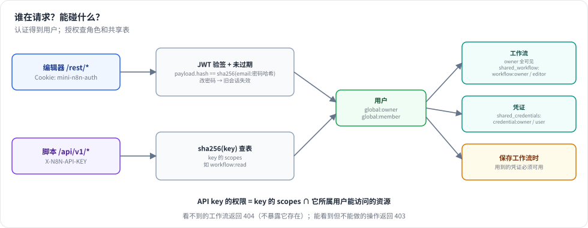
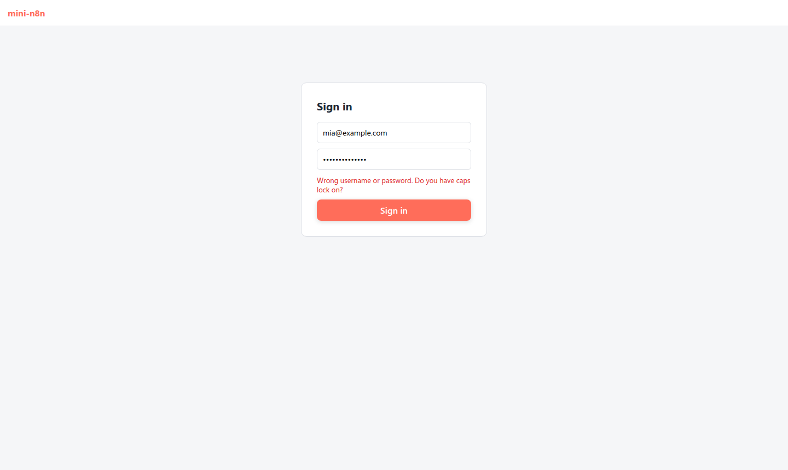
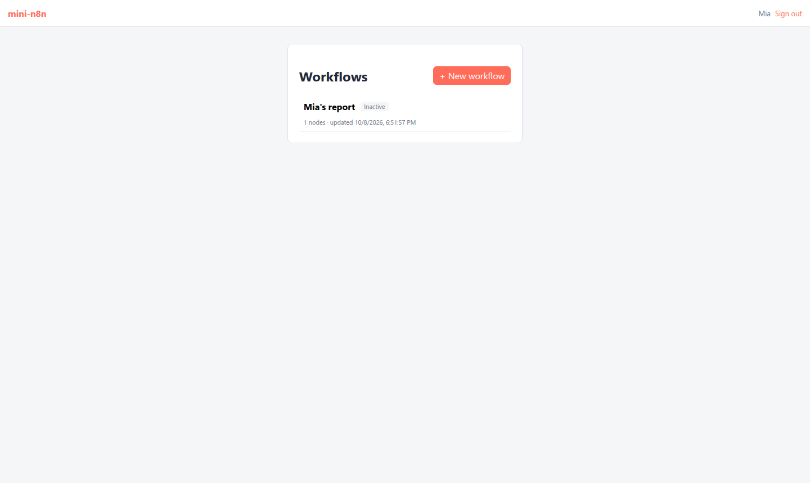

# 第 27 章 多用户、权限与开放 API

> 本章目标：读完你能给 mini-n8n 加上用户系统：第一次启动创建 owner，之后登录；每个用户只看得到自己和别人分享给自己的工作流与凭证；并提供一套用 API Key 认证的开放 API，给脚本和其他系统调用。前置：第 9、11、26 章。对应代码：mini-n8n v1.0 的 `cli/src/auth/`、`cli/src/public-api/`

## 1. 问题与概念

到 v0.5 为止，mini-n8n 没有用户：谁都能看到所有工作流、读到所有凭证、调用所有 REST 接口。单机自用没问题，一旦多人共用就不行了。平台化要解决三件事：

1. **认证（authentication）**：你是谁。编辑器用会话 cookie，脚本用 API Key。
2. **授权（authorization）**：你能碰什么。owner 能看一切；普通成员只能看自己的，以及别人分享给他的。
3. **开放 API**：一套稳定的、给机器用的接口，和编辑器用的内部 REST 接口分开。



*图 27-1：两条认证路径都解析出一个用户；再按全局角色和共享表判断能否访问某个工作流或凭证。*

几个概念：

- **全局角色**：`global:owner`（实例管理员）和 `global:member`。n8n 还有更多角色和基于项目（project）的权限，我们只做这两个。
- **共享（sharing）**：一个工作流有一个 `workflow:owner` 和若干 `workflow:editor`；一个凭证有 `credential:owner` 和若干 `credential:user`。n8n 分享给“项目”，每个用户有一个个人项目；我们直接分享给用户，少一层。
- **会话 cookie**：登录后服务器签发一个 httpOnly 的 JWT，放进 cookie。httpOnly 意味着页面脚本读不到它，降低 XSS 窃取风险。
- **API Key**：一串随机令牌，带若干 **scope**（如 `workflow:read`）。只存它的哈希，像存密码一样。

## 2. n8n 是怎么做的

### 2.1 会话

登录成功后 `issueCookie()`（`packages/cli/src/auth/auth.service.ts:299`）签发 JWT 放进 cookie：`httpOnly`，一周过期。token 里带一个 `hash`：

```ts
// auth.service.ts:570
createJWTHash({ email, password, mfaEnabled, mfaSecret }: User) {
	const payload = [email, password];
	if (mfaEnabled && mfaSecret) payload.push(mfaSecret.substring(0, 3));
	return this.hash(payload.join(':')).substring(0, 10);
}
```

`password` 是数据库里的 bcrypt 哈希。每次请求带着 cookie 进来，`resolveJwt()` 验签、查出用户，再比对 `jwtPayload.hash !== this.createJWTHash(user)`（`:450`）：用户一改密码，这个哈希就变了，**所有旧会话立刻失效**。

JWT 的密钥从加密密钥推导（`services/jwt.service.ts`）：取加密密钥每隔一个字符拼起来再 sha256。所以同一个实例重启后老会话还能用，不同实例之间不行。

### 2.2 密码

密码用 bcrypt（`services/password.utility.ts`）。密码规则在 `@n8n/api-types` 的 `passwordSchema`：8–64 位，至少一个数字、一个大写字母。错误信息也在那里（`Password must contain at least 1 number.` 等）。

### 2.3 授权

n8n 的权限系统基于 scope（`@n8n/permissions`）。`global:owner` 拥有全部 scope；`global:member` 只有自己资源的 scope。列工作流时，成员看到的是“分享给他所在项目的”那些。

保存工作流时有一道关键检查 `validateWorkflowCredentialUsage()`（`workflows/workflow.service.ee.ts:224`）：工作流里用到的凭证，当前用户必须有权使用，否则报错 `You don't have access to the credentials in the '...' node. Ask the owner to share them with you.`。不然成员就能新建一个工作流、在里面引用别人的凭证、执行它来“借用”别人的秘密。

### 2.4 API Key 与开放 API

API Key 存在 `user_api_keys` 表（`@n8n/db/src/entities/api-key.ts`），有 `scopes` 字段。开放 API 用 `X-N8N-API-KEY` 头认证（`services/api-key-auth.strategy.ts`）：按 key 查出用户，`lastUsedAt` 记一下，请求以该用户身份运行。开放 API 的 handler 在 `public-api/v1/handlers/`，按 OpenAPI 规范组织，列表返回 `{ data, nextCursor }` 的游标分页。

## 3. 从零实现

### 3.1 自己写一个 JWT

不引第三方库，`auth/jwt.ts` 手写 HS256：

```ts
// :6
export function signJwt(payload, secret, expiresInSeconds): string {
	const head = b64(JSON.stringify({ alg: 'HS256', typ: 'JWT' }));
	const body = b64(JSON.stringify({ ...payload, iat: now, exp: now + expiresInSeconds }));
	const signature = createHmac('sha256', secret).update(`${head}.${body}`).digest('base64url');
	return `${head}.${body}.${signature}`;
}
```

`verifyJwt()`（`:15`）用 `timingSafeEqual` 比签名，再检查 `exp`。密码用 Node 内置的 scrypt（`auth/password.ts`），存成 `scrypt$<salt>$<hash>`，验证时也用 `timingSafeEqual`——n8n 用 bcrypt，作用一样。

### 3.2 AuthService

`auth/auth.service.ts` 的 JWT 密钥推导和 n8n 一样（每隔一个字符 + sha256）；`createJWTHash()`（`:62`）用 `email:密码哈希` 的 sha256 前 10 位，改密码即失效。

授权是几个小方法：

```ts
// :109
canAccessWorkflow(user, workflowId) {
	return user.role === 'global:owner' || !!this.db.sharing.workflowRole(workflowId, user.id);
}
// :115 看不到的工作流一律 404，不暴露它是否存在
assertWorkflowAccess(user, workflowId) {
	if (!this.db.workflows.get(workflowId) || !this.canAccessWorkflow(user, workflowId)) throw new HttpError(404, 'Workflow not found');
}
```

还有 `assertCredentialUsage()`（`:130`），照搬 n8n 保存工作流时的那道检查。

### 3.3 认证中间件

```ts
// auth/routes.ts:33
app.addHook('onRequest', async (req, reply) => {
	const path = req.url.split('?')[0];
	if (!path.startsWith('/rest/') || PUBLIC_REST.has(`${req.method} ${path}`)) return;
	req.user = auth.userFromCookie(req);
	if (!req.user) return reply.code(401).send({ message: 'Unauthorized' });
});
```

除了三个公开接口（`/rest/settings`、owner 设置、登录），所有 `/rest/*` 都要一个有效会话。Webhook（`/webhook/*`）不走这个 hook，保持公开。

第一次启动时还没有 owner：`/rest/settings` 返回 `showSetupOnFirstLoad: true`，编辑器据此显示“设置 owner”页。`/rest/owner/setup`（`:43`）创建 owner，并把此前（还没有用户系统时）建的工作流和凭证都归到 owner 名下。

每个写操作都加了检查。比如列工作流只返回有权看的，保存工作流先验证凭证使用权，删除工作流要求是 workflow:owner。

### 3.4 开放 API

`public-api/routes.ts` 用自己的 hook 认证：

```ts
// :21
const resolved = typeof header === 'string' ? auth.resolveApiKey(header) : undefined;
if (!resolved) return reply.code(401).send({ message: "'X-N8N-API-KEY' header required" });
req.user = resolved.user;
req.apiKey = resolved.key;
```

每个接口先查 scope，再查访问权：

```ts
// :29
const requireScope = (req, scope) => {
	if (!req.apiKey!.scopes.includes(scope)) throw new HttpError(403, `API key is missing the scope "${scope}"`);
	return req.user!;
};
```

关键一点：**API Key 的权限 = key 的 scope ∩ 它所属用户能访问的资源**。列工作流用 `auth.accessibleWorkflowIds(user)` 过滤，所以就算 key 有 `workflow:read`，也只看得到 key 主人看得到的工作流。创建 key 时（`AuthService.createApiKey`，`:90`）只把 key 显示一次，数据库里存 `sha256(key)` 和末 4 位（`hint`）。

### 3.5 编辑器

`editor/src/components/SignIn.vue` 是登录 / owner 设置页：`/rest/settings` 说要不要设置 owner。`api.ts` 的请求遇到 401 就派发一个事件，`App.vue` 把界面切回登录页。顶栏多了用户名和 “Sign out”。

### 3.6 裁剪了什么

| n8n 有 | mini-n8n |
|---|---|
| 项目（personal / team project），分享给项目 | 直接分享给用户 |
| 很多角色和细粒度 scope（`@n8n/permissions`） | owner / member 两个角色 |
| 邀请邮件、密码重置、MFA、SSO/LDAP | owner 直接给成员设密码 |
| 公开 API 按 OpenAPI 规范、游标分页、更多资源 | 工作流和执行两种资源，简单分页 |

## 4. 运行与验证

```bash
npx vitest run packages/cli/test/auth.test.ts --reporter=verbose
```

真实输出：

```text
 ✓ sign-in > asks for an owner first, then requires a session for /rest
 ✓ sign-in > rejects a wrong password, a forged token, and old sessions after a password change
 ✓ sharing > a member sees only own and shared workflows; editors cannot delete
 ✓ sharing > a member cannot use a credential that is not shared with them
 ✓ public API > authenticates with X-N8N-API-KEY and checks the scopes of the key
```

第二个测试验证了三件事：错误密码返回 401 和 `Wrong username or password. Do you have caps lock on?`；篡改 token 里的用户 ID 后签名对不上，返回 401；直接改数据库里的密码哈希后，旧 cookie 立刻失效。

第四个测试还原了那个“借用凭证”的攻击：成员创建一个引用 owner 凭证的工作流，被 403 挡下（`You don't have access to the credentials in the 'Call API' node. ...`）；owner 把凭证分享给他之后，他能在工作流里用了，但读凭证详情仍然 403——**能用不等于能看**。

### 4.1 编辑器里

`e2e/platform.e2e.mjs` 走完整个流程：



*图 27-2：没有会话时编辑器显示登录页；输错密码，显示服务器返回的错误。*



*图 27-3：成员 Mia 登录后，工作流列表里只有她自己的 “Mia's report”，owner 的私有工作流不在其中。*

真实输出：

```text
✓ without a session the editor shows the sign-in page
✓ a wrong password shows the error from the server
✓ the member sees only own workflows (1: Mia's report)
✓ signing out clears the session cookie
✓ no errors in the browser console
```

### 4.2 踩坑记录

1. **Fastify 拒绝空的 JSON body**。所有旧测试都用一个共享的 `createTestServer()`（会先设置 owner、带上 cookie），改造顺利。但部署端到端脚本（第 28 章）用 `curl -X POST .../activate -H 'content-type: application/json'` 且不带 body 时报了 400 `Body cannot be empty when content-type is set to 'application/json'`：Fastify 默认的 JSON 解析器不接受空 body，而 n8n 用的 Express 接受。修复：注册一个把空 body 当作 `undefined`、否则再 `JSON.parse` 的解析器（`server.ts`）。这个坑是在第 28 章跑部署脚本时才发现的，但根因在本章。

## 5. 练习

1. **巩固**：用 curl 走一遍：`POST /rest/owner/setup` 拿 cookie → `POST /rest/api-keys` 建 key → 用 `X-N8N-API-KEY` 调 `GET /api/v1/workflows`。再创建一个只有 `workflow:read` 的 key，用它 `POST /api/v1/workflows`，看看返回什么。
2. **扩展**：实现“工作流所有权转移”：owner 能把一个工作流的 `workflow:owner` 换成另一个用户。注意别把自己锁在外面。
3. **读源码**：阅读 n8n 的 `@n8n/permissions` 里 `global:member` 的 scope 列表，和 `workflows/workflow.service.ee.ts` 的 `getSharedWorkflowIds`。成员在团队项目里看到工作流和在个人项目里有什么不同？

## 6. 延伸阅读

- `packages/cli/src/auth/`：完整的认证，包括 MFA、浏览器绑定、cookie 续期。
- `packages/@n8n/permissions/`：角色和 scope 的定义。
- `packages/cli/src/public-api/`：开放 API 的 OpenAPI 规范和所有 handler。
