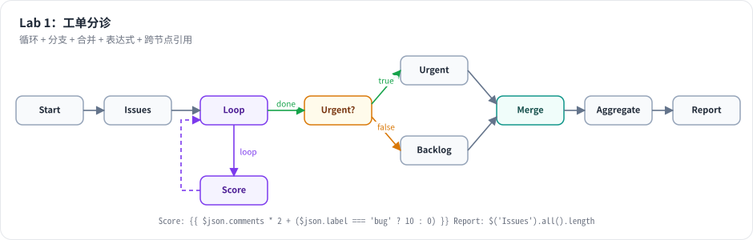

# Lab 1：mini-n8n v0.1 —— 用 CLI 跑一个带分支、合并和循环的工作流

> 目标：从空目录开始，写出 mini-n8n v0.1：数据模型、表达式与沙箱、栈式执行引擎、12 个节点和一个命令行。完成后，下面这个“工单分诊”工作流能跑通。前置：第 4–8 章。对应代码：tag `v0.1`



*图 L1-1：Issues 产出 5 个工单 → Loop Over Items 每批 2 个给 Score 打分（循环 3 轮）→ done 输出接 If 分流 → 两个 Set → Merge → Aggregate → Report。一张图里同时有循环、分支、合并、表达式和跨节点引用。*

## 1. 搭骨架

```bash
mkdir mini-n8n && cd mini-n8n && git init
npm init -y
npm i -D typescript tsx vitest @types/node
```

根目录 `package.json` 关键字段：

```json
{
  "type": "module",
  "workspaces": ["packages/*"],
  "scripts": {
    "test": "vitest run",
    "typecheck": "tsc --noEmit -p tsconfig.json",
    "mini-n8n": "tsx packages/cli/src/bin.ts"
  }
}
```

建 4 个包，每个包的 `package.json` 都把 `main` 指向 `src/index.ts`（不编译，`tsx` 和 Vitest 直接读 TS）：

```text
packages/workflow    @mini-n8n/workflow    依赖 acorn、acorn-walk、luxon
packages/core        @mini-n8n/core        依赖 @mini-n8n/workflow
packages/nodes-base  @mini-n8n/nodes-base  依赖 @mini-n8n/workflow
packages/cli         @mini-n8n/cli         依赖以上全部
```

## 2. 按顺序实现

每一步都能独立验证，建议写完一步跑一次测试。

| 步骤 | 文件 | 要点 | 对应章节 |
|---|---|---|---|
| 1 | `workflow/src/interfaces.ts` | `INode`、`IConnections`、`INodeExecutionData`、`ITaskData`、`IRunExecutionData`、`INodeType`、`IExecuteFunctions` | 4、5 |
| 2 | `workflow/src/errors.ts` | `ExecutionBaseError` 及子类，`toJSON()` 便于序列化进运行数据 | 8 |
| 3 | `workflow/src/graph.ts` | `mapConnectionsByDestination`、`getConnectedNodes`（BFS，支持 `ALL_NON_MAIN`） | 4 |
| 4 | `workflow/src/node-helpers.ts` | `displayParameter`、`getNodeParameters`（填默认值、丢隐藏字段） | 5 |
| 5 | `workflow/src/expression-parser.ts` | `isExpression`、`splitExpression` | 6 |
| 6 | `workflow/src/expression-sandbox.ts` | acorn 检查黑名单属性、改写动态键、`with` + Proxy 白名单作用域 | 6 |
| 7 | `workflow/src/workflow-data-proxy.ts` | `$json`、`$input`、`$()`、paired item 回溯、`$now` | 6 |
| 8 | `workflow/src/expression.ts`、`workflow.ts` | `Expression`；`Workflow` 构造时建反向索引、填默认值 | 4、5、6 |
| 9 | `core/src/execution-lifecycle-hooks.ts` | 四个钩子 + `sendResponse` | 3 |
| 10 | `core/src/execute-context.ts` | `getInputData`、`getNodeParameter`（解析表达式）、`putExecutionToWait`、`getContext` | 5、8 |
| 11 | `core/src/workflow-execute.ts` | 主循环、`addNodeToBeExecuted`、`releaseWaitingNode`、重试、错误输出、等待恢复、取消/超时 | 7、8 |
| 12 | `nodes-base/src/nodes/*.node.ts` | 12 个节点 | 5 |
| 13 | `cli/src/commands/execute.ts`、`bin.ts` | 读 JSON → `Workflow` → 钩子打印 → `WorkflowExecute.run` | 3 |

建议的测试顺序（`packages/core/test/workflow-execute.test.ts`）：线性 → If 分支 → 空分支不执行 → 并行 + Merge → If + Merge（单边为空）→ 循环 → 错误三模式 → 重试 → pin 数据 → 部分执行 → 禁用节点 → Wait 存盘恢复 → 超时 → 取消。每个测试都对应第 7、8 章的一个机制。

## 3. 运行与验证

```bash
git checkout v0.1        # 或者用你自己写的版本
npm install
npm run typecheck
npm test
npm run mini-n8n -- execute --file examples/03-issue-triage.json
```

真实输出（测试部分）：

```text
 Test Files  2 passed (2)
      Tests  24 passed (24)
```

真实输出（工作流部分）：

```text
✓ Start                        items out: 1  (0 ms)
✓ Issues                       items out: 5  (9 ms)
✓ Loop                         items out: 0/2  (0 ms)
✓ Score                        items out: 2  (3 ms)
✓ Loop                         items out: 0/2  (0 ms)
✓ Score                        items out: 2  (0 ms)
✓ Loop                         items out: 0/1  (0 ms)
✓ Score                        items out: 1  (0 ms)
✓ Loop                         items out: 5/0  (0 ms)
✓ Urgent?                      items out: 3/2  (0 ms)
✓ Urgent                       items out: 3  (0 ms)
✓ Backlog                      items out: 2  (0 ms)
✓ Merge                        items out: 5  (1 ms)
✓ Aggregate                    items out: 1  (0 ms)
✓ Report                       items out: 1  (0 ms)

status: success
last node: Report
[
  {
    "total": 5,
    "urgent": [
      "#101 Crash on save (score 18)",
      "#102 Dark mode (score 18)",
      "#104 Login loop (score 12)"
    ],
    "backlog": 2
  }
]
```

对照第 7 章检查你的引擎：

- Loop 运行了 4 次（`0/2`、`0/2`、`0/1`、`5/0`），Score 运行了 3 次。
- Urgent 和 Backlog 都有数据，Merge 等到两个输入都到齐才执行（没有用到“栈空放行”）。
- Report 里的 `$('Issues').all().length` 读到了 5：跨节点引用能读到任意已执行节点的输出。

## 4. 踩坑记录

以下是写 v0.1 时真实遇到的问题。

1. **`tsx` 找不到 `./nodes/Aggregate.node`**。报错 `ERR_MODULE_NOT_FOUND`。原因：`.node` 是 Node.js 原生插件的扩展名，解析器认为 `Aggregate.node` 已经带了扩展名，不会再尝试补 `.ts`。解决：导入时写全 `./nodes/Aggregate.node.ts`，并在 `tsconfig.json` 打开 `allowImportingTsExtensions`。
2. **Code 节点一运行就报 “access to env vars denied”**。Code 节点用 `{ ...proxy }` 展开数据代理来构造沙箱变量，而 `$env` 当时写成了 getter，展开时 getter 被调用就抛错。解决：把 `$env` 改成一个“访问任何属性都抛错”的 Proxy 对象，展开时只复制引用，不触发访问。
3. **`nodeExecuteAfter` 钩子里看不到等待区的变化**。写 `examples/execution-order.ts` 时发现 Merge 进入等待区的那一刻打印不出来。对照 n8n 源码发现，n8n 是在 **子节点进栈之后** 才调用 `nodeExecuteAfter`（`workflow-execute.ts:2626-2634`），而我写在了之前。按 n8n 的顺序改正后，钩子能看到完整的调度结果。
4. **（自查发现，未造成运行错误）错误输出的语义和 n8n 不同**。最初实现是“整个节点失败时，把所有输入 item 放进 Error 输出”。读 `handleNodeErrorOutput` 后发现 n8n 是“节点逐条产出 error item，引擎再按 `pairedItem` 把它们挪到 Error 输出并合并原始字段”。按 n8n 语义重写，并改了对应测试。
5. **（自查发现）默认值的填充位置**。最初在 `getNodeParameter` 里查 `description` 补默认值。读 n8n 源码发现默认值在 `Workflow` 构造函数里一次性填好，`getNodeParameter` 取不到值就报错。改成和 n8n 一致后，“隐藏字段的值会被丢弃”这个行为也自然得到了。
6. **（自查发现）超时的状态**。最初把超时报告为 `error`。n8n 报告为 `canceled`，错误是 `TimeoutExecutionCancelledError`。已对齐。

## 5. 检查清单

- [ ] `npm run typecheck` 无错误
- [ ] `npm test` 24 个测试全部通过
- [ ] `examples/01-orders.json`、`02-error-output.json`、`03-issue-triage.json` 都能运行
- [ ] `npx tsx examples/execution-order.ts` 的输出和第 7 章一致
- [ ] 提交并打 tag：`git tag v0.1`

## 6. 扩展挑战

1. 实现 Switch 节点：按规则把 item 分到 N 个输出（`outputs` 用函数根据规则数量动态生成）。
2. 实现 `settings.errorWorkflow`：CLI 执行失败时，自动运行指定的另一个工作流文件，把错误信息作为输入。
3. 给 CLI 加一个 `--pin Node=file.json` 参数，用文件内容作为某个节点的 pin 数据。
