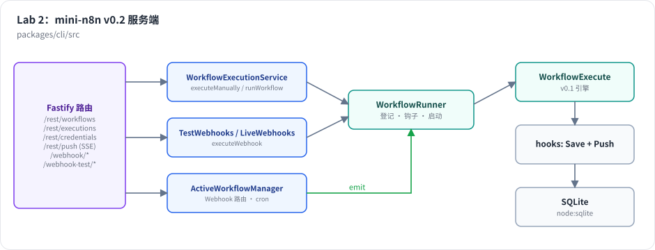

# Lab 2：mini-n8n v0.2 —— REST API + Webhook + 定时任务

> 目标：在 v0.1 的引擎外面包一层服务端：数据库、REST API、推送、凭证、Webhook 和定时触发器。完成后，你可以用 curl 创建工作流、手动执行并实时收到进度，激活后让它被 HTTP 请求或定时器自动触发。前置：第 9–12 章。对应代码：tag `v0.2`（`git diff v0.1 v0.2 --stat`：39 个文件，+3308 行）



*图 L2-1：Fastify 路由把请求交给执行服务；执行服务决定“现在跑”还是“等测试 Webhook”；Runner 登记执行、组装钩子、启动引擎；钩子写库和推送。ActiveWorkflowManager 负责激活后的 Webhook 路由和 cron 任务。*

## 1. 新增文件

```text
packages/workflow/src/interfaces.ts     + 凭证、触发器、Webhook 相关接口
packages/core/src/
  node-contexts.ts                      TriggerContext、WebhookContext
  scheduled-task-manager.ts             基于 croner 的 cron 管理
  triggers-and-pollers.ts               runTrigger（手动 / 激活两种模式）
  execute-context.ts                    + getCredentials、sendResponse、httpRequestWithAuthentication
  workflow-execute.ts                   + 手动运行 trigger 节点
packages/nodes-base/src/
  credentials/index.ts                  httpHeaderAuth / httpBasicAuth / httpQueryAuth
  nodes/Webhook.node.ts、RespondToWebhook.node.ts、ScheduleTrigger.node.ts
  nodes/HttpRequest.node.ts             + 认证参数
packages/cli/src/
  config.ts、cipher.ts                  配置、加密
  databases/db.ts                       表结构 + 仓储
  credentials-helper.ts                 解密、套用认证规则
  push.ts                               SSE 推送
  execution-lifecycle-hooks.ts          hookFunctionsSave / hookFunctionsPush
  active-executions.ts、workflow-runner.ts、workflow-execution.service.ts
  webhooks/                             webhook-helpers、live-webhooks、test-webhooks
  active-workflow-manager.ts            激活 / 停用
  server.ts、commands/start.ts          路由、启动命令
packages/cli/test/server.test.ts        9 个集成测试
examples/server-demo.sh                 curl 演示脚本
```

## 2. 建议的实现顺序

| 步骤 | 内容 | 验证方式 |
|---|---|---|
| 1 | `Database`：建表、`WorkflowRepository` | 在 Node REPL 里创建、读取一个工作流 |
| 2 | `ExecutionRepository` + `hookFunctionsSave` + `WorkflowRunner` | 测试：手动执行后能查到状态为 `success` 的执行 |
| 3 | `server.ts`：工作流 CRUD、`/run`、执行查询 | `app.inject` 测试 |
| 4 | `Push` + `hookFunctionsPush` | 测试：断言推送消息的顺序 |
| 5 | `Cipher`、`CredentialsHelper`、凭证路由、HTTP Request 认证 | 测试：本地 HTTP 服务收到正确的请求头，数据库里没有明文 |
| 6 | Webhook 节点、`getWorkflowWebhooks`、`executeWebhook`、`LiveWebhooks` | 测试：三种响应模式 |
| 7 | `ActiveWorkflowManager`：Webhook 部分 | 测试：激活后能调用，路径冲突报 400 |
| 8 | `TestWebhooks` + `executeManually` 的等待逻辑 | 测试：只响应一次、推送 `testWebhookReceived` |
| 9 | `ScheduledTaskManager`、`runTrigger`、Schedule Trigger | 测试：激活后自动产生执行，停用后停止 |

## 3. 运行与验证

```bash
git checkout v0.2 && npm install
npm test
```

真实输出：

```text
 ✓ packages/workflow/test/expression.test.ts (7 tests)
 ✓ packages/core/test/workflow-execute.test.ts (17 tests)
 ✓ packages/cli/test/server.test.ts (9 tests)
      Tests  33 passed (33)
```

启动服务器，用演示脚本驱动：

```bash
npm run mini-n8n -- start            # 默认 http://127.0.0.1:5678，数据在 ~/.mini-n8n
./examples/server-demo.sh            # 另开一个终端
```

真实输出见第 12 章第 4 节。再试一个定时任务：

```bash
B=http://localhost:5678
WF=$(curl -s -X POST $B/rest/workflows -H 'content-type: application/json' -d '{
  "name": "tick",
  "nodes": [
    {"id":"1","name":"Every 2s","type":"n8n-nodes-base.scheduleTrigger","typeVersion":1,"position":[0,0],"parameters":{"unit":"seconds","value":2}},
    {"id":"2","name":"Log","type":"n8n-nodes-base.noOp","typeVersion":1,"position":[200,0],"parameters":{}}
  ],
  "connections": {"Every 2s":{"main":[[{"node":"Log","type":"main","index":0}]]}}
}' | node -pe "JSON.parse(require('fs').readFileSync(0)).data.id")
curl -s -X POST $B/rest/workflows/$WF/activate > /dev/null
sleep 7
curl -s -X POST $B/rest/workflows/$WF/deactivate > /dev/null
curl -s "$B/rest/executions?workflowId=$WF" | node -pe "JSON.parse(require('fs').readFileSync(0)).data.map(e => e.mode + ' ' + e.status).join('\n')"
```

真实输出（7 秒内触发了 4 次：cron 在每个偶数秒触发，具体次数取决于激活时刻和 2 秒边界的对齐）：

```text
trigger success
trigger success
trigger success
trigger success
```

## 4. 踩坑记录

以下是写 v0.2 时真实遇到的问题。

1. **ID 太丑**。最初用 `randomUUID().slice(0, 16)` 生成工作流 ID，得到 `3e5cd103-c724-41` 这样带连字符、被截断的字符串。改成 16 位字母数字随机串（和 n8n 工作流 ID 的形状一致）。第 9 章保留了一条旧输出，以作对比。
2. **`testWebhookReceived` 推送得太晚**。第一版在 `executeWebhook` 返回之后才推送这条消息。lastNode 模式下 `executeWebhook` 要等执行结束才返回，于是编辑器先收到所有节点的进度，最后才收到“收到测试请求”。n8n 是在执行开始时就推送的。改为给 `executeWebhook` 传一个 `onExecutionStarted` 回调。
3. **机器上没有 `sqlite3` 命令行**。想直接查看数据库时发现系统没装 `sqlite3`。改用 `node -e "new (require('node:sqlite').DatabaseSync)(file)..."` 查询——既然用了 `node:sqlite`，就不需要额外工具。
4. **`node:sqlite` 的实验特性警告**。每次启动都会打印 `ExperimentalWarning: SQLite is an experimental feature`。这是 Node 22 的正常行为，不影响功能；生产部署时可以用 `--disable-warning=ExperimentalWarning` 关掉（第 28 章的 Dockerfile 里会这样做）。

## 5. 检查清单

- [ ] 33 个测试全部通过，`npm run typecheck` 无错误
- [ ] `examples/server-demo.sh` 的输出和第 12 章一致
- [ ] 数据库里的凭证是 `v1:` 开头的密文；`GET /rest/credentials/:id` 返回占位符
- [ ] 重启服务器后，已激活的工作流仍然响应 Webhook、定时任务继续运行
- [ ] `git tag v0.2`

## 6. 扩展挑战

1. 给 REST API 加上分页：`GET /rest/executions?cursor=<lastId>&limit=20`。
2. 实现 `saveDataSuccessExecution: 'none'`：成功的执行不保存执行数据（只保留元数据）。
3. 用 WebSocket 替代 SSE 实现推送，并比较两者在浏览器断线重连时的行为。
