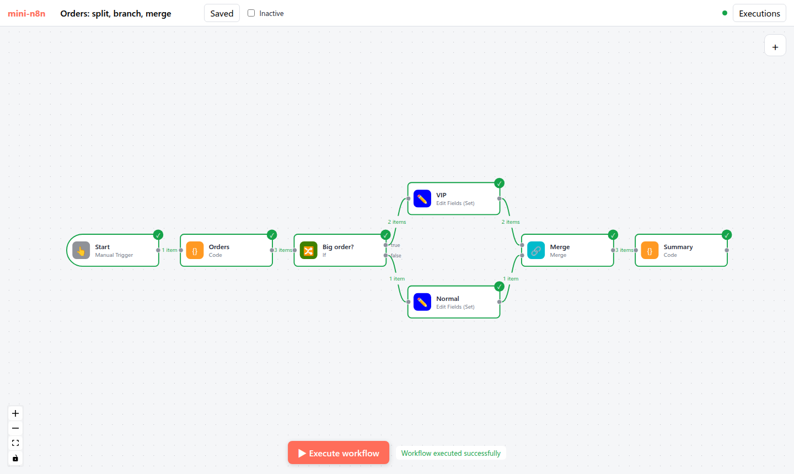

# Lab 3：mini-n8n v0.3 —— 可视化编排 + 实时执行

> 目标：给 v0.2 的服务端加上一个 Vue 3 编辑器：画布、节点面板、NDV（参数表单、表达式预览、拖拽映射）、实时执行状态、Pin 数据、部分执行、执行列表和 Debug in editor。前置：第 13–15 章。对应代码：tag `v0.3`



*图 L3-1：v0.3 的编辑器执行完订单工作流。*

## 1. 新增内容

```text
packages/editor/                      Vue 3 + Vite + Pinia + @vue-flow/core
  src/api.ts                          REST 客户端（每个端点一个函数）
  src/stores/
    nodeTypes.ts                      节点描述 + 浏览器用的 INodeTypes
    workflow.ts                       正在编辑的工作流（n8n 格式）+ 脏节点
    execution.ts                      执行状态：runData、runningNodes、部分执行、Debug in editor
    push.ts                           SSE 连接，按消息类型分发
  src/composables/
    useCanvasMapping.ts               工作流 → Vue Flow 节点/边
    useNodeRunContext.ts              NDV 的输入/输出数据 + 表达式预览
  src/components/
    Canvas.vue、CanvasNode.vue        画布与节点
    NodeCreator.vue                   节点面板
    NodeDetailsView.vue               NDV
    ParameterInput.vue                递归的参数组件
    RunDataView.vue                   表格 / JSON 视图，可拖拽映射
    NodeSettings.vue、CredentialSelect.vue、ExecutionsPanel.vue、WorkflowList.vue
packages/core/src/partial-execution.ts   部分执行算法 + 3 个测试
packages/cli/src/                     /run 支持 runData + dirtyNodeNames；托管编辑器静态文件
e2e/editor.e2e.mjs                    headless Chrome 端到端测试（17 项）
```

## 2. 建议的实现顺序

| 步骤 | 内容 | 验证 |
|---|---|---|
| 1 | Vite + Vue 骨架，`api.ts`，工作流列表 | 列表能显示 v0.2 里创建的工作流 |
| 2 | `nodeTypes` / `workflow` store，`useCanvasMapping`，只读画布 | 打开工作流能看到节点和连线 |
| 3 | 画布交互：拖动、连线、删除、保存 | 刷新页面后修改还在 |
| 4 | `push` / `execution` store，执行按钮 | 节点逐个变绿，边上显示 item 数 |
| 5 | NDV：参数表单（先 string/number/boolean/options，再 collection/fixedCollection） | 修改参数后执行结果随之变化 |
| 6 | 表达式开关 + `useNodeRunContext` 预览 | 不执行也能看到表达式结果 |
| 7 | 节点面板、自动连接、凭证选择、Webhook URL | 能从零搭出一个工作流 |
| 8 | Pin、部分执行、执行列表、Debug in editor | e2e 全部通过 |

## 3. 运行与验证

```bash
git checkout v0.3 && npm install
npm test                 # 36 个单元/集成测试
npm start                # 构建编辑器并启动，打开 http://localhost:5678
npm run test:e2e         # 另一个终端：17 项端到端测试
```

单元测试真实输出：

```text
 ✓ packages/core/test/partial-execution.test.ts (3 tests)
 ✓ packages/workflow/test/expression.test.ts (7 tests)
 ✓ packages/core/test/workflow-execute.test.ts (17 tests)
 ✓ packages/cli/test/server.test.ts (9 tests)
      Tests  36 passed (36)
```

端到端测试的真实输出见第 15 章第 4 节。开发编辑器时可以用热更新：

```bash
npm run mini-n8n -- start      # 终端 1：服务端 :5678
npm run dev:editor             # 终端 2：Vite :5173，/rest 和 /webhook 代理到 :5678
```

## 4. 踩坑记录

以下是写 v0.3 时真实遇到的问题。

1. **新建节点没反应**。点击节点面板里的条目后 NDV 没有打开，e2e 测试超时。抓取浏览器控制台发现：`DataCloneError: Failed to execute 'structuredClone' on 'Window': #<Object> could not be cloned`。原因：`getNodeParameters` 用 `structuredClone(property.default)` 复制默认值，而在编辑器里 `property` 来自 Pinia store，是 Vue 的响应式 Proxy，`structuredClone` 无法克隆 Proxy。改为 `deepCopy`（`JSON.parse(JSON.stringify(...))`），n8n 也有同名工具函数。
2. **打开工作流时画布没有居中**。截图里节点挤在右边、部分超出视口。`fit-view-on-init` 在节点数据还没到达时就执行了。改为监听 Vue Flow 的 `nodes-initialized` 事件再调用 `fitView`。
3. **部分执行后，下游节点的输入面板变空了**。e2e 里先对 VIP 做部分执行，再给 Summary 后面新加的节点打开 NDV，输入栏没有数据。原因：部分执行的结果只包含子图（Start → … → VIP），前端直接用它替换了全部运行数据。对照 n8n：后端 `cleanRunData` 本来就会去掉子图之外的数据，前端负责把上一次的数据合并回来。改成 `runData = { ...partialBase, ...新结果 }`。
4. **e2e 里第二次点“Executions”反而关掉了面板**。切换工作流时面板保持打开状态，测试脚本再点一次按钮就把它关了。测试改为“没打开才点”。
5. **（自查发现）参数行太挤**。fixedCollection 的一行里 Name、Type、Value 三个字段横排，表达式输入框只剩很窄一条（截图可见）。改成两列网格，Value 单独占一行。

## 5. 检查清单

- [ ] 36 个测试通过，`npm run test:e2e` 17 项通过、浏览器控制台无错误
- [ ] 能从空白工作流开始，用节点面板搭出 Manual Trigger → Code → If → Set，并执行成功
- [ ] 表达式预览在不执行的情况下随输入实时变化
- [ ] 改一个节点后 Execute step，上游节点没有重跑（看执行数据里的 `startTime`）
- [ ] `git tag v0.3`

## 6. 扩展挑战

1. 撤销/重做（第 13 章练习 2）。
2. 给 NDV 的 JSON 视图实现字段级拖拽：拖 `body.customer.name` 生成 `{{ $json.body.customer.name }}`。
3. 实现复制粘贴：选中若干节点，Ctrl+C 复制成 n8n 格式的 JSON（`{ nodes, connections }`），Ctrl+V 粘贴时重命名冲突的节点。
