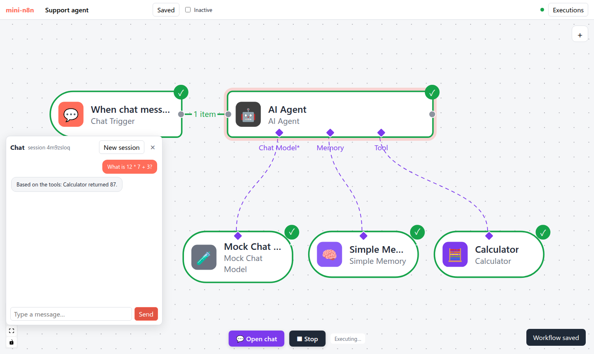

# Lab 4：从零搭一个能调工具、有记忆的 AI Agent 工作流

> 目标：给 mini-n8n 加上 AI 能力（v0.4），然后在编辑器里从零搭出一个客服 Agent：Chat Trigger → AI Agent，下挂模型、记忆和工具；在编辑器里对话测试，激活后通过公开聊天页流式对话。最后换成真实的本地模型再跑一遍。前置：第 16–21 章。对应代码：tag `v0.4`



*图 L4-1：本 Lab 要搭出的工作流（e2e 测试截图）。*

## 1. 新增内容

```text
packages/workflow/src/interfaces.ts       SupplyData、EngineRequest/Response、AiTool/AiToolkit、StructuredChunk、$fromAI 相关
packages/core/src/
  workflow-execute.ts                     handleEngineRequest、collectSubNodeResults、工具输出重定向、工具出错默认继续
  get-input-connection-data.ts            根节点拉取子节点
  supply-data-context.ts                  addInputData / addOutputData
  node-as-tool.ts、node-types.ts          合成 xxxTool 类型、$fromAI
  execute-context.ts                      getInputConnectionData、isStreaming、sendChunk、executeWorkflow
packages/nodes-ai/                        新包（对应 @n8n/nodes-langchain）
  models/   types、mock、openai-compatible、log-wrapper
  agent/    execute.ts（Tools Agent 循环）
  memory/   buffer-window.ts
  nodes/    agent、chain-llm、chat-trigger、models、memory、tools
  mcp-client.ts、credentials.ts
packages/cli/src/                         子工作流、/rest/workflows/:id/chat、流式 Webhook、chatChunk 推送
packages/editor/src/                      聊天面板、子节点自动连接、NDV 显示子节点数据和多次运行
examples/  ollama-agent.ts、model-stream.ts、agent-stack-trace.ts、mcp-server.ts、mcp-agent.ts
e2e/ai.e2e.mjs                            8 项端到端测试
```

## 2. 建议的实现顺序

| 步骤 | 内容 | 验证 |
|---|---|---|
| 1 | 接口：`SupplyData`、`EngineRequest/Response`、`AiTool` | 编译通过 |
| 2 | `getInputConnectionData` + `SupplyDataContext` | 测试：没接模型时报 “A Chat Model sub-node must be connected” |
| 3 | `MockChatModel` + `ChatModel` 接口 + 日志包装 | 直接调用模型，检查工具调用 |
| 4 | 计算器工具节点（`supplyData` + `execute`） | 单独执行它的 `execute` |
| 5 | Agent：先只支持“没有工具” | 输出 `You said: ...` |
| 6 | 引擎：`handleEngineRequest` / `collectSubNodeResults` | 测试：钩子事件序列（第 18 章） |
| 7 | 记忆、多工具、工具出错、最大迭代 | `agent.test.ts` 全部通过 |
| 8 | OpenAI 兼容模型 + Ollama 节点 | `examples/ollama-agent.ts` |
| 9 | 节点即工具 + `$fromAI`、Workflow Tool、MCP | 对应测试 |
| 10 | Chat Trigger、流式 Webhook、编辑器聊天面板 | `ai.test.ts`、`e2e/ai.e2e.mjs` |

## 3. 动手：在编辑器里搭 Agent

```bash
git checkout v0.4 && npm install
npm start                                  # http://localhost:5678
```

1. 新建工作流，删除默认的 Manual Trigger，从节点面板（`+`）添加 **Chat Trigger**。
2. 选中 Chat Trigger，添加 **AI Agent**——它自动接在 Chat Trigger 后面。
3. 选中 AI Agent，依次添加 **Mock Chat Model**、**Simple Memory**、**Calculator**——它们自动出现在 Agent 下方，并用紫色虚线连到对应端口。
4. 保存，点底部的 **💬 Open chat**，输入 `What is 12 * 7 + 3?`。
5. 观察：画布上 Agent、模型、计算器依次变绿；双击 Mock Chat Model，NDV 顶部有 Run 1 / Run 2；双击 Calculator，输入栏是模型给的 `expression`。
6. 再发 `Hi, my name is Ada`，然后 `What is my name?`。
7. 打开 Active 开关，双击 Chat Trigger，复制 Test URL 旁边那个 URL 中的路径，在新标签页打开 `http://localhost:5678/webhook/<路径>`——这是公开聊天页。

这些步骤也被写成了端到端测试：

```bash
npm run test:e2e        # 先跑编辑器测试，再跑 AI 测试
```

`e2e/ai.e2e.mjs` 真实输出见第 21 章第 4 节。

## 4. 换成真实模型

```bash
ollama pull qwen2.5:0.5b
npx tsx examples/ollama-agent.ts "A shirt costs 25 dollars. How much do 17 shirts cost?"
```

真实输出见第 18 章第 4 节（`The cost of 17 shirts is 425 dollars.`）。在编辑器里，把 Mock Chat Model 删掉，换成 **Ollama Chat Model**（模型名 `qwen2.5:0.5b`，不选凭证即使用 `http://localhost:11434`）即可。

也可以接任何 OpenAI 兼容服务：添加 **OpenAI Chat Model**，新建 “OpenAI API (or compatible)” 凭证，Base URL 填服务商地址。

## 5. 测试

```bash
npm test
```

真实输出：

```text
 ✓ packages/core/test/partial-execution.test.ts (3 tests)
 ✓ packages/workflow/test/expression.test.ts (7 tests)
 ✓ packages/nodes-ai/test/agent.test.ts (9 tests)
 ✓ packages/cli/test/ai.test.ts (4 tests)
 ✓ packages/core/test/workflow-execute.test.ts (17 tests)
 ✓ packages/cli/test/server.test.ts (9 tests)
      Tests  49 passed (49)
```

## 6. 踩坑记录

以下是写 v0.4 时真实遇到的问题。

1. **Code Tool 抛出的错误消息多了个 “Error: ” 前缀**。测试期望工具错误是 `boom`，实际是 `Error: boom`。原因：Code Tool 在 `node:vm` 的新上下文里运行，那里抛出的 `Error` 来自另一个 realm，`error instanceof Error` 为 false，于是 `toExecutionError` 退化成 `String(error)`。改为鸭子类型判断（有字符串 `message` 就当作错误）。
2. **子工作流测试拿到 `undefined`**。Workflow Tool 的集成测试里，先 `run()` 拿到执行 ID，再 `getPostExecutePromise(id)` 等待结束——但执行太快，在第二步之前已经结束并从活动执行表里删除了。增加 `start()`，在启动 **之前** 就拿到“结束 Promise”；`ActiveExecutions` 也会保留最近结束的 100 个执行结果。
3. **公开聊天页算错了 `(19 + 23) * 2`**。Mock 模型用正则提取算式，第一版不认括号，只取到了 `19 + 23`，答案是 42。改为“取包含运算符的、最长的数字/运算符/括号串”。改完后 e2e 仍然失败——因为后台服务器进程还在运行旧代码，重启后通过。
4. **Cluster Node 的连线绕到节点顶部**、**聊天面板卡在 “…”**、**画布卡在 Executing…**：见第 16、21 章的踩坑记录。
5. **（真实模型）复述错误**：`qwen2.5:0.5b` 正确调用了计算器并得到 `7006652`，却在最终回答里写成 `700,665,200`。这不是代码问题，但值得记录：见第 18 章第 4 节的讨论。

## 7. 检查清单

- [ ] 49 个测试通过；`npm run test:e2e` 两套测试全部通过
- [ ] 编辑器里能从空白开始搭出 Chat Trigger + Agent + 三个子节点，并完成三轮对话
- [ ] 模型节点 NDV 显示每次调用的消息和响应；工具节点 NDV 显示模型给的参数
- [ ] 公开聊天页能流式回答
- [ ] （可选）`examples/ollama-agent.ts` 用真实模型跑通
- [ ] `git tag v0.4`

## 8. 扩展挑战

1. 实现 Agent 的 “Require Specific Output Format”：接一个结构化输出解析器（v0.5 会实现，先自己试试）。
2. 给 OpenAI 兼容模型实现 token 用量统计，并在模型节点的 NDV 里显示每次调用的 `promptTokens` / `completionTokens`。
3. 实现 MCP Server Trigger（第 20 章练习 2），然后用 `examples/mcp-agent.ts` 里的客户端去连接它——mini-n8n 自己当 MCP 服务器，被自己的 Agent 调用。
