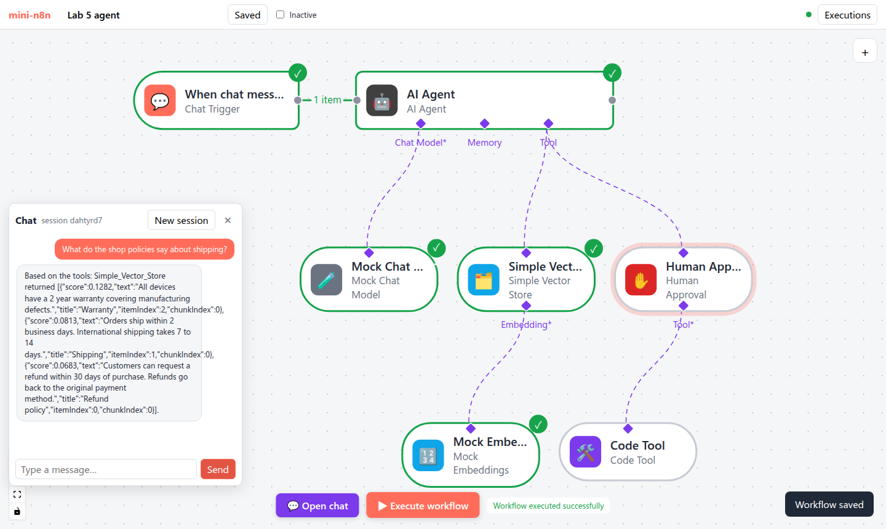
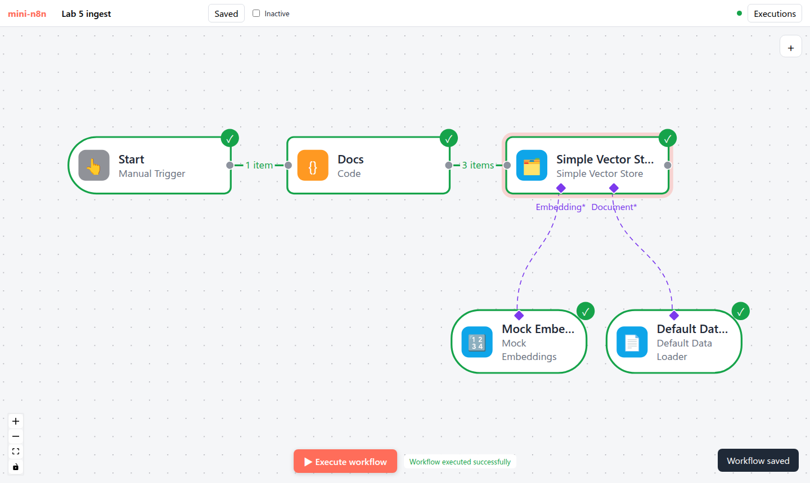

# Lab 5：知识库问答 + 需要人工审批的工具

> 目标：给 mini-n8n 加上 RAG、结构化输出、多 Agent 和人工审批（v0.5），然后在编辑器里只用节点面板搭出两个工作流：一个把店铺政策写进向量库，一个客服 Agent 既能查知识库，又能在人批准后执行退款。前置：第 22–23 章。对应代码：tag `v0.5`



*图 L5-1：本 Lab 搭出的客服 Agent（e2e 测试截图）。左侧聊天面板里，Agent 调用了 Simple Vector Store 工具，回答引用了检索到的文本块。*

## 1. 新增内容

```text
packages/workflow/src/interfaces.ts         waitReason、getResumeUrl、INodePropertyOptions.action
packages/core/src/
  workflow-execute.ts                       handleWaitingState：waitReason = 'resume-node' 时不禁用栈顶节点
  execute-context.ts                        getResumeUrl()
packages/nodes-ai/src/
  rag/      embeddings.ts（Mock 哈希 / OpenAI 兼容）、documents.ts（切块、加载器）、memory-vector-store.ts
  nodes/    rag.ts（Embeddings × 2、Default Data Loader、Simple Vector Store 三种模式）
            output-parser.ts、agent-tool.ts、approval-tool.ts
  agent/execute.ts                          格式工具 format_final_json_response、finishedItems
  models/mock.ts                            填写格式工具的参数
packages/cli/src/webhooks/waiting-webhooks.ts   /webhook-waiting/:executionId
packages/editor/src/                        节点面板的模式动作、按求值后的输出判断子节点、审批框
examples/  rag-ollama.ts、structured-ollama.ts
e2e/advanced.e2e.mjs（7 项）、e2e/lab5.e2e.mjs（6 项）
```

`git diff --stat v0.4 v0.5` 的最后一行：`33 files changed, 1179 insertions(+), 14 deletions(-)`（标签移动之前的统计；之后又加了编辑器的修复）。

## 2. 建议的实现顺序

| 步骤 | 内容 | 验证 |
|---|---|---|
| 1 | `Embeddings` 接口 + `MockEmbeddings` | 相同文本的向量相同；共享词语的文本余弦相似度更高 |
| 2 | `splitText` + `DefaultDataLoader` | 测试 “splits long text into overlapping chunks” |
| 3 | 内存向量库 + Simple Vector Store 的 `insert` 和 `load` 模式 | 测试 “inserts documents…”、“finds the right chunk…” |
| 4 | `retrieve-as-tool` 模式（`supplyData` 给定义，`execute` 做检索） | 测试 “lets an Agent search the store as a tool” |
| 5 | Structured Output Parser + Agent 的格式工具 | 测试 “returns an object in the format of the output parser” |
| 6 | AI Agent Tool | 测试 “an Agent hands a task to another Agent” |
| 7 | `waitReason`、`getResumeUrl`、Human Approval | 两个 “human in the loop” 测试 |
| 8 | 等待 Webhook 路由 | `ai.test.ts`：403 / 200 / 409 |
| 9 | 编辑器：审批框、节点面板的模式动作 | `e2e/advanced.e2e.mjs`、`e2e/lab5.e2e.mjs` |

步骤 7 是唯一要动引擎的地方，而且只有 5 行。如果你发现自己在改 `handleEngineRequest`，多半是走偏了。

## 3. 动手：写入工作流

```bash
git checkout v0.5 && npm install
npm start                                  # http://localhost:5678
```

1. 新建工作流。在 Manual Trigger 后面加一个 **Code** 节点，命名为 `Docs`，代码：

   ```js
   return [
     { title: 'Refund policy', text: 'Customers can request a refund within 30 days of purchase. Refunds go back to the original payment method.' },
     { title: 'Shipping', text: 'Orders ship within 2 business days. International shipping takes 7 to 14 days.' },
     { title: 'Warranty', text: 'All devices have a 2 year warranty covering manufacturing defects.' },
   ];
   ```

2. 选中 `Docs`，打开节点面板，搜索 `vector`。Simple Vector Store 下面列出了三个动作，选 **Add documents to vector store**。节点以 `insert` 模式加入，主输入自动接在 `Docs` 后面，下方出现 `Embedding*` 和 `Document*` 两个端口。
3. 选中 Simple Vector Store，依次添加 **Mock Embeddings** 和 **Default Data Loader**，它们自动连到对应端口。
4. 双击 Simple Vector Store，把 Memory Key 改成 `shop`。
5. 点 **Execute workflow**。`Docs → Simple Vector Store` 的连线显示 `3 items`，所有节点变绿：



*图 L5-2：在编辑器里搭出并执行的写入工作流。*

## 4. 动手：客服 Agent

1. 新建工作流，删除 Manual Trigger，添加 **Chat Trigger**，再添加 **AI Agent**。
2. 选中 AI Agent，添加 **Mock Chat Model**。
3. 选中 AI Agent，搜索 `vector`，选 **Retrieve documents for AI Agent as Tool**。这次节点只有一个 `Embedding*` 输入，输出是 `ai_tool`，所以它作为工具接到了 Agent 下面。
4. 选中这个 Simple Vector Store，添加 **Mock Embeddings**。双击它，Memory Key 填 `shop`（必须和写入工作流相同），Description 填 `Search the shop policies`。
5. 选中 AI Agent，添加 **Human Approval**；选中 Human Approval，添加 **Code Tool**。把 Code Tool 改名为 `Refund`，Description 填 `Refund an order`，JavaScript 填 `return 'refunded: ' + query;`。
6. 保存。打开聊天，发 `What do the shop policies say about shipping?`。
7. 再发 `Please refund order 42`。聊天面板显示 “⏸ Waiting for a human to approve…”。双击 Human Approval，点 **Approve**，新标签页显示 “✅ Approved”。在 Executions 里打开这次执行，Refund 已经运行。
8. （可选）在 AI Agent 上勾选 Require Specific Output Format，接一个 **Structured Output Parser**，再问一次。

第 3–4 节的搭建和第一个问题就是 `e2e/lab5.e2e.mjs`（它没有填写 Code Tool 的参数）；退款和审批流程在 `e2e/advanced.e2e.mjs` 里：

```bash
npm run test:e2e        # 依次运行 editor、ai、advanced、lab5 四套测试（服务器要先启动）
```

真实输出（lab5 部分）：

```text
✓ the "Add documents to vector store" action added a Simple Vector Store in insert mode
✓ Docs → store (main), embeddings and loader → store (AI connections) were connected automatically
✓ executing the ingest workflow stored 3 chunks
✓ agent workflow: model, vector store tool (+ embeddings) and the approval-gated Code Tool are wired
✓ the chat answer is grounded in the Shipping chunk
✓ no errors in the browser console
```

四套测试一共 38 项，全部通过。

仔细看图 L5-1 里的回答：问的是 shipping，可 Mock Embeddings 把 Warranty 排在第一（score 0.1282），Shipping 只排第二（0.0813）。Warranty 那句话和问题没有一个共同的词，它的分数来自 256 个哈希桶里的冲突。Limit 默认是 3，三块都返回了，所以回答里仍有 Shipping 的原文。这就是离线向量化的局限，换成 `nomic-embed-text` 就不会这样（第 22 章第 4.3 节）。

## 5. 换成真实模型

```bash
ollama pull nomic-embed-text && ollama pull qwen2.5:3b
OLLAMA_MODEL=qwen2.5:3b npx tsx examples/rag-ollama.ts
OLLAMA_MODEL=qwen2.5:7b npx tsx examples/structured-ollama.ts
```

真实输出和分析见第 22 章第 4.3 节和第 23 章第 4.3 节。在编辑器里：把 Mock Embeddings 换成 **Embeddings Ollama**（默认模型 `nomic-embed-text`），把 Mock Chat Model 换成 **Ollama Chat Model**。**两个工作流要换成同一个 Embeddings 模型**，并重新执行写入工作流：向量只能和同一个模型产生的向量比较。

## 6. 测试

```bash
npm test
```

真实输出：

```text
 ✓ packages/core/test/partial-execution.test.ts (3 tests)
 ✓ packages/workflow/test/expression.test.ts (7 tests)
 ✓ packages/nodes-ai/test/advanced.test.ts (8 tests)
 ✓ packages/nodes-ai/test/agent.test.ts (9 tests)
 ✓ packages/cli/test/ai.test.ts (5 tests)
 ✓ packages/core/test/workflow-execute.test.ts (17 tests)
 ✓ packages/cli/test/server.test.ts (9 tests)
      Tests  58 passed (58)
```

## 7. 踩坑记录

以下是写 v0.5 时真实遇到的问题。前 4 条的细节在第 22、23 章。

1. **用聊天模型做 Embeddings，每个问题都检索到 Warranty**：把 Embeddings Ollama 的默认模型改为 `nomic-embed-text`（第 22 章 4.4 节）。
2. **Default Data Loader 在画布上是灰色**：补上加载器的运行记录（第 22 章 4.4 节）。
3. **结构化输出的 `result` 是 7 而不是 42**、**审批页显示 Rejected**：见第 23 章 4.4 节。
4. **（对照 n8n 发现）恢复令牌不是常数时间比较**：见第 23 章 4.4 节。
5. **e2e 最后一步超时**。`advanced.e2e.mjs` 第一版等待画布上“至少 6 个节点成功”，30 秒后超时。原因：审批后的那次执行没有检索文档，Shop Docs 和 Mock Embeddings 不会运行，成功的节点只有 5 个（触发器、Agent、模型、Human Approval、Refund）。改为等待恰好 5 个。同一张截图里，右侧的执行列表挡住了两个节点，于是在截图前关闭列表（图 23-4）。
6. **在编辑器里搭 Agent 时，Human Approval 接错了地方**。`lab5.e2e.mjs` 第一次运行时，Agent 工作流的连线检查失败。打印保存的工作流，发现 Human Approval 的位置是 `[590, 190]`，正好是 Simple Vector Store 的位置向右移 240，而且没有连到 Agent。也就是说，测试明明点了 AI Agent，`addNode` 却以为选中的是 Simple Vector Store。用一个小脚本检查，Vue Flow 里 AI Agent 确实处于选中状态。问题出在 Canvas 转发选中事件的方式：一次点击会产生 “选中 AI Agent” 和 “取消选中 Simple Vector Store” 两条变更，Canvas 逐条发给 App，后一条把选中状态设成了 `null`。于是 `addNode` 退回到“最右边的节点”。这个缺陷从 v0.3 就有，之前的测试每次都是先添加节点再点击，碰巧没有触发。修复：一批变更里只要有一条“选中”，就以它为准。
7. **节点面板里加的 Simple Vector Store 连不上**。还是在写这个 Lab 时发现：Simple Vector Store 的默认模式是 `retrieve-as-tool`，没有主输入，所以在 `Docs` 后面添加它时连不上；在 AI Agent 下面添加它，又因为 `outputs` 是表达式字符串，`addNode` 认不出它是子节点。n8n 的做法是在节点面板里为 AI 节点的 `mode` 参数列出动作（`packages/frontend/editor-ui/src/features/shared/nodeCreator/composables/useActionsGeneration.ts:178`，`modeCategory`），文字取自选项的 `action` 字段（如 “Add documents to vector store”，`createVectorStoreNode/constants.ts:28`）。我们照做，`addNode` 也改为先建节点、再按它的参数求值输出（commit `744fe16`）。

## 8. 检查清单

- [ ] 58 个测试通过；`npm run test:e2e` 四套测试（38 项）全部通过
- [ ] 编辑器里只用节点面板就能搭出写入工作流和客服 Agent
- [ ] 写入后，问答工作流能检索到对应的文本块；改 Memory Key 后检索不到
- [ ] 审批链接只能用一次；Reject 后 Agent 告诉用户被拒绝
- [ ] （可选）`examples/rag-ollama.ts`、`examples/structured-ollama.ts` 用真实模型跑通
- [ ] `git tag v0.5`

## 9. 扩展挑战

1. **评估检索质量**：准备 10 个问题和它们应该命中的文档标题，写一个脚本统计 Mock Embeddings 和 `nomic-embed-text` 的 top-1 命中率。
2. **审批反馈**：让审批页显示一个文本框，审批人可以写一段话代替简单的拒绝，Agent 收到 “The user reviewed your planned tool call … and provided feedback: …”（n8n 的 `getDenialMessage()`）。
3. **持久化向量库**：用 `node:sqlite` 把向量存进数据库，服务器重启后检索仍然可用。比较 3000 个块时的检索耗时。
