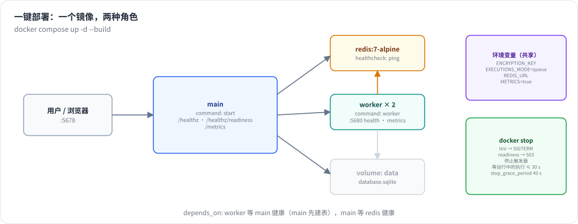

# Lab 6：一键部署的 mini-n8n v1.0

> 目标：把前五个版本攒起来的 mini-n8n 做成能部署的平台（v1.0）：子工作流与等待/恢复、队列模式、Code 节点的 Task Runner、多用户与开放 API、Docker 部署与可观测。最后用 Docker Compose 起一套“Redis + main + 2 worker”，像用户一样用一遍，再优雅关闭。前置：第 24–28 章。对应代码：tag `v1.0`



*图 L6-1：本 Lab 部署并验证的拓扑。*

## 1. 新增内容

```text
packages/workflow/src/interfaces.ts     parentExecution、WAIT_*、ExecuteWorkflowResult、startJob、setMetadata、crashed 状态
packages/core/src/
  workflow-execute.ts                   createStartRunExecutionData、resumeError、共享 metadata
  execute-context.ts                    子工作流等待、startJob、setMetadata
packages/nodes-base/src/nodes/ExecuteWorkflow.node.ts   子工作流节点
packages/task-runner/                   新包：Code 节点的子进程 runner
packages/cli/src/
  wait-tracker.ts                       恢复到期的等待执行
  scaling/                              queue.ts、redis-queue.ts、job-processor.ts（队列模式）
  task-runners/task-runner-process.ts   管理 runner 子进程
  auth/                                 password、jwt、auth.service、routes（用户、会话、API Key）
  public-api/routes.ts                  /api/v1
  logger.ts、metrics.ts、executions-pruning.ts   可观测与清理
  commands/worker.ts                    worker 进程
  databases/db.ts                       user / shared_* / user_api_keys 表、prune、claimWaiting
packages/editor/src/components/SignIn.vue   登录 / owner 设置页
Dockerfile、docker-compose.yml、.dockerignore、.env.example
deploy/e2e.sh                           部署端到端脚本
examples/queue-demo.sh、code-escape.ts
e2e/platform.e2e.mjs、auth.mjs
测试：platform、queue、task-runner、auth、ops（24 项）
```

`git diff --stat v0.5 v1.0` 的最后一行：`71 files changed, 3108 insertions(+), 105 deletions(-)`。

## 2. 建议的实现顺序

v1.0 比前面都大，一定要分开做、每步都能跑：

| 步骤 | 内容 | 验证 |
|---|---|---|
| 1 | Execute Workflow 节点 + WaitTracker（第 24 章） | `platform.test.ts` |
| 2 | 队列抽象 + MemoryQueue + worker（第 25 章） | `queue.test.ts`（用 MemoryQueue） |
| 3 | RedisQueue + `queue-demo.sh` | 真实 Redis，两个 worker 平分任务 |
| 4 | Task Runner 包 + 子进程（第 26 章） | `task-runner.test.ts`、`code-escape.ts` |
| 5 | 用户、会话、共享、API Key（第 27 章） | `auth.test.ts`、`platform.e2e.mjs` |
| 6 | 日志、指标、清理、优雅关闭（第 28 章） | `ops.test.ts` |
| 7 | Dockerfile + compose + `deploy/e2e.sh` | 部署端到端 |

每一步都是“先改类型 → 改引擎/核心 → 改服务器 → 加测试”。队列模式和多用户会改动很多旧测试，第 5 步引入的 `createTestServer()`（自动建 owner、带 cookie）让旧测试几乎不用动。

## 3. 动手：本地跑队列模式

```bash
git checkout v1.0 && npm install
./examples/queue-demo.sh
```

脚本用 Docker 起 Redis，再起 1 个 main 和 2 个 worker，发 20 个并发 Webhook。真实输出见第 25 章第 4.2 节（两个 worker 各处理 10 个）。

看 Code 节点的隔离：

```bash
MINI_N8N_ENCRYPTION_KEY=super-secret-key npx tsx examples/code-escape.ts
```

同一段越狱代码，在主进程里读到了加密密钥，在 Task Runner 里被挡下（第 26 章第 4.2 节）。

## 4. 动手：Docker Compose 部署

```bash
cp .env.example .env
# 编辑 .env，设一个 MINI_N8N_ENCRYPTION_KEY（openssl rand -base64 24）
docker compose up -d --build
open http://localhost:5678        # 第一次进去设置 owner
```

打开 `http://localhost:5678/metrics` 看指标，`docker compose logs -f worker` 看 worker 日志。

一条命令把整套部署建起来、用一遍、再拆掉：

```bash
./deploy/e2e.sh
```

真实输出见第 28 章第 4.2 节：11 项检查全过，覆盖健康检查、公开 API、30 并发、指标、优雅关闭、重启后数据留存。

## 5. 测试

```bash
npm test
```

真实输出：

```text
 ✓ packages/core/test/partial-execution.test.ts (3 tests)
 ✓ packages/workflow/test/expression.test.ts (7 tests)
 ✓ packages/nodes-ai/test/advanced.test.ts (8 tests)
 ✓ packages/nodes-ai/test/agent.test.ts (9 tests)
 ✓ packages/cli/test/ops.test.ts (4 tests)
 ✓ packages/cli/test/queue.test.ts (5 tests)
 ✓ packages/cli/test/ai.test.ts (5 tests)
 ✓ packages/cli/test/platform.test.ts (5 tests)
 ✓ packages/cli/test/auth.test.ts (5 tests)
 ✓ packages/core/test/workflow-execute.test.ts (17 tests)
 ✓ packages/cli/test/task-runner.test.ts (5 tests)
 ✓ packages/cli/test/server.test.ts (9 tests)
      Tests  82 passed (82)
```

浏览器端到端（服务器要先启动）：

```bash
npm start &            # 或 docker compose up
npm run test:e2e       # editor、ai、advanced、lab5、platform 五套，43 项
```

## 6. 踩坑记录

v1.0 的坑几乎都在前五章里讲过，这里汇总并点出它们的共同主题——**多进程**。

1. **多个进程开同一个 SQLite 文件互相锁**：`PRAGMA busy_timeout`，compose 里用 `depends_on` 排序（第 25 章踩坑 1）。
2. **被中断的演示留下孤儿 worker，连上新 Redis 偷任务**：用 `node --import tsx` 直接启动让 `$!` 正确，加信号陷阱（第 25 章踩坑 2）。
3. **worker 阻塞在 BLMOVE 上关不掉**：`close()` 先断开空闲连接（第 25 章踩坑 3）。
4. **main 在关库后还收到 worker 消息**：关闭时先让 runner 忽略后续消息（第 25 章踩坑 4）。
5. **`setMetadata` 改到了栈条目的拷贝上**：创建上下文前共享 `metadata` 对象（第 24 章踩坑 1）。
6. **Fastify 拒绝空 JSON body**，被 `deploy/e2e.sh` 跑出来；`curl -sf` 还把错误响应吞了（第 27、28 章）。
7. **（自查发现）v0.5 的 WaitTracker 从来没被调用**：长等待的执行永远不恢复，到 v1.0 才补上调用方（第 24 章踩坑 2）。

主题很清楚：单进程时很多东西“碰巧能工作”（内存里的队列、进程内的 vm、谁都能访问的数据），一旦拆成多进程，共享什么、谁负责清理、消息会不会迟到，全都要想清楚。

## 7. 检查清单

- [ ] 82 个单元测试通过；`npm run test:e2e` 五套（43 项）通过
- [ ] `./examples/queue-demo.sh`：两个 worker 平分 20 个请求
- [ ] `examples/code-escape.ts`：越狱代码在 runner 里被挡下
- [ ] `docker compose up -d --build` 起来，能设置 owner、建工作流
- [ ] `./deploy/e2e.sh` 11 项全过
- [ ] `git tag v1.0`

## 8. 扩展挑战

1. **PostgreSQL**：把 `databases/db.ts` 抽象成一个接口，加一个 Postgres 实现（`pg` 库），compose 里加一个 postgres 服务。这样 worker 就能真正跑在另一台机器上。
2. **多 main + leader 选举**：用 Redis 的 `SET NX PX` 做一把带过期的锁，只有持锁的 main 跑 WaitTracker 和触发器；其他 main 只服务 API 和 Webhook。
3. **Kubernetes**：把 compose 翻译成 Deployment（main、worker）+ Service + 一个 Redis。给 main 和 worker 配上 `livenessProbe`（`/healthz`）和 `readinessProbe`（`/healthz/readiness`），验证滚动更新时不丢正在跑的执行。
